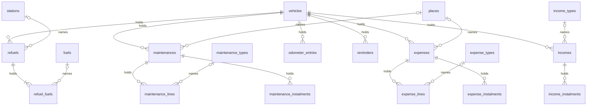

# Specification: The data model of the car log copy

`spec.md` holds the components and the declarations. This file holds the tables, the views, and
the decision that shapes them.

## Design decisions

### `DRIVVO-DD-018`

**Realizes:** `DRIVVO-FR-018`, `DRIVVO-FR-022` to `DRIVVO-FR-024`, `DRIVVO-FR-058`,
`DRIVVO-INV-003`, `DRIVVO-INV-004`
**Decision:** Each aggregate of the car log account has a table of its own: each list of reference
items, the vehicle, each kind of log entry, and the reminder. A line and an instalment belong to
one aggregate, so each kind that holds them has its own line table and its own instalment table.
Every foreign key names one table, so a line of a refuel names a fuel and no other item. Every
column that the service always sends is `NOT NULL`. Three views read the five kinds as one:
`log_entries`, `log_entry_lines`, and `log_entry_instalments`. Each view is a `UNION ALL` of one
query for each kind, resolves the names of the reference items, and carries
`security_invoker = true`, so the policy of each table applies to the member who reads it. The
history, the detail, and `VehicleRows` read the views. A write names the tables.
**Rationale:** The kinds differ in their members: a refuel alone holds fuels, a station, and a
battery, and an income alone holds an income type. One table for all kinds leaves each of those
columns nullable for every row, and lets a line name an item of the wrong list. The pages read
the kinds together, so the views keep each read to one query. A view with no `security_invoker`
runs as its owner and reads every workspace.
**Alternatives:** One table for each kind, with one shared line table and one shared instalment
table. The shared table then needs one nullable parent column for each kind, and the line names
an item of any list. One table for all kinds, as before. The constraints then hold no member of a
kind.

## Tables

Every table lives in `dev_maroid_drivvo`, carries `id UUID DEFAULT uuidv7()`, `workspace_id` with
the default of the acting workspace, `collected_at TIMESTAMPTZ NOT NULL DEFAULT now()`, set again
at each upsert, and the policy of `OWN-006`. `source_id` is the positive integer identifier at
the car log service, and `UNIQUE (workspace_id, source_id)` holds for each table that carries it.
A child table carries `UNIQUE (<parent>_id, position)` or `UNIQUE (<parent>_id, number)`, from 1,
and its parent column deletes with `CASCADE`. A column that names a reference item deletes with
`SET NULL`.

| Table                                                                                                             | Realizes                                                                              |
| ----------------------------------------------------------------------------------------------------------------- | ------------------------------------------------------------------------------------- |
| `car_log_settings`                                                                                                | `DRIVVO-FR-015`, `DRIVVO-FR-034`                                                      |
| `fuels`, `maintenance_types`, `expense_types`, `income_types`, `reasons`, `payment_methods`, `stations`, `places` | `DRIVVO-FR-015`, `DRIVVO-FR-058`                                                      |
| `vehicles`                                                                                                        | `DRIVVO-FR-018`, `DRIVVO-FR-027`, `DRIVVO-INV-003`                                    |
| `refuels`, `maintenances`, `expenses`, `incomes`, `odometer_entries`                                              | `DRIVVO-FR-018`, `DRIVVO-FR-019`, `DRIVVO-FR-022`, `DRIVVO-INV-003`, `DRIVVO-INV-004` |
| `refuel_fuels`, `maintenance_lines`, `expense_lines`                                                              | `DRIVVO-FR-023`, `DRIVVO-FR-037`                                                      |
| `maintenance_instalments`, `expense_instalments`, `income_instalments`                                            | `DRIVVO-FR-024`, `DRIVVO-FR-038`                                                      |
| `reminders`                                                                                                       | `DRIVVO-FR-060` to `DRIVVO-FR-062`, `DRIVVO-INV-004`                                  |

| Table and column                                                                   | Type                                                  | Null              | Note                                                                         |
| ---------------------------------------------------------------------------------- | ----------------------------------------------------- | ----------------- | ---------------------------------------------------------------------------- |
| `car_log_settings.volume_unit`                                                     | `TEXT`                                                | no                | `CHECK (volume_unit IN ('l', 'gal_us', 'gal_imp'))`. `UNIQUE (workspace_id)` |
| `car_log_settings.consumption_format`                                              | `SMALLINT`                                            | no                | `CHECK (consumption_format BETWEEN 1 AND 12)`, the value of the service      |
| `car_log_settings.currency`                                                        | `TEXT`                                                | no                | ISO 4217, three letters                                                      |
| `<reference list>.source_id`, `.name`                                              | `INTEGER`, `TEXT`                                     | no                | One table for each list of `DRIVVO-DD-018`                                   |
| `vehicles.name`, `.make`, `.model`                                                 | `TEXT`                                                | no                | Empty when the service sends none                                            |
| `vehicles.year`                                                                    | `SMALLINT`                                            | yes               |                                                                              |
| `vehicles.distance_unit`                                                           | `TEXT`                                                | no                | `CHECK (distance_unit IN ('km', 'mi'))`                                      |
| `vehicles.principal`, `.active`                                                    | `BOOLEAN`                                             | no                |                                                                              |
| `<log entry>.vehicle_id`                                                           | `UUID`                                                | no                | `REFERENCES vehicles (id) ON DELETE CASCADE`, in each of the five tables     |
| `<log entry>.occurred_at`                                                          | `TIMESTAMPTZ`                                         | no                | `DRIVVO-DD-007`                                                              |
| `<log entry>.odometer`                                                             | `NUMERIC`                                             | no                | Zero when the service sends none                                             |
| `<log entry>.note`                                                                 | `TEXT`                                                | yes               |                                                                              |
| `refuels.amount`, `maintenances.amount`, `expenses.amount`, `incomes.amount`       | `NUMERIC`                                             | no                | `DRIVVO-DD-008`. An odometer entry holds no amount                           |
| `refuels.station_id`, `.payment_method_id`, `.reason_id`                           | `UUID`                                                | yes               | `stations`, `payment_methods`, `reasons`                                     |
| `refuels.missed_refuel`                                                            | `BOOLEAN`                                             | no                | `esqueceu_anterior`                                                          |
| `refuels.battery_start_pct`, `.battery_end_pct`, `.charge_minutes`                 | `NUMERIC`, `NUMERIC`, `INTEGER`                       | yes               | Null when the service sends zero                                             |
| `refuel_fuels.refuel_id`, `.position`, `.fuel_id`                                  | `UUID`, `SMALLINT`, `UUID`                            | no, no, yes       | `CHECK (position BETWEEN 1 AND 3)`. `fuel_id` names `fuels`                  |
| `refuel_fuels.amount`, `.unit_price`, `.volume`, `.full_tank`, `.free`             | `NUMERIC`, `NUMERIC`, `NUMERIC`, `BOOLEAN`, `BOOLEAN` | no                | The values that the service sends for the slot                               |
| `maintenances.title`, `expenses.title`                                             | `TEXT`                                                | yes               |                                                                              |
| `maintenances.place_id`, `.payment_method_id`                                      | `UUID`                                                | yes               | `places`, `payment_methods`                                                  |
| `expenses.place_id`, `.payment_method_id`, `.reason_id`                            | `UUID`                                                | yes               | `places`, `payment_methods`, `reasons`                                       |
| `maintenance_lines.maintenance_id`, `.position`, `.maintenance_type_id`, `.amount` | `UUID`, `SMALLINT`, `UUID`, `NUMERIC`                 | no, no, yes, no   | `maintenance_type_id` names `maintenance_types`                              |
| `expense_lines.expense_id`, `.position`, `.expense_type_id`, `.amount`             | `UUID`, `SMALLINT`, `UUID`, `NUMERIC`                 | no, no, yes, no   | `expense_type_id` names `expense_types`                                      |
| `incomes.income_type_id`                                                           | `UUID`                                                | yes               | `income_types`                                                               |
| `<kind>_instalments.<kind>_id`, `.number`, `.due_on`, `.amount`                    | `UUID`, `SMALLINT`, `DATE`, `NUMERIC`                 | no                | One table for a maintenance, an expense, and an income                       |
| `reminders.vehicle_id`, `.source_id`                                               | `UUID`, `INTEGER`                                     | no                | `ON DELETE CASCADE`                                                          |
| `reminders.kind`                                                                   | `TEXT`                                                | no                | `CHECK (kind IN ('maintenance', 'expense'))`                                 |
| `reminders.maintenance_type_id`, `.expense_type_id`                                | `UUID`                                                | yes               | A `CHECK` lets a row hold only the column of its kind                        |
| `reminders.due_on`, `.due_odometer`                                                | `DATE`, `NUMERIC`                                     | yes               | The own due point of the reminder                                            |
| `reminders.repeats`, `.repeat_every`, `.repeat_unit`, `.repeat_distance`           | `BOOLEAN`, `INTEGER`, `TEXT`, `NUMERIC`               | no, yes, yes, yes | `repeat_unit IN ('day', 'month', 'year')`                                    |
| `reminders.note`                                                                   | `TEXT`                                                | yes               |                                                                              |

Each of the five log entry tables has the index `<table>_list_idx (workspace_id, vehicle_id,
occurred_at DESC, id DESC)`, so the planner merges the five scans of a page of the history in
order. Each child table has an index on `(workspace_id, <parent>_id)`. The end of a connection
deletes no row (`DRIVVO-FR-014`).

## Views

| View                    | Columns                                                                                                                                                                                                                    |
| ----------------------- | -------------------------------------------------------------------------------------------------------------------------------------------------------------------------------------------------------------------------- |
| `log_entries`           | `id`, `vehicle_id`, `kind`, `occurred_at`, `odometer`, `amount`, `title`, `note`, `station`, `place`, `payment_method`, `reason`, `income_type`, `missed_refuel`, `battery_start_pct`, `battery_end_pct`, `charge_minutes` |
| `log_entry_lines`       | `log_entry_id`, `position`, `item_id`, `item`, `amount`, `unit_price`, `volume`, `full_tank`, `free`                                                                                                                       |
| `log_entry_instalments` | `log_entry_id`, `number`, `due_on`, `amount`                                                                                                                                                                               |

`kind` is the constant of each branch. A reference column answers the name of the item. A member
that a kind does not hold answers null, and `missed_refuel` answers false. The fuel lines answer
their unit price, volume, full tank mark, and free mark; the type lines answer null for each.

## Retired identifiers

This file has no retired identifier.
