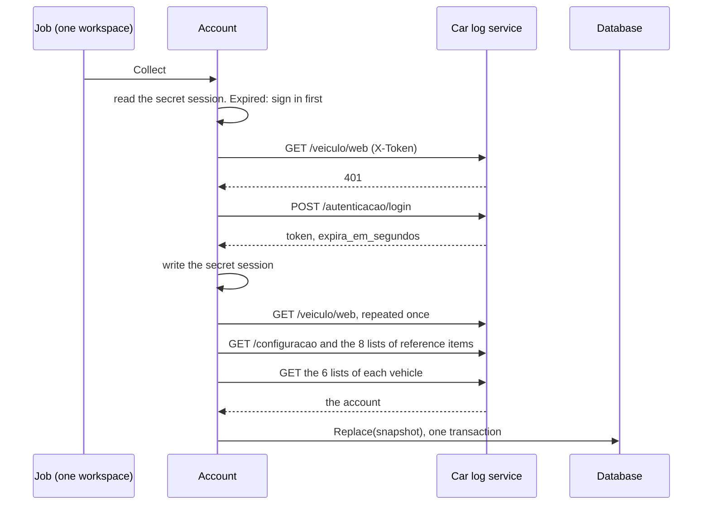

# Specification: The car log account of a workspace

## 1. Summary

The new plugin `dev.maroid.drivvo` reads the API of the car log service at
`https://api.drivvo.com`, as its web site does. A connect signs in with the email address and
the MD5 of the password, and stores the token and its end as the workspace plugin secret
`session` of `PSECRET`. Every call signs in again once when the service rejects the token. The
hourly job reads the whole account of each connected workspace into memory, then writes it in
one transaction: an upsert of each item by its identifier at the service, and a delete of each
row that the read did not hold. Every page and the widget read the stored rows, and Go computes
each figure over the rows of one vehicle. No change reaches the hub, `pluginapi`, or another
plugin. `spec-data.md` holds the tables and the views. `spec-pages.md` holds the decisions of the
pages and the widget. `spec-scenarios.md`
and `spec-scenarios-pages.md` hold the scenarios.

## 2. Coverage

| Requirement                        | Where this specification realizes it                                            |
| ---------------------------------- | ------------------------------------------------------------------------------- |
| `DRIVVO-FR-001`, `DRIVVO-FR-002`   | Section 4.3, `DRIVVO-SC-001`                                                    |
| `DRIVVO-FR-003`, `DRIVVO-FR-004`   | `api.yaml`, `DRIVVO-SC-002`                                                     |
| `DRIVVO-FR-005`                    | `api.yaml`, `DRIVVO-DD-004`, `DRIVVO-SC-003`                                    |
| `DRIVVO-FR-006`                    | Section 4.5, `DRIVVO-SC-004`                                                    |
| `DRIVVO-FR-007`, `DRIVVO-FR-008`   | Section 4.4, `DRIVVO-DD-001`, `DRIVVO-DD-002`, `DRIVVO-SC-005`, `DRIVVO-SC-006` |
| `DRIVVO-FR-009`                    | `DRIVVO-DD-002`, `DRIVVO-SC-007`                                                |
| `DRIVVO-FR-011`, `DRIVVO-FR-014`   | `api.yaml`, Section 4.2, `DRIVVO-SC-008`                                        |
| `DRIVVO-FR-012`                    | `DRIVVO-DD-003`, `DRIVVO-SC-009`, `DRIVVO-SC-010`                               |
| `DRIVVO-FR-013`                    | `DRIVVO-DD-003`, `DRIVVO-SC-011`                                                |
| `DRIVVO-FR-015` to `DRIVVO-FR-017` | Section 4.3, `DRIVVO-DD-005`, `DRIVVO-SC-012`, `DRIVVO-SC-013`                  |
| `DRIVVO-FR-018`                    | Section 4.4, `DRIVVO-SC-014`                                                    |
| `DRIVVO-FR-019`, `DRIVVO-FR-020`   | Section 4.2, `DRIVVO-DD-006`, `DRIVVO-SC-015`, `DRIVVO-SC-016`                  |
| `DRIVVO-FR-021`                    | Section 4.5, `DRIVVO-SC-017`                                                    |
| `DRIVVO-FR-022`                    | `DRIVVO-DD-007`, `DRIVVO-SC-018`                                                |
| `DRIVVO-FR-023`, `DRIVVO-FR-024`   | `DRIVVO-DD-018`, `DRIVVO-DD-008`, `DRIVVO-SC-019`, `DRIVVO-SC-020`              |
| `DRIVVO-FR-025`, `DRIVVO-FR-026`   | Section 4.3, `DRIVVO-SC-021`                                                    |
| `DRIVVO-FR-027` to `DRIVVO-FR-036` | `spec-pages.md`, `api.yaml`                                                     |
| `DRIVVO-FR-037` to `DRIVVO-FR-047` | `DRIVVO-DD-009`, `DRIVVO-DD-010`, `spec-pages.md`                               |
| `DRIVVO-FR-048` to `DRIVVO-FR-059` | `spec-pages.md`, `api.yaml`                                                     |
| `DRIVVO-FR-060` to `DRIVVO-FR-064` | `DRIVVO-DD-011`, `spec-pages.md`                                                |
| `DRIVVO-FR-065` to `DRIVVO-FR-068` | Section 4.3, `spec-pages.md`                                                    |
| `DRIVVO-NFR-001`                   | `DRIVVO-DD-006`, `DRIVVO-SC-022`                                                |
| `DRIVVO-NFR-002`                   | `DRIVVO-DD-009`, `DRIVVO-SC-023`                                                |
| `DRIVVO-INV-001`                   | Section 4.2, `DRIVVO-SC-005`                                                    |
| `DRIVVO-INV-002`                   | Section 4.2, `DRIVVO-SC-024`                                                    |
| `DRIVVO-INV-003`, `DRIVVO-INV-004` | `DRIVVO-DD-018`, `DRIVVO-SC-025`, `DRIVVO-SC-026`, `DRIVVO-SC-053`              |
| `DRIVVO-INV-005`, `DRIVVO-INV-006` | `api.yaml`, `DRIVVO-DD-002`, `DRIVVO-SC-027`                                    |

`DRIVVO-FR-010` is retired. A connection starts no collection.

## 3. Guideline compliance

| Rule                            | Guideline         | How this specification obeys it                                                                                                                             |
| ------------------------------- | ----------------- | ----------------------------------------------------------------------------------------------------------------------------------------------------------- |
| `PLG-006`, `PLG-007`            | Plugin model      | The plugin adds each capability through the existing interfaces, and reaches every resource through the host.                                               |
| `PLG-008`                       | Plugin model      | The plugin imports no other plugin. The keyset, the list helpers, and the sign in again repeat the telecom plugin.                                          |
| `ARC-008`                       | Architecture      | No file of the hub changes.                                                                                                                                 |
| `DAT-001`, `DAT-006`, `DAT-009` | Data              | Every table and view lives in `dev_maroid_drivvo`. Each `id` is `uuidv7()`.                                                                                 |
| `DAT-010`                       | Data              | Every moment is `TIMESTAMPTZ`. A due day of an instalment and of a reminder is `DATE`, because it names a day and no moment.                                |
| `OWN-004` to `OWN-008`          | Ownership         | Every table carries `workspace_id` and forced row level security. Each view runs as its reader. No repository filters by workspace.                         |
| `OWN-009`                       | Ownership         | The job runs with `CronScopePerWorkspace`.                                                                                                                  |
| `CFG-007`                       | Configuration     | The credentials are workspace settings.                                                                                                                     |
| `EXT-001` to `EXT-007`          | External services | `service/api-client.go` holds a resty client with `base_url`. A status that is not a success is an error with the status and at most 512 bytes of the body. |
| `LOG-003`, `LOG-007`, `LOG-008` | Logging           | Each service and handler adds `component`. No log line holds the password, its MD5, the token, or the email address.                                        |
| `SEC-013`                       | Security          | Each route and the widget name a permission.                                                                                                                |
| `JOB-006`, `JOB-007`            | Jobs              | The scheduler skips a run while the previous one runs. A failed workspace returns its error, and the next workspace runs.                                   |
| `API-004`, `ERR-002`            | HTTP API, Errors  | The routes mount under `/workspaces/{workspaceId}/plugins/dev.maroid.drivvo/api`. Each problem type has the form `/problems/dev.maroid.drivvo/<slug>`.      |
| `RES-001` (`Z-173`, `Z-171`)    | REST              | An amount travels as the money object. A moment travels in UTC. Every integer names `int32`.                                                                |
| `RES-005`, `RES-006`            | REST              | Each list answers the `Page` of `libs/rest/page`, and names its sort set and its default. A bounded collection answers one page.                            |
| `RES-009`                       | REST              | Every operation declares the pseudo permission `uid` on the session cookie.                                                                                 |
| `GO-005`                        | Go style          | Every sentinel error lives in `errs/`.                                                                                                                      |
| `UI-005` to `UI-009`            | Web UI            | The navigation entries hold no parameter segment. Each one opens the principal vehicle at an address with the vehicle.                                      |
| `PKG-001`, `BLD-003`            | Package, Build    | The layout of the telecom plugin. The build plan builds the UI before the `.so`.                                                                            |

## 4. Design

### 4.1 Components

Every path is under `plugins/drivvo/`, and every path is "create". A file not named here
follows the telecom plugin.

| Path                                                                               | Holds                                                                                                                                                                                                                                              |
| ---------------------------------------------------------------------------------- | -------------------------------------------------------------------------------------------------------------------------------------------------------------------------------------------------------------------------------------------------- |
| `go.mod`                                                                           | The module `github.com/abgeo/maroid/plugins/drivvo`, with resty. A row in `go.work`                                                                                                                                                                |
| `db/migrations/<ts>_{table,view}_<name>_create.{up,down}.sql`                      | One pair for each table and each view of `spec-data.md`. A table precedes each table that references it, and the views follow the tables                                                                                                           |
| `errs/errs.go`                                                                     | `ErrRequestFailed`, `ErrSessionRejected`, `ErrNotConnected`, `ErrCredentialsAbsent`, `ErrCredentialsRejected`, `ErrNewPasswordRequired`, `ErrVehicleNotFound`, `ErrLogEntryNotFound`, `ErrUnknownKind`, `ErrAmountUnreadable`, `ErrReversedPeriod` |
| `config/config.go`                                                                 | `Config` (section 4.3), `WorkspaceSettings` with `Email`, `Password`                                                                                                                                                                               |
| `model/session.go`                                                                 | `Session` with `Token`, `ExpiresAt`. `MarshalSecret`, `ParseSession`, `Session.Expired(now)`                                                                                                                                                       |
| `model/account.go`                                                                 | `Snapshot` with `Settings`, `ReferenceItems`, `Vehicles`, `LogEntries`, `Reminders`: one read of the account                                                                                                                                       |
| `model/vehicle.go`, `model/settings.go`                                            | `Vehicle`, `DistanceUnit` (`km`, `mi`). `CarLogSettings` with `VolumeUnit` (`l`, `gal_us`, `gal_imp`), `ConsumptionFormat`, `Currency`                                                                                                             |
| `model/entry.go`                                                                   | `LogEntry`, `Kind` (`refuel`, `maintenance`, `expense`, `income`, `odometer`), `Line`, `Instalment`, `ReferenceItem`, `ReferenceKind`                                                                                                              |
| `model/reminder.go`                                                                | `Reminder`, `RepeatUnit` (`day`, `month`, `year`), `DuePoint`, `DueState`                                                                                                                                                                          |
| `model/period.go`                                                                  | `Tbilisi()`, `Period` with `From`, `To` (days), `Period.Bounds(loc)`, `Months(loc)`, `ParseDay`                                                                                                                                                    |
| `figures/`                                                                         | The pure functions of `DRIVVO-DD-009` to `DRIVVO-DD-011`: `Spend`, `Distance`, `Consumption`, `Parts`, `DueReminders`. No import of a store                                                                                                        |
| `dto/api-client.go`                                                                | `LogInRequest`, `LogInAnswer`, `ServiceError`, `Vehicle`, `Settings`, `Refuel`, `Maintenance`, `Expense`, `Income`, `OdometerEntry`, `Reminder`, `Instalment`, `NamedItem`, and their readers (`DRIVVO-DD-007`, `DRIVVO-DD-008`)                   |
| `dto/{connection,vehicle,overview,entry,reminder}.go`                              | The bodies of `api.yaml`                                                                                                                                                                                                                           |
| `service/api-client.go`                                                            | `APIClient`: `SignIn`, `Vehicles`, `Settings`, `ReferenceItems`, `VehicleEntries`, `Reminders` (section 4.4)                                                                                                                                       |
| `service/account.go`                                                               | `Account`: `credentials`, `session`, `signIn`, `forgetSession`, and `call`, the sign in again of `DRIVVO-DD-003`                                                                                                                                   |
| `service/connection.go`                                                            | `Connections`: `Status`, `Connect`, `Disconnect`                                                                                                                                                                                                   |
| `service/collector.go`                                                             | `Collector.Collect(ctx) (model.Snapshot, error)` reads, then `Store.Replace`                                                                                                                                                                       |
| `service/store.go`                                                                 | `Store` over `PluginDB`: `Replace`, `Vehicles`, `VehicleRows`, `LogEntries`, `LogEntry`, `Settings`. One transaction for each call                                                                                                                 |
| `service/figures.go`                                                               | `Figures`: `Overview`, `Totals`, `Reminders`, `Widget`. Each reads `VehicleRows` and calls `figures/`                                                                                                                                              |
| `repository/{settings,reference,vehicle,entry,line,instalment,reminder,keyset}.go` | One repository for each aggregate. Each writes the table of each kind, and reads the views. The keyset of the telecom plugin                                                                                                                       |
| `job/car_log_collector.go`                                                         | `CarLogCollector`                                                                                                                                                                                                                                  |
| `handler/{doc,connection,vehicle,overview,entry,reminder,list,problem}.go`         | The handlers of section 4.3, and the problem types of section 4.5                                                                                                                                                                                  |
| `permission/permission.go`                                                         | `AccountRead`, `AccountConnect`                                                                                                                                                                                                                    |
| `widget/{doc,car}.go`                                                              | `NewCar`                                                                                                                                                                                                                                           |
| `embed.go`, `main.go`                                                              | `uiAssets`. `DrivvoPlugin`: `Meta` (`Drivvo`, "Vehicles, refuels, maintenance, and costs from Drivvo.", version `0.1.0`), `SettingsModel`, `CronJobs`, `Migrations`, `Permissions`, `Routes`, `Widgets`, `UIManifest`                              |
| `internal/fakeservice/`, `internal/fakes/`                                         | The fake car log service, and the secrets, the settings, and the store in memory, of the tests. No production code imports them                                                                                                                    |
| `ui/`                                                                              | The UI of the telecom plugin with the pages of `spec-pages.md`                                                                                                                                                                                     |
| `config.yaml` at the repository root                                               | The block of `dev.maroid.drivvo` with the defaults of section 4.3                                                                                                                                                                                  |

Each service, handler, and widget depends on an interface that it declares, and `Store` or
the service meets it. The plugin declares no notification topic and no command.

### 4.2 Data model

The token lives in the workspace plugin secret `session`, with no expiry of the secret: a JSON
object `{"token": "<value>", "expires_at": "<RFC 3339>"}`. The secret outlives the token, so
the connection page reads "connected" until a sign in fails (`DRIVVO-DD-003`).

`spec-data.md` holds every table and every view (`DRIVVO-DD-018`).

### 4.3 Declarations

**HTTP routes.** The prefix is `/workspaces/{workspaceId}/plugins/dev.maroid.drivvo/api`.
`api.yaml` holds the bodies and the status codes.

| Method   | Path                                             | Permission        | Realizes                                                             |
| -------- | ------------------------------------------------ | ----------------- | -------------------------------------------------------------------- |
| `GET`    | `/connections/self`                              | `account.read`    | `DRIVVO-FR-003` to `DRIVVO-FR-006`, `DRIVVO-FR-012`, `DRIVVO-FR-013` |
| `PUT`    | `/connections/self`                              | `account.connect` | `DRIVVO-FR-007` to `DRIVVO-FR-009`                                   |
| `DELETE` | `/connections/self`                              | `account.connect` | `DRIVVO-FR-011`, `DRIVVO-FR-014`                                     |
| `GET`    | `/vehicles`                                      | `account.read`    | `DRIVVO-FR-027` to `DRIVVO-FR-029`, `DRIVVO-FR-032`                  |
| `GET`    | `/vehicles/{vehicleId}/overview`                 | `account.read`    | `DRIVVO-FR-031`, `DRIVVO-FR-033` to `DRIVVO-FR-047`                  |
| `GET`    | `/vehicles/{vehicleId}/log-entries`              | `account.read`    | `DRIVVO-FR-031`, `DRIVVO-FR-048` to `DRIVVO-FR-054`, `DRIVVO-FR-056` |
| `GET`    | `/vehicles/{vehicleId}/log-entry-totals`         | `account.read`    | `DRIVVO-FR-055`                                                      |
| `GET`    | `/vehicles/{vehicleId}/log-entries/{logEntryId}` | `account.read`    | `DRIVVO-FR-057` to `DRIVVO-FR-059`                                   |
| `GET`    | `/vehicles/{vehicleId}/reminders`                | `account.read`    | `DRIVVO-FR-031`, `DRIVVO-FR-060` to `DRIVVO-FR-064`                  |

**Permissions.**

| Name              | Description                                                    | Lowest   | Realizes        |
| ----------------- | -------------------------------------------------------------- | -------- | --------------- |
| `account.read`    | Read the car log account, its vehicles, entries, and reminders | `viewer` | `DRIVVO-FR-025` |
| `account.connect` | Connect the car log account                                    | `editor` | `DRIVVO-FR-026` |

**Settings.** Both fields carry `x-maroid-scope=workspace`.

| Field      | Kind                    | Title         | Realizes                         |
| ---------- | ----------------------- | ------------- | -------------------------------- |
| `email`    | free text, format email | Email address | `DRIVVO-FR-001`                  |
| `password` | secret                  | Password      | `DRIVVO-FR-001`, `DRIVVO-FR-002` |

**Configuration.**

| Key                               | Type                   | Default                  | Realizes                         |
| --------------------------------- | ---------------------- | ------------------------ | -------------------------------- |
| `base_url`                        | URL, no trailing slash | `https://api.drivvo.com` | `DRIVVO-FR-008`, `DRIVVO-FR-015` |
| `request_timeout`                 | duration               | `15s`                    | `DRIVVO-FR-006`                  |
| `app_version`                     | integer text           | `23`                     | `DRIVVO-FR-008`                  |
| `app_version_name`                | text                   | `14.2.3`                 | `DRIVVO-FR-008`                  |
| `cron_schedule.car_log_collector` | cron                   | `0 * * * *`              | `DRIVVO-FR-015`, `DRIVVO-FR-016` |

**Cron job.**

| Identifier          | Scope                   | Behavior                                                                                  | Realizes                           |
| ------------------- | ----------------------- | ----------------------------------------------------------------------------------------- | ---------------------------------- |
| `car_log_collector` | `CronScopePerWorkspace` | `Collect`. `ErrNotConnected` logs a skip at info and answers nil. Any other error returns | `DRIVVO-FR-015` to `DRIVVO-FR-021` |

**UI routes.** Each navigation entry opens the principal vehicle at the address of its page
(`DRIVVO-DD-012`). The vehicle follows the entry in the address, so the deck marks the entry and
leads the trail with it.

| Page route                                | Navigation entry | Page               | Realizes                                                             |
| ----------------------------------------- | ---------------- | ------------------ | -------------------------------------------------------------------- |
| `/overview`, `/overview/:vehicle`         | "Overview"       | `Overview.svelte`  | `DRIVVO-FR-027` to `DRIVVO-FR-047`                                   |
| `/history`, `/history/:vehicle`           | "History"        | `History.svelte`   | `DRIVVO-FR-048`, `DRIVVO-FR-049`, `DRIVVO-FR-056`, `DRIVVO-FR-057`   |
| `/refuels`, `/refuels/:vehicle`           | "Refuels"        | `EntryList.svelte` | `DRIVVO-FR-050`, `DRIVVO-FR-051`, `DRIVVO-FR-055` to `DRIVVO-FR-057` |
| `/maintenances`, `/maintenances/:vehicle` | "Maintenance"    | `EntryList.svelte` | `DRIVVO-FR-052`, `DRIVVO-FR-055` to `DRIVVO-FR-057`                  |
| `/expenses`, `/expenses/:vehicle`         | "Expenses"       | `EntryList.svelte` | `DRIVVO-FR-053`, `DRIVVO-FR-055` to `DRIVVO-FR-057`                  |
| `/incomes`, `/incomes/:vehicle`           | "Income"         | `EntryList.svelte` | `DRIVVO-FR-054` to `DRIVVO-FR-057`                                   |
| `/<history or a list>/:vehicle/:entry`    | none             | `Entry.svelte`     | `DRIVVO-FR-058`, `DRIVVO-FR-059`                                     |
| `/reminders`, `/reminders/:vehicle`       | "Reminders"      | `Reminders.svelte` | `DRIVVO-FR-060` to `DRIVVO-FR-064`                                   |
| `/account`                                | "Account"        | `Account.svelte`   | `DRIVVO-FR-003` to `DRIVVO-FR-014`                                   |

**Widget.**

| Key   | Title | Kind   | Size | Permission     | Realizes                           |
| ----- | ----- | ------ | ---- | -------------- | ---------------------------------- |
| `car` | Car   | `list` | `m`  | `account.read` | `DRIVVO-FR-065` to `DRIVVO-FR-068` |

### 4.4 Flow

Every request carries `Accept: application/json`, `App-Platform: Web`, `App-Version`, and
`App-Version-Name` from the configuration, and ends after `request_timeout`. A data call
carries `X-Token`. The calls:

| Call             | Requests                                                                                                                                                                            |
| ---------------- | ----------------------------------------------------------------------------------------------------------------------------------------------------------------------------------- |
| `SignIn`         | `POST /autenticacao/login`, JSON `{"email", "senha", "idioma": "en"}`. `senha` is the lowercase hex MD5 of the password with its outer spaces cut. `DRIVVO-DD-002` reads the answer |
| `Vehicles`       | `GET /veiculo/web`: `id_veiculo`, `nome`, `marca`, `modelo`, `ano`, `unidade_distancia` (1 km, 2 mi), `principal`, `ativo`                                                          |
| `Settings`       | `GET /configuracao`, the first item: `unidade_medida` (1 L, 2 US gallon, 3 imperial gallon), `eficiencia_combustivel` (1 to 12), `formato_valor` (ISO 4217, `USD` when empty)       |
| `ReferenceItems` | `GET /combustivel`, `/tipoServico`, `/tipoDespesa`, `/tipoReceita`, `/tipoMotivo`, `/formaPagamento`, `/postoCombustivel`, `/local`: the identifier of each and `nome`              |
| `VehicleEntries` | `GET /veiculo/{id}/abastecimento/web`, `/veiculo/{id}/servico/completo`, `/veiculo/{id}/despesa/completo`, `/veiculo/{id}/receita/completo`, `/veiculo/{id}/leitura/web`            |
| `Reminders`      | `GET /veiculo/{id}/lembrete/web`                                                                                                                                                    |

A value of a unit outside these lists is `ErrRequestFailed` that names the field. An account with
three vehicles costs 1 + 1 + 8 + 3 x 6 = 28 requests. The calls run one at a
time. Step 10 of the build plan confirms each path and member against the service.

### 4.5 Errors

| Condition                                                                                                  | Route answer                                                                                                            | Collection                                       |
| ---------------------------------------------------------------------------------------------------------- | ----------------------------------------------------------------------------------------------------------------------- | ------------------------------------------------ |
| No `session` secret                                                                                        | `GET` connection: 200 `not_connected`. A read of the stored rows answers them                                           | Skip at info                                     |
| The service answers 401, or the token passed `expires_at`                                                  | Sign in again once (`DRIVVO-DD-003`)                                                                                    | Sign in again once                               |
| The settings are absent                                                                                    | `PUT` connection: 422 `credentials-absent`. `GET` connection, after a rejection: the session goes, then `not_connected` | Error `ErrCredentialsAbsent`. The session goes   |
| The sign in answers 401, 403, or `exception.code` 1908                                                     | `PUT` connection: 422 `credentials-rejected`. `GET` connection: the session goes, then `not_connected`                  | Error `ErrCredentialsRejected`. The session goes |
| The sign in answers `alterar_senha: true`                                                                  | `PUT` connection: 422 `new-password-required`. `GET` connection: the session goes, then `not_connected`                 | Error `ErrNewPasswordRequired`. The session goes |
| The service answers 5xx, another status, a body that does not decode, a unit outside the lists, or nothing | `GET` connection: 502 `service-unavailable`. The session stays                                                          | Error `ErrRequestFailed`. The copy stays         |
| The vehicle of the path is not in the copy                                                                 | 404 `/problems/dev.maroid.drivvo/vehicle-not-found`                                                                     | Not reached                                      |
| The log entry of the path is not in the copy, or not of the vehicle                                        | 404 `/problems/dev.maroid.drivvo/log-entry-not-found`                                                                   | Not reached                                      |
| `from` after `to`, a day that does not parse, or a `kind` outside the list                                 | 400 `/problems/http/request-invalid`                                                                                    | Not reached                                      |

A failed collection logs at error, through `JOB-007`, with `workspace_id`, the sentinel, and
the path of the request. No detail and no log line names the email address, the password, its
MD5, or the token.

## 5. Design decisions

### `DRIVVO-DD-001`

**Realizes:** `DRIVVO-FR-008`, `DRIVVO-INV-001`
**Decision:** `PUT /connections/self` signs in, writes `session`, lists the vehicles from the
service, and answers 200 with the connection, as the telecom plugin does. It starts no collection.
**Rationale:** The service asks for no code, so no pending state exists. A repeat replaces the one
secret of the workspace.
**Alternatives:** `POST /connections`. It overstates a repeat.

### `DRIVVO-DD-002`

**Realizes:** `DRIVVO-FR-008`, `DRIVVO-FR-009`, `DRIVVO-FR-013`, `DRIVVO-INV-006`
**Decision:** `SignIn` sends the request of the web site. A 2xx answer with `alterar_senha: true`
is `ErrNewPasswordRequired`. A 2xx answer with a token is a session that ends at now plus
`expira_em_segundos`, else at `token_validade` read in UTC, else 24 hours after now. A 401, a 403,
or `exception.code` 1908 is `ErrCredentialsRejected`. Any other answer is `ErrRequestFailed`.
`LogInAnswer` decodes `token`, `token_validade`, `expira_em_segundos`, and `alterar_senha` alone.
**Rationale:** The web site reads these signals and no other. A decoder with four members keeps the
name, the email address, the phone, and the licence of the holder out of every value of Go.
**Alternatives:** The form encoded sign in of the Android application at `usuario/login`. It sends
the password in clear and names a path that the web site no longer uses.

### `DRIVVO-DD-003`

**Realizes:** `DRIVVO-FR-012`, `DRIVVO-FR-013`
**Decision:** `call` reads `session`. A session past `expires_at` signs in before the call. A 401
from a data call is `ErrSessionRejected`, and `call` signs in, writes `session`, and repeats the
call once. A second `ErrSessionRejected` is `ErrRequestFailed`. A rejection of the sign in, a new
password, or absent settings deletes `session`. A mutex for each workspace, in the process, holds
the sign in, and a call that waited reads the token of the sign in before it.
**Rationale:** One token serves the job and the connection page. The repeat bounds the cost to one
sign in. The secret has no expiry, so the connection stays visible while the token renews.
**Alternatives:** The secret with the expiry of the token through `PutUntil`. The connection then
reads "not connected" each day until the next sign in.

### `DRIVVO-DD-004`

**Realizes:** `DRIVVO-FR-005`
**Decision:** `GET /connections/self` calls `Vehicles` and answers `name`, `make`, `model`, and
`active` of each. It reads no table.
**Rationale:** The requirement asks for the read of the service as the proof of the connection.
**Alternatives:** The vehicles of the copy. They prove nothing about the token.

### `DRIVVO-DD-005`

**Realizes:** `DRIVVO-FR-015` to `DRIVVO-FR-017`
**Decision:** The job `car_log_collector` runs with `CronScopePerWorkspace` on
`cron_schedule.car_log_collector`. `Collect` answers `ErrNotConnected` before any request when
the workspace holds no `session`.
**Rationale:** The scope gives each run one acting workspace, so the policies of `OWN-006` hold.
**Alternatives:** One shared run that loops over the workspaces. It sets the acting workspace by
hand, and one failure needs its own handling to spare the next workspace.

### `DRIVVO-DD-006`

**Realizes:** `DRIVVO-FR-019`, `DRIVVO-FR-020`, `DRIVVO-NFR-001`
**Decision:** `Collect` reads the whole account into a `model.Snapshot` first. Any failure answers
before a write. `Store.Replace` then runs one transaction: upsert `car_log_settings`; upsert
the table of each list of reference items, then delete each one of the workspace that the snapshot
does not hold; the same for `vehicles`, the table of each kind of log entry, and `reminders`; then
delete every line and instalment of the workspace from each table that holds them, and insert those
of the snapshot. Each upsert runs
`ON CONFLICT ... DO UPDATE` and keeps `id`. Each delete names the kept `source_id` values with
`<> ALL($1)`.
**Rationale:** The snapshot keeps a failed read from the database. The kept `id` keeps the address
of a detail page across collections. A line and an instalment have no address, so a fresh insert
costs nothing. 2,000 entries with their lines are some 5,000 rows, a write of well under a second.
**Alternatives:** Replace every row. Each collection then renames every log entry, and a saved link
breaks each hour.

### `DRIVVO-DD-007`

**Realizes:** `DRIVVO-FR-022`
**Decision:** A moment of the service (`yyyy-MM-dd HH:mm:ss`) parses in
`time.FixedZone("Asia/Tbilisi", 4*60*60)` and stores in UTC. A due day of an instalment
(`data_vencimento`) and the day of a reminder (`data`) keep the date part alone, as a `DATE`.
**Rationale:** Tbilisi keeps no summer time. A day has no moment, so a conversion moves it to the
wrong day near midnight.
**Alternatives:** `time.LoadLocation`. It needs the zone database in the image of the hub.

### `DRIVVO-DD-008`

**Realizes:** `DRIVVO-FR-023`, `DRIVVO-FR-024`, `DRIVVO-FR-037`
**Decision:** A refuel holds a line for each of its first, `_dois`, and `_tres` fuels whose
`id_combustivel` is above zero, at positions 1 to 3: `preco`, `valor_total`, `tanque_cheio`,
`sem_custo`, and the volume. As the web site reads it, the volume of a line with `sem_custo` is
`volume`, and of any other line `valor_total / preco`, rounded to 3 decimals, or zero when `preco`
is zero. The service leaves `volume` at zero on a paid fuel. A maintenance holds a line for each item of `tipos_servico`, and
an expense for each item of `tipos_despesa`, in the order of the service: the type and `valor`.
The amount of a log entry is the sum of the amounts of the lines, with zero for a line with `free`; an
income takes `valor`. Each item of `parcelas` with a `numero` above zero is an instalment. The
service sends no discount that the plugin reads (section 3 of the requirements).
**Rationale:** The amount is stored at the collection, so a list and its total sum one column.
**Alternatives:** Compute the amount at each read. Every list then joins the lines.

### `DRIVVO-DD-009`

**Realizes:** `DRIVVO-FR-037` to `DRIVVO-FR-044`, `DRIVVO-NFR-002`
**Decision:** `Store.VehicleRows` reads every log entry, line, and instalment of one vehicle in
three queries. `figures.Spend` turns each into dated amounts: an instalment on its due day, with a
share for each line in proportion to the line amount; any other entry on its day in the time zone
of the member, with its lines. The overview sums them by kind, by type, and by month of the period.
The distance is the highest minus the lowest odometer of the entries in the period, when two or
more exist and the difference is above zero.
**Rationale:** A vehicle holds hundreds of entries. One read and one pass in Go take a few
milliseconds, and every rule is a unit test with no database.
**Alternatives:** Sums in SQL with `GROUP BY`. The share of an instalment and the zone of the member
then live in SQL, apart from the walk of the consumption.

### `DRIVVO-DD-010`

**Realizes:** `DRIVVO-FR-045` to `DRIVVO-FR-047`, `DRIVVO-FR-051`
**Decision:** `figures.Parts` orders the refuels by odometer, then by moment. A refuel is full when
one of its fuel lines carries `full_tank`. A part runs from one full refuel to the next full one. Its
volume sums every fuel line of the refuels after the first, up to the last. Its distance is the
difference of the two odometer values. A part with a refuel with `missed_refuel` after its start, or
with no distance, has no value. The average of a period sums the volume and the distance of each part
whose last refuel is in the period. Formats 1 to 3 and 7 to 9 show distance per volume. Formats 4 to 6
and 10 to 12 show volume per 100 of the distance. The units are the distance unit of the vehicle and
the volume unit of the settings.
**Rationale:** The sum of the parts weighs a long part more than a short one, as the service does. A
format gives the shape alone, so no unit converts (section 3 of the requirements).
**Alternatives:** The mean of the values of the parts. A short part then weighs as much as a long one.

### `DRIVVO-DD-011`

**Realizes:** `DRIVVO-FR-061` to `DRIVVO-FR-064`
**Decision:** `figures.DueReminders` takes the reminders, the entries of the vehicle, the latest
odometer, and today in the zone of the member. A reminder that repeats takes the latest entry of the
vehicle whose lines name its type: the day of that entry plus `repeat_every` in `repeat_unit`, when
above zero, and the odometer of the latest such entry with an odometer above zero plus
`repeat_distance`, when above zero. With no such entry, or for a reminder that applies one time, the
due point is `due_on` and `due_odometer`. A reminder is due when today is on or after the due day, or
when the latest odometer is at or above the due odometer. The order: due first, then by the days
left, then by the distance left. A tie orders by the name of the type.
**Rationale:** The web site counts the same way (`getNextDatePrediction`), so the two show one due
point.
**Alternatives:** The own due point alone. A repeated oil change then stays due forever.

`spec-pages.md` holds `DRIVVO-DD-012` to `DRIVVO-DD-017`.

## 6. Scenarios

`spec-scenarios.md` holds `DRIVVO-SC-001` to `DRIVVO-SC-028` and `DRIVVO-SC-053`: the connection,
the collection, and the data model.
`spec-scenarios-pages.md` holds `DRIVVO-SC-029` to `DRIVVO-SC-052` and `DRIVVO-SC-054`: the pages and
the widget.

## 7. Build plan

| #   | Step                                                                                                                                                          | Realizes                                                               | Done |
| --- | ------------------------------------------------------------------------------------------------------------------------------------------------------------- | ---------------------------------------------------------------------- | ---- |
| 1   | The module, `go.work`, `errs/`, `model/`, `config/`, `permission/`, and `config.yaml`                                                                         | `DRIVVO-FR-001`, `DRIVVO-FR-002`, `DRIVVO-FR-016`                      | [x]  |
| 2   | `service/api-client.go` and `dto/api-client.go`, against an `httptest` service                                                                                | `DRIVVO-FR-008`, `DRIVVO-FR-009`, `DRIVVO-FR-022` to `DRIVVO-FR-024`   | [x]  |
| 3   | The migrations and `repository/`                                                                                                                              | `DRIVVO-FR-019`, `DRIVVO-INV-001` to `DRIVVO-INV-004`                  | [x]  |
| 4   | `service/account.go`, `service/store.go`, `service/collector.go`, and the job                                                                                 | `DRIVVO-FR-012` to `DRIVVO-FR-021`, `DRIVVO-NFR-001`                   | [x]  |
| 5   | `service/connection.go`, `handler/connection.go`, `dto/connection.go`                                                                                         | `DRIVVO-FR-003` to `DRIVVO-FR-014`                                     | [x]  |
| 6   | `figures/` with its unit tests                                                                                                                                | `DRIVVO-FR-037` to `DRIVVO-FR-047`, `DRIVVO-FR-060` to `DRIVVO-FR-064` | [x]  |
| 7   | `service/figures.go`, the other handlers, their DTOs, `api.yaml`, the widget, and `main.go`                                                                   | `DRIVVO-FR-025` to `DRIVVO-FR-067`, `DRIVVO-NFR-002`                   | [x]  |
| 8   | `ui/`, `embed.go`, and `UIManifest`. Build the UI, then the `.so` (`BLD-003`)                                                                                 | `DRIVVO-FR-027` to `DRIVVO-FR-064`                                     | [x]  |
| 9   | The tests of both scenario files. Lint and build the plugin                                                                                                   | Every statement                                                        | [x]  |
| 10  | Run against the service: a sign in, an expired token, a collection of the account. Correct section 4.4, `DRIVVO-DD-002`, `DRIVVO-DD-007`, and `DRIVVO-DD-008` | `DRIVVO-FR-008`, `DRIVVO-FR-012`, `DRIVVO-FR-022`, `DRIVVO-NFR-001`    | [ ]  |

## Retired identifiers

This file has no retired identifier.
