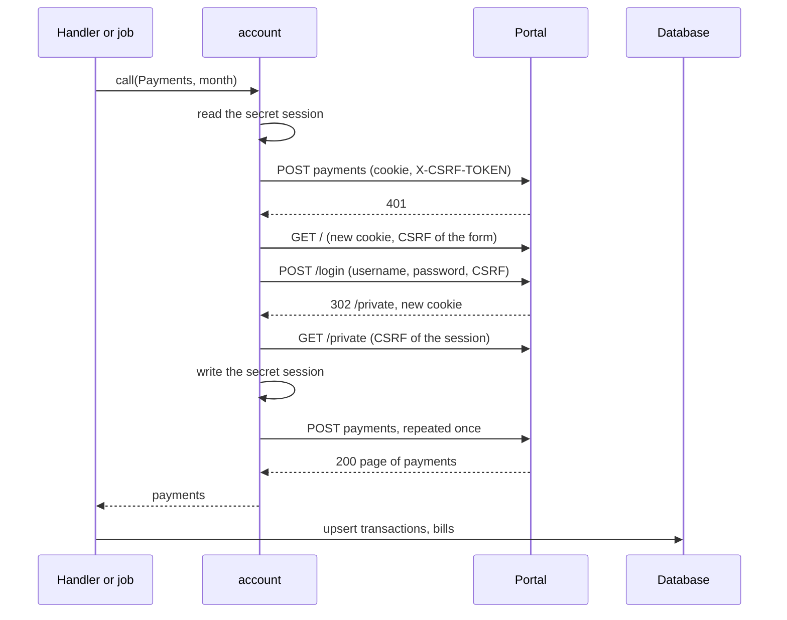

# Specification: The electricity account of a workspace

## 1. Summary

The new plugin `dev.maroid.telmico` reads the portal of the electricity service at
`https://my.telmico.ge`. A connect signs in through the form of the portal and stores the
session cookie and its CSRF token as the workspace plugin secret `session` of `PSECRET`.
Every call signs in again once when the portal rejects the session. An editor assigns one
customer in the scoped table `customer_assignments`. The assignment and the scheduled
collection read the previous calendar month, keep each transaction in `transactions` and
each bill in `bills`, and send the bill of the newest reading stored for the first time, with
its document. The command `backfill` collects earlier months, and sends no bill. The widget
`last-reading`, the page `/transactions` with a chart of 12 months, and the page `/bills`
with a download through Maroid read the stored rows. No change reaches the hub, `pluginapi`,
or another plugin. `spec-pages.md` holds the decisions of the pages. `spec-scenarios.md` holds
the scenarios.

## 2. Coverage

| Requirement | Where this specification realizes it |
| ----------- | ------------------------------------ |
| `ELECACC-FR-001`, `ELECACC-FR-002` | Section 4.3, `ELECACC-SC-001` |
| `ELECACC-FR-003`, `ELECACC-FR-004` | `api.yaml`, `ELECACC-SC-002` |
| `ELECACC-FR-005`, `ELECACC-FR-006` | `api.yaml`, `ELECACC-DD-004`, `ELECACC-SC-003` |
| `ELECACC-FR-007` | Section 4.5, `ELECACC-SC-004` |
| `ELECACC-FR-008`, `ELECACC-FR-009` | Section 4.4, `ELECACC-DD-001`, `ELECACC-DD-002`, `ELECACC-SC-005`, `ELECACC-SC-006` |
| `ELECACC-FR-010`, `ELECACC-FR-011` | `api.yaml`, `ELECACC-SC-007` |
| `ELECACC-FR-012` | `ELECACC-DD-003`, `ELECACC-SC-008` |
| `ELECACC-FR-013` | `ELECACC-DD-003`, `ELECACC-SC-009` |
| `ELECACC-FR-014`, `ELECACC-FR-015` | `api.yaml`, `ELECACC-SC-010`, `ELECACC-SC-011` |
| `ELECACC-FR-016` | Section 4.4, `ELECACC-DD-006`, `ELECACC-SC-012` |
| `ELECACC-FR-017`, `ELECACC-FR-018` | Section 4.3, `ELECACC-DD-005`, `ELECACC-SC-013` |
| `ELECACC-FR-019` | Section 4.3, `ELECACC-SC-014` |
| `ELECACC-FR-020` | Section 4.5, `ELECACC-SC-009` |
| `ELECACC-FR-021` | `ELECACC-DD-004`, `ELECACC-SC-015` |
| `ELECACC-FR-022`, `ELECACC-FR-023` | Section 4.2, `ELECACC-DD-007`, `ELECACC-SC-016`, `ELECACC-SC-017` |
| `ELECACC-FR-024` | Section 4.2, `ELECACC-SC-018` |
| `ELECACC-FR-025` to `ELECACC-FR-027` | Section 4.3, `ELECACC-DD-009`, `ELECACC-SC-019`, `ELECACC-SC-020` |
| `ELECACC-FR-028` | Section 4.3, `ELECACC-SC-021` |
| `ELECACC-FR-029` to `ELECACC-FR-031` | `ELECACC-DD-006`, `ELECACC-DD-008`, `ELECACC-DD-010`, `ELECACC-SC-021`, `ELECACC-SC-022` |
| `ELECACC-FR-032` to `ELECACC-FR-036` | Section 4.3, `ELECACC-DD-011`, `ELECACC-SC-023`, `ELECACC-SC-024` |
| `ELECACC-FR-037`, `ELECACC-FR-038` | `api.yaml`, `ELECACC-DD-012`, `ELECACC-DD-016`, `ELECACC-SC-025` |
| `ELECACC-FR-039` | `ELECACC-DD-013`, `ELECACC-SC-026` |
| `ELECACC-FR-040`, `ELECACC-FR-041` | `api.yaml`, `ELECACC-DD-014`, `ELECACC-SC-027` |
| `ELECACC-FR-042` | `api.yaml`, `ELECACC-DD-015`, `ELECACC-SC-028`, `ELECACC-SC-029` |
| `ELECACC-FR-043`, `ELECACC-FR-044` | Section 4.5, `ELECACC-SC-030` |
| `ELECACC-FR-045` | Section 4.3, `ELECACC-SC-025`, `ELECACC-SC-027` |
| `ELECACC-FR-046`, `ELECACC-FR-047` | Section 4.3, `ELECACC-SC-031` |
| `ELECACC-INV-001` | Section 4.2, `ELECACC-SC-010` |
| `ELECACC-INV-002` | Section 4.2, `ELECACC-SC-032` |
| `ELECACC-INV-003`, `ELECACC-INV-004` | `api.yaml`, `ELECACC-DD-004`, `ELECACC-SC-033` |
| `ELECACC-INV-005` | `ELECACC-DD-015`, `ELECACC-SC-029` |

## 3. Guideline compliance

| Rule | Guideline | How this specification obeys it |
| ---- | --------- | ------------------------------- |
| `PLG-006`, `PLG-007` | Plugin model | The plugin adds each capability through the existing interfaces, and reaches every resource through the host. |
| `PLG-008` | Plugin model | The plugin imports no other plugin. The chart and the Tbilisi date repeat in the plugin. |
| `ARC-008` | Architecture | No file of the hub changes. |
| `DAT-001`, `DAT-006`, `DAT-009` | Data | Every table lives in `dev_maroid_telmico`. Each `id` is `uuidv7()`. |
| `OWN-004` to `OWN-008` | Ownership | Every table carries `workspace_id` and forced row level security. No repository filters by workspace. |
| `OWN-003` | Ownership | `backfill` sets the acting workspace from `--workspace`, and no acting user. |
| `OWN-009` | Ownership | The collection runs with `CronScopePerWorkspace`. |
| `CFG-007` | Configuration | The credentials are workspace settings. |
| `EXT-001`, `EXT-002` | External services | `service/api-client.go` holds a resty client with `base_url`. The calls of the API keep `Accept: application/json`. The three calls of the sign in and the bill download override it. |
| `EXT-005`, `EXT-007` | External services | A status that is not a success is an error that wraps the status and at most 512 bytes of the body. A redirect of the sign in is read, never followed (`ELECACC-DD-002`). |
| `LOG-003`, `LOG-007`, `LOG-008` | Logging | Each service and handler adds `component`. No log line holds the password, the cookie, the CSRF token, or the username. |
| `SEC-013` | Security | Each route and the widget name a permission. |
| `NTF-002` | Notifications | The bill goes to the topic `monthly_bill`. |
| `CLI-003` to `CLI-006` | Command line | `backfill` holds the collector and a logger with `component=command`. `PreRunE` checks the flags. |
| `API-004` | HTTP API | The routes mount under `/workspaces/{workspaceId}/plugins/dev.maroid.telmico/api`. |
| `ERR-002` | Errors | Each problem type has the form `/problems/dev.maroid.telmico/<slug>`. |
| `RES-002`, `RES-005`, `RES-006` | REST | `/connections/self` and `/customer-assignments/self` follow the gas plugin (`ADR-0015`, `ADR-0018`). The lists answer the `Page` of `libs/rest/page`. |
| `RES-001` (`Z-173`) | REST | An amount travels as the money object. |
| `GO-005` | Go style | Every sentinel error lives in `errs/`. |
| `UI-005` to `UI-009` | Web UI | The remote exports `/account`, `/transactions`, and `/bills`, and reaches the API through `host.api`. |
| `PKG-001` | Package layout | The layout of the gas plugin: `cli/`, `config/`, `db/`, `dto/`, `errs/`, `handler/`, `job/`, `model/`, `permission/`, `repository/`, `service/`, `widget/`, `ui/`. |
| `BLD-003` | Build | The build plan builds the UI before the `.so`. |

## 4. Design

### 4.1 Components

Every path is under `plugins/telmico/`. A file not named here follows the gas plugin.

| Path | Holds |
| ---- | ----- |
| `go.mod` | The module `github.com/abgeo/maroid/plugins/telmico`. `golang.org/x/net` becomes a direct dependency for `html` |
| `db/migrations/<ts>_table_customer_assignments_create.{up,down}.sql` | Section 4.2 |
| `db/migrations/<ts>_table_transactions_create.{up,down}.sql` | Section 4.2 |
| `db/migrations/<ts>_table_bills_create.{up,down}.sql` | Section 4.2 |
| `errs/errs.go` | `ErrRequestFailed`, `ErrSessionRejected`, `ErrNotConnected`, `ErrCredentialsAbsent`, `ErrCredentialsRejected`, `ErrNotAssigned`, `ErrCustomerUnknown`, `ErrCustomerAbsent`, `ErrBillUnknown`, `ErrReversedPeriod` |
| `config/config.go` | `Config` (section 4.3), `WorkspaceSettings` with `Username`, `Password` |
| `model/connection.go` | `ConnectionState`, `Connection`, `Customer` with `Number`, `Name`, `Address`, `Assigned` |
| `model/session.go` | `Session` with `Cookie`, `CSRFToken`. `MarshalSecret`, `ParseSession` |
| `model/transaction.go` | `Transaction` (section 4.2), `IsCharge()`, `Reading` with `Date`, `Usage`, `MeterValue`, `Charge`, `ReadingsOf([]Transaction) []Reading`, `Collection` |
| `model/bill.go` | `Bill` (section 4.2) |
| `model/period.go` | `Month`, `Period` (first and last month), `Period.Months()`, `PreviousMonth(now time.Time) Month`, `Tbilisi()` |
| `dto/api-client.go` | `Account`, `AccountDetail` (`account`, `address` alone, `ELECACC-DD-004`), `PaymentsPage`, `Payment`, `ReceiptsPage`, `Receipt`, `MapToModel(customerNumber)` |
| `dto/connection.go`, `dto/transaction.go`, `dto/bill.go` | `ConnectionResponse`, `CustomerResponse`, `AssignmentRequest`, `TransactionResponse`, `BillResponse`, `MoneyResponse` |
| `service/api-client.go` | `APIClient`: `SignIn`, `Accounts`, `AccountDetail`, `Payments`, `Receipts`, `ReceiptDocument` (section 4.4) |
| `service/account.go` | `account`, shared by `Connections`, `Collector`, `Bills`, and `Documents`: `credentials`, `session`, `signIn`, `forgetSession`, and `call`, which repeats a call once after a new sign in on `ErrSessionRejected` (`ELECACC-DD-003`) |
| `service/connection.go` | `Connections`: `Status`, `Connect`, `Disconnect`, `Assign`. It holds `Collector` and `Bills` |
| `service/collector.go` | `Collector.Collect(ctx, month model.Month) (model.Collection, error)` |
| `service/bill.go` | `Bills.Send(ctx, reading model.Reading) error`. The message and the document |
| `service/document.go` | `Documents.Open(ctx, billID uuid.UUID) (model.Document, error)` |
| `service/store.go` | `Store` over `PluginDB`, one transaction for each call |
| `repository/{assignment,transaction,bill}.go` | `CustomerAssignment`: `Get`, `Put`, `Delete`. `Transaction`: `Insert(ctx, *model.Transaction) (bool, error)`, `LatestReading`, `List`. `Bill`: `Insert`, `Get`, `ByMonth`, `List` |
| `job/transactions_collector.go` | `TransactionsCollector`, `MonthlyBillTopic` |
| `cli/{doc,backfill}.go` | `Backfill`, `NewBackfill`, `Command() *cobra.Command` |
| `handler/{doc,connection,transaction,bill,problem}.go` | `ConnectionHandler`, `TransactionHandler`, `BillHandler`, the problem types of section 4.5 |
| `permission/permission.go` | `AccountRead`, `AccountConnect` |
| `widget/{doc,last_reading}.go` | `NewLastReading` |
| `embed.go`, `main.go` | `uiAssets`. `TelmicoPlugin`: `Meta` (`Telmico`, version `0.1.0`), `SettingsModel`, `CronJobs`, `NotificationTopics`, `Migrations`, `Commands`, `Permissions`, `Routes`, `Widgets`, `UIManifest` |
| `ui/` | The UI of the gas plugin with `src/pages/bills/Bills.svelte` added, and `src/api/bill.ts` |
| `config.yaml` at the repository root | The block of `dev.maroid.telmico` with the defaults of section 4.3 |

`Collector.Collect` reads the payments and the receipts of one month of the assigned customer,
and stores each one. It sends no bill. `model.Collection` holds `Count`, the count of the
payments that the portal answered, and `NewestReading`, the latest reading whose charges
the call stored for the first time, or nil. The callers:

| Caller | Month | Bill |
| ------ | ----- | ---- |
| The job | `PreviousMonth(now)` | `Bills.Send` with `NewestReading` when it is not nil |
| `Connections.Assign` | `PreviousMonth(now)` | `Bills.Send` with `NewestReading` when it is not nil |
| `backfill` | Each month of `--from` to `--to` | None |

Each service, handler, and widget depends on an interface that it declares, and `Store` meets it.

### 4.2 Data model

The session lives in the workspace plugin secret `session`, with no expiry: a JSON object
with `cookie` and `csrf_token`.

| Table | Schema | Scope | Realizes |
| ----- | ------ | ----- | -------- |
| `customer_assignments` | `dev_maroid_telmico` | Workspace | `ELECACC-FR-014`, `ELECACC-INV-001` |
| `transactions` | `dev_maroid_telmico` | Workspace | `ELECACC-FR-022`, `ELECACC-FR-024` |
| `bills` | `dev_maroid_telmico` | Workspace | `ELECACC-FR-023`, `ELECACC-FR-024` |

`customer_assignments` repeats the table of the gas plugin: `id`, `workspace_id` `UNIQUE`,
`customer_number` `TEXT` of 1 to 64 characters, `assigned_at`. `Put` runs
`INSERT ... ON CONFLICT (workspace_id) DO UPDATE`.

`transactions`:

| Column | Type | Null | Default | Note |
| ------ | ---- | ---- | ------- | ---- |
| `id` | `UUID` | no | `uuidv7()` | Primary key |
| `workspace_id` | `UUID` | no | the acting workspace | |
| `customer_number` | `TEXT` | no | | `account`, for example `8370764` |
| `operation` | `TEXT` | no | | `transType`, as the portal gives it |
| `transaction_date` | `DATE` | no | | `operDate` |
| `meter_value` | `NUMERIC` | yes | | `counterValue`. Null for a payment |
| `usage` | `NUMERIC` | yes | | `kiloValue`, in kilowatt hours |
| `amount` | `NUMERIC` | yes | | `amount`, in lari. A payment is below zero |
| `balance` | `NUMERIC` | yes | | `debt`, in lari |
| `tariff` | `NUMERIC` | yes | | `tariffValue`, in lari for each kilowatt hour. Zero becomes null |
| `meter_serial` | `TEXT` | yes | | `counterNumber` |
| `due_date` | `DATE` | yes | | `dueDate` |
| `collected_at` | `TIMESTAMPTZ` | no | `now()` | |

The constraint `transactions_identity_key` is `UNIQUE NULLS NOT DISTINCT (workspace_id,
customer_number, operation, transaction_date, meter_value)` (`ELECACC-DD-007`).

`bills`:

| Column | Type | Null | Default | Note |
| ------ | ---- | ---- | ------- | ---- |
| `id` | `UUID` | no | `uuidv7()` | Primary key, the identifier that the routes answer |
| `workspace_id` | `UUID` | no | the acting workspace | |
| `customer_number` | `TEXT` | no | | |
| `bill_number` | `TEXT` | no | | `billNumber`, for example `8370764-2026-9` |
| `service_bill_id` | `UUID` | no | | `billId`, the address of the document at the portal |
| `month` | `DATE` | no | | The first day of the month that `billNumber` names |
| `issued_at` | `TIMESTAMPTZ` | no | | `billCreateDate`, a time of Tbilisi |
| `meter_serial` | `TEXT` | yes | | `serialnumber` |
| `collected_at` | `TIMESTAMPTZ` | no | `now()` | |

The constraint `bills_workspace_bill_number_key` is `UNIQUE (workspace_id, bill_number)`. The
insert runs `ON CONFLICT ... DO UPDATE` on `service_bill_id`, `issued_at`, and `meter_serial`.

Every table takes the policy of `OWN-006`. No foreign key joins them, because a transaction
and a bill outlive their assignment.

### 4.3 Declarations

**HTTP routes.** The prefix is `/workspaces/{workspaceId}/plugins/dev.maroid.telmico/api`.
`api.yaml` holds the bodies and the status codes.

| Method | Path | Permission | Realizes |
| ------ | ---- | ---------- | -------- |
| `GET` | `/connections/self` | `account.read` | `ELECACC-FR-003` to `ELECACC-FR-007`, `ELECACC-FR-012`, `ELECACC-FR-013` |
| `PUT` | `/connections/self` | `account.connect` | `ELECACC-FR-008`, `ELECACC-FR-009` |
| `DELETE` | `/connections/self` | `account.connect` | `ELECACC-FR-010`, `ELECACC-FR-011` |
| `PUT` | `/customer-assignments/self` | `account.connect` | `ELECACC-FR-014` to `ELECACC-FR-016` |
| `GET` | `/transactions` | `account.read` | `ELECACC-FR-037` to `ELECACC-FR-039`, `ELECACC-FR-043` to `ELECACC-FR-045` |
| `GET` | `/bills` | `account.read` | `ELECACC-FR-040`, `ELECACC-FR-041`, `ELECACC-FR-043` to `ELECACC-FR-045` |
| `GET` | `/bills/{billId}/document` | `account.read` | `ELECACC-FR-042`, `ELECACC-INV-005` |

**Permissions.**

| Name | Description | Lowest | Realizes |
| ---- | ----------- | ------ | -------- |
| `account.read` | Read the electricity account, the transactions, and the bills of the workspace | `viewer` | `ELECACC-FR-046` |
| `account.connect` | Connect the electricity account and assign its customer | `editor` | `ELECACC-FR-047` |

**Settings.** Both fields carry `x-maroid-scope=workspace`.

| Field | Kind | Title | Realizes |
| ----- | ---- | ----- | -------- |
| `username` | free text | Username | `ELECACC-FR-001` |
| `password` | secret | Password | `ELECACC-FR-001`, `ELECACC-FR-002` |

**Configuration.**

| Key | Type | Default | Realizes |
| --- | ---- | ------- | -------- |
| `base_url` | URL, no trailing slash | `https://my.telmico.ge` | `ELECACC-FR-009` |
| `request_timeout` | duration | `15s` | `ELECACC-FR-007` |
| `cron_schedule.transactions_collector` | cron | `0 10 1 * *` | `ELECACC-FR-017`, `ELECACC-FR-018` |

**Cron job.**

| Identifier | Scope | Behavior | Realizes |
| ---------- | ----- | -------- | -------- |
| `transactions_collector` | `CronScopePerWorkspace` | `Collect` with `PreviousMonth`, then `Bills.Send` with `NewestReading`. `ErrNotConnected` and `ErrNotAssigned` log a skip at info and answer nil | `ELECACC-FR-017` to `ELECACC-FR-021`, `ELECACC-FR-029` |

**Notification topic.** `monthly_bill`, "Monthly bill", "The electricity bill of the last
month, with its document." (`ELECACC-FR-028`). `ELECACC-DD-010` gives the message.

**CLI command.** The registrar mounts it under `maroid dev-maroid-telmico`.

| Command | Flags | Behavior | Realizes |
| ------- | ----- | -------- | -------- |
| `backfill` | `--workspace` (UUID), `--from` and `--to` (`YYYY-MM`), each required | `Collect` for each month of the period, and print the count of each month. No bill | `ELECACC-FR-025` to `ELECACC-FR-027` |

**UI routes.**

| Page route | Navigation entry | Page | Realizes |
| ---------- | ---------------- | ---- | -------- |
| `/transactions` | "Transactions" | `Transactions.svelte` | `ELECACC-FR-037` to `ELECACC-FR-039`, `ELECACC-FR-043` to `ELECACC-FR-045` |
| `/bills` | "Bills" | `Bills.svelte` | `ELECACC-FR-040` to `ELECACC-FR-045` |
| `/account` | "Account" | `Account.svelte` | `ELECACC-FR-003` to `ELECACC-FR-015` |

`Account.svelte` repeats the page of the gas plugin.

**Widget.**

| Key | Title | Kind | Size | Permission | Realizes |
| --- | ----- | ---- | ---- | ---------- | -------- |
| `last-reading` | Electricity usage | `stat` | `s` | `account.read` | `ELECACC-FR-032` to `ELECACC-FR-036` |

`Load` calls `Store.LatestReading` and no service. No assignment answers
`NotSetUpAnswer("Connect the electricity account and assign a customer.", "/account")`. No
reading answers `EmptyAnswer("No reading yet.")`.

### 4.4 Flow

`APIClient` signs a request with the header `Cookie: _tpcabinet_app_u_=<cookie>` and the
header `X-CSRF-TOKEN`. Every call of the API is a `POST`. `Payments` and `Receipts` send a
multipart form with `page`, `size` 100, and the month as both `from_month` and `to_month`, and
follow `totalPages`. `ReceiptDocument` answers the bytes of `GET /private/receipt/{billId}`, at
most 10 MiB, and refuses a body whose first bytes are not `%PDF`. Every call ends after
`request_timeout`. Each request sends a browser `User-Agent`.

### 4.5 Errors

| Condition | Route answer | Collection |
| --------- | ------------ | ---------- |
| No `session` secret | `GET` connection: 200 `not_connected`. A write or the download: 409 `not-connected` | Skip (`ELECACC-FR-019`) |
| The portal rejects the session | Sign in again once (`ELECACC-DD-003`) | Sign in again once |
| The settings are absent | `PUT` connection: 422 `credentials-absent` | Error `ErrCredentialsAbsent` |
| The portal rejects the credentials | `PUT` connection: 422 `credentials-rejected`. Another route: the session goes, then `GET` connection answers 200 `not_connected`, and another route 409 `not-connected` | Error `ErrCredentialsRejected`. The session goes |
| The customer is not in the list of the account | 422 `customer-unknown` | Error `ErrCustomerAbsent`, nothing stored |
| No assigned customer | `GET /transactions`, `GET /bills`: 409 `not-assigned` | Skip |
| The bill is not a stored bill of the assigned customer | 404 `/problems/http/not-found` | Not reached |
| `backfill` in a workspace with no connection or no assignment | Not reached | The command fails with `ErrNotConnected` or `ErrNotAssigned` |
| `backfill` with `--from` after `--to`, a month that does not parse, or a `--workspace` that is not a UUID | Not reached | `PreRunE` fails, and no service is called |
| The body of the assignment passes 4 KiB | 413 `/problems/http/content-too-large` | Not reached |
| `from` is not a date | 400 `/problems/http/request-invalid` | Not reached |
| The portal answers 5xx, an unknown redirect, a page with no CSRF token, or no answer | 502 `service-unavailable`. The session stays | Error `ErrRequestFailed` |
| The document of the bill fails to download | The download: 502 `service-unavailable` | The bill goes without it (`ELECACC-DD-010`) |

No detail names the password, the cookie, the CSRF token, or the username.

## 5. Design decisions

### `ELECACC-DD-001`

**Realizes:** `ELECACC-FR-009`
**Decision:** `PUT /connections/self` signs in, writes `session`, lists the customers, and
answers 200 with the connection, as the gas plugin does.
**Rationale:** No code by phone exists, so no pending state exists. A repeat has no new effect.
**Alternatives:** `POST /connections`. It overstates a repeat.

### `ELECACC-DD-002`

**Realizes:** `ELECACC-FR-009`, `ELECACC-FR-013`
**Decision:** `SignIn` runs three requests with a fresh cookie jar and no redirect follow:
`GET /` for the first cookie and the `_csrf` of the form, `POST /login` as a form, and
`GET /private` for the `_csrf` of the new session. `golang.org/x/net/html` reads the content
of `<meta name="_csrf">`. The answer of `POST /login` decides: a 302 whose `Location` path is
`/private` is a success. A 302 whose query holds `error=error.bad_credentials` is
`ErrCredentialsRejected`. Any other answer is `ErrRequestFailed`.
**Rationale:** The portal is a form application with a CSRF token bound to the session. It
changes the cookie at the sign in, so the token of the first page fails after it. The portal
redirects to `http://`, so a follow leaves TLS. One function of the standard extension reads
one tag. The portal masks the token on each page, and any masked form of it passes.
**Alternatives:** `goquery`. It adds a module for one selector. A browser in the process. It
adds a runtime of hundreds of megabytes to the image of the hub.

### `ELECACC-DD-003`

**Realizes:** `ELECACC-FR-012`, `ELECACC-FR-013`, `ELECACC-FR-020`
**Decision:** A 401 or a 403 from the API, or a 302 from `GET /private`, is
`ErrSessionRejected`. `account.call` then signs in with the stored credentials, writes the new
`session`, and repeats the call once. `ErrCredentialsRejected` from that sign in deletes
`session`, keeps the assignment, and reaches the caller. A second `ErrSessionRejected` is
`ErrRequestFailed`.
**Rationale:** The portal keeps a session for a short time, so the page and the collection
both meet an ended session in normal use. One repeat bounds the cost. The gas plugin removes
its connection on a rejected token, because its token lasts. Here that removal would show
"not connected" at most visits.
**Alternatives:** Sign in at each action and store no session. Each page view then costs four
requests in place of one.

### `ELECACC-DD-004`

**Realizes:** `ELECACC-FR-005`, `ELECACC-FR-021`, `ELECACC-INV-004`
**Decision:** The customer number is `account`. `Accounts` answers the number and `name`, the
label that the holder gave the customer. `AccountDetail` answers the address, one call for
each customer. `dto.AccountDetail` decodes `account` and `address` alone, so `owner`,
`idNumber`, `phoneNumbers`, and `emails` never reach a value of Go. `Collect` lists the
customers before it reads the month, and answers `ErrCustomerAbsent` when the list does not
hold the assigned customer.
**Rationale:** The list answers no address. A member that Go does not decode cannot reach an
answer or a log. An account holds one customer for each house, so the extra calls stay few.
**Alternatives:** Show no address. The holder then tells two customers apart by the label alone.

### `ELECACC-DD-005`

**Realizes:** `ELECACC-FR-017`, `ELECACC-FR-018`
**Decision:** The months are months of Tbilisi, `time.FixedZone("Asia/Tbilisi", 4*60*60)`.
`PreviousMonth` answers the month before the one of `now`. The portal filters by month, so
the plugin sends `<year>-<month>` with no leading zero, the form that the portal sends.
**Rationale:** The gas plugin made the same choice. The plugin cannot import it (`PLG-008`).
**Alternatives:** A shared module in `libs/`. Two plugins share twelve lines.

### `ELECACC-DD-006`

**Realizes:** `ELECACC-FR-016`, `ELECACC-FR-026`, `ELECACC-FR-029`
**Decision:** `Collect` sends no bill. It answers `NewestReading`, and the job and `Assign` pass
it to `Bills.Send`. A failed collection after an assignment keeps the assignment and answers
200, as in the gas plugin.
**Rationale:** One `Collect` serves every caller. A repeated assignment stores no new charge,
so it sends no second bill.
**Alternatives:** A flag on `Collect`. The flag names the caller.

### `ELECACC-DD-007`

**Realizes:** `ELECACC-FR-022`
**Decision:** The identity of a transaction is the workspace, the customer, `operation`,
`transaction_date`, and `meter_value`, with null equal to null. The insert runs
`ON CONFLICT ON CONSTRAINT transactions_identity_key DO UPDATE` on every value column,
`WHERE (...) IS DISTINCT FROM (EXCLUDED...)`, and `RETURNING (xmax = 0)`. `Insert` answers
true for a row stored for the first time.
**Rationale:** The portal splits a reading in two charges on one date, each with its own meter
value, when the tariff changes. The portal answers no identifier of a transaction.
**Alternatives:** The amount in the key. A corrected amount then adds a row.

### `ELECACC-DD-008`

**Realizes:** `ELECACC-FR-029`, `ELECACC-FR-030`, `ELECACC-FR-032`, `ELECACC-FR-039`
**Decision:** A transaction is a charge when it holds a meter value and an amount
(`Transaction.IsCharge`). `ReadingsOf` groups the charges of one date into one `Reading`: the
sum of `usage`, the sum of `amount`, and the highest `meter_value`. The first reading of a new
meter holds no amount, and is no charge. `NewestReading` is the reading of the latest date on
which `Collect` stored a charge for the first time, built from every stored charge of that date.
**Rationale:** The portal answers each kind by a name that differs from the names of its own
filter, so a rule on the values outlasts a rule on the name.
**Alternatives:** A rule on `operation`. A new name at the portal hides every reading.

### `ELECACC-DD-009`

**Realizes:** `ELECACC-FR-025`, `ELECACC-FR-027`
**Decision:** `backfill` sets the acting workspace with `pluginapi.ContextWithActingWorkspace`,
and no acting user. It calls `Collect` once for each month from `--from` to `--to`, and stops at
the first failure.
**Rationale:** A month is the range of the job. A failure names its month.
**Alternatives:** One request for the whole period. The portal accepts it, but one failure then
names no month.

### `ELECACC-DD-010`

**Realizes:** `ELECACC-FR-030`, `ELECACC-FR-031`
**Decision:** `Bills.Send` finds the stored bill whose `month` is the month of the reading, and
downloads its document with `ReceiptDocument` through `account.call`. The message carries the
title `თელმიკო | ქვითარი` and the body of the plugin of the distributor: the date
`YYYY-MM-DD`, the meter value and the usage in kWh with no trailing zero, and the charge with
two decimals. The document is the attachment `<bill_number>.pdf`, `application/pdf`. No bill, or
a failed download, logs a warning, and the message goes without it. A failed `Notify` fails
the run.
**Rationale:** The reading is stored, so a later run never sends it again. The figures matter
more than the document. The household knows the message of the plugin of the distributor.
**Alternatives:** Fail the run on a failed download. The bill of that month is then lost.

`spec-pages.md` holds `ELECACC-DD-011` to `ELECACC-DD-016`.

## 6. Scenarios

`spec-scenarios.md` holds `ELECACC-SC-001` to `ELECACC-SC-033`.

## 7. Build plan

| # | Step | Realizes | Done |
| - | ---- | -------- | ---- |
| 1 | The module, `errs/`, `model/`, `config/`, `permission/`, and `config.yaml` | `ELECACC-FR-001`, `ELECACC-FR-002`, `ELECACC-FR-018` | [x] |
| 2 | `service/api-client.go` and `dto/api-client.go`, against an `httptest` portal | `ELECACC-FR-009`, `ELECACC-FR-012`, `ELECACC-FR-013` | [x] |
| 3 | The three migrations and `repository/` | `ELECACC-FR-014`, `ELECACC-FR-022` to `ELECACC-FR-024` | [x] |
| 4 | `service/store.go`, `service/account.go`, `service/collector.go` | `ELECACC-FR-017` to `ELECACC-FR-024` | [x] |
| 5 | `service/bill.go`, the job, and `cli/backfill.go` | `ELECACC-FR-025` to `ELECACC-FR-031` | [x] |
| 6 | `service/connection.go`, `handler/connection.go`, `dto/connection.go` | `ELECACC-FR-003` to `ELECACC-FR-016` | [ ] |
| 7 | `handler/transaction.go`, `handler/bill.go`, `service/document.go`, their DTOs, and `api.yaml` | `ELECACC-FR-037` to `ELECACC-FR-045` | [ ] |
| 8 | `widget/last_reading.go` and `main.go` | `ELECACC-FR-032` to `ELECACC-FR-036`, `ELECACC-FR-046`, `ELECACC-FR-047` | [ ] |
| 9 | `ui/`, `embed.go`, and `UIManifest`. Build the UI, then the `.so` (`BLD-003`) | `ELECACC-FR-003` to `ELECACC-FR-015`, `ELECACC-FR-037` to `ELECACC-FR-044` | [ ] |
| 10 | Run the flow against the portal: an ended session, the download from the deck, `backfill` of 12 months. Correct `ELECACC-DD-003` and `ELECACC-DD-015` | `ELECACC-FR-012`, `ELECACC-FR-025`, `ELECACC-FR-042` | [ ] |
| 11 | The tests of `spec-scenarios.md`. Lint and build the plugin | Every statement | [ ] |

## Retired identifiers

This file has no retired identifier.
