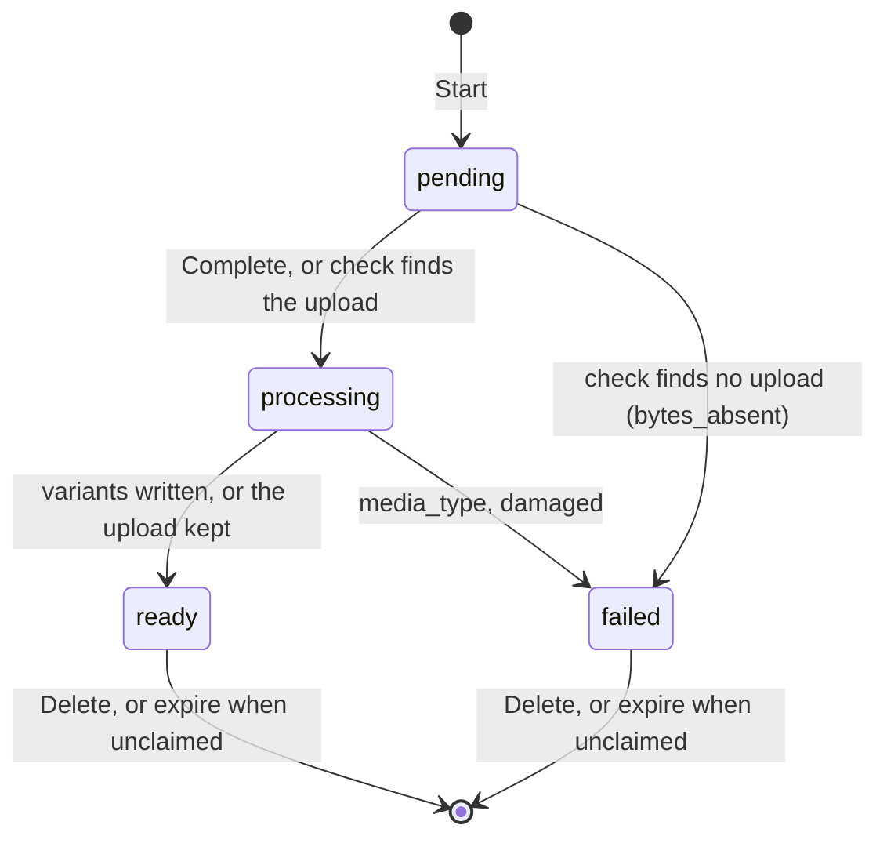
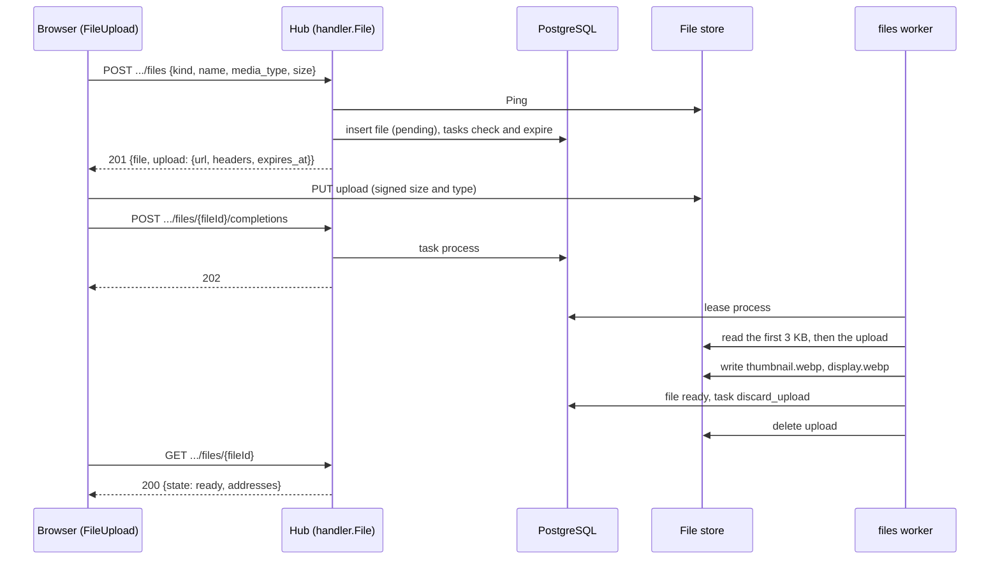

# Specification: The files of the hub and of a plugin

## 1. Summary

A plugin declares its file kinds as a new capability. The hub answers the start of an
upload with a row in one of two scoped tables and a signed address of one PUT, and the
browser sends the bytes to the file store with Uppy. A `files` worker drains an outbox
of tasks: it checks the content, derives two WebP variants of an image in pure Go,
deletes the upload, and removes unclaimed and deleted files. A plugin reads, claims, and
deletes a file through `Host.Files`, and its table references the file with a foreign
key. `spec-decisions.md` holds the design decisions, and `spec-scenarios.md` holds the
scenarios.

## 2. Coverage

| Requirement     | Where this specification realizes it                   |
| --------------- | ------------------------------------------------------ |
| `FILES-FR-001`  | Section 4.1, `FILES-DD-001`, `FILES-SC-001`            |
| `FILES-FR-002`  | `FILES-DD-001`, `FILES-SC-002`, `FILES-SC-003`         |
| `FILES-FR-003`  | Section 4.3, `FILES-SC-004`, `FILES-SC-005`            |
| `FILES-FR-004`  | Section 4.5, `FILES-SC-006`                            |
| `FILES-FR-005`  | Section 4.5, `FILES-SC-007`                            |
| `FILES-FR-006`  | `FILES-DD-004`, `FILES-SC-008`                         |
| `FILES-FR-007`  | Section 4.4, `FILES-DD-004`, `FILES-SC-009`            |
| `FILES-FR-008`  | Section 4.4, `FILES-SC-004`                            |
| `FILES-FR-009`  | `FILES-DD-005`, `FILES-DD-006`, `FILES-SC-010`, `-011` |
| `FILES-FR-010`  | `FILES-DD-008`, `FILES-SC-012`                         |
| `FILES-FR-011`  | Section 4.2, `FILES-DD-008`, `FILES-SC-012`, `-013`    |
| `FILES-FR-012`  | `FILES-DD-007`, `FILES-SC-014`, `FILES-SC-015`         |
| `FILES-FR-013`  | `FILES-DD-007`, `FILES-SC-016`                         |
| `FILES-FR-014`  | `FILES-DD-007`, `FILES-SC-017`                         |
| `FILES-FR-015`  | `FILES-DD-007`, `FILES-SC-018`                         |
| `FILES-FR-016`  | `FILES-DD-006`, `FILES-SC-019`                         |
| `FILES-FR-017`  | `FILES-DD-007`, `FILES-SC-020`                         |
| `FILES-FR-018`  | Section 4.1, `FILES-SC-021`                            |
| `FILES-FR-019`  | `FILES-DD-009`, `FILES-SC-022`, `FILES-SC-023`         |
| `FILES-FR-020`  | `FILES-DD-009`, `FILES-SC-024`                         |
| `FILES-FR-021`  | `FILES-DD-009`, `FILES-SC-025`                         |
| `FILES-FR-022`  | `FILES-DD-009`, `FILES-SC-026`                         |
| `FILES-FR-023`  | `FILES-DD-010`, `FILES-SC-027`, `-028`, `-029`         |
| `FILES-FR-024`  | Section 4.5, `FILES-DD-012`, `FILES-SC-030`            |
| `FILES-FR-025`  | `FILES-DD-012`, `FILES-SC-031`                         |
| `FILES-FR-026`  | Section 4.1, `FILES-DD-013`, `FILES-SC-032`            |
| `FILES-FR-027`  | `FILES-DD-013`, `FILES-SC-033`                         |
| `FILES-FR-028`  | `FILES-DD-013`, `FILES-SC-034`                         |
| `FILES-NFR-001` | `FILES-DD-007`, `FILES-SC-035`                         |
| `FILES-NFR-002` | `FILES-DD-014`, `FILES-SC-036`                         |
| `FILES-NFR-003` | `FILES-DD-004`, `FILES-SC-037`                         |
| `FILES-NFR-004` | `FILES-DD-010`, `FILES-SC-038`                         |
| `FILES-NFR-005` | `FILES-DD-005`, `FILES-SC-039`                         |
| `FILES-INV-001` | `FILES-DD-003`, `FILES-SC-040`                         |
| `FILES-INV-002` | Section 4.2, `FILES-DD-003`, `FILES-SC-041`            |
| `FILES-INV-003` | Section 4.2, `FILES-SC-042`                            |
| `FILES-INV-004` | `FILES-DD-007`, `FILES-SC-043`                         |
| `FILES-INV-005` | Section 4.2, `FILES-SC-044`                            |

## 3. Guideline compliance

| Rule      | Guideline        | How this specification obeys it                                                                                                                               |
| --------- | ---------------- | ------------------------------------------------------------------------------------------------------------------------------------------------------------- |
| `ARC-008` | Architecture     | The hub reads the file kind from the registry, and names no plugin and no kind. Section 4.1.                                                                  |
| `ARC-010` | Architecture     | `maroid worker` runs the tasks of the outbox, which `ADR-0021` adds to the rule. `FILES-DD-005`.                                                              |
| `PLG-006` | Plugin model     | `FilePlugin`, `FileKindRegistry`, and `FileKindRegistrar`. Section 4.1.                                                                                       |
| `PLG-007` | Plugin model     | A plugin reaches a file through `Host.Files`. Section 4.1.                                                                                                    |
| `PLG-011` | Plugin model     | The registry refuses a second kind under one key of one plugin. Section 4.1.                                                                                  |
| `DAT-003` | Data             | A plugin table references `public.workspace_files` or `public.user_files` with a foreign key and `ON DELETE RESTRICT`, as `ADR-0022` permits. `FILES-DD-009`. |
| `DAT-005` | Data             | Each migration has an up file and a down file. Section 4.2.                                                                                                   |
| `DAT-009` | Data             | Each `id` declares `DEFAULT uuidv7()`. Section 4.2.                                                                                                           |
| `DAT-010` | Data             | Each point in time is `TIMESTAMPTZ`, and `updated_at` takes its trigger. Section 4.2.                                                                         |
| `OWN-003` | Record ownership | A task of the outbox sets the owner of its file as the acting scope, as `ADR-0021` gives. `FILES-DD-005`.                                                     |
| `OWN-004` | Record ownership | Two scoped tables, and `public.file_tasks` as a queue of the hub that `ADR-0021` makes a shared table. Each migration states its scope. Section 4.2.          |
| `OWN-005` | Record ownership | Each scope column, and `uploaded_by`, takes its value from the session. No insert names it. Section 4.2.                                                      |
| `OWN-006` | Record ownership | Both file tables force their policy. Section 4.2.                                                                                                             |
| `OWN-008` | Record ownership | `repository.File` filters by `plugin_id` and never by a scope column. Section 4.1.                                                                            |
| `SEC-012` | Security         | The three routes run behind `workspace.RequireEnabledOf`. Section 4.3.                                                                                        |
| `SEC-013` | Security         | Each route checks the permission of the file kind, as `handler.Widget.Read` checks a widget. Section 4.3.                                                     |
| `API-004` | HTTP API         | The routes live beside `/api`, under `/workspaces/{workspaceId}/plugins/{id}`, as the widget routes do. Section 4.3.                                          |
| `API-006` | HTTP API         | The start reads `Idempotency-Key`. `api.yaml`.                                                                                                                |
| `CFG-003` | Configuration    | `config.Files` declares each default and each check in its tags. Section 4.3.                                                                                 |
| `CFG-004` | Configuration    | The access key and the secret key of the file store stay out of the repository. Section 4.3.                                                                  |
| `JOB-001` | Jobs             | `file.Worker` implements `worker.Worker`. Section 4.3.                                                                                                        |
| `LOG-008` | Logging          | No log line holds an upload address, a read address, or a key of the file store. Section 4.5.                                                                 |
| `UI-006`  | Web UI           | A plugin page reaches the upload through `PluginHost.files` and `@maroid/ui`. Section 4.1.                                                                    |
| `PKG-005` | Package layout   | `file` names `GLO-file`, and `filestore` names `GLO-file-store`. Section 4.1.                                                                                 |
| `BLD-004` | Build            | `Host` changes, so the build plan rebuilds and loads every plugin. Section 7.                                                                                 |

## 4. Design

### 4.1 Components

| Path                                                                                     | Action         | Holds                                                                                                               |
| ---------------------------------------------------------------------------------------- | -------------- | ------------------------------------------------------------------------------------------------------------------- |
| `libs/pluginapi/file.go`                                                                 | create         | The contract below                                                                                                  |
| `libs/pluginapi/host.go`                                                                 | change         | `Host.Files`                                                                                                        |
| `apps/hub/db/migrations/20261118100000_table_workspace_files_create.{up,down}.sql`       | create         | `public.workspace_files`                                                                                            |
| `apps/hub/db/migrations/20261118100100_table_user_files_create.{up,down}.sql`            | create         | `public.user_files`                                                                                                 |
| `apps/hub/db/migrations/20261118100200_table_file_tasks_create.{up,down}.sql`            | create         | `public.file_tasks`                                                                                                 |
| `apps/hub/internal/model/file.go`                                                        | create         | `File`, `FileTask`, `FileTaskAction`                                                                                |
| `apps/hub/internal/repository/file.go`                                                   | create         | `FileRepository`, `File`, `NewFile`. One type over both scoped tables, as `repository.PluginSecret` does            |
| `apps/hub/internal/repository/file_task.go`                                              | create         | `FileTaskRepository`, `FileTask`, `NewFileTask`: `Enqueue`, `Lease`, `Done`, `Retry`                                |
| `apps/hub/internal/registry/file_kind.go`                                                | create         | `FileKindRegistry`, `FileKind`. `Get(pluginID, key)`                                                                |
| `apps/hub/internal/registry/capability.go`                                               | change         | `CapFiles Capability = "files"`                                                                                     |
| `apps/hub/internal/registry/capability_item.go`                                          | change         | `FileKindItem`, the item of the capability report                                                                   |
| `specs/features/pcap/api.yaml`                                                           | change         | The member `files` of the capability report, and the schema `FileKind`                                              |
| `apps/hub/internal/plugin/registrar/file_kind.go`                                        | create         | `FileKindRegistrar`. `FILES-DD-001` gives its checks                                                                |
| `apps/hub/internal/plugin/loader/loader.go`                                              | change         | Adds `FileKindRegistrar` to the list, after `PermissionRegistrar`                                                   |
| `apps/hub/internal/filestore/{doc,client,presign}.go`                                    | create         | `Client`, `New`, `Head`, `ReadRange`, `Read`, `Write`, `Delete`, `DeletePrefix`, `Ping`, `PresignPut`, `PresignGet` |
| `apps/hub/internal/file/{doc,store,key}.go`                                              | create         | `Store`, `NewStore`: `Start`, `Complete`, `Get`, `Claim`, `Delete`. `objectKey`                                     |
| `apps/hub/internal/file/{worker,task}.go`                                                | create         | `Worker`, `NewWorker`, and one function for each `model.FileTaskAction`                                             |
| `apps/hub/internal/file/{image,orient,sniff}.go`                                         | create         | `deriveVariants`, `orient`, `sniff`. `FILES-DD-007`, `FILES-DD-008`                                                 |
| `apps/hub/internal/plugin/host/file.go`                                                  | create         | `FileStore` interface, `boundFiles`                                                                                 |
| `apps/hub/internal/plugin/host/host.go`                                                  | change         | `Dependencies.Files`, the `files` field, `Host.Files`                                                               |
| `apps/hub/internal/handler/file.go`                                                      | create         | `File` handler: `Start`, `Read`, `Complete`                                                                         |
| `apps/hub/internal/healthcheck/filestore.go`                                             | create         | `fileStoreCheck`                                                                                                    |
| `apps/hub/internal/healthcheck/service.go`                                               | change         | `New` takes a `filestore.Client` and adds the check                                                                 |
| `specs/features/health/api.yaml`                                                         | change         | `file-store` in the dependencies of the problem of a hub that is not ready                                          |
| `apps/hub/internal/config/config.go`                                                     | change         | `Files` and `Config.Files`                                                                                          |
| `apps/hub/internal/depresolver/{file,resolver,plugin}.go`                                | create, change | `Container.FileStore`, `Container.Files`, `Container.FileWorker`                                                    |
| `apps/hub/internal/command/worker.go`                                                    | change         | `getWorkers` adds `files`                                                                                           |
| `apps/hub/internal/domain/errs/errs.go`                                                  | change         | `ErrInvalidFileKind`, `ErrFileKindAlreadyRegistered`, `ErrUnknownFileKind`                                          |
| `apps/hub/internal/teststore/teststore.go`                                               | create         | `Start`: a RustFS container that one integration test owns, as `testbao` does                                       |
| `libs/plugin-sdk/src/{types,files}.ts`                                                   | change, create | `FileClient`, `FileRecord`, `UploadTicket`, `PluginHost.files`                                                      |
| `apps/deck/src/lib/api/client.ts`                                                        | change         | `createFileClient(workspaceId, pluginId)`                                                                           |
| `apps/deck/src/lib/api/types.ts`, `apps/deck/src/lib/plugins/capabilities.ts`            | change         | `FileKind`, `Capabilities.files`, and its label and columns on the plugins page                                     |
| `apps/deck/src/routes/(dashboard)/w/[workspace]/plugins/[plugin]/[...path]/+page.svelte` | change         | Passes `files` in the host                                                                                          |
| `libs/ui/src/upload/{FileUpload.svelte,uploader.svelte.ts}`                              | create         | The upload control. `FILES-DD-013`                                                                                  |
| `libs/ui/src/index.ts`, `libs/ui/package.json`                                           | change         | Exports `FileUpload`. Adds `@uppy/core`, `@uppy/aws-s3`, `@uppy/svelte`                                             |
| `docker-compose.yaml`, `config.yaml.example`, `chart/values.yaml`                        | change         | A RustFS service for development, and the `files` keys                                                              |

The contract in `libs/pluginapi/file.go`:

```go
// FileScope names the owner of every file of a kind.
type FileScope string

const (
    FileScopeWorkspace FileScope = "workspace"
    FileScopeUser      FileScope = "user"
)

// MaxFileSize is the largest size limit that a file kind declares, in bytes.
const MaxFileSize int64 = 25 << 20

// FileKind declares what a plugin accepts for one purpose. Key is unique within the
// plugin. Permission is a local name that the plugin declares, as for a route.
type FileKind struct {
    Key        string
    Scope      FileScope
    MediaTypes []string
    MaxSize    int64
    Permission string
    // Image makes the hub derive the variants. Every media type is then one of
    // image/jpeg, image/png, image/webp, image/heic, or image/heif.
    Image bool
}

// FilePlugin is a plugin that accepts files.
type FilePlugin interface {
    FileKinds() ([]FileKind, error)
}

type FileState string   // "pending", "processing", "ready", "failed"
type FileFailure string // "media_type", "damaged", "bytes_absent"
type FileVariant string // "original", "thumbnail", "display"

// ReadAddress is a signed address of one variant, and the time it stops working.
type ReadAddress struct {
    URL       string
    ExpiresAt time.Time
}

// File holds the facts of one file. Addresses holds a read address for each
// variant of a ready file: thumbnail and display for an image, original otherwise.
type File struct {
    ID, Kind         string
    State            FileState
    Failure          FileFailure
    Name, MediaType  string
    Size             int64
    Width, Height    int
    UploadedBy       string
    UploadedAt       time.Time
    Claimed          bool
    Addresses        map[FileVariant]ReadAddress
}

var (
    ErrFileAbsent      = errors.New("file: absent")
    ErrFileReferenced  = errors.New("file: a row references it")
    ErrFileScopeAbsent = errors.New("file: the unit of work carries no owner of the scope")
)

// PluginFiles reads, claims, and deletes the files of one plugin in the acting scope.
type PluginFiles interface {
    // Get answers the files under the identifiers. It omits an identifier that the
    // plugin and the acting scope do not hold.
    Get(ctx context.Context, ids ...string) ([]File, error)
    Claim(ctx context.Context, id string) error
    Delete(ctx context.Context, id string) error
}
```

`Host` gains `Files() (PluginFiles, error)`.

### 4.2 Data model

| Table                    | Schema   | Scope            | Migration                                     | Realizes                                        |
| ------------------------ | -------- | ---------------- | --------------------------------------------- | ----------------------------------------------- |
| `public.workspace_files` | `public` | scoped workspace | `20261118100000_table_workspace_files_create` | `FILES-FR-008`, `-011`, `-018`, `FILES-INV-003` |
| `public.user_files`      | `public` | scoped user      | `20261118100100_table_user_files_create`      | `FILES-FR-008`, `-011`, `-018`, `FILES-INV-003` |
| `public.file_tasks`      | `public` | shared           | `20261118100200_table_file_tasks_create`      | `FILES-FR-009`, `-016`, `-019`, `FILES-NFR-005` |

`public.workspace_files`:

| Column         | Type          | Rule                                                                                                   |
| -------------- | ------------- | ------------------------------------------------------------------------------------------------------ |
| `id`           | `UUID`        | Primary key, `DEFAULT uuidv7()`                                                                        |
| `workspace_id` | `UUID`        | `OWN-005`                                                                                              |
| `plugin_id`    | `TEXT`        | `NOT NULL`                                                                                             |
| `kind`         | `TEXT`        | `NOT NULL`, `CHECK (kind ~ '^[a-z0-9-]{1,64}$')`                                                       |
| `state`        | `TEXT`        | `NOT NULL DEFAULT 'pending'`, one of the four file states                                              |
| `failure`      | `TEXT`        | One of `media_type`, `damaged`, `bytes_absent`. `CHECK ((state = 'failed') = (failure IS NOT NULL))`   |
| `name`         | `TEXT`        | `NOT NULL`, 1 to 255 characters                                                                        |
| `media_type`   | `TEXT`        | `NOT NULL`. The type that the start declared, then the type that `sniff` found                         |
| `size`         | `BIGINT`      | `NOT NULL`, `CHECK (size > 0 AND size <= 26214400)`                                                    |
| `width`        | `INTEGER`     | The width of the image after `orient`. Null for a file that is not an image                            |
| `height`       | `INTEGER`     | As `width`                                                                                             |
| `uploaded_by`  | `UUID`        | `NOT NULL DEFAULT NULLIF(current_setting('app.user_id', true), '')::uuid REFERENCES public.users (id)` |
| `claimed_at`   | `TIMESTAMPTZ` | Null until a claim                                                                                     |
| `created_at`   | `TIMESTAMPTZ` | `NOT NULL DEFAULT now()`. The time of the upload                                                       |
| `updated_at`   | `TIMESTAMPTZ` | `NOT NULL DEFAULT now()`, `set_updated_at`                                                             |

The table enables and forces the policy of `OWN-006` on `workspace_id`. An index on
`(workspace_id, plugin_id)` serves `Get`. A trigger `files_keep_identity` refuses an
update that changes `workspace_id`, `plugin_id`, or `kind` (`FILES-INV-005`).

`public.user_files` holds the same columns with `user_id` in place of `workspace_id`,
and no `uploaded_by`, because the owner is the uploader.

`public.file_tasks` is shared. Its comment gives the reason: the worker runs with no
acting user and no acting workspace, and a task holds identifiers and no content.

| Column         | Type          | Rule                                                              |
| -------------- | ------------- | ----------------------------------------------------------------- |
| `id`           | `UUID`        | Primary key, `DEFAULT uuidv7()`                                   |
| `file_id`      | `UUID`        | `NOT NULL`, no foreign key: a purge outlives the row of its file  |
| `scope`        | `TEXT`        | `workspace` or `user`                                             |
| `owner_id`     | `UUID`        | `NOT NULL`. The workspace or the user of the file                 |
| `object_key`   | `TEXT`        | `NOT NULL`. The prefix of the objects of the file. `FILES-DD-003` |
| `action`       | `TEXT`        | `process`, `check`, `discard_upload`, `expire`, or `purge`        |
| `run_after`    | `TIMESTAMPTZ` | `NOT NULL DEFAULT now()`                                          |
| `locked_until` | `TIMESTAMPTZ` | Null when no worker holds the task                                |
| `attempts`     | `INTEGER`     | `NOT NULL DEFAULT 0`                                              |
| `last_error`   | `TEXT`        | The error of the last attempt. It holds no address. `LOG-008`     |
| `created_at`   | `TIMESTAMPTZ` | `NOT NULL DEFAULT now()`                                          |

An index on `(run_after)` serves `Lease`.



### 4.3 Declarations

**HTTP routes.** `api.yaml` holds the bodies and the status codes.

| Method | Path                                                                | Access          | Permission           | Realizes                                 |
| ------ | ------------------------------------------------------------------- | --------------- | -------------------- | ---------------------------------------- |
| `POST` | `/workspaces/{workspaceId}/plugins/{id}/files`                      | Member, enabled | The kind of the body | `FILES-FR-003` to `-005`, `-008`, `-024` |
| `GET`  | `/workspaces/{workspaceId}/plugins/{id}/files/{fileId}`             | Member, enabled | The kind of the file | `FILES-FR-018`, `-023`, `-028`           |
| `POST` | `/workspaces/{workspaceId}/plugins/{id}/files/{fileId}/completions` | Member, enabled | The kind of the file | `FILES-FR-009`                           |

**Background worker.**

| Name    | Prepare verifies                                                 | Start runs                                                                                 | Realizes                                                  |
| ------- | ---------------------------------------------------------------- | ------------------------------------------------------------------------------------------ | --------------------------------------------------------- |
| `files` | `filestore.Client.Ping` answers, and the codecs decode a fixture | Leases due tasks every `files.poll_interval`, runs at most `files.concurrency` at one time | `FILES-FR-009` to `-017`, `-019`, `FILES-NFR-001`, `-005` |

**Configuration scheme.** Section `files` of `config.yaml`.

| Key                     | Type     | Default     | Secret | Realizes                   |
| ----------------------- | -------- | ----------- | ------ | -------------------------- |
| `files.endpoint`        | URL      | none        | No     | `FILES-FR-007`             |
| `files.public_endpoint` | URL      | none        | No     | `FILES-FR-007`, `-023`     |
| `files.region`          | string   | `us-east-1` | No     | `FILES-FR-007`             |
| `files.bucket`          | string   | none        | No     | `FILES-INV-001`            |
| `files.access_key`      | string   | none        | Yes    | `FILES-INV-001`            |
| `files.secret_key`      | string   | none        | Yes    | `FILES-INV-001`            |
| `files.upload_ttl`      | duration | `15m`       | No     | `FILES-NFR-003`, `lte=15m` |
| `files.read_ttl`        | duration | `1h`        | No     | `FILES-NFR-004`, `lte=1h`  |
| `files.poll_interval`   | duration | `2s`        | No     | `FILES-NFR-001`            |
| `files.concurrency`     | integer  | `2`         | No     | `FILES-NFR-001`, `gte=1`   |

### 4.4 Flow



The consumer saves its row with the identifier of the file while the worker still runs,
and claims the file. A gallery reads its files with `Host.Files().Get`, which answers a
read address for each variant of each ready file.

### 4.5 Errors

| Condition                                                  | Behavior                                                     | Message                                           |
| ---------------------------------------------------------- | ------------------------------------------------------------ | ------------------------------------------------- |
| The body names a kind that the plugin never declared       | 422, `/problems/http/validation`, field `kind`               | "The plugin accepts no file of this kind."        |
| The media type is absent from the kind                     | 422, field `media_type`                                      | "The file kind does not accept this media type."  |
| The size is 0, or passes `MaxSize` of the kind             | 422, field `size`                                            | "The file is larger than the file kind accepts."  |
| The name holds 0 or more than 255 characters               | 422, field `name`                                            | "The name of the file holds 1 to 255 characters." |
| The role does not hold the permission of the kind          | 403, `permission-denied`                                     | The permission and the lowest role                |
| `Ping` fails or passes 1 second                            | 503, `/problems/hub/not-ready`, `file-store`                 | The dependency                                    |
| The file is absent, of another plugin, or of another scope | 404, `not-found`; `ErrFileAbsent` on the host                | None                                              |
| A completion of a file that is not `pending`               | 202, no task                                                 | None                                              |
| `Delete` of a file that a row references                   | `ErrFileReferenced` (SQLSTATE `23503`)                       | None                                              |
| A task fails with an error of the file store               | `Retry` after 2 s times 2 to the attempts, at most 5 minutes | `last_error` holds the error, without an address  |

No error, no log line, and no `last_error` holds an address or a key (`LOG-008`).
`filestore` wraps every error of the S3 client without its request.

## 5. Design decisions

`spec-decisions.md` holds `FILES-DD-001` to `FILES-DD-014`.

## 6. Scenarios

`spec-scenarios.md` holds `FILES-SC-001` to `FILES-SC-044`.

## 7. Build plan

| #   | Step                                                                                                        | Realizes                                        | Done |
| --- | ----------------------------------------------------------------------------------------------------------- | ----------------------------------------------- | ---- |
| 1   | Time the pipeline of `FILES-DD-007` on a 12 MB HEIC of 48 megapixels. Stop and report if it fails.          | `FILES-NFR-001`, `FILES-NFR-002`                | [x]  |
| 2   | Write the ADR of the `files` worker (`ARC-010`, `OWN-003`) and the ADR of the reference (`DAT-003`).        | `FILES-DD-005`, `FILES-DD-009`                  | [x]  |
| 3   | Add `libs/pluginapi/file.go` and `Host.Files`.                                                              | `FILES-FR-001`, `-018` to `-023`                | [x]  |
| 4   | Add `FileKindRegistry`, `FileKindRegistrar`, and `CapFiles`.                                                | `FILES-FR-001`, `FILES-FR-002`                  | [x]  |
| 5   | Write the three migrations.                                                                                 | `FILES-INV-003`, `FILES-INV-005`                | [x]  |
| 6   | Add `model.File`, `repository.File`, and `repository.FileTask`.                                             | `FILES-FR-018` to `-022`                        | [x]  |
| 7   | Add `config.Files`, `filestore`, and `teststore`.                                                           | `FILES-FR-006`, `-007`, `FILES-NFR-003`         | [x]  |
| 8   | Add the check `file-store` to the readiness.                                                                | `FILES-FR-025`                                  | [x]  |
| 9   | Add `file.Store` and `handler.File`. Check the routes against `api.yaml`.                                   | `FILES-FR-003` to `-005`, `-008`, `-024`        | [x]  |
| 10  | Add `boundFiles` and wire `Container.Files`.                                                                | `FILES-FR-018` to `-023`, `FILES-INV-002`       | [x]  |
| 11  | Add `sniff`, `orient`, and `deriveVariants`.                                                                | `FILES-FR-010` to `-017`, `FILES-INV-004`       | [x]  |
| 12  | Add `file.Worker`, its tasks, and the worker `files`.                                                       | `FILES-FR-009`, `-016`, `-019`, `FILES-NFR-005` | [x]  |
| 13  | Add `FileClient` to `@maroid/plugin-sdk`, and `createFileClient` to the deck.                               | `FILES-FR-026`                                  | [x]  |
| 14  | Add `FileUpload` to `@maroid/ui`.                                                                           | `FILES-FR-026` to `-028`                        | [x]  |
| 15  | Add RustFS to `docker-compose.yaml` with the bucket, its CORS rule for the deck, and the policy of the key. | `FILES-INV-001`                                 | [x]  |
| 16  | Rebuild and load every plugin (`BLD-004`).                                                                  | `FILES-FR-001`                                  | [x]  |
| 17  | Run the manual scenarios against the running hub.                                                           | `FILES-SC-009`, `-033`, `-034`, `-040`          | [x]  |

## 8. Out of scope for this specification

This specification postpones no requirement. The gallery of the garden plugin is a
change to `GARDEN`, and it declares the first file kind.

## Retired identifiers

This file has no retired identifier.
