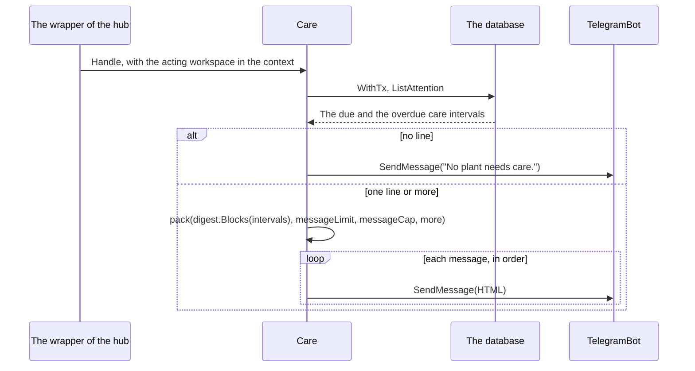

# Specification: The bot command of the care that is due

## 1. Summary

The plugin declares the bot command `care`. It reads the attention list of the acting
workspace and sends it in one or more messages, in the form of the reminder. The text of
the reminder moves from `job/` to a package `digest/` that both use. No table changes, and
no change reaches the hub or `pluginapi`.

## 2. Guideline compliance

| Rule                 | Guideline      | How this specification obeys it |
| -------------------- | -------------- | ------------------------------- |
| `TG-003`, `TG-004`   | Telegram       | `Care` implements `pluginapi.TelegramCommand`, with the default scope. |
| `TG-007`             | Telegram       | `Care` sends through `pluginapi.TelegramBot`, never through the telego client. |
| `SEC-013`            | Security       | The command names `plants.read`, the permission of the widget and of `GET /care-intervals`. |
| `OWN-003`, `OWN-008` | Ownership      | The wrapper of the hub gives the acting workspace. `ListAttention` does not filter on it. |
| `PKG-001`            | Package layout | `digest/` and `telegram/command/` are new directories. `PKG-001` gains the row `digest/`. |
| `PKG-002`            | Package layout | `main.go` only binds the bot and answers the command. |

## 3. Design

### 3.1 Components

Every path is under `plugins/jasmine/`, except the guideline.

| Path                                           | Action | Holds |
| ---------------------------------------------- | ------ | ----- |
| `digest/digest.go`, `digest/doc.go`            | create | `Title = "🌿 Plant care due"`, `Block{Heading string; Lines []string}`, `Blocks(intervals []model.CareInterval) []Block`, `Body(blocks []Block) string`. The line, the marks, and `days` of `job/digest.go`. |
| `digest/digest_test.go`                        | create | `GARDEN-SC-035`, moved from `job/`. |
| `job/digest.go`, `job/digest_internal_test.go` | delete | `digest/` holds them. |
| `job/care_reminder.go`                         | change | `pluginapi.Message{Title: digest.Title, Body: digest.Body(digest.Blocks(intervals))}`. |
| `telegram/command/care.go`, `telegram/command/doc.go` | create | `Care`, `NewCare(db *pluginapi.PluginDB, bot pluginapi.TelegramBot, pages pluginapi.PageLinker, pluginID *pluginapi.PluginID) *Care`, `Care.Reply(ctx context.Context, message *telego.Message) error`, which `Handle` calls, `messageLimit = 4096`, `messageCap = 3`, and `pack(blocks []digest.Block, limit, maxMessages int, more func(left int) string) []string`. |
| `telegram/command/care_test.go`                | create | `GARDEN-SC-036`, `GARDEN-SC-038`. |
| `main_test.go`                                 | change | `GARDEN-SC-037`. |
| `telegram/command/care_internal_test.go`       | create | `GARDEN-SC-039`, `GARDEN-SC-042`. |
| `telegram/command/measure_test.go`             | create | `GARDEN-SC-040`. |
| `main.go`                                      | change | Bind `Host.TelegramBot()` and `Host.Pages()`. Add `pluginapi.TelegramCommandPlugin`, which answers `command.NewCare(p.db, p.telegramBot, p.pages, p.Meta().ID)`. |
| `specs/guidelines/package-layout.md`           | change | The row `digest/`: "The text of a list that two surfaces send." |

### 3.2 Declarations

**Telegram command.**

| Command | Scope   | Permission    | Validates    | Handles      | Realizes |
| ------- | ------- | ------------- | ------------ | ------------ | -------- |
| `care`, sent as `/dev_maroid_jasmine_care`. Description "Plants that need care". | default | `plants.read` | Every update. | Section 3.3. | `GARDEN-FR-034` to `GARDEN-FR-038` |

The wrapper of the hub checks the acting workspace, the enablement, and the permission
before `Handle`. A role below viewer gets the refusal of `authz.Refusal`.

### 3.3 Flow

`Care` reads `ListAttention`, so the command, the reminder, and the widget show one order.
`digest.Blocks` gives one block for each environment: the heading `📍 <b>E001 Office</b>`
and the lines of `spec.md` section 4.4. `digest.Body` joins the lines of a block with `\n`
and the blocks with `\n\n`, so the reminder keeps its text.

`pack` starts the first message with `<b>🌿 Plant care due</b>` and a blank line, then adds
the blocks in the form of `digest.Body`. It counts the HTML text in UTF-16 code units, with
`utf16.RuneLen`. When the next heading or line takes the message past `limit`, it ends the
message first. A message that starts inside a block starts with the heading of that block.
A line of the longest escaped names takes less than 700 units, so every line fits.

`pack` makes at most `maxMessages` messages. In the last of them, a line that is not the
last line of the list must leave room for `\n\n` and `more(total)`, where `total` is the
count of every line. When a line does not fit there, `pack` ends the message with `\n\n`
and `more(left)`, where `left` is the count of the lines it did not place, and stops.
`more` answers `And 2300 more lines. <a href="...">Open Needs attention</a>.` with the
address of `PageURL(ctx, pluginID, "/attention")`, escaped. When `PageURL` fails, it
answers `And 2300 more lines. Open Needs attention in Maroid.`, as
`plugins/parking/telegram/command/notice.go` does.

Each message goes to the chat and the thread of the command, with `ModeHTML`, as
`plugins/parking/telegram/command/helpers.go` builds it. A failed read returns
`fmt.Errorf("reading the care list: %w", err)` and sends nothing. A failed send returns
`fmt.Errorf("sending the care list: %w", err)` and sends no later message. The engine of
the hub logs both.

## 4. Design decisions

### `GARDEN-DD-012`

**Realizes:** `GARDEN-FR-035`
**Decision:** `job/digest.go` moves to the package `digest/`. The reminder and the command render each line through it.
**Rationale:** One function gives the line of `GARDEN-FR-023`, so the bot and the reminder cannot drift. The command needs the blocks, not one body, to divide the text.
**Alternatives:** The text in `model/`. The model then holds HTML. An exported `job.Digest`. A bot command then depends on the package of a cron job.

### `GARDEN-DD-013`

**Realizes:** `GARDEN-FR-037`
**Decision:** `pack` fills a message up to 4096 UTF-16 code units of the HTML text, and divides only between two lines. A message that starts inside a block repeats its heading.
**Rationale:** Telegram refuses a text above 4096 characters after the parse of the entities. The HTML text is never shorter than the parsed text, so the bound holds. The repeated heading keeps each line under its environment.
**Alternatives:** One message for each environment. An environment of 100 lines still exceeds the limit, and 10 environments send 10 messages. A cut with a link to the page. The owner selected the division.

### `GARDEN-DD-014`

**Realizes:** `GARDEN-FR-038`, `GARDEN-NFR-003`
**Decision:** `messageCap = 3`. The last message reserves room for the count and the link, unless its line is the last one of the list.
**Rationale:** 3 messages hold about 150 lines of the attention list. With 3 sends the answer of `GARDEN-SC-040` takes about 0.4 seconds. 49 sends took 5 seconds.
**Alternatives:** The bound on the first message only. It leaves the flood. A cap of 1 message. A garden of 60 due lines then loses the end of the list.

## 5. Scenarios

`spec-scenarios.md` holds `GARDEN-SC-036` to `GARDEN-SC-042`.

## Retired identifiers

This file has no retired identifier.
