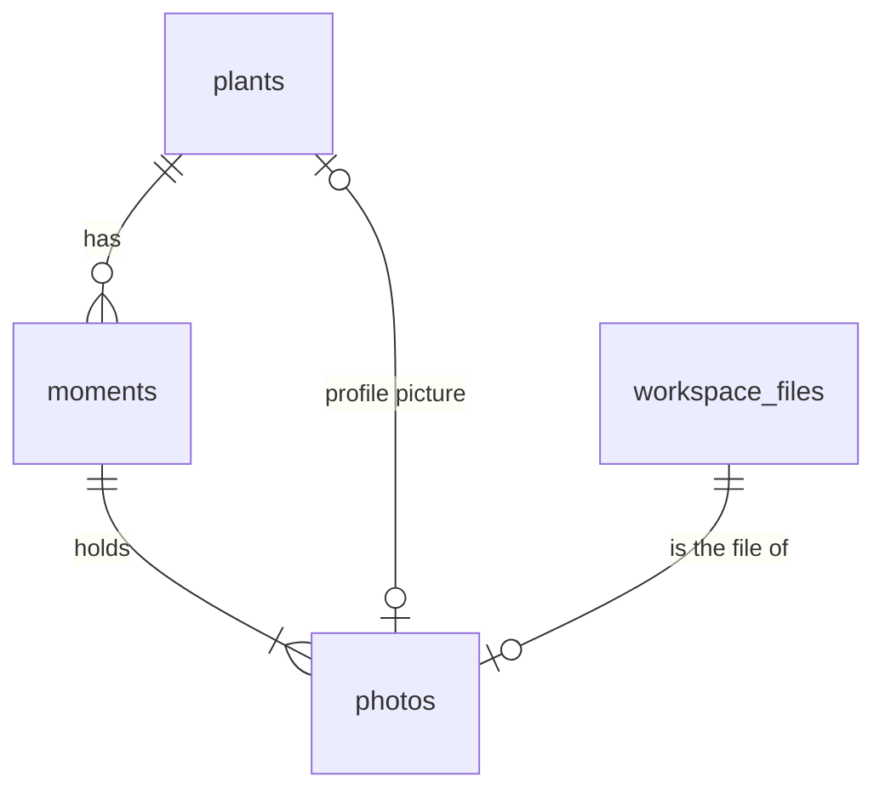
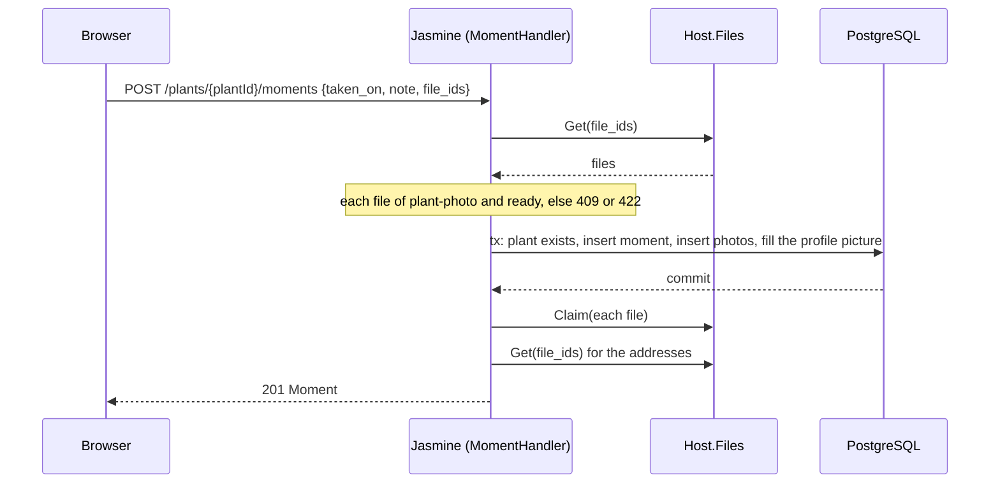

# Specification: The photos of a plant

`spec-photos-scenarios.md` holds the scenarios. `api.yaml` holds the bodies and the
status codes. `ADR-0023` gives the `PluginFiles.Delete` that this file depends on.

## 1. Summary

Jasmine declares the workspace file kind `plant-photo` and adds two scoped tables:
`moments` and `photos`. A photo references its file in `public.workspace_files`. A plant
gains `profile_photo_id`, a foreign key on a photo of the same plant that the database
sets to null when the photo goes. Seven routes under `/plants/{plantId}` add, change,
and delete the moments, their photos, and the profile picture. Every answer that holds a
photo carries the read addresses that `Host.Files().Get` signs. A delete removes the
rows, then deletes each file through `Host.Files` in the same transaction, and the
`files` worker of the hub purges the bytes after the commit. The plant page shows the gallery and the full view, and both plant pages show
the profile picture.

## 2. Coverage

| Requirement      | Where this file realizes it                                        |
| ---------------- | ------------------------------------------------------------------ |
| `GARDEN-FR-045`  | 4.3, 4.5, `GARDEN-DD-022`, `GARDEN-SC-050` to `GARDEN-SC-052`      |
| `GARDEN-FR-046`  | 4.6, `GARDEN-DD-022`, `GARDEN-SC-071`                              |
| `GARDEN-FR-047`  | 4.3, `GARDEN-DD-023`, `GARDEN-SC-054`                              |
| `GARDEN-FR-048`  | 4.4, 4.5, `GARDEN-DD-019`, `GARDEN-SC-053`, `GARDEN-SC-071`        |
| `GARDEN-FR-049`  | 4.3, `GARDEN-SC-056`                                               |
| `GARDEN-FR-050`  | 4.3, `GARDEN-DD-018`, `GARDEN-SC-057`                              |
| `GARDEN-FR-051`  | 4.4, `GARDEN-SC-058`                                               |
| `GARDEN-FR-052`  | 4.4, `GARDEN-SC-059`                                               |
| `GARDEN-FR-053`  | 4.4, `GARDEN-DD-019`, `ADR-0023`, `GARDEN-SC-059`, `GARDEN-SC-060` |
| `GARDEN-FR-054`  | 4.2, 4.4, `GARDEN-SC-060`                                          |
| `GARDEN-FR-055`  | 4.3, `GARDEN-SC-061`                                               |
| `GARDEN-FR-056`  | 4.3, 4.6, `GARDEN-DD-020`, `GARDEN-SC-062`, `GARDEN-SC-072`        |
| `GARDEN-FR-057`  | 4.6, `GARDEN-DD-020`, `GARDEN-SC-062`, `GARDEN-SC-072`             |
| `GARDEN-FR-058`  | 4.6, `GARDEN-SC-072`                                               |
| `GARDEN-FR-059`  | 4.6, `GARDEN-SC-073`                                               |
| `GARDEN-FR-060`  | 4.6, `GARDEN-SC-073`                                               |
| `GARDEN-FR-061`  | 4.3, 4.6, `GARDEN-SC-063`, `GARDEN-SC-074`                         |
| `GARDEN-FR-062`  | 4.3, `GARDEN-DD-018`, `GARDEN-SC-064`                              |
| `GARDEN-FR-063`  | 4.4, `GARDEN-SC-065`                                               |
| `GARDEN-FR-064`  | 4.2, `GARDEN-DD-017`, `GARDEN-SC-066`                              |
| `GARDEN-FR-065`  | 4.3, 4.6, `GARDEN-DD-021`, `GARDEN-SC-067`, `GARDEN-SC-075`        |
| `GARDEN-NFR-005` | `GARDEN-DD-021`, `GARDEN-SC-069`                                   |
| `GARDEN-NFR-006` | `GARDEN-DD-021`, `GARDEN-SC-070`                                   |
| `GARDEN-INV-004` | 4.4, `GARDEN-SC-058`                                               |
| `GARDEN-INV-005` | 4.2, `GARDEN-SC-055`                                               |
| `GARDEN-INV-006` | 4.2, `GARDEN-DD-017`, `GARDEN-SC-068`                              |
| `GARDEN-INV-007` | 4.2, `GARDEN-DD-017`, `GARDEN-SC-068`                              |

## 3. Guideline compliance

| Rule                            | Guideline    | How this file obeys it                                                                     |
| ------------------------------- | ------------ | ------------------------------------------------------------------------------------------ |
| `OWN-004`, `OWN-005`, `OWN-006` | Ownership    | `moments` and `photos` carry `workspace_id` and a forced policy. Section 4.2.              |
| `OWN-008`                       | Ownership    | No repository filters on `workspace_id` or sets it.                                        |
| `DAT-003`                       | Data         | `photos.file_id` references `public.workspace_files (id)` with `ON DELETE RESTRICT`.       |
| `DAT-003` after `ADR-0023`      | Data         | Jasmine claims a file after its commit and deletes it in the transaction of the delete.    |
| `DAT-009`                       | Data         | Both tables take `id UUID DEFAULT uuidv7()`. No insert names `id`.                         |
| `REP-002`, `REP-003`            | Repository   | `repository.Moment` and `repository.Photo`, each over `*sqlx.Tx`.                          |
| `SEC-013`                       | Security     | A read names `plants.read`. A write and the file kind name `plants.write`.                 |
| `RES-005`, `RES-006`            | REST         | The moments answer a page. The cursor seeks by `id`. `GARDEN-DD-020`.                      |
| `API-007`                       | HTTP API     | A moment answers `ETag`. Its `PUT` and `DELETE` read `If-Match`.                           |
| `ERR-002`                       | Errors       | `/problems/dev.maroid.jasmine/photo-not-ready`. Section 4.5.                               |
| `PLG-006`, `PLG-007`            | Plugin model | The plugin declares the kind through `pluginapi.FilePlugin` and reaches files by the host. |
| `UI-007`, `TS-002`              | Web UI       | The pages call `host.api` and `host.files`, and keep their runes.                          |

## 4. Design

### 4.1 Components

Every path is under `plugins/jasmine/`, except `api.yaml`. `ADR-0023` and the change of
`FILES` that follows it own the hub side of `PluginFiles.Delete`.

| Path                                                       | Action | Holds                                                                                                                                                                                                       |
| ---------------------------------------------------------- | ------ | ----------------------------------------------------------------------------------------------------------------------------------------------------------------------------------------------------------- |
| `db/migrations/20261118120000_tables_garden_photos.up.sql` | create | Section 4.2. The down migration drops the column of `plants`, then `photos`, then `moments`.                                                                                                                |
| `model/moment.go`                                          | create | `Moment{ID, PlantID, TakenOn time.Time, Note *string, Photos []Photo, CreatedAt, UpdatedAt}`. `Photo{ID, MomentID, FileID, CreatedAt}`. `const PhotoKind = "plant-photo"`.                                  |
| `model/plant.go`                                           | change | `ProfilePhotoID *string` (`db:"profile_photo_id"`), `ProfileFileID *string` (`db:"profile_file_id"`).                                                                                                       |
| `repository/moment.go`                                     | create | `Insert`, `GetByID(ctx, plantID, id)`, `List(ctx, plantID, seek)`, `Update(ctx, entity, ifMatch)`, `Delete(ctx, plantID, id, ifMatch)`. `GetByID` and `List` fill `Photos`.                                 |
| `repository/photo.go`                                      | create | `InsertMany(ctx, plantID, momentID, fileIDs) ([]model.Photo, error)`, `ListOfMoments(ctx, momentIDs)`, `Delete(ctx, plantID, momentID, id) (model.Photo, int, error)`, `FileIDsOfMoment`, `FileIDsOfPlant`. |
| `repository/plant.go`                                      | change | `selectPlants` gains `LEFT JOIN photos pp ON pp.id = p.profile_photo_id` and `pp.file_id AS profile_file_id`. `SetProfilePhoto(ctx, plantID, photoID)`, `FillProfilePhoto(ctx, plantID, photoID)`.          |
| `errs/errs.go`                                             | change | `ErrFileTaken` (SQLSTATE `23505` on `photos_file_id_key`), `ErrPhotoForeign` (SQLSTATE `23503` on `plants_profile_photo_fkey`).                                                                             |
| `dto/moment.go`                                            | create | `MomentRequest`, `MomentUpdateRequest`, `PhotosRequest`, `ProfilePhotoRequest`, `MomentResponse`, `PhotoResponse`, `ReadAddressResponse`. Section 4.3.                                                      |
| `dto/plant.go`                                             | change | `PlantResponse.ProfilePhoto *ProfilePhotoResponse` (`json:"profile_photo,omitempty"`). `NewPlantResponse` and `NewPlantResponseList` take `map[string]pluginapi.File`.                                      |
| `handler/moment.go`                                        | create | `MomentHandler` with the six moment and photo routes of section 4.3.                                                                                                                                        |
| `handler/photo_file.go`                                    | create | `checkPhotoFiles(ctx, files, ids)`, `readFiles(ctx, files, ids)` in groups of `pluginapi.MaxFilesPerGet`, `claimAfterCommit(ctx, files, logger, ids)`.                                                      |
| `handler/plant.go`                                         | change | `PlantHandler` takes `pluginapi.PluginFiles`. `List`, `GetByID`, `Update` answer the profile picture. `Delete` deletes the files. `SetProfilePhoto` handles the new route.                                  |
| `handler/problem.go`                                       | change | `writePhotoNotReady(w, r, count int)`.                                                                                                                                                                      |
| `handler/photo_test.go`                                    | create | `GARDEN-SC-050` to `GARDEN-SC-053`, `GARDEN-SC-055` to `GARDEN-SC-068`.                                                                                                                                     |
| `handler/measure_test.go`                                  | change | `GARDEN-SC-069`, `GARDEN-SC-070`.                                                                                                                                                                           |
| `main.go`                                                  | change | `host.Files()`, `var _ pluginapi.FilePlugin = (*Plugin)(nil)`, `FileKinds()`, the routes of `MomentHandler`.                                                                                                |
| `main_test.go`                                             | change | `GARDEN-SC-054`.                                                                                                                                                                                            |
| `ui/src/api/types.ts`                                      | change | `Moment`, `Photo`, `ReadAddress`, `MomentInput`, `MomentUpdate`, `ProfilePhoto`. `Plant.profile_photo?`.                                                                                                    |
| `ui/src/api/moments.ts`                                    | create | `list`, `create`, `update`, `remove`, `addPhotos`, `removePhoto`.                                                                                                                                           |
| `ui/src/api/plants.ts`, `ui/src/api/index.ts`              | change | `setProfilePhoto`. `createJasmineApi` gains `moments`.                                                                                                                                                      |
| `ui/src/lib/photo.ts`                                      | create | `PHOTO_KIND`, `PHOTO_TYPES`, `PHOTO_MAX_SIZE`, equal to the kind of `GARDEN-DD-023`.                                                                                                                        |
| `ui/src/lib/galleryPreview.svelte.ts`                      | delete | The preview data.                                                                                                                                                                                           |
| `ui/src/pages/plants/*.svelte`                             | change | `PlantGallery`, `MomentDialog`, `PhotoViewer`, `PlantAvatar`, `PlantView`, `PlantList`. Section 4.6.                                                                                                        |
| `specs/features/garden/api.yaml`                           | change | The seven routes, `Plant.profile_photo`, and the new schemas.                                                                                                                                               |

### 4.2 Data model

| Table     | Schema               | Scope  | Migration                                    | Realizes                                                     |
| --------- | -------------------- | ------ | -------------------------------------------- | ------------------------------------------------------------ |
| `moments` | `dev_maroid_jasmine` | scoped | `20261118120000_tables_garden_photos.up.sql` | `GARDEN-FR-045`, `GARDEN-FR-049`, `GARDEN-INV-007`           |
| `photos`  | `dev_maroid_jasmine` | scoped | same                                         | `GARDEN-FR-045`, `GARDEN-FR-050`, `GARDEN-INV-005` to `-007` |
| `plants`  | `dev_maroid_jasmine` | scoped | same, a new column                           | `GARDEN-FR-062`, `GARDEN-FR-064`, `GARDEN-INV-006`           |

Both new tables carry the columns, the policy, and the trigger of `spec.md` section 4.2.

| Table     | Column             | Type   | Rule                          |
| --------- | ------------------ | ------ | ----------------------------- |
| `moments` | `plant_id`         | `UUID` | `NOT NULL`                    |
|           | `taken_on`         | `DATE` | `NOT NULL`                    |
|           | `note`             | `TEXT` | Null, or 1 to 1000 characters |
| `photos`  | `plant_id`         | `UUID` | `NOT NULL`                    |
|           | `moment_id`        | `UUID` | `NOT NULL`                    |
|           | `file_id`          | `UUID` | `NOT NULL`                    |
| `plants`  | `profile_photo_id` | `UUID` | Null                          |

| Constraint or index                                                                                                                                                           | Enforces                          |
| ----------------------------------------------------------------------------------------------------------------------------------------------------------------------------- | --------------------------------- |
| `moments FOREIGN KEY (workspace_id, plant_id) REFERENCES plants (workspace_id, id) ON DELETE CASCADE`                                                                         | `GARDEN-FR-054`, `GARDEN-INV-007` |
| `moments UNIQUE (workspace_id, plant_id, id)`, `photos UNIQUE (workspace_id, plant_id, id)`                                                                                   | The targets of the keys below.    |
| `photos FOREIGN KEY (workspace_id, plant_id, moment_id) REFERENCES moments (workspace_id, plant_id, id) ON DELETE CASCADE`                                                    | `GARDEN-FR-052`, `GARDEN-INV-007` |
| `photos FOREIGN KEY (file_id) REFERENCES public.workspace_files (id) ON DELETE RESTRICT`                                                                                      | `DAT-003`, `FILES-FR-022`         |
| `photos UNIQUE (file_id)` as `photos_file_id_key`                                                                                                                             | `GARDEN-INV-005`                  |
| `plants FOREIGN KEY (workspace_id, id, profile_photo_id) REFERENCES photos (workspace_id, plant_id, id) ON DELETE SET NULL (profile_photo_id)` as `plants_profile_photo_fkey` | `GARDEN-FR-064`, `GARDEN-INV-006` |
| `moments INDEX (workspace_id, plant_id, taken_on DESC, id DESC)`                                                                                                              | The gallery. `GARDEN-NFR-005`.    |
| `photos INDEX (workspace_id, moment_id, id)`                                                                                                                                  | The photos of a page of moments.  |

The migration creates `moments`, then `photos`, then adds the column and the key to
`plants`. A key with a null column is not checked, so a plant with no profile picture
passes. `GARDEN-INV-004` needs a count of rows, which no constraint holds, so section
4.4 keeps it in one transaction.

### 4.3 Declarations

**HTTP routes.** The prefix and the access of `spec.md` section 4.3 hold.

| Method   | Path                                               | Permission     | Answer                | Realizes                                                  |
| -------- | -------------------------------------------------- | -------------- | --------------------- | --------------------------------------------------------- |
| `GET`    | `/plants/{plantId}/moments`                        | `plants.read`  | 200, `MomentPage`     | `GARDEN-FR-056`, `GARDEN-FR-057`, `GARDEN-FR-061`         |
| `POST`   | `/plants/{plantId}/moments`                        | `plants.write` | 201, `Moment`         | `GARDEN-FR-045`, `GARDEN-FR-048`, `GARDEN-FR-055`, `-063` |
| `GET`    | `/plants/{plantId}/moments/{id}`                   | `plants.read`  | 200, `Moment`, `ETag` | `GARDEN-FR-061`                                           |
| `PUT`    | `/plants/{plantId}/moments/{id}`                   | `plants.write` | 200, `Moment`, `ETag` | `GARDEN-FR-049`                                           |
| `DELETE` | `/plants/{plantId}/moments/{id}`                   | `plants.write` | 204                   | `GARDEN-FR-052`, `GARDEN-FR-053`                          |
| `POST`   | `/plants/{plantId}/moments/{momentId}/photos`      | `plants.write` | 201, `Moment`         | `GARDEN-FR-050`                                           |
| `DELETE` | `/plants/{plantId}/moments/{momentId}/photos/{id}` | `plants.write` | 204                   | `GARDEN-FR-051`, `GARDEN-FR-053`, `GARDEN-FR-064`         |
| `PUT`    | `/plants/{plantId}/profile-photo`                  | `plants.write` | 200, `Plant`, `ETag`  | `GARDEN-FR-062`                                           |

`GET /plants`, `GET /plants/{id}`, and `PUT /plants/{id}` answer `profile_photo`.
`DELETE /plants/{id}` deletes the files of the plant. No route checks the status of the
plant, so an inactive plant takes every write (`GARDEN-FR-055`).

| Body                | Members                                                                                                            |
| ------------------- | ------------------------------------------------------------------------------------------------------------------ |
| `MomentInput`       | `taken_on` (date, `not_after_tomorrow`), `note` (1 to 1000), `file_ids` (1 to 100 distinct UUIDs, the order kept)  |
| `MomentUpdate`      | `taken_on`, `note`. An omitted `note` becomes null.                                                                |
| `PhotoInput`        | `file_ids`, with the rules of `MomentInput`                                                                        |
| `ProfilePhotoInput` | `photo_id` (UUID)                                                                                                  |
| `Moment`            | `id`, `plant_id`, `taken_on`, `note` when set, `photos`, `created_at`, `updated_at`                                |
| `Photo`             | `id`, `width`, `height`, and `thumbnail` and `display` as `ReadAddress` when the file is ready. The order of `id`. |
| `ProfilePhoto`      | `id`, and `thumbnail` as `ReadAddress` when the file is ready                                                      |
| `ReadAddress`       | `url`, `expires_at`                                                                                                |

**File kind.**

| Key           | Scope       | Media types                                                         | Max size                       | Permission     | Image | Realizes        |
| ------------- | ----------- | ------------------------------------------------------------------- | ------------------------------ | -------------- | ----- | --------------- |
| `plant-photo` | `workspace` | `image/jpeg`, `image/png`, `image/webp`, `image/heic`, `image/heif` | `pluginapi.MaxFileSize`, 25 MB | `plants.write` | yes   | `GARDEN-FR-047` |

### 4.4 Flow

A write reads every file with `Get` before its transaction, so the transaction holds
no call to the file store. `Claim` runs after the commit. A failed claim logs at `WARN`
and the answer stays 201, because the expiry of `FILES-DD-009` meets the key and claims
the file.

`POST .../moments` calls `Photo.InsertMany` in the order of `file_ids`, then
`Plant.FillProfilePhoto`, which runs
`UPDATE plants SET profile_photo_id = :photo WHERE id = :plant AND profile_photo_id IS NULL`
with the first photo (`GARDEN-FR-063`). `POST .../photos` never fills it.

A delete runs in one transaction:

| Route                     | Reads first             | Deletes                                                                      | Then                        |
| ------------------------- | ----------------------- | ---------------------------------------------------------------------------- | --------------------------- |
| `DELETE .../photos/{id}`  | nothing                 | the photo. When the moment holds no other, the moment too. `GARDEN-INV-004`. | `Files.Delete` of its file  |
| `DELETE .../moments/{id}` | `Photo.FileIDsOfMoment` | the moment, and the photos by the cascade                                    | `Files.Delete` of each file |
| `DELETE /plants/{id}`     | `Photo.FileIDsOfPlant`  | the plant, and its moments and photos by the cascade                         | `Files.Delete` of each file |

`Files.Delete` takes the transaction of the delete and runs after the rows go
(`ADR-0023`). A refused `If-Match` or any later failure rolls back the files with the
rows. The key of the profile picture
sets the column to null when its photo goes, in the same statement.

### 4.5 Errors

| Condition                                                            | Answer                                              | Detail                                             |
| -------------------------------------------------------------------- | --------------------------------------------------- | -------------------------------------------------- |
| The plant, the moment, or the photo is absent, or of another parent  | 404, `not-found`                                    | None                                               |
| `taken_on` is absent, not a date, or after tomorrow in UTC           | 422, `/problems/http/validation`, `taken_on`        | The text of `TagNotAfterTomorrow`                  |
| `note` holds 0 or more than 1000 characters                          | 422, `note`                                         | The text of the bound                              |
| `file_ids` is empty, holds more than 100, a duplicate, or a non UUID | 422, `file_ids`                                     | The text of the rule                               |
| `Get` omits a file, or answers a kind other than `plant-photo`       | 422, `file_ids`                                     | "The file is not a plant photo of this workspace." |
| `Get` answers a `failed` file                                        | 422, `file_ids`                                     | "The photo failed. Remove it and upload it again." |
| `Get` answers a `pending` or `processing` file                       | 409, `/problems/dev.maroid.jasmine/photo-not-ready` | "2 photos are not ready yet." with the count       |
| `ErrFileTaken`                                                       | 422, `file_ids`                                     | "The file is already a photo of a moment."         |
| `photo_id` names no photo, or `ErrPhotoForeign`                      | 422, `photo_id`                                     | "The photo is not a photo of this plant."          |
| `If-Match` names an older version                                    | 412                                                 | As `spec.md` section 4.5                           |
| `Get` or `Files.Delete` fails, `ErrFileReferenced` included          | 500, the transaction rolls back                     | None. The log holds the cause.                     |

### 4.6 The pages

`PlantGallery` takes the plant and `canWrite`, which `host.can('plants.write')` gives.
It reads every page of `moments.list` with `readAll` and `limit` 100. A failure shows
"Failed to load the photos." with a retry. The markup of the approved preview stays: the
timeline, the day with `ageOf`, the note, the grid of thumbnails, the menus, and
`ConfirmDialog`. The badge "Preview" goes. An `error` event of an image loads the
moments again once, because an address expires after `files.read_ttl`.

`MomentDialog` holds `FileUpload` of `@maroid/ui` with `client` `host.files`, `kind`
`PHOTO_KIND`, `accept` `PHOTO_TYPES`, and `maxSize` `PHOTO_MAX_SIZE`. `onuploaded` keeps
the identifier, and `onsettled` keeps the state. The day starts at `today()` with `max`
`today()`. "Add moment" stays disabled while a photo is uploading or processing, or while
no photo is ready. A save sends the ready files in the order of the upload. In the edit
mode, the dialog sends `PUT`, then `POST .../photos` when it holds a ready file.

`PhotoViewer` shows `display.url` and keeps its controls. "Set as profile picture" calls
`plants.setProfilePhoto` and replaces the plant of the page with the answer.

`PlantAvatar` takes `ProfilePhoto` and shows `thumbnail.url`, or the initial when the
plant holds no profile picture or no ready thumbnail. `PlantList` reads it from each
plant of the page. `PlantView` reads the plant again after an add or a delete in the
gallery, so its avatar and its `ETag` follow the profile picture.

## 5. Design decisions

### `GARDEN-DD-017`

**Realizes:** `GARDEN-FR-064`, `GARDEN-INV-005` to `GARDEN-INV-007`
**Decision:** `photos` repeats `plant_id`, and the composite keys tie a photo to a moment of its plant and a profile picture to a photo of its plant. `ON DELETE SET NULL (profile_photo_id)` clears the profile picture.
**Rationale:** The database refuses a profile picture of another plant and a photo of another workspace in every path, with no check in Go. PostgreSQL 15 and later take a column list on `SET NULL`, so the key keeps `workspace_id`.
**Alternatives:** A `profile` flag on `photos` with a partial unique index. A move of the flag then writes two rows. A check in the handler alone. A future path forgets it.

### `GARDEN-DD-018`

**Realizes:** `GARDEN-FR-050`, `GARDEN-FR-062`
**Decision:** The moments nest under the plant and embed their photos. `POST .../photos` takes many files in one transaction. The profile picture has its own `PUT /plants/{plantId}/profile-photo`.
**Rationale:** The owner chose these three on 2026-11-18. One `POST` adds every photo or none, as `POST /maintenance-entries` does. `PlantUpdate` stays as it is, and the plant form never sends the profile picture.
**Alternatives:** One `POST` for each photo. A failure leaves part of the photos. A member `profile_photo_id` of `PlantUpdate`. Every edit of a plant must then send it.

### `GARDEN-DD-019`

**Realizes:** `GARDEN-FR-048`, `GARDEN-FR-053`
**Decision:** A write checks its files with `Get` before its transaction and claims them after the commit. A delete removes its rows, then deletes their files with `PluginFiles.Delete` in the same transaction.
**Rationale:** A claim before the commit leaves a claimed file with no row when the commit fails. A claim after it that fails heals at the expiry, because the key holds the file. `ADR-0023` gives the delete: the file rows and their `purge` tasks commit with the rows of the plugin.
**Alternatives:** `Delete` after the commit. A failure between them leaves the file for ever. A `release` task that the worker runs. It needs a new task action. A trigger of the hub on `photos`. It hides the delete in a migration.

### `GARDEN-DD-020`

**Realizes:** `GARDEN-FR-056`, `GARDEN-FR-057`
**Decision:** `GET .../moments` sorts by `taken_on DESC, id DESC` and takes no `sort`. The keyset reads the day of the boundary moment from its row, as `entryKeyset` does. The page reads every page with `limit` 100.
**Rationale:** `id` is a UUID version 7, so `id DESC` puts the moment added last first within one day. A plant gets a few moments each year, so one request reads the gallery.
**Alternatives:** A route with no page. `RES-005` holds no deviation for it.

### `GARDEN-DD-021`

**Realizes:** `GARDEN-FR-065`, `GARDEN-NFR-005`, `GARDEN-NFR-006`
**Decision:** A handler reads the files of a page with one call of `Get` for each 100 identifiers, and the DTO builds each address from the map. The plant answers `profile_photo` with its thumbnail alone.
**Rationale:** `Get` signs with one HMAC for each address and makes no call to the file store (`FILES-DD-010`). A page of 100 plants needs one call. A page of 100 moments with 300 photos needs three, about 600 signatures.
**Alternatives:** A route of the plugin that answers the addresses apart. The page then waits for a second request before it draws.

### `GARDEN-DD-022`

**Realizes:** `GARDEN-FR-045`, `GARDEN-FR-046`
**Decision:** `taken_on` takes `TagNotAfterTomorrow`, as `acquired_on` does. The form sets `max` to the date of the browser.
**Rationale:** The hub knows the UTC date alone. A browser at UTC+4 reads the next date from 20:00 to 24:00 UTC, and the rule with no margin refuses its today. The form refuses the future of the person.
**Alternatives:** A time zone in the body. No other route of the plugin takes one.

### `GARDEN-DD-023`

**Realizes:** `GARDEN-FR-047`
**Decision:** One workspace kind `plant-photo`, the five image types, `pluginapi.MaxFileSize`, the permission `plants.write`, and `Image` set.
**Rationale:** A photo serves every member of the workspace, and an editor uploads it. `FILES` derives the thumbnail and the display image of these five types.
**Alternatives:** A user kind. A viewer then reads no photo of another member.

## 6. Scenarios

`spec-photos-scenarios.md` holds `GARDEN-SC-050` to `GARDEN-SC-075`. `SPC-001`.

## Retired identifiers

This file has no retired identifier.
