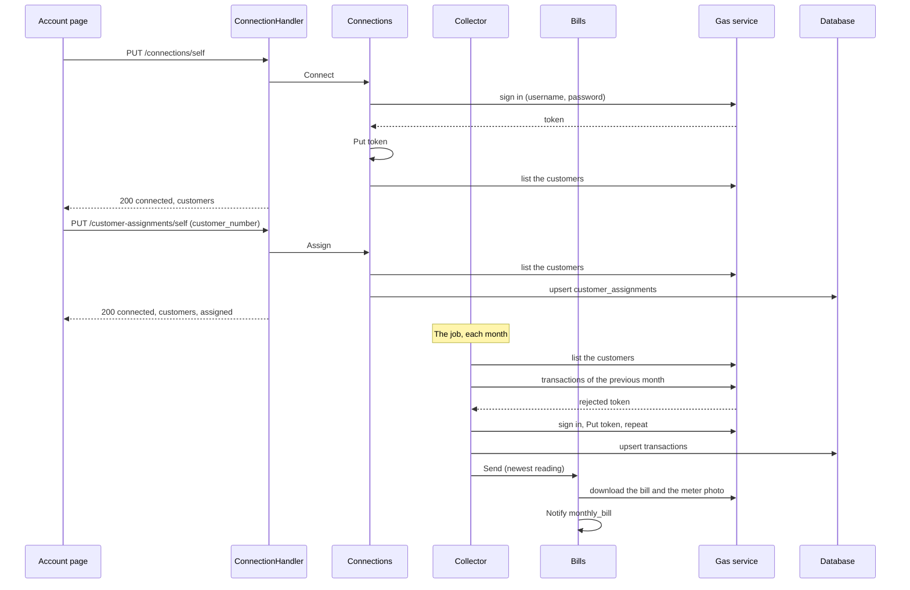

# Specification: The gas account of a workspace

## 1. Summary

The gas plugin `dev.maroid.tbilisi-energy` gains a connection page. A connect signs in
with the workspace settings and stores the token as the workspace plugin secret `token` of
`PSECRET`. The page lists the customers of the account, and an editor assigns one in the scoped
table `customer_assignments`, and the assignment collects nothing. The scheduled collection
reads the previous calendar month, keeps each transaction in the scoped table `transactions`,
and sends the bill of the newest reading stored for the first time. The command `backfill` collects an
earlier period for one workspace, and sends no bill.
The widget `last-reading` shows that reading. The page `/transactions` lists the transactions
with links to the files at the gas service, and draws a chart of 12 months. No change reaches
the hub, `pluginapi`, or another plugin. `spec-pages.md` holds the decisions of the pages. `spec-scenarios.md` holds the scenarios.

## 2. Coverage

| Requirement | Where this specification realizes it |
| ----------- | ------------------------------------ |
| `GASACC-FR-001`, `GASACC-FR-002`, `GASACC-FR-003` | Section 4.3, `GASACC-SC-001` |
| `GASACC-FR-004`, `GASACC-FR-005` | `api.yaml`, `GASACC-SC-002` |
| `GASACC-FR-006`, `GASACC-FR-007` | `api.yaml`, `GASACC-DD-001`, `GASACC-SC-003` |
| `GASACC-FR-008` | Section 4.5, `GASACC-SC-004` |
| `GASACC-FR-009`, `GASACC-FR-010` | Section 4.4, `GASACC-DD-002`, `GASACC-SC-005`, `GASACC-SC-006` |
| `GASACC-FR-011`, `GASACC-FR-012` | `api.yaml`, `GASACC-SC-007` |
| `GASACC-FR-013` | Section 4.5, `GASACC-SC-008` |
| `GASACC-FR-014`, `GASACC-FR-015` | `api.yaml`, `GASACC-SC-009`, `GASACC-SC-010` |
| `GASACC-FR-043` | Section 4.4, `GASACC-DD-007`, `GASACC-SC-034` |
| `GASACC-FR-017` | Section 4.3, `GASACC-DD-006`, `GASACC-SC-012` |
| `GASACC-FR-018` | Section 4.3, `GASACC-SC-013` |
| `GASACC-FR-019` | Section 4.4, `GASACC-SC-014`, `GASACC-SC-015` |
| `GASACC-FR-020` | `GASACC-DD-005`, `GASACC-SC-016` |
| `GASACC-FR-021` | Section 4.2, `GASACC-DD-008`, `GASACC-SC-017` |
| `GASACC-FR-022` | Section 4.2, `GASACC-SC-018` |
| `GASACC-FR-023` | Section 4.3, `GASACC-DD-009`, `GASACC-SC-019`, `GASACC-SC-020` |
| `GASACC-FR-024` | `GASACC-DD-007`, `GASACC-SC-019` |
| `GASACC-FR-025` | Section 4.5, `GASACC-SC-021` |
| `GASACC-FR-026` | Section 4.3, `GASACC-SC-022` |
| `GASACC-FR-027` | `GASACC-DD-007`, `GASACC-DD-010`, `GASACC-SC-023`, `GASACC-SC-024` |
| `GASACC-FR-028` | `GASACC-DD-010`, `GASACC-SC-023`, `GASACC-SC-022` |
| `GASACC-FR-029` to `GASACC-FR-033` | Section 4.3, `GASACC-DD-011`, `GASACC-SC-025`, `GASACC-SC-026` |
| `GASACC-FR-034`, `GASACC-FR-035` | `api.yaml`, `GASACC-DD-012`, `GASACC-DD-015`, `GASACC-SC-027` |
| `GASACC-FR-036` | `api.yaml`, `GASACC-DD-013`, `GASACC-SC-028` |
| `GASACC-FR-037` | `GASACC-DD-014`, `GASACC-SC-029` |
| `GASACC-FR-038`, `GASACC-FR-039` | Section 4.5, `GASACC-SC-030` |
| `GASACC-FR-040` | Section 4.3, `GASACC-SC-027` |
| `GASACC-FR-041`, `GASACC-FR-042` | Section 4.3, `GASACC-SC-031` |
| `GASACC-INV-001` | Section 4.2, `GASACC-SC-009` |
| `GASACC-INV-002` | Section 4.2, `GASACC-SC-032` |
| `GASACC-INV-003`, `GASACC-INV-004` | `api.yaml`, `GASACC-DD-001`, `GASACC-SC-033` |

## 3. Guideline compliance

| Rule | Guideline | How this specification obeys it |
| ---- | --------- | ------------------------------- |
| `PLG-006`, `PLG-007` | Plugin model | The plugin adds the permission, route, UI, and widget capabilities through the existing interfaces, and reaches every resource through the host. |
| `PLG-008` | Plugin model | The plugin imports no other plugin. The chart lives in the plugin (`GASACC-DD-014`). |
| `ARC-008` | Architecture | No file of the hub changes. |
| `DAT-001`, `DAT-006`, `DAT-009` | Data | Both tables live in `dev_maroid_tbilisi_energy`. Each `id` is `uuidv7()`. |
| `OWN-004` to `OWN-008` | Ownership | Both tables carry `workspace_id` and forced row level security. No repository filters by workspace. `transaction_types` stays a shared table. |
| `OWN-003` | Ownership | `backfill` sets the acting workspace from `--workspace`, and no acting user. |
| `OWN-009` | Ownership | The collection keeps `CronScopePerWorkspace`. |
| `CFG-007` | Configuration | The credentials stay workspace settings. |
| `EXT-005`, `EXT-007` | External services | A status that is not a success, or `code` other than 0, is an error that wraps the status and at most 512 bytes of the body. |
| `LOG-003`, `LOG-007` | Logging | Each service and handler adds `component` and its name. A message names the event, and a value goes in an attribute. |
| `LOG-008` | Logging | No log line holds the password, the token, or a personal number. |
| `SEC-013` | Security | Each route and the widget name a permission. |
| `NTF-002` | Notifications | The bill keeps the topic `monthly_bill`. |
| `CLI-003` to `CLI-006` | Command line | `backfill` holds the collector and a logger with `component=command`. `PreRunE` checks the flags. `RunE` collects with `cmd.Context()` and returns an error. |
| `API-004` | HTTP API | The routes mount under `/workspaces/{workspaceId}/plugins/dev.maroid.tbilisi-energy/api`. |
| `ERR-002` | Errors | Each problem type has the form `/problems/dev.maroid.tbilisi-energy/<slug>`. |
| `RES-002`, `RES-005`, `RES-006` | REST | `/connections/self` and `/customer-assignments/self` keep the plural of `Z-134`, and the collections answer no `GET`, as `ADR-0015` permits. `PUT /connections/self` carries no body (`ADR-0018`). `GET /transactions` answers the `Page` of `libs/rest/page`. |
| `RES-001` (`Z-173`) | REST | An amount travels as the money object, with `amount` and `currency` (`GASACC-DD-015`). |
| `GO-005` | Go style | Every sentinel error lives in `errs/`. |
| `UI-005` to `UI-009` | Web UI | The remote exports `/transactions` and `/account`, and reaches the API through `host.api`. |
| `PKG-001` | Package layout | The plugin gains `cli/`, `handler/`, `permission/`, `widget/`, and `ui/`. `service/` holds the domain services and the store (`ADR-0017`). |
| `BLD-003` | Build | The build plan builds the UI before the `.so`. |

## 4. Design

### 4.1 Components

Every path is under `plugins/tbilisi-energy/`.

| Path | Action | Holds |
| ---- | ------ | ----- |
| `db/migrations/<ts>_table_customer_assignments_create.{up,down}.sql` | create | Section 4.2 |
| `db/migrations/<ts>_transactions_key_by_customer_and_operation.{up,down}.sql` | create | Section 4.2, `GASACC-DD-008` |
| `errs/errs.go` | change | `ErrRequestFailed` stays. `ErrNotConnected`, `ErrCredentialsAbsent`, `ErrCredentialsRejected`, `ErrSignInBlocked`, `ErrNotAssigned`, `ErrCustomerUnknown`, `ErrCustomerAbsent`, `ErrReversedPeriod` |
| `model/connection.go` | create | `ConnectionState`, `Connection`, `Customer` with `Number`, `Name`, `Address`, `Assigned` |
| `model/transaction.go` | change | `Transaction` (section 4.2), `OperationReading`, `IsReading()`, `Tbilisi()`, `Period`, `Period.Months()`, `PreviousMonth(now time.Time) Period`, `Collection` |
| `dto/api-client.go` | change | `HomeResponse`, `Customer` with `custNumber`, `controlNumber`, `customerName`, `address`, and no other member (`GASACC-INV-004`). `Transaction.MapToModel(customerNumber string)`. `Hash` goes |
| `dto/connection.go`, `dto/transaction.go` | create | `ConnectionResponse`, `CustomerResponse`, `AssignmentRequest`, `TransactionResponse`, `MoneyResponse`, `NewTransactionResponseList(transactions, fileBase)` |
| `config/config.go` | change | `Config.RequestTimeout`. `base_url` is a URL with no trailing slash. `WorkspaceSettings.CustomerNumber` goes |
| `service/api-client.go` | change | `GetCustomers(ctx, token) ([]dto.Customer, error)`. A rejected token is `errs.ErrNotConnected` (`GASACC-DD-004`). A sign in with `recaptchaRequested` is `errs.ErrSignInBlocked`, one with a `code` other than 0 is `errs.ErrCredentialsRejected`. Every call ends after `request_timeout`, and a body passes no 10 MiB |
| `service/account.go` | create | `account`, which `Connections`, `Collector`, and `Bills` share: `credentials` reads the settings, `token` reads the secret, `signIn` signs in and writes the secret, `forgetToken` deletes it, and `call` repeats a call once after a new sign in when the gas service rejects the token |
| `service/connection.go` | create | `Connections`, `NewConnections`. It collects nothing |
| `service/collector.go` | create | `Collector`, `NewCollector` |
| `service/bill.go` | create | `Bills`, `NewBills`. The message and the attachments of the bill, moved from the job |
| `service/store.go` | create | `Store` over `PluginDB`, one transaction for each call |
| `repository/assignment.go` | create | `CustomerAssignment`: `Get`, `Put`, `Delete` |
| `repository/transaction.go` | change | `Insert(ctx, *model.Transaction) (bool, error)`, `LatestReading(ctx, customerNumber)`, `List(ctx, seek, customerNumber, from)` |
| `job/transactions_collector.go` | change | `Run` calls `Collect` with `PreviousMonth`, then `Bills.Send` |
| `cli/{doc,backfill}.go` | create | `Backfill`, `NewBackfill`, `Command() *cobra.Command` |
| `handler/{doc,connection,transaction,problem}.go` | create | `ConnectionHandler`, `TransactionHandler`, the problem types of section 4.5 |
| `permission/permission.go` | create | `AccountRead`, `AccountConnect` |
| `widget/{doc,last_reading}.go` | create | `NewLastReading` |
| `embed.go` | create | `uiAssets`, the embedded `ui/dist` |
| `main.go` | change | `Commands`, `Permissions`, `Routes`, `Widgets`, `UIManifest`, `host.Secrets`. `Version` is `0.2.0` |
| `ui/` | create | `package.json` with `d3-scale` `4.0.2`, `d3-shape` `3.2.0`, and their types as development dependencies, `index.html`, `vite.config.ts`, `svelte.config.js`, `tsconfig.json`, `src/entry.ts`, `src/app.css`, `src/api/{index,connection,transaction,types}.ts`, `src/lib/chart.ts`, `src/pages/account/Account.svelte`, `src/pages/transactions/{Transactions,UsageChart}.svelte` |

`Collector`:

```go
// Collect reads the transactions of the assigned customer of the acting workspace in
// the period, and stores each one. It sends no bill. It answers errs.ErrNotAssigned
// with no assigned customer and errs.ErrNotConnected with no connection.
Collect(ctx context.Context, period model.Period) (model.Collection, error)
```

The caller gives the period, and decides on the bill, which `Bills.Send(ctx context.Context, reading model.Transaction) error` sends:

| Caller | Period | Bill |
| ------ | ------ | ---- |
| The job | `PreviousMonth(now)` | `Bills.Send` with `NewestReading` when it is not nil |
| `backfill` | Each calendar month of `--from` to `--to` | None |

`model.Collection` holds `Count`, the count of the transactions that the gas service answered, and `NewestReading`, the latest reading that the call stored for the first time, or nil.
`handler.ConnectionService`, which the handler declares as its consumer:

```go
Status(ctx context.Context) (*model.Connection, error)
Connect(ctx context.Context) (*model.Connection, error)
Disconnect(ctx context.Context) error
Assign(ctx context.Context, customerNumber string) (*model.Connection, error)
```

`Store` gives `AssignedCustomer`, `Assign`, `Unassign`, `InsertTransactions`, `LatestReading`, and `TransactionsPage`, each in one `PluginDB.WithTx`, where it creates each repository. Each service, handler, and widget depends on an interface that it declares, and `Store` meets it.

### 4.2 Data model

The token lives in the workspace plugin secret `token`, with no expiry.

| Table | Schema | Scope | Migration | Realizes |
| ----- | ------ | ----- | --------- | -------- |
| `customer_assignments` | `dev_maroid_tbilisi_energy` | Workspace | `<ts>_table_customer_assignments_create` | `GASACC-FR-014`, `GASACC-INV-001` |
| `transactions` | `dev_maroid_tbilisi_energy` | Workspace | `<ts>_transactions_key_by_customer_and_operation` | `GASACC-FR-021`, `GASACC-FR-022` |
| `transaction_types` | `dev_maroid_tbilisi_energy` | Shared | none | The name of each operation |

`customer_assignments`:

| Column | Type | Null | Default | Note |
| ------ | ---- | ---- | ------- | ---- |
| `id` | `UUID` | no | `uuidv7()` | Primary key |
| `workspace_id` | `UUID` | no | the acting workspace (`OWN-005`) | `UNIQUE`, so one row for each workspace |
| `customer_number` | `TEXT` | no | | 1 to 64 characters (`GASACC-DD-001`) |
| `assigned_at` | `TIMESTAMPTZ` | no | `now()` | |

`Put` runs `INSERT ... ON CONFLICT (workspace_id) DO UPDATE`.

`transactions`, created again:

| Column | Type | Null | Default | Note |
| ------ | ---- | ---- | ------- | ---- |
| `id` | `UUID` | no | `uuidv7()` | Primary key |
| `workspace_id` | `UUID` | no | the acting workspace (`OWN-005`) | |
| `customer_number` | `TEXT` | no | | `<custNumber>-<controlNumber>` (`GASACC-DD-001`). It stays after a new assignment |
| `transaction_type_id` | `INTEGER` | no | | `operId`, references `transaction_types (id)` |
| `transaction_date` | `DATE` | no | | `operDate`, a date of Tbilisi |
| `consumption` | `NUMERIC` | no | | `consumption`, in cubic metres |
| `meter_value` | `NUMERIC` | no | | `meterReading`, 0 for a payment |
| `amount` | `NUMERIC` | no | | `amount`, in lari |
| `balance` | `NUMERIC` | no | | `balance`, in lari |
| `bill_path` | `TEXT` | yes | | `billDocPath`. An empty path is null |
| `meter_photo_path` | `TEXT` | yes | | `meterPhotoPath`. An empty path is null |
| `collected_at` | `TIMESTAMPTZ` | no | `now()` | |

The constraint `transactions_workspace_customer_operation_date_key` is `UNIQUE (workspace_id,
customer_number, transaction_type_id, transaction_date)`. Its index serves every read through
its two leading columns. Both scoped tables take the policy of `OWN-006`. No foreign key joins
them, because a transaction outlives its assignment.

### 4.3 Declarations

**HTTP routes.** The prefix is `/workspaces/{workspaceId}/plugins/dev.maroid.tbilisi-energy/api`.
`api.yaml` holds the bodies and the status codes.

| Method | Path | Access | Permission | Realizes |
| ------ | ---- | ------ | ---------- | -------- |
| `GET` | `/connections/self` | Authenticated | `account.read` | `GASACC-FR-004` to `GASACC-FR-008`, `GASACC-FR-013` |
| `PUT` | `/connections/self` | Authenticated | `account.connect` | `GASACC-FR-009`, `GASACC-FR-010` |
| `DELETE` | `/connections/self` | Authenticated | `account.connect` | `GASACC-FR-011`, `GASACC-FR-012` |
| `PUT` | `/customer-assignments/self` | Authenticated | `account.connect` | `GASACC-FR-014`, `GASACC-FR-015`, `GASACC-FR-043` |
| `GET` | `/transactions` | Authenticated | `account.read` | `GASACC-FR-034` to `GASACC-FR-040` |

`GET /transactions` takes `limit` (1 to 100, default 20), `cursor`, and the filter `from`, a
date `YYYY-MM-DD`. The order is `transaction_date DESC, id DESC`, fixed.

**Permissions.**

| Name | Description | Lowest | Realizes |
| ---- | ----------- | ------ | -------- |
| `account.read` | Read the gas account and the transactions of the workspace | `viewer` | `GASACC-FR-041` |
| `account.connect` | Connect the gas account and assign its customer | `editor` | `GASACC-FR-042` |

**Settings.** `WorkspaceSettings` keeps two fields, with `x-maroid-scope=workspace`. A stored
`customer_number` stays in the settings of a workspace, and the decoder ignores it.

| Field | Kind | Title | Realizes |
| ----- | ---- | ----- | -------- |
| `username` | free text | Username | `GASACC-FR-001` |
| `password` | secret | Password | `GASACC-FR-001`, `GASACC-FR-002` |

**Configuration.**

| Key | Type | Default | Secret | Realizes |
| --- | ---- | ------- | ------ | -------- |
| `base_url` | string | `https://my.te.ge` | no | `GASACC-FR-010`, `GASACC-DD-013` |
| `request_timeout` | duration | `15s` | no | `GASACC-FR-008`, `GASACC-FR-019` |
| `cron_schedule.transactions_collector` | cron | `0 10 1 * *` | no | `GASACC-FR-017` |

**Cron job.** The identifier and the schedule stay.

| Identifier | Schedule | Runs in | Behavior | Realizes |
| ---------- | -------- | ------- | -------- | -------- |
| `transactions_collector` | `cron_schedule.transactions_collector` | Each workspace that enabled the plugin | `Collect` with `PreviousMonth`, then `Bills.Send` with `NewestReading`. `ErrNotConnected` and `ErrNotAssigned` log a skip at info and answer nil | `GASACC-FR-017` to `GASACC-FR-020`, `GASACC-FR-026` to `GASACC-FR-028` |

**Notification topic.**

| Identifier | Name | Description | Realizes |
| ---------- | ---- | ----------- | -------- |
| `monthly_bill` | Monthly bill | The gas bill of the last month, with its receipt. | `GASACC-FR-026` |

The topic stays as today, so the routes of each workspace stay. The message keeps the title `თბილისი ენერჯი | ქვითარი` and its body: the date, the meter value and the usage without a decimal, and the amount with two (`GASACC-FR-028`).

**CLI command.** The registrar mounts it under `maroid dev-maroid-tbilisi-energy`.

| Command | Flags | Behavior | Realizes |
| ------- | ----- | -------- | -------- |
| `backfill` | `--workspace` (UUID, required), `--from` and `--to` (`YYYY-MM-DD`, required) | `Collect` for each calendar month of the period in the acting workspace of `--workspace`, and print the count of each month. No bill | `GASACC-FR-023` to `GASACC-FR-025` |

**UI routes.**

| Page route | Navigation entry | Page | Realizes |
| ---------- | ---------------- | ---- | -------- |
| `/transactions` | "Transactions" | `Transactions.svelte` | `GASACC-FR-034` to `GASACC-FR-040` |
| `/account` | "Account" | `Account.svelte` | `GASACC-FR-004` to `GASACC-FR-015` |

`Account.svelte` shows "not connected", the settings to fill, or the list of the customers. The
list is a radio group of the number, the name, and the address, with one "Assign" button, and
marks the assigned customer. "Connect" and "Disconnect" start and end the connection, and
"Disconnect" asks through `ConfirmDialog`. The page hides each button of `account.connect` when
`host.can` denies it, and shows each problem of section 4.5 as an alert.

**Widget.**

| Key | Title | Kind | Size | Permission | Realizes |
| --- | ----- | ---- | ---- | ---------- | -------- |
| `last-reading` | Gas usage | `stat` | `s` | `account.read` | `GASACC-FR-029` to `GASACC-FR-033` |

The key obeys `WIDGET-FR-005`: lowercase letters, digits, and the hyphen. `Load` calls `Store.LatestReading` and no service. No assignment answers
`NotSetUpAnswer("Connect the gas account and assign a customer.", "/account")`. No reading
answers `EmptyAnswer("No reading yet.")`. `GASACC-DD-011` gives the data.

### 4.4 Flow



### 4.5 Errors

| Condition | Route answer | Collection |
| --------- | ------------ | ---------- |
| No `token` secret | `GET` connection: 200 `not_connected`. `PUT` assignment: 409 `not-connected` | Skip (`GASACC-FR-018`) |
| The gas service rejects the token | `GET` connection: 200 `not_connected`, and the token goes. `PUT` assignment: 409 `not-connected` | Sign in again, once |
| The settings are absent | `PUT` connection: 422 `credentials-absent` | Error `ErrCredentialsAbsent` |
| The sign in answers a `code` other than 0 | 422 `credentials-rejected` | Error `ErrCredentialsRejected` |
| The sign in answers `recaptchaRequested: true` | 422 `sign-in-blocked` | Error `ErrSignInBlocked` |
| The customer is not in the list of the account | 422 `customer-unknown` | Error `ErrCustomerAbsent`, nothing stored |
| `backfill` in a workspace with no connection or no assignment | Not reached | The command fails with `ErrNotConnected` or `ErrNotAssigned` (`GASACC-FR-025`) |
| `backfill` with `--from` after `--to`, a date that does not parse, or a `--workspace` that is not a UUID | Not reached | `PreRunE` fails, and no service is called |
| The body of the assignment passes 4 KiB | 413 `/problems/http/content-too-large` | Not reached |
| No assigned customer | `GET /transactions`: 409 `not-assigned` | Skip |
| `from` is not a date | 400 `/problems/http/request-invalid` | Not reached |
| The gas service answers 5xx, or fails to answer | 502 `service-unavailable`. The token stays | Error `ErrRequestFailed` |
| A file of the bill fails to download | Not reached | The bill goes without it (`GASACC-DD-010`) |

No detail names the password, the token, or a personal number.

## 5. Design decisions

### `GASACC-DD-001`

**Realizes:** `GASACC-FR-006`, `GASACC-INV-004`
**Decision:** The customer number of the plugin is `<custNumber>-<controlNumber>`, for example
`757235-992`. Each customer answers its number, `customerName`, `address`, and `assigned`.
`dto.Customer` decodes no other member of the answer.
**Rationale:** The request of the transactions takes this form, and the gas service prints it on
a bill. A member that Go does not decode cannot reach an answer or a log.
**Alternatives:** Two columns, the number and the control number. Every call then joins them.

### `GASACC-DD-002`

**Realizes:** `GASACC-FR-009`, `GASACC-FR-010`
**Decision:** `PUT /connections/self` signs in, writes `token`, lists the customers, and answers
200 with the connection.
**Rationale:** No code by phone exists, so no pending state exists. A repeat leaves the
workspace connected, which `Z-148` and `Z-149` give to `PUT`.
**Alternatives:** `POST /connections`. A repeat has no new effect, so `POST` overstates it.

### `GASACC-DD-003`

**Realizes:** `GASACC-FR-012`, `GASACC-FR-013`, `GASACC-FR-022`
**Decision:** `Disconnect` deletes `token` and the assignment. A rejected token deletes `token`
alone. Neither touches `transactions`.
**Rationale:** An editor who reconnects after an expired token keeps the assignment.
**Alternatives:** Delete the assignment on a rejected token too. The editor then assigns again.

### `GASACC-DD-004`

**Realizes:** `GASACC-FR-013`, `GASACC-FR-019`
**Decision:** The client sends the token in the header `token`, as today. Build step 9 learns
how the gas service answers a rejected token and the call to list the customers, and corrects
this decision and `APIClient`.
**Rationale:** No capture holds the answer to an expired token.
**Alternatives:** Ship on the assumption. A wrong assumption fails each collection in silence.

### `GASACC-DD-005`

**Realizes:** `GASACC-FR-015`, `GASACC-FR-020`
**Decision:** `Collect` lists the customers of the account before it reads the transactions, and
answers `ErrCustomerAbsent` when the list does not hold the assigned customer.
**Rationale:** The answer of the gas service to an unknown customer is not known. One more call
each month gives a defined failure.
**Alternatives:** Trust the answer of the transactions. An empty answer then hides the loss.

### `GASACC-DD-006`

**Realizes:** `GASACC-FR-017`
**Decision:** The dates are dates of Tbilisi, `time.FixedZone("Asia/Tbilisi", 4*60*60)`.
`model.PreviousMonth` answers the first and the last day of the month before the one of `now`.
The job passes it to `Collect`.
**Rationale:** Georgia keeps UTC+4 with no daylight time, so a fixed zone needs no zone data in
the image.
**Alternatives:** The zone of the process. The hub runs in UTC, so a run at 00:30 of the first
day reads the wrong month.

### `GASACC-DD-007`

**Realizes:** `GASACC-FR-043`, `GASACC-FR-024`, `GASACC-FR-027`
**Decision:** `Collect` sends no bill. It answers `Collection.NewestReading`, and the job passes
it to `Bills.Send`. `backfill` sends none. `Connections` holds no collector: `Assign` checks the
customer against the account, stores the assignment, and answers. A transaction is a reading
when its operation is `operId` 125, "რეალური ჩვენება" (`Transaction.IsReading`). The chart, the
widget, and the bill take readings alone.
**Rationale:** One `Collect` serves every caller, and the caller decides the period and the bill.
A collection inside the assignment held the request for the calls of the gas service, and the
owner fills the history with `backfill` after the assignment. The gas service also
records a control reading, "საკონტროლო ჩვენება": a meter value and a photo, with no usage, no
charge, and no bill. A rule on the meter value counts it as a reading, so the chart draws a zero
and the widget or the bill can show it. The owner chose the operation over a rule on the bill or
on the charge.
**Alternatives:** A second method that collects the previous month and sends the bill. It fixes
the period inside the collector. A flag on `Collect`. The flag names the caller.

### `GASACC-DD-008`

**Realizes:** `GASACC-FR-021`
**Decision:** The migration drops `transactions` and creates it as section 4.2 gives. The insert
runs `ON CONFLICT ON CONSTRAINT transactions_workspace_customer_operation_date_key DO UPDATE`
on every value column, `WHERE (...) IS DISTINCT FROM (EXCLUDED...)`, and `RETURNING (xmax = 0)`.
`Insert` answers true for a row stored for the first time.
**Rationale:** The owner confirmed that one operation of one customer happens once a date. A
row of the old table names no customer, and `backfill` collects the history again.
**Alternatives:** A migration that keeps the rows. No column tells their customer.

### `GASACC-DD-009`

**Realizes:** `GASACC-FR-023`, `GASACC-FR-025`
**Decision:** `backfill` sets the acting workspace with `pluginapi.ContextWithActingWorkspace`,
and sets no acting user (`OWN-003`). It calls `Collect` once for each calendar month of the
period, the first and the last month cut to `--from` and `--to`, and stops at the first failure.
**Rationale:** A month is the range that the job asks for, so no limit of the gas service on a
range reaches the command. A failure names its month, and a repeat stores nothing twice.
**Alternatives:** One request for the whole period. The gas service may cap the range, and no
capture shows the cap. A run for every workspace. The plugin cannot list the workspaces that enable it.

### `GASACC-DD-010`

**Realizes:** `GASACC-FR-027`, `GASACC-FR-028`
**Decision:** `Bills.Send` downloads the bill and the meter photo with the token. A failed
download logs a warning, and the message goes without that file. A failed `Notify` fails the run.
**Rationale:** The reading is stored, so a later run never sends the bill again. The figures of
the message matter more than the files.
**Alternatives:** Fail the run on a failed download. The bill of that month is then lost.

`spec-pages.md` holds `GASACC-DD-011` to `GASACC-DD-015`: the widget, the transactions page, the
chart, and the money object.

## 6. Scenarios

`spec-scenarios.md` holds `GASACC-SC-001` to `GASACC-SC-034`, with `GASACC-SC-011` retired.

## 7. Build plan

| # | Step | Realizes | Done |
| - | ---- | -------- | ---- |
| 1 | `errs/`, `model/`, `permission/`, `config/`, and the API client: `GetCustomers`, the rejected token, the blocked sign in, the timeout | `GASACC-FR-003`, `GASACC-FR-010`, `GASACC-FR-019` | [x] |
| 2 | Both migrations and `repository/` | `GASACC-FR-014`, `GASACC-FR-021`, `GASACC-FR-022` | [x] |
| 3 | `service/store.go`, `service/account.go`, `service/collector.go` | `GASACC-FR-017` to `GASACC-FR-021` | [x] |
| 4 | `service/bill.go`, the job, and `cli/backfill.go` | `GASACC-FR-017`, `GASACC-FR-023` to `GASACC-FR-028` | [x] |
| 5 | `service/connection.go`, `handler/connection.go`, `dto/connection.go` | `GASACC-FR-004` to `GASACC-FR-015`, `GASACC-FR-043` | [x] |
| 6 | `handler/transaction.go`, `dto/transaction.go`, and `api.yaml` | `GASACC-FR-034` to `GASACC-FR-036`, `GASACC-FR-038` to `GASACC-FR-040` | [x] |
| 7 | `widget/last_reading.go` and `main.go` | `GASACC-FR-029` to `GASACC-FR-033`, `GASACC-FR-041`, `GASACC-FR-042` | [x] |
| 8 | `ui/`, `embed.go`, and `UIManifest`. Build the UI, then the `.so` (`BLD-003`) | `GASACC-FR-004` to `GASACC-FR-015`, `GASACC-FR-034` to `GASACC-FR-039` | [x] |
| 9 | Run the flow against the gas service: an expired token, a link to a bill with no session, `backfill` of 12 months. Correct `GASACC-DD-013` and `GASACC-DD-004` | `GASACC-FR-019`, `GASACC-FR-023`, `GASACC-FR-036` | [x] |
| 10 | The tests of `spec-scenarios.md`. Lint and build the plugin | Every statement | [x] |

## Retired identifiers

This file has no retired identifier.
