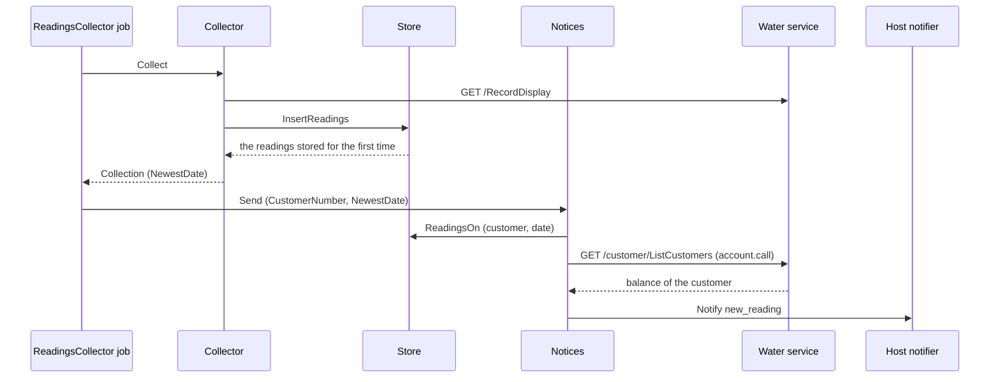

# Specification: The notification of a new water reading

## 1. Summary

The plugin declares the notification topic `new_reading`. The store answers the readings that a
collection stored for the first time. The scheduled collection passes the latest date among them
to `Notices.Send`, which reads the readings of that date with their usage, reads the balance of
the assigned customer from the list of the customers, and sends one message. The collection
after an assignment sends nothing. No table changes, and no change reaches the hub or `pluginapi`.

## 2. Guideline compliance

| Rule      | Guideline         | How this specification obeys it                                                       |
| --------- | ----------------- | ------------------------------------------------------------------------------------- |
| `NTF-001` | Notifications     | `NotificationTopics` declares `new_reading` with a name and a description.            |
| `NTF-002` | Notifications     | `Notices` calls `PluginNotifier.Notify` with the topic, and names no destination.     |
| `NTF-003` | Notifications     | The message holds a title and a body, and no attachment.                              |
| `OWN-005` | Ownership         | `OnDate` writes no filter on `workspace_id`. The policy scopes the read.              |
| `EXT-005` | External services | A failed read of the balance is a warning and a marked line, never a balance of zero. |
| `LOG-008` | Logging           | The warning names no token and no credential.                                         |
| `JOB-007` | Jobs              | A failed notification fails the run of one workspace only.                            |

## 3. Design

### 3.1 Components

| Path                                    | Action | Holds                                                                                                                                                                                                               |
| --------------------------------------- | ------ | ------------------------------------------------------------------------------------------------------------------------------------------------------------------------------------------------------------------- |
| `plugins/gwp/model/collection.go`       | create | `Collection` with `Count int`, `CustomerNumber string`, and `NewestDate *time.Time`, the latest date of a reading that the run stored for the first time                                                            |
| `plugins/gwp/repository/reading.go`     | change | `Insert` answers `(bool, error)`, true for a row stored for the first time (`DD-016`). `OnDate(ctx, customerNumber string, date time.Time) ([]model.Reading, error)` over `withUsage`, ordered by the serial number |
| `plugins/gwp/service/store.go`          | change | `InsertReadings` answers `([]model.Reading, error)`, the readings stored for the first time. `ReadingsOn(ctx, customerNumber string, date time.Time) ([]model.Reading, error)`                                      |
| `plugins/gwp/service/collector.go`      | change | `ReadingStore.InsertReadings` takes the new signature. `Collect` answers `(model.Collection, error)`                                                                                                                |
| `plugins/gwp/service/notice.go`         | create | `NewReadingTopic = "new_reading"`, `Notices`, `NewNotices`, `Send(ctx, customerNumber string, date time.Time) error`                                                                                                |
| `plugins/gwp/job/readings_collector.go` | change | `NoticeSender`, which the job declares. `Run` calls `Send` when `NewestDate` is set                                                                                                                                 |
| `plugins/gwp/main.go`                   | change | `host.Notifier`, `Notices`, and `NotificationTopics`                                                                                                                                                                |

### 3.2 Declarations

**Notification topic.**

| Identifier    | Name              | Sent when                                                    | Realizes                         |
| ------------- | ----------------- | ------------------------------------------------------------ | -------------------------------- |
| `new_reading` | New water reading | The scheduled collection stores a reading for the first time | `GWPACC-FR-035`, `GWPACC-FR-036` |

Description: "The new readings of the water meters, with the balance of the customer."

**Message.** The title is `GWP | წყლის ჩვენება`. The body, in HTML for Telegram, as the gas bill:

```text
წყლის მრიცხველის ახალი ჩვენება.

<b>თარიღი</b>: 15/09/2026
<b>H24MA082393</b>: 1216.5 მ³, მოხმარება 12.5 მ³
<b>ბალანსი</b>: 12.40 ₾
```

One line for each meter of `OnDate`, ordered by the serial number. A meter with no usage shows
its value alone. A failed read of the balance shows `<b>ბალანსი</b>: მიუწვდომელია`. The date
takes the layout `02/01/2006`, as the widget. A value and a usage take one decimal, and the
balance two.

### 3.3 Flow



Only the job calls `Collect` (`GWPACC-DD-019`), so every new reading reaches `Send`.

## 4. Design decisions

### `GWPACC-DD-016`

**Realizes:** `GWPACC-FR-036`
**Decision:** `Insert` ends with `RETURNING (xmax = 0) AS inserted`. A row that the upsert of
`DD-007` corrects answers false, and a row that the `WHERE` of the upsert skips answers no row,
which reads as false. `Collect` sets `NewestDate` to the latest date among the true rows.
**Rationale:** The database tells a new row from an update in the same statement, as the gas
plugin does. A correction of a stored date is not a new reading.
**Alternatives:** Compare the dates with the latest stored date before the insert. A second
read, and a missed month of the past would never count.

### `GWPACC-DD-017`

**Realizes:** `GWPACC-FR-036`
**Decision:** The job sends the notification. `Collect` answers the newest date and sends
nothing.
**Rationale:** The gas plugin draws the same line: its job sends the bill, and its command
line collection sends none. `Collect` stays a read and a store, which a test drives alone.
**Alternatives:** `Collect` sends the notification. It then needs the notifier and the
balance, and every caller of it sends.

### `GWPACC-DD-018`

**Realizes:** `GWPACC-FR-038`
**Decision:** `Notices.Send` reads the readings of the date from the store, with the usage of
`withUsage`, and the balance from the list of the customers through `account.call`. A failed
read of the token, a failed list, or a list with no assigned customer logs a warning and marks
the balance unavailable. A failed `Notify` fails the run.
**Rationale:** The store holds the reading before each new one, so the usage needs no new
query shape. The list is the only answer of the water service that holds the balance. The
readings are stored, so a notification without the balance is worth more than none.
**Alternatives:** Store the balance with the readings. No requirement keeps it, and the scope
keeps the balance out of every other surface.

## 5. Scenarios

`spec-scenarios.md` holds `GWPACC-SC-038` to `GWPACC-SC-044`.

## Retired identifiers

This file has no retired identifier.
