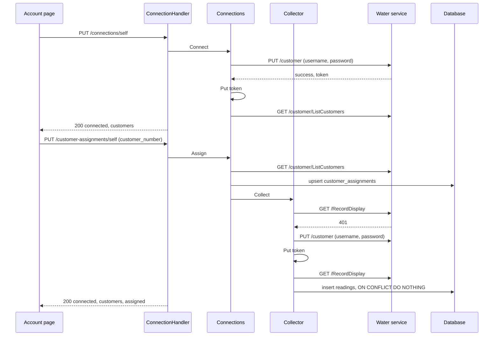

# Specification: The water account of a workspace

## 1. Summary

The water plugin gains a connection page. A connect signs in to the water service with
the workspace settings and stores the token as the workspace plugin secret `token` of
`PSECRET`. The page lists the customers of the account, and an editor assigns one to the
workspace in the scoped table `customer_assignments`. The collection reads the readings
of the assigned customer and inserts each one into the scoped table `readings` under a
hash. The widget `usage` lists the last reading of each meter. No change reaches the hub
or `pluginapi`. `spec-scenarios.md` holds the scenarios.

## 2. Coverage

| Requirement       | Where this specification realizes it |
| ----------------- | ------------------------------------ |
| `GWPACC-FR-001`   | Section 4.3, `GWPACC-SC-001` |
| `GWPACC-FR-002`   | Section 4.3, `GWPACC-SC-001` |
| `GWPACC-FR-003`   | `api.yaml`, `GWPACC-SC-002` |
| `GWPACC-FR-004`   | `api.yaml`, `GWPACC-SC-002` |
| `GWPACC-FR-005`   | `api.yaml`, `GWPACC-DD-004`, `GWPACC-SC-003` |
| `GWPACC-FR-006`   | `api.yaml`, `GWPACC-SC-003` |
| `GWPACC-FR-007`   | Section 4.5, `GWPACC-SC-004` |
| `GWPACC-FR-008`   | `api.yaml`, `GWPACC-DD-003`, `GWPACC-SC-005` |
| `GWPACC-FR-009`   | Section 4.4, `GWPACC-DD-003`, `GWPACC-SC-005`, `GWPACC-SC-006` |
| `GWPACC-FR-010`   | `api.yaml`, `GWPACC-SC-007` |
| `GWPACC-FR-011`   | `GWPACC-DD-005`, `GWPACC-SC-007` |
| `GWPACC-FR-012`   | `GWPACC-DD-002`, `GWPACC-DD-005`, `GWPACC-SC-008` |
| `GWPACC-FR-013`   | `api.yaml`, `GWPACC-DD-001`, `GWPACC-SC-009` |
| `GWPACC-FR-014`   | Section 4.5, `GWPACC-SC-010` |
| `GWPACC-FR-015`   | Section 4.4, `GWPACC-DD-006`, `GWPACC-SC-009`, `GWPACC-SC-011` |
| `GWPACC-FR-016`   | Section 4.3, `GWPACC-SC-012` |
| `GWPACC-FR-017`   | Section 4.3, `GWPACC-SC-013` |
| `GWPACC-FR-018`   | Section 4.4, `GWPACC-DD-002`, `GWPACC-SC-014`, `GWPACC-SC-015` |
| `GWPACC-FR-019`   | Section 4.5, `GWPACC-SC-016` |
| `GWPACC-FR-020`   | Section 4.2, `GWPACC-DD-007`, `GWPACC-SC-017` |
| `GWPACC-FR-021`   | Section 4.2, `GWPACC-DD-005`, `GWPACC-SC-018` |
| `GWPACC-FR-022`   | Section 4.3, `GWPACC-DD-008`, `GWPACC-SC-019` |
| `GWPACC-FR-023`   | Section 4.3, `GWPACC-SC-020` |
| `GWPACC-FR-024`   | Section 4.3, `GWPACC-SC-020` |
| `GWPACC-FR-025`   | Section 4.3, `GWPACC-SC-019` |
| `GWPACC-FR-026`   | Section 4.3, `GWPACC-DD-009`, `GWPACC-SC-021` |
| `GWPACC-FR-027`   | Section 4.3, `GWPACC-DD-009`, `GWPACC-SC-021` |
| `GWPACC-INV-001`  | Section 4.2, `GWPACC-DD-001`, `GWPACC-SC-009` |
| `GWPACC-INV-002`  | Section 4.2, `GWPACC-SC-022` |
| `GWPACC-INV-003`  | `api.yaml`, `GWPACC-SC-023` |

## 3. Guideline compliance

| Rule      | Guideline         | How this specification obeys it |
| --------- | ----------------- | ------------------------------- |
| `PLG-006` | Plugin model      | The plugin adds the migration, route, UI, permission, and widget capabilities through the existing interfaces. |
| `PLG-007` | Plugin model      | The plugin reads the settings, the plugin secret, and the database through the host. |
| `ARC-008` | Architecture      | No file of the hub changes. |
| `DAT-001`, `DAT-006`, `DAT-009` | Data | Both tables live in `dev_maroid_gwp`. The migrations live in `plugins/gwp/db/migrations/`. Each `id` is `uuidv7()`. Section 4.2. |
| `OWN-004` to `OWN-008` | Ownership | Both tables take the workspace scope, with `workspace_id` and forced row level security. No repository filters by workspace. |
| `OWN-009` | Ownership         | The collection keeps `CronScopePerWorkspace`. |
| `CFG-007` | Configuration     | The credentials stay workspace settings. Section 4.3. |
| `EXT-005` | External services | `service/api-client.go` answers a status that is not a success, or `success: false`, with an error. |
| `LOG-008` | Logging           | No log line holds the password or the token. |
| `SEC-013` | Security          | Each route and the widget name a permission. Section 4.3. |
| `API-004` | HTTP API          | The routes mount under `/workspaces/{workspaceId}/plugins/dev.maroid.gwp/api`. |
| `ERR-002` | Errors            | Each new problem type has the form `/problems/dev.maroid.gwp/<slug>`. Section 4.5. |
| `RES-001`, `RES-002` | REST   | `/connections/self` and `/customer-assignments/self` keep the plural of `Z-134`. Both collections answer no `GET`, as `ADR-0015` permits. |
| `GO-005`  | Go style          | Every sentinel error lives in `errs/`. |
| `UI-005` to `UI-009` | Web UI | The remote exports `routes` with `/account`, and reaches the API through `host.api`. |
| `PKG-001` | Package layout    | The plugin gains `db/`, `errs/`, `handler/`, `model/`, `permission/`, `repository/`, `widget/`, and `ui/`. |
| `BLD-003` | Build             | The build plan builds the UI before the `.so`. |

## 4. Design

### 4.1 Components

| Path | Action | Holds |
| ---- | ------ | ----- |
| `plugins/gwp/db/migration_source.go` | create | `Migrations`, the embedded `migrations/*.sql` |
| `plugins/gwp/db/migrations/<ts>_table_customer_assignments_create.{up,down}.sql` | create | Section 4.2 |
| `plugins/gwp/db/migrations/<ts>_table_readings_create.{up,down}.sql` | create | Section 4.2 |
| `plugins/gwp/errs/errs.go` | create | `ErrRequestFailed` (moved from `service`), `ErrNotConnected`, `ErrCredentialsAbsent`, `ErrCredentialsRejected`, `ErrCustomerUnknown`, `ErrCustomerAbsent` |
| `plugins/gwp/model/{doc,connection,reading}.go` | create | `ConnectionState`, `Connection`, `Customer`, `Reading`, `MeterUsage` |
| `plugins/gwp/dto/api-client.go` | change | `ReadingItem.Hash()`, `ReadingItem.MapToModel(customerNumber string)` |
| `plugins/gwp/dto/connection.go` | create | `ConnectionResponse`, `CustomerResponse`, `AssignmentRequest` |
| `plugins/gwp/service/api-client.go` | change | A 401 is `errs.ErrNotConnected`. A sign in with `success: false` is `errs.ErrCredentialsRejected` |
| `plugins/gwp/service/connection.go` | create | `ConnectionService`, `Connections`, `NewConnections` |
| `plugins/gwp/service/collector.go` | create | `Collector`, `NewCollector` |
| `plugins/gwp/repository/{assignment,reading}.go` | create | `CustomerAssignment`, `Reading` |
| `plugins/gwp/job/readings_collector.go` | change | `Run` calls `Collector.Collect`. The log of every customer goes |
| `plugins/gwp/handler/{doc,connection,problem}.go` | create | `ConnectionHandler`, `NewConnectionHandler`, the problem types of section 4.5 |
| `plugins/gwp/permission/permission.go` | create | `AccountRead`, `AccountConnect` |
| `plugins/gwp/widget/{doc,usage}.go` | create | `NewUsage` |
| `plugins/gwp/embed.go` | create | `uiAssets`, the embedded `ui/dist` |
| `plugins/gwp/main.go` | change | `Migrations`, `Permissions`, `Routes`, `UIManifest`, `Widgets`, `host.Database`, `host.Secrets` |
| `plugins/gwp/ui/` | create | `package.json`, `vite.config.ts`, `svelte.config.js`, `tsconfig.json`, `src/entry.ts`, `src/app.css`, `src/api/{index,connection,types}.ts`, `src/pages/account/Account.svelte` |

`ConnectionService`:

```go
Status(ctx context.Context) (*model.Connection, error)
Connect(ctx context.Context) (*model.Connection, error)
Disconnect(ctx context.Context) error
Assign(ctx context.Context, customerNumber string) (*model.Connection, error)
```

`Collector`:

```go
// Collect reads the readings of the assigned customer of the acting workspace and
// inserts each new one. It answers errs.ErrNotConnected with no connection or no
// assigned customer, which the job treats as a skip.
Collect(ctx context.Context) error
```

`repository.CustomerAssignment`: `Get(ctx) (string, error)` answers `sql.ErrNoRows`
when the workspace holds none, `Put(ctx, customerNumber string) error`, `Delete(ctx) error`.
`repository.Reading`: `Insert(ctx, *model.Reading) error`, `LastOfEachMeter(ctx, customerNumber string) ([]model.Reading, error)`.

### 4.2 Data model

The token lives in the workspace plugin secret `token`, with no expiry. `Connect` and the
collection write it with `Put`. `DD-002` deletes it.

| Table | Schema | Scope | Migration | Realizes |
| ----- | ------ | ----- | --------- | -------- |
| `customer_assignments` | `dev_maroid_gwp` | Workspace | `<ts>_table_customer_assignments_create` | `GWPACC-FR-013`, `GWPACC-INV-001` |
| `readings` | `dev_maroid_gwp` | Workspace | `<ts>_table_readings_create` | `GWPACC-FR-020`, `GWPACC-FR-021`, `GWPACC-FR-022` |

`customer_assignments`:

| Column | Type | Null | Default | Note |
| ------ | ---- | ---- | ------- | ---- |
| `id` | `UUID` | no | `uuidv7()` | Primary key |
| `workspace_id` | `UUID` | no | the acting workspace (`OWN-005`) | `UNIQUE`, so one row for each workspace |
| `customer_number` | `TEXT` | no | | `customerNo` of the water service |
| `assigned_at` | `TIMESTAMPTZ` | no | `now()` | |

`readings`:

| Column | Type | Null | Default | Note |
| ------ | ---- | ---- | ------- | ---- |
| `id` | `UUID` | no | `uuidv7()` | Primary key |
| `workspace_id` | `UUID` | no | the acting workspace (`OWN-005`) | |
| `hash` | `TEXT` | no | | `UNIQUE (workspace_id, hash)`. `DD-007` |
| `customer_number` | `TEXT` | no | | The customer of the reading. It stays after a new assignment |
| `serial_number` | `TEXT` | no | | `serialNumber` of the meter |
| `reading_date` | `DATE` | no | | `lastReadingDate` |
| `value` | `NUMERIC` | no | | `lastReading` |
| `previous_value` | `NUMERIC` | no | | `prevReadValue` |
| `collected_at` | `TIMESTAMPTZ` | no | `now()` | |

The index `readings_customer_meter_date_idx` on `(customer_number, serial_number, reading_date DESC)` serves `LastOfEachMeter`.
Both tables take the policy of `OWN-006` on `workspace_id`. No foreign key joins them,
because a reading outlives its assignment (`GWPACC-FR-021`).

### 4.3 Declarations

**HTTP routes.** The prefix is `/workspaces/{workspaceId}/plugins/dev.maroid.gwp/api`.
`api.yaml` holds the bodies and the status codes.

| Method | Path | Access | Permission | Realizes |
| ------ | ---- | ------ | ---------- | -------- |
| `GET` | `/connections/self` | Authenticated | `account.read` | `GWPACC-FR-003` to `GWPACC-FR-007`, `GWPACC-FR-012` |
| `PUT` | `/connections/self` | Authenticated | `account.connect` | `GWPACC-FR-008`, `GWPACC-FR-009` |
| `DELETE` | `/connections/self` | Authenticated | `account.connect` | `GWPACC-FR-010`, `GWPACC-FR-011` |
| `PUT` | `/customer-assignments/self` | Authenticated | `account.connect` | `GWPACC-FR-013` to `GWPACC-FR-015` |

**Permissions.**

| Name | Description | Lowest | Realizes |
| ---- | ----------- | ------ | -------- |
| `account.read` | Read the water account and the usage of the workspace | `viewer` | `GWPACC-FR-026` |
| `account.connect` | Connect the water account and assign its customer | `editor` | `GWPACC-FR-027` |

**Settings.** `WorkspaceSettings` keeps both fields, with `x-maroid-scope=workspace`, as today.

| Field | Kind | Title | Realizes |
| ----- | ---- | ----- | -------- |
| `username` | free text | Username | `GWPACC-FR-001` |
| `password` | secret | Password | `GWPACC-FR-001`, `GWPACC-FR-002` |

**Cron job.** The identifier and the schedule stay.

| Identifier | Schedule | Runs in | Behavior | Realizes |
| ---------- | -------- | ------- | -------- | -------- |
| `readings_collector` | `cron_schedule.readings_collector`, default `0 0 15 * *` | Each workspace that enabled the plugin | `Collector.Collect`. `errs.ErrNotConnected` logs a skip at info and answers nil | `GWPACC-FR-016` to `GWPACC-FR-019` |

**UI routes.**

| Page route | Navigation entry | Page | Realizes |
| ---------- | ---------------- | ---- | -------- |
| `/account` | "Account" | `Account.svelte` | `GWPACC-FR-003` to `GWPACC-FR-015` |

The page hides the buttons of `account.connect` when `host.can` denies it. The list of
customers is a radio group with one "Assign" button. "Disconnect" asks through `ConfirmDialog`.

**Widget.**

| Key | Title | Kind | Size | Permission | Realizes |
| --- | ----- | ---- | ---- | ---------- | -------- |
| `usage` | Water usage | `list` | `m` | `account.read` | `GWPACC-FR-022` to `GWPACC-FR-025` |

`Load` reads `customer_assignments` and `readings` in one `PluginDB.WithTx`, and calls
no service. No assignment answers `NotSetUpAnswer("Connect the water account and assign a customer.", "/account")`.
No reading answers `EmptyAnswer("No reading yet.")`. `DD-008` gives each line.

### 4.4 Flow

The connect, the assignment, and the collection:



The 401 branch is the one of `GWPACC-FR-018`. A read of the page takes no such branch (`DD-002`).

### 4.5 Errors

| Condition | Route answer | Collection |
| --------- | ------------ | ---------- |
| No `token` secret | `GET`: 200 `state: not_connected`. `PUT` assignment: 409 `not-connected` | Skip (`GWPACC-FR-017`) |
| A route call answers 401 | `GET`: 200 `state: not_connected`, and the token goes. `PUT` assignment: 409 `not-connected` | Sign in again, once |
| The settings are absent | `PUT` connection: 422 `credentials-absent`. `GET` reports `credentials_stored: false` | Error `ErrCredentialsAbsent` |
| The sign in answers `success: false`, 400, or 401 | 422 `credentials-rejected` | Error `ErrCredentialsRejected` |
| The customer is not in the list of the account | 422 `customer-unknown` | Not reached |
| The answer of `/RecordDisplay` holds no entry for the assigned customer | Not reached | Error `ErrCustomerAbsent`, nothing stored (`GWPACC-FR-019`) |
| The water service answers 5xx, or fails to answer | 502 `service-unavailable`. The token stays | Error `ErrRequestFailed` |

No detail names the password or the token (`GWPACC-INV-003`, `LOG-008`).

## 5. Design decisions

### `GWPACC-DD-001`

**Realizes:** `GWPACC-FR-013`, `GWPACC-INV-001`
**Decision:** The assignment is one row of the scoped table `customer_assignments`, unique
on `workspace_id`. `Put` runs `INSERT ... ON CONFLICT (workspace_id) DO UPDATE`.
**Rationale:** The widget reads the assignment and the readings in one transaction, with
no call to the secret store. The unique key holds the invariant in the database.
**Alternatives:** A second workspace plugin secret. Every widget read then decrypts it, and a customer number is no secret.

### `GWPACC-DD-002`

**Realizes:** `GWPACC-FR-012`, `GWPACC-FR-018`
**Decision:** `APIClient` answers a 401 on a call that carries the token with
`errs.ErrNotConnected`. `Connections` deletes `token` on it. `Collector` signs in with the
settings, writes the new token with `Put`, and repeats the call once.
**Rationale:** The owner wants a person to reconnect from the page, and the collection to
recover alone. One sentinel serves both, and each caller picks its reaction.
**Alternatives:** A sign in on each page read. A wrong password then shows as a failure of the page, not as "not connected".

### `GWPACC-DD-003`

**Realizes:** `GWPACC-FR-008`, `GWPACC-FR-009`
**Decision:** `PUT /connections/self` signs in, writes `token`, and answers 200 with the connection.
**Rationale:** No code by phone exists, so no pending state exists. A repeat leaves the
workspace connected, which `Z-148` and `Z-149` give to `PUT`.
**Alternatives:** `POST /connections`. A repeat has no new effect, so `POST` overstates it.

### `GWPACC-DD-004`

**Realizes:** `GWPACC-FR-005`
**Decision:** `Status` calls `GetCustomers` on each read of a connected workspace, and
answers each customer with `customer_number`, the address joined from `city`, `street`,
and `building`, and `assigned`.
**Rationale:** The read proves the token, and `DD-002` removes a rejected one in the same call.
**Alternatives:** Store the list at the connect. A new customer of the account then stays hidden.

### `GWPACC-DD-005`

**Realizes:** `GWPACC-FR-011`, `GWPACC-FR-012`, `GWPACC-FR-021`
**Decision:** `Disconnect` deletes `token` and the row of `customer_assignments`. A 401
deletes `token` alone. Neither touches `readings`.
**Rationale:** An editor who reconnects after an expired token keeps the assignment.
An explicit end can precede a different account.
**Alternatives:** Delete the assignment on a 401 too. The editor then assigns again for a token that only expired.

### `GWPACC-DD-006`

**Realizes:** `GWPACC-FR-015`
**Decision:** `Assign` writes the row, then calls `Collector.Collect` in the same request.
A failure of the collection is logged at warn, and the answer stays 200.
**Rationale:** The row is stored at that moment. The next collection retries, and the widget answers "empty" meanwhile.
**Alternatives:** Answer the failure. The editor retries an assignment that already succeeded.

### `GWPACC-DD-007`

**Realizes:** `GWPACC-FR-020`
**Decision:** `hash` is the hex SHA-256 of `customerNo|serialNumber|lastReadingDate|lastReading|prevReadValue`,
and the insert runs `ON CONFLICT (workspace_id, hash) DO NOTHING`, as the plugin `tbilisi-energy` does.
**Rationale:** The water service gives a reading no identifier. The five values name one reading of one meter.
**Alternatives:** A unique key on the five columns. It repeats the hash in a wider index, and differs from the other plugins.

### `GWPACC-DD-008`

**Realizes:** `GWPACC-FR-022`
**Decision:** `LastOfEachMeter` runs `SELECT DISTINCT ON (serial_number) ... ORDER BY serial_number, reading_date DESC, collected_at DESC`.
Each line is `ListItem{Label: "Meter <serial>: <usage> m³", Meta: "<previous> to <value>, <dd/mm/yyyy>"}`, with one decimal, and a negative usage as it is.
**Rationale:** One query answers every meter. The label leads with the usage, which the household reads first.
**Alternatives:** A stat widget for each meter. The plugin declares widgets at load, and the count of meters is unknown then.

### `GWPACC-DD-009`

**Realizes:** `GWPACC-FR-026`, `GWPACC-FR-027`
**Decision:** `account.read` with `viewer` guards the read and the widget. `account.connect` with `editor` guards the three writes.
**Rationale:** The requirements give two roles. The connection belongs to the workspace, so a viewer changes nothing.
**Alternatives:** One permission. It cannot hold two lowest roles.

### `GWPACC-DD-010`

**Realizes:** `GWPACC-FR-012`, `GWPACC-FR-018`, `GWPACC-FR-019`
**Decision:** Build step 7 runs the flow against the water service and corrects `DD-002`,
`DD-007`, and the date layout of `lastReadingDate`.
**Rationale:** No capture holds the answer to an expired token or a wrong password, the
format of the date, or whether `customerNo` of a reading equals `customerNo` of a customer.
**Alternatives:** Ship on the assumption. A wrong assumption fails each collection in silence.

## 6. Scenarios

`spec-scenarios.md` holds `GWPACC-SC-001` to `GWPACC-SC-023`.

## 7. Build plan

| #   | Step | Realizes | Done |
| --- | ---- | -------- | ---- |
| 1 | `errs/`, `model/`, `permission/`, and the API client: the 401 rule and the rejected sign in | `GWPACC-FR-012`, `GWPACC-FR-018`, `GWPACC-FR-026`, `GWPACC-FR-027` | [ ] |
| 2 | `db/`, both migrations, `repository/`, and `Migrations` in `main.go` | `GWPACC-FR-013`, `GWPACC-FR-020`, `GWPACC-FR-021` | [ ] |
| 3 | `service/collector.go`, `ReadingItem.Hash`, and the job | `GWPACC-FR-016` to `GWPACC-FR-020` | [ ] |
| 4 | `service/connection.go` | `GWPACC-FR-003` to `GWPACC-FR-015` | [ ] |
| 5 | `handler/`, `dto/connection.go`, and `api.yaml` | `GWPACC-FR-003` to `GWPACC-FR-015` | [ ] |
| 6 | `widget/usage.go` and `Widgets` | `GWPACC-FR-022` to `GWPACC-FR-025` | [ ] |
| 7 | `GWPACC-SC-015` against the water service. Correct `DD-002`, `DD-007`, and the date layout | `GWPACC-FR-012`, `GWPACC-FR-018`, `GWPACC-FR-019` | [ ] |
| 8 | `ui/`, `embed.go`, and `UIManifest`. Build the UI, then the `.so` (`BLD-003`) | `GWPACC-FR-003` to `GWPACC-FR-015` | [ ] |
| 9 | The tests of `spec-scenarios.md`. Lint and build the plugin | Every statement | [ ] |

## Retired identifiers

This file has no retired identifier.
