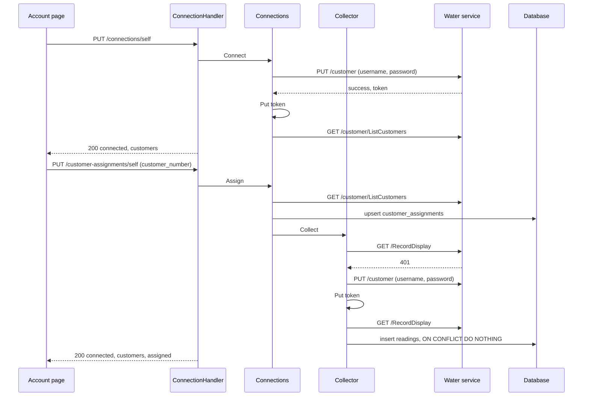

# Specification: The water account of a workspace

## 1. Summary

The water plugin gains a connection page. A connect signs in to the water service with
the workspace settings and stores the token as the workspace plugin secret `token` of
`PSECRET`. The page lists the customers of the account, and an editor assigns one to the
workspace in the scoped table `customer_assignments`. The collection reads the readings
of the assigned customer and keeps each one in the scoped table `readings`, one for a
meter on a date. The usage of a reading is computed when it is read. The widget `usage` lists the last reading of each meter. No change reaches the hub
or `pluginapi`. `spec-readings.md` holds the readings page. `spec-scenarios.md` holds the scenarios.

## 2. Coverage

| Requirement       | Where this specification realizes it |
| ----------------- | ------------------------------------ |
| `GWPACC-FR-001`   | Section 4.3, `GWPACC-SC-001` |
| `GWPACC-FR-002`   | Section 4.3, `GWPACC-SC-001` |
| `GWPACC-FR-003`   | `api.yaml`, `GWPACC-SC-002` |
| `GWPACC-FR-004`   | `api.yaml`, `GWPACC-SC-002` |
| `GWPACC-FR-005`   | `api.yaml`, `GWPACC-DD-004`, `GWPACC-SC-003` |
| `GWPACC-FR-006`   | `api.yaml`, `GWPACC-SC-003` |
| `GWPACC-FR-007`   | Section 4.5, `GWPACC-SC-004`, `GWPACC-SC-032` |
| `GWPACC-FR-008`   | `api.yaml`, `GWPACC-DD-003`, `GWPACC-SC-005` |
| `GWPACC-FR-009`   | Section 4.4, `GWPACC-DD-003`, `GWPACC-SC-005`, `GWPACC-SC-006` |
| `GWPACC-FR-010`   | `api.yaml`, `GWPACC-SC-007` |
| `GWPACC-FR-011`   | `GWPACC-DD-005`, `GWPACC-SC-007` |
| `GWPACC-FR-012`   | `GWPACC-DD-002`, `GWPACC-DD-005`, `GWPACC-SC-008`, `GWPACC-SC-037` |
| `GWPACC-FR-013`   | `api.yaml`, `GWPACC-DD-001`, `GWPACC-SC-009`, `GWPACC-SC-024` |
| `GWPACC-FR-014`   | Section 4.5, `GWPACC-SC-010` |
| `GWPACC-FR-015`   | Section 4.4, `GWPACC-DD-006`, `GWPACC-SC-009`, `GWPACC-SC-011` |
| `GWPACC-FR-016`   | Section 4.3, `GWPACC-SC-012`, `GWPACC-SC-033` |
| `GWPACC-FR-017`   | Section 4.3, `GWPACC-SC-013` |
| `GWPACC-FR-018`   | Section 4.4, `GWPACC-DD-002`, `GWPACC-SC-014`, `GWPACC-SC-015`, `GWPACC-SC-034` to `GWPACC-SC-036` |
| `GWPACC-FR-019`   | Section 4.5, `GWPACC-SC-016` |
| `GWPACC-FR-020`   | Section 4.2, `GWPACC-DD-007`, `GWPACC-SC-017` |
| `GWPACC-FR-021`   | Section 4.2, `GWPACC-DD-005`, `GWPACC-SC-018` |
| `GWPACC-FR-022`   | Section 4.3, `GWPACC-DD-008`, `GWPACC-SC-019` |
| `GWPACC-FR-023`   | Section 4.3, `GWPACC-SC-020` |
| `GWPACC-FR-024`   | Section 4.3, `GWPACC-SC-020` |
| `GWPACC-FR-025`   | Section 4.3, `GWPACC-SC-019` |
| `GWPACC-FR-026`   | Section 4.3, `spec-readings.md` 3.3, `GWPACC-DD-009`, `GWPACC-SC-021`, `GWPACC-SC-031` |
| `GWPACC-FR-027`   | Section 4.3, `GWPACC-DD-009`, `GWPACC-SC-021` |
| `GWPACC-FR-028`   | `spec-readings.md` 3.3, `GWPACC-DD-011`, `GWPACC-SC-025`, `GWPACC-SC-026` |
| `GWPACC-FR-029`   | `spec-readings.md` 3.3, `GWPACC-DD-011`, `GWPACC-SC-025` |
| `GWPACC-FR-030`   | `GWPACC-DD-012` to `GWPACC-DD-014`, `GWPACC-SC-027`, `GWPACC-SC-030` |
| `GWPACC-FR-031`   | `spec-readings.md` 3.4, `GWPACC-DD-015`, `GWPACC-SC-028`, `GWPACC-SC-030` |
| `GWPACC-FR-032`   | `spec-readings.md` 3.4, `GWPACC-DD-015`, `GWPACC-SC-029`, `GWPACC-SC-030` |
| `GWPACC-FR-033`   | `spec-readings.md` 3.1, `GWPACC-DD-012`, `GWPACC-SC-025` |
| `GWPACC-FR-034`   | `spec-readings.md` 3.3, `GWPACC-SC-019` |
| `GWPACC-INV-001`  | Section 4.2, `GWPACC-DD-001`, `GWPACC-SC-009` |
| `GWPACC-INV-002`  | Section 4.2, `GWPACC-SC-022` |
| `GWPACC-INV-003`  | `api.yaml`, `GWPACC-SC-023` |

## 3. Guideline compliance

| Rule      | Guideline         | How this specification obeys it |
| --------- | ----------------- | ------------------------------- |
| `PLG-006` | Plugin model      | The plugin adds the migration, route, UI, permission, and widget capabilities through the existing interfaces. |
| `PLG-007` | Plugin model      | The plugin reads the settings, the plugin secret, and the database through the host. |
| `ARC-008` | Architecture      | No file of the hub changes. |
| `DAT-001`, `DAT-006`, `DAT-009` | Data | Both tables live in `dev_maroid_gwp`. The migrations live in `plugins/gwp/db/migrations/`. Each `id` is `uuidv7()`. Section 4.2. |
| `OWN-004` to `OWN-008` | Ownership | Both tables take the workspace scope, with `workspace_id` and forced row level security. No repository filters by workspace. |
| `OWN-009` | Ownership         | The collection keeps `CronScopePerWorkspace`. |
| `CFG-007` | Configuration     | The credentials stay workspace settings. Section 4.3. |
| `EXT-005` | External services | `service/api-client.go` answers a status that is not a success, or `success: false`, with an error. |
| `LOG-008` | Logging           | No log line holds the password or the token. |
| `SEC-013` | Security          | Each route and the widget name a permission. Section 4.3. |
| `API-004` | HTTP API          | The routes mount under `/workspaces/{workspaceId}/plugins/dev.maroid.gwp/api`. |
| `ERR-002` | Errors            | Each new problem type has the form `/problems/dev.maroid.gwp/<slug>`. Section 4.5. |
| `RES-001`, `RES-002` | REST   | `/connections/self` and `/customer-assignments/self` keep the plural of `Z-134`. Both collections answer no `GET`, as `ADR-0015` permits. |
| `GO-005`  | Go style          | Every sentinel error lives in `errs/`. |
| `UI-005` to `UI-009` | Web UI | The remote exports `routes` with `/account`, and reaches the API through `host.api`. |
| `PKG-001` | Package layout    | The plugin gains `db/`, `errs/`, `handler/`, `model/`, `permission/`, `repository/`, `widget/`, and `ui/`. `service/` holds the domain services and the store (`ADR-0017`). |
| `RES-002` | REST              | `PUT /connections/self` carries no body (`ADR-0018`). |
| `BLD-003` | Build             | The build plan builds the UI before the `.so`. |

## 4. Design

### 4.1 Components

| Path | Action | Holds |
| ---- | ------ | ----- |
| `plugins/gwp/db/migration_source.go` | create | `Migrations`, the embedded `migrations/*.sql` |
| `plugins/gwp/db/migrations/<ts>_table_customer_assignments_create.{up,down}.sql` | create | Section 4.2 |
| `plugins/gwp/db/migrations/<ts>_table_readings_create.{up,down}.sql` | create | Section 4.2 |
| `plugins/gwp/db/migrations/<ts>_readings_key_by_meter_and_date.{up,down}.sql` | create | Section 4.2 |
| `plugins/gwp/errs/errs.go` | create | `ErrRequestFailed` (moved from `service`), `ErrNotConnected`, `ErrTokenRejected`, `ErrCredentialsAbsent`, `ErrCredentialsRejected`, `ErrNotAssigned`, `ErrCustomerUnknown`, `ErrCustomerAbsent` |
| `plugins/gwp/model/{doc,connection,reading}.go` | create | `ConnectionState`, `Connection`, `Customer`, `Reading`, whose `Usage` is nil for the earliest reading of a meter |
| `plugins/gwp/dto/api-client.go` | change | `ReadingItem.MapToModel(customerNumber string)`. `prevReadValue` stays unread |
| `plugins/gwp/dto/connection.go` | create | `ConnectionResponse`, `CustomerResponse`, `AssignmentRequest` |
| `plugins/gwp/config/config.go` | change | `Config.RequestTimeout` |
| `libs/pluginconfig/config.go` | change | The decoder takes `mapstructure.StringToTimeDurationHookFunc`, so a configuration value `15s` decodes into a `time.Duration`. The hub and every plugin build again, because they share the package |
| `plugins/gwp/service/api-client.go` | change | A 401 is `errs.ErrTokenRejected` (`DD-002`). A sign in with `success: false` is `errs.ErrCredentialsRejected`. A failure wraps the status and at most 512 bytes of the body (`EXT-007`). Every call ends after `request_timeout` |
| `plugins/gwp/service/account.go` | change | `call`, which repeats a call once after a new sign in on `errs.ErrTokenRejected`. `signIn` deletes `token` on `errs.ErrCredentialsRejected` (`DD-002`) |
| `plugins/gwp/service/connection.go` | create | `Connections`, `NewConnections` |
| `plugins/gwp/service/collector.go` | create | `Collector`, `NewCollector` |
| `plugins/gwp/repository/{doc,assignment,reading}.go` | create | `CustomerAssignmentRepository` and `CustomerAssignment`, `ReadingRepository` and `Reading`, each over one transaction (`REP-002`, `REP-003`) |
| `plugins/gwp/service/store.go` | create | `Store` over `PluginDB`, one transaction for each call (`ADR-0017`) |
| `plugins/gwp/job/readings_collector.go` | change | `Run` calls `Collector.Collect`. The log of every customer goes |
| `plugins/gwp/handler/{doc,connection,problem}.go` | create | `ConnectionService`, which the handler declares, `ConnectionHandler`, `NewConnectionHandler`, the problem types of section 4.5 |
| `plugins/gwp/permission/permission.go` | create | `AccountRead`, `AccountConnect` |
| `plugins/gwp/widget/{doc,usage}.go` | create | `NewUsage` |
| `plugins/gwp/embed.go` | create | `uiAssets`, the embedded `ui/dist` |
| `plugins/gwp/main.go` | change | `Migrations`, `Permissions`, `Routes`, `UIManifest`, `Widgets`, `host.Database`, `host.Secrets` |
| `plugins/gwp/ui/` | create | `package.json`, `vite.config.ts`, `svelte.config.js`, `tsconfig.json`, `src/entry.ts`, `src/app.css`, `src/api/{index,connection,types}.ts`, `src/pages/account/Account.svelte` |

`handler.ConnectionService`, which the handler declares as its consumer:

```go
Status(ctx context.Context) (*model.Connection, error)
Connect(ctx context.Context) (*model.Connection, error)
Disconnect(ctx context.Context) error
Assign(ctx context.Context, customerNumber string) (*model.Connection, error)
```

`Collector`:

```go
// Collect reads the readings of the assigned customer of the acting workspace and
// inserts each new one. It answers errs.ErrNotAssigned with no assigned customer and
// errs.ErrNotConnected with no connection. The job treats both as a skip. It answers
// the count of the readings that the water service reported for the customer.
Collect(ctx context.Context) (int, error)
```

`repository.CustomerAssignment`: `Get(ctx) (string, error)` answers `errs.ErrNotAssigned`
when the workspace holds none, `Put(ctx, customerNumber string) error`, `Delete(ctx) error`.
`service.Store` gives `AssignedCustomer`, `Assign`, `Unassign`, `InsertReadings`, and
`LastReadingOfEachMeter`, each in one `PluginDB.WithTx`, where it creates each repository.
The services, the handlers, and the widget depend on interfaces that each one declares,
and `Store` meets them.
`repository.Reading`: `Insert(ctx, *model.Reading) error`, `LastOfEachMeter(ctx, customerNumber string) ([]model.Reading, error)`.

### 4.2 Data model

The token lives in the workspace plugin secret `token`, with no expiry. `Connect` and the
collection write it with `Put`. `DD-002` deletes it.

| Table | Schema | Scope | Migration | Realizes |
| ----- | ------ | ----- | --------- | -------- |
| `customer_assignments` | `dev_maroid_gwp` | Workspace | `<ts>_table_customer_assignments_create` | `GWPACC-FR-013`, `GWPACC-INV-001` |
| `readings` | `dev_maroid_gwp` | Workspace | `<ts>_table_readings_create`, `<ts>_readings_key_by_meter_and_date` | `GWPACC-FR-020`, `GWPACC-FR-021`, `GWPACC-FR-022` |

`customer_assignments`:

| Column | Type | Null | Default | Note |
| ------ | ---- | ---- | ------- | ---- |
| `id` | `UUID` | no | `uuidv7()` | Primary key |
| `workspace_id` | `UUID` | no | the acting workspace (`OWN-005`) | `UNIQUE`, so one row for each workspace |
| `customer_number` | `TEXT` | no | | `customerNo` of the water service |
| `assigned_at` | `TIMESTAMPTZ` | no | `now()` | |

`readings`:

| Column | Type | Null | Default | Note |
| ------ | ---- | ---- | ------- | ---- |
| `id` | `UUID` | no | `uuidv7()` | Primary key |
| `workspace_id` | `UUID` | no | the acting workspace (`OWN-005`) | |
| `customer_number` | `TEXT` | no | | The customer of the reading. It stays after a new assignment |
| `serial_number` | `TEXT` | no | | `serialNumber` of the meter |
| `reading_date` | `DATE` | no | | `lastReadingDate`, which the water service gives as `dd/mm/yyyy` |
| `value` | `NUMERIC` | no | | `lastReading` |
| `collected_at` | `TIMESTAMPTZ` | no | `now()` | |

The constraint `readings_workspace_meter_date_key` is `UNIQUE (workspace_id, customer_number,
serial_number, reading_date)` (`DD-007`). Its index serves every read, because the policy adds
the condition on `workspace_id`. The second migration drops `hash`, `previous_value`, and the
index `readings_customer_meter_date_idx`. It keeps the latest collected row of each key
before it adds the constraint.
Both tables take the policy of `OWN-006` on `workspace_id`. No foreign key joins them,
because a reading outlives its assignment (`GWPACC-FR-021`).

### 4.3 Declarations

**HTTP routes.** The prefix is `/workspaces/{workspaceId}/plugins/dev.maroid.gwp/api`.
`api.yaml` holds the bodies and the status codes.

| Method | Path | Access | Permission | Realizes |
| ------ | ---- | ------ | ---------- | -------- |
| `GET` | `/connections/self` | Authenticated | `account.read` | `GWPACC-FR-003` to `GWPACC-FR-007`, `GWPACC-FR-012` |
| `PUT` | `/connections/self` | Authenticated | `account.connect` | `GWPACC-FR-008`, `GWPACC-FR-009` |
| `DELETE` | `/connections/self` | Authenticated | `account.connect` | `GWPACC-FR-010`, `GWPACC-FR-011` |
| `PUT` | `/customer-assignments/self` | Authenticated | `account.connect` | `GWPACC-FR-013` to `GWPACC-FR-015` |

**Permissions.**

| Name | Description | Lowest | Realizes |
| ---- | ----------- | ------ | -------- |
| `account.read` | Read the water account and the usage of the workspace | `viewer` | `GWPACC-FR-026` |
| `account.connect` | Connect the water account and assign its customer | `editor` | `GWPACC-FR-027` |

**Settings.** `WorkspaceSettings` keeps both fields, with `x-maroid-scope=workspace`, as today.

| Field | Kind | Title | Realizes |
| ----- | ---- | ----- | -------- |
| `username` | free text | Username | `GWPACC-FR-001` |
| `password` | secret | Password | `GWPACC-FR-001`, `GWPACC-FR-002` |

**Configuration.**

| Key | Type | Default | Secret | Realizes |
| --- | ---- | ------- | ------ | -------- |
| `base_url` | string | `https://www.gwp.ge/api` | no | `GWPACC-FR-009` |
| `request_timeout` | duration | `15s` | no | `GWPACC-FR-007`, `GWPACC-FR-018` |
| `cron_schedule.readings_collector` | cron | `0 0 15 * *` | no | `GWPACC-FR-016` |

**Cron job.** The identifier and the schedule stay.

| Identifier | Schedule | Runs in | Behavior | Realizes |
| ---------- | -------- | ------- | -------- | -------- |
| `readings_collector` | `cron_schedule.readings_collector`, default `0 0 15 * *` | Each workspace that enabled the plugin | `Collector.Collect`, and log the count of the readings at info. `errs.ErrNotConnected` and `errs.ErrNotAssigned` log a skip at info and answer nil | `GWPACC-FR-016` to `GWPACC-FR-019` |

**UI routes.**

| Page route | Navigation entry | Page | Realizes |
| ---------- | ---------------- | ---- | -------- |
| `/account` | "Account" | `Account.svelte` | `GWPACC-FR-003` to `GWPACC-FR-015` |

The page hides the buttons of `account.connect` when `host.can` denies it. The list of
customers is a radio group with one "Assign" button. "Disconnect" asks through `ConfirmDialog`.

**Widget.**

| Key | Title | Kind | Size | Permission | Realizes |
| --- | ----- | ---- | ---- | ---------- | -------- |
| `usage` | Water usage | `list` | `s` | `account.read` | `GWPACC-FR-022` to `GWPACC-FR-025` |

`Load` reads `customer_assignments` and `readings` in one `PluginDB.WithTx`, and calls
no service. No assignment answers `NotSetUpAnswer("Connect the water account and assign a customer.", "/account")`.
No reading answers `EmptyAnswer("No reading yet.")`. `DD-008` gives each line. The size `s`
shows two lines, because a house holds one or two meters. A third meter stays off the card.

### 4.4 Flow

The connect, the assignment, and the collection:



The 401 branch is the one of `GWPACC-FR-018`. Every call that carries the token takes it, a read of
the page too (`DD-002`). No stored token takes no branch: no action but `Connect` signs in.

### 4.5 Errors

| Condition | Route answer | Collection |
| --------- | ------------ | ---------- |
| No `token` secret | `GET`: 200 `state: not_connected`. `PUT` assignment: 409 `not-connected` | Skip (`GWPACC-FR-017`) |
| A call answers 401 | Sign in again, once, and repeat the call. A second 401: 502 `service-unavailable` | Sign in again, once. A second 401: error `ErrRequestFailed` |
| The new sign in of a 401 is rejected | `GET`: 200 `state: not_connected`, and the token goes. `PUT` assignment: 409 `not-connected`, and the token goes | Error `ErrCredentialsRejected`, and the token goes |
| The settings are absent at the new sign in of a 401 | `GET`: 200 `state: not_connected`. `PUT` assignment: 409 `not-connected` | Error `ErrCredentialsAbsent` |
| The settings are absent | `PUT` connection: 422 `credentials-absent`. `GET` reports `credentials_stored: false` | Error `ErrCredentialsAbsent` |
| The sign in answers `success: false`, 400, or 401 | 422 `credentials-rejected` | Error `ErrCredentialsRejected` |
| The customer is not in the list of the account | 422 `customer-unknown` | Not reached |
| The body of the assignment passes 4 KiB | 413 `/problems/http/content-too-large` | Not reached |
| The answer of `/RecordDisplay` holds no entry for the assigned customer | Not reached | Error `ErrCustomerAbsent`, nothing stored (`GWPACC-FR-019`) |
| The water service answers 5xx, or fails to answer | 502 `service-unavailable`. The token stays | Error `ErrRequestFailed` |

No detail names the password or the token (`GWPACC-INV-003`, `LOG-008`). An error of the water
service wraps the status and at most 512 bytes of the body (`EXT-007`). The water service
echoes no credential in the body of a failure, so the body names none. A call that passes
`request_timeout` fails as `errs.ErrRequestFailed`, so a route answers 502.

## 5. Design decisions

### `GWPACC-DD-001`

**Realizes:** `GWPACC-FR-013`, `GWPACC-INV-001`
**Decision:** The assignment is one row of the scoped table `customer_assignments`, unique
on `workspace_id`. `Put` runs `INSERT ... ON CONFLICT (workspace_id) DO UPDATE`.
**Rationale:** The widget reads the assignment and the readings in one transaction, with
no call to the secret store. The unique key holds the invariant in the database.
**Alternatives:** A second workspace plugin secret. Every widget read then decrypts it, and a customer number is no secret.

### `GWPACC-DD-002`

**Realizes:** `GWPACC-FR-012`, `GWPACC-FR-018`
**Decision:** `APIClient` answers a 401 on a call that carries the token with
`errs.ErrTokenRejected`. `account.call` runs each such call of `Connections` and `Collector`. On
`ErrTokenRejected` it signs in with the settings, writes the new token with `Put`, and repeats
the call once. A second `ErrTokenRejected` is `errs.ErrRequestFailed`. `account.signIn` deletes
`token` when the water service rejects the credentials. With no stored token, an action answers
`errs.ErrNotConnected` and signs in to nothing. `Status` reads `ErrCredentialsRejected` and
`ErrCredentialsAbsent` as `not_connected`, and `Assign` as `ErrNotConnected`, so neither route
answer changes. Changed on 2026-10-14.
**Rationale:** The settings hold all that a new sign in needs, so "not connected" on an expired
token only makes an editor press Connect. A sentinel for each meaning keeps a 401 from reading as
"not connected". The electricity plugin does the same (`ELECACC-DD-003`).
**Alternatives:** `ErrNotConnected` for a 401 too, as before 2026-10-14. One sentinel then means
two things. A new sign in before each page read. It costs a call to the water service on every read.

### `GWPACC-DD-003`

**Realizes:** `GWPACC-FR-008`, `GWPACC-FR-009`
**Decision:** `PUT /connections/self` signs in, writes `token`, and answers 200 with the connection.
**Rationale:** No code by phone exists, so no pending state exists. A repeat leaves the
workspace connected, which `Z-148` and `Z-149` give to `PUT`.
**Alternatives:** `POST /connections`. A repeat has no new effect, so `POST` overstates it.

### `GWPACC-DD-004`

**Realizes:** `GWPACC-FR-005`
**Decision:** `Status` calls `GetCustomers` on each read of a connected workspace, and
answers each customer with `customer_number`, `communal_number` from `commCustomerNo`, the
address joined from `city`, `street`, and `building`, and `assigned`. An empty
`commCustomerNo` leaves `communal_number` out.
**Rationale:** The read proves the token, and `DD-002` removes a rejected one in the same call.
**Alternatives:** Store the list at the connect. A new customer of the account then stays hidden.

### `GWPACC-DD-005`

**Realizes:** `GWPACC-FR-011`, `GWPACC-FR-012`, `GWPACC-FR-021`
**Decision:** `Disconnect` deletes `token` and the row of `customer_assignments`. Rejected
credentials delete `token` alone. Neither touches `readings`.
**Rationale:** An editor who reconnects after a changed password keeps the assignment.
An explicit end can precede a different account.
**Alternatives:** Delete the assignment on rejected credentials too. The editor then assigns again for the same account.

### `GWPACC-DD-006`

**Realizes:** `GWPACC-FR-015`
**Decision:** `Assign` writes the row, then calls `Collector.Collect` in the same request.
A failure of the collection is logged at warn, and the answer stays 200.
**Rationale:** The row is stored at that moment. The next collection retries, and the widget answers "empty" meanwhile.
**Alternatives:** Answer the failure. The editor retries an assignment that already succeeded.

### `GWPACC-DD-007`

**Realizes:** `GWPACC-FR-020`
**Decision:** A reading is unique on `(workspace_id, customer_number, serial_number, reading_date)`.
The insert runs `ON CONFLICT ... DO UPDATE SET value = EXCLUDED.value, collected_at = now()`,
with `WHERE readings.value <> EXCLUDED.value`, so a repeat writes nothing and a correction
replaces the value.
**Rationale:** A reading is the value of a meter on a date, so the meter and the date name it.
The water service marks a value as an estimate, and a later answer can correct it.
**Alternatives:** A hash of the meter, the date, and the value. A corrected value then adds a
second reading on the same date.

### `GWPACC-DD-008`

**Realizes:** `GWPACC-FR-022`
**Decision:** `LastOfEachMeter` computes `value - LAG(value) OVER (PARTITION BY serial_number
ORDER BY reading_date)` over every reading of the customer, and keeps the latest row of each
meter with `DISTINCT ON (serial_number)`. Each line is `ListItem{Label: "Meter <serial>: <usage> m³",
Meta: "<value> m³ on <dd/mm/yyyy>"}`, with one decimal. A meter with one reading answers the
label `Meter <serial>`. A negative usage shows as it is.
**Rationale:** The usage needs the reading before the latest, so the window runs before the
filter. One query answers every meter. The label leads with the usage, which the household reads first.
**Alternatives:** Store the usage. A correction of an earlier value then leaves a stale usage.

### `GWPACC-DD-009`

**Realizes:** `GWPACC-FR-026`, `GWPACC-FR-027`
**Decision:** `account.read` with `viewer` guards the read and the widget. `account.connect` with `editor` guards the three writes.
**Rationale:** The requirements give two roles. The connection belongs to the workspace, so a viewer changes nothing.
**Alternatives:** One permission. It cannot hold two lowest roles.

### `GWPACC-DD-010`

**Realizes:** `GWPACC-FR-012`, `GWPACC-FR-018`, `GWPACC-FR-019`
**Decision:** Build step 7 runs the flow against the water service and corrects `DD-002`
and `DD-007`. An answer of `/RecordDisplay` of 2026-10-12 gives `lastReadingDate` as
`dd/mm/yyyy`, for example `10/09/2026`.
**Rationale:** No capture holds the answer to an expired token or a wrong password, or
whether `customerNo` of a reading equals `customerNo` of a customer.
**Alternatives:** Ship on the assumption. A wrong assumption fails each collection in silence.

## 6. Scenarios

`spec-scenarios.md` holds `GWPACC-SC-001` to `GWPACC-SC-037`.

## 7. Build plan

| #   | Step | Realizes | Done |
| --- | ---- | -------- | ---- |
| 1 | `errs/`, `model/`, `permission/`, and the API client: the 401 rule and the rejected sign in | `GWPACC-FR-012`, `GWPACC-FR-018`, `GWPACC-FR-026`, `GWPACC-FR-027` | [x] |
| 2 | `db/`, both migrations, `repository/`, and `Migrations` in `main.go` | `GWPACC-FR-013`, `GWPACC-FR-020`, `GWPACC-FR-021` | [x] |
| 3 | `service/collector.go`, the mapping of `ReadingItem`, and the job | `GWPACC-FR-016` to `GWPACC-FR-020` | [x] |
| 4 | `service/connection.go` | `GWPACC-FR-003` to `GWPACC-FR-015` | [x] |
| 5 | `handler/`, `dto/connection.go`, and `api.yaml` | `GWPACC-FR-003` to `GWPACC-FR-015` | [x] |
| 6 | `widget/usage.go` and `Widgets` | `GWPACC-FR-022` to `GWPACC-FR-025` | [x] |
| 7 | `GWPACC-SC-015` against the water service. Correct `DD-002` and `DD-007` | `GWPACC-FR-012`, `GWPACC-FR-018`, `GWPACC-FR-019` | [ ] |
| 8 | `ui/`, `embed.go`, and `UIManifest`. Build the UI, then the `.so` (`BLD-003`) | `GWPACC-FR-003` to `GWPACC-FR-015` | [x] |
| 9 | The tests of `spec-scenarios.md`. Lint and build the plugin | Every statement | [x] |
| 10 | The migration `readings_key_by_meter_and_date`, the upsert of `DD-007`, the usage of `DD-008`, the lines of the widget, and the mapping that leaves `prevReadValue` unread | `GWPACC-FR-020`, `GWPACC-FR-022` | [x] |
| 11 | `Reading.ID`, `Reading.List`, and `ReadingsPage` of the store | `GWPACC-FR-028`, `GWPACC-FR-029` | [x] |
| 12 | `handler/reading.go`, `dto/reading.go`, `api.yaml`, the `More` of the widget | `GWPACC-FR-028` to `GWPACC-FR-034` | [x] |
| 13 | The page `/readings`, the chart, and `UIManifest`. Build the UI, then the `.so` | `GWPACC-FR-028` to `GWPACC-FR-032` | [x] |
| 14 | `GWPACC-SC-030` in the deck, in both themes. Lint and build the plugin | `GWPACC-FR-030` to `GWPACC-FR-032` | [ ] |
| 15 | The corrections of the review of 2026-10-13: `service.Store` (`ADR-0017`), the repository interfaces, the timeout, the body of `EXT-007`, the count of a collection, the fragment of the assignment | `GWPACC-FR-007`, `GWPACC-FR-013`, `GWPACC-FR-016`, `GWPACC-FR-018` | [x] |
| 16 | The change of 2026-10-14: `ErrTokenRejected`, `account.call`, and `Connections` and `Collector` over it (`DD-002`). The tests of `GWPACC-SC-008`, `GWPACC-SC-014`, `GWPACC-SC-034` to `GWPACC-SC-037`. Lint and build the plugin | `GWPACC-FR-012`, `GWPACC-FR-018` | [x] |

## Retired identifiers

This file has no retired identifier.
