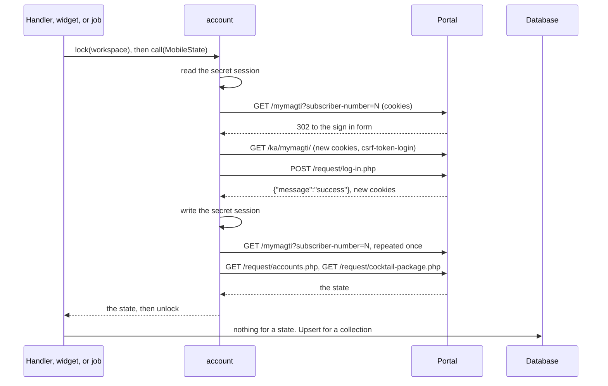

# Specification: The telecom account of a workspace

## 1. Summary

The new plugin `dev.maroid.magti` reads the portal of the telecom service at
`https://www.magticom.ge`. A connect signs in through the form of the portal and stores the
session cookies as the workspace plugin secret `session` of `PSECRET`. Every call signs in
again once when the portal rejects the session. An editor assigns one mobile subscriber or
home line in the scoped table `subscriber_assignments`, and the assignment collects nothing.
The daily job reads the statistics of the previous day of an assigned mobile subscriber into
`traffic_days` and `money_entries`. The command `backfill` collects an earlier period. The
widget `subscriber-state` and the page `/subscriber` read the subscriber state from the portal
at each read. The pages `/traffic` and `/money` read the stored rows. No change reaches the hub,
`pluginapi`, or another plugin. `spec-pages.md` holds the decisions of the pages.
`spec-scenarios.md` holds the scenarios.

## 2. Coverage

| Requirement                            | Where this specification realizes it                                                                |
| -------------------------------------- | --------------------------------------------------------------------------------------------------- |
| `MAGTIACC-FR-001`, `MAGTIACC-FR-002`   | Section 4.3, `MAGTIACC-SC-001`                                                                      |
| `MAGTIACC-FR-003`, `MAGTIACC-FR-004`   | `api.yaml`, `MAGTIACC-SC-002`                                                                       |
| `MAGTIACC-FR-005`, `MAGTIACC-FR-006`   | `api.yaml`, `MAGTIACC-DD-004`, `MAGTIACC-SC-003`                                                    |
| `MAGTIACC-FR-007`                      | Section 4.5, `MAGTIACC-SC-004`                                                                      |
| `MAGTIACC-FR-008`, `MAGTIACC-FR-009`   | Section 4.4, `MAGTIACC-DD-001`, `MAGTIACC-DD-002`, `MAGTIACC-SC-005`                                |
| `MAGTIACC-FR-010`, `MAGTIACC-FR-011`   | `MAGTIACC-DD-002`, `MAGTIACC-SC-006`                                                                |
| `MAGTIACC-FR-012`, `MAGTIACC-FR-013`   | `api.yaml`, `MAGTIACC-DD-007`, `MAGTIACC-SC-007`, `MAGTIACC-SC-031`                                 |
| `MAGTIACC-FR-014`                      | `MAGTIACC-DD-003`, `MAGTIACC-SC-008`                                                                |
| `MAGTIACC-FR-015`                      | `MAGTIACC-DD-003`, `MAGTIACC-SC-009`                                                                |
| `MAGTIACC-FR-016` to `MAGTIACC-FR-018` | `api.yaml`, `MAGTIACC-DD-004`, `MAGTIACC-SC-010`, `MAGTIACC-SC-011`                                 |
| `MAGTIACC-FR-019`                      | `MAGTIACC-DD-008`, `MAGTIACC-SC-012`                                                                |
| `MAGTIACC-FR-020`, `MAGTIACC-FR-021`   | Section 4.3, `MAGTIACC-DD-009`, `MAGTIACC-SC-013`                                                   |
| `MAGTIACC-FR-022`                      | Section 4.3, `MAGTIACC-DD-008`, `MAGTIACC-SC-014`                                                   |
| `MAGTIACC-FR-023`                      | Section 4.5, `MAGTIACC-SC-009`                                                                      |
| `MAGTIACC-FR-024`                      | `MAGTIACC-DD-004`, `MAGTIACC-SC-015`                                                                |
| `MAGTIACC-FR-025`, `MAGTIACC-FR-026`   | Section 4.2, `MAGTIACC-DD-010`, `MAGTIACC-SC-016`, `MAGTIACC-SC-017`                                |
| `MAGTIACC-FR-027`                      | Section 4.2, `MAGTIACC-SC-018`                                                                      |
| `MAGTIACC-FR-028`                      | `MAGTIACC-DD-009`, `MAGTIACC-SC-016`                                                                |
| `MAGTIACC-FR-029` to `MAGTIACC-FR-031` | Section 4.3, `MAGTIACC-DD-011`, `MAGTIACC-SC-019`, `MAGTIACC-SC-020`                                |
| `MAGTIACC-FR-032`, `MAGTIACC-FR-033`   | `api.yaml`, `MAGTIACC-DD-005`, `MAGTIACC-DD-013`, `MAGTIACC-SC-021`                                 |
| `MAGTIACC-FR-034` to `MAGTIACC-FR-036` | `api.yaml`, Section 4.5, `MAGTIACC-DD-007`, `MAGTIACC-SC-021`, `MAGTIACC-SC-022`, `MAGTIACC-SC-031` |
| `MAGTIACC-FR-037` to `MAGTIACC-FR-039` | Section 4.3, `MAGTIACC-DD-014`, `MAGTIACC-SC-023`                                                   |
| `MAGTIACC-FR-040` to `MAGTIACC-FR-044` | `api.yaml`, `MAGTIACC-DD-015`, `MAGTIACC-SC-024`                                                    |
| `MAGTIACC-FR-045` to `MAGTIACC-FR-047` | `api.yaml`, `MAGTIACC-DD-016`, `MAGTIACC-DD-017`, `MAGTIACC-SC-025`                                 |
| `MAGTIACC-FR-048` to `MAGTIACC-FR-051` | Section 4.5, `MAGTIACC-SC-026`                                                                      |
| `MAGTIACC-FR-052`, `MAGTIACC-FR-053`   | Section 4.3, `MAGTIACC-SC-027`                                                                      |
| `MAGTIACC-NFR-001`                     | `MAGTIACC-DD-006`, `MAGTIACC-SC-028`                                                                |
| `MAGTIACC-INV-001`                     | Section 4.2, `MAGTIACC-SC-010`                                                                      |
| `MAGTIACC-INV-002`                     | Section 4.2, `MAGTIACC-SC-029`                                                                      |
| `MAGTIACC-INV-003`, `MAGTIACC-INV-004` | `api.yaml`, `MAGTIACC-DD-005`, `MAGTIACC-SC-030`                                                    |

## 3. Guideline compliance

| Rule                            | Guideline         | How this specification obeys it                                                                                                                                                                              |
| ------------------------------- | ----------------- | ------------------------------------------------------------------------------------------------------------------------------------------------------------------------------------------------------------ |
| `PLG-006`, `PLG-007`            | Plugin model      | The plugin adds each capability through the existing interfaces, and reaches every resource through the host.                                                                                                |
| `PLG-008`                       | Plugin model      | The plugin imports no other plugin. The sign in again, the Tbilisi day, and the keyset repeat the electricity plugin. The charts come from `@maroid/ui`.                                                     |
| `ARC-008`                       | Architecture      | No file of the hub changes.                                                                                                                                                                                  |
| `DAT-001`, `DAT-006`, `DAT-009` | Data              | Every table lives in `dev_maroid_magti`. Each `id` is `uuidv7()`.                                                                                                                                            |
| `OWN-004` to `OWN-008`          | Ownership         | Every table carries `workspace_id` and forced row level security. No repository filters by workspace.                                                                                                        |
| `OWN-003`, `OWN-009`            | Ownership         | `backfill` sets the acting workspace from `--workspace`, and no acting user. The job runs with `CronScopePerWorkspace`.                                                                                      |
| `CFG-007`                       | Configuration     | The credentials are workspace settings.                                                                                                                                                                      |
| `EXT-001`, `EXT-002`, `EXT-005` | External services | `service/api-client.go` holds a resty client with `base_url`. A status that is not a success is an error with the status and at most 512 bytes of a body that is not HTML.                                   |
| `LOG-003`, `LOG-007`, `LOG-008` | Logging           | Each service and handler adds `component`. No log line holds the password, a cookie, a CSRF token, or the username.                                                                                          |
| `SEC-013`                       | Security          | Each route and the widget name a permission.                                                                                                                                                                 |
| `CLI-003` to `CLI-006`          | Command line      | `backfill` holds the collector and a logger with `component=command`. `PreRunE` checks the flags.                                                                                                            |
| `API-004`, `ERR-002`            | HTTP API, Errors  | The routes mount under `/workspaces/{workspaceId}/plugins/dev.maroid.magti/api`. Each problem type has the form `/problems/dev.maroid.magti/<slug>`.                                                         |
| `RES-001` (`Z-173`, `Z-171`)    | REST              | An amount travels as the money object. Every integer names `int32`.                                                                                                                                          |
| `RES-005`, `RES-006`            | REST              | Each list answers the `Page` of `libs/rest/page`, declares the set that `sort` takes and its default, and names the acting workspace as its scope. `/monthly-money-totals` is bounded, and answers one page. |
| `RES-009`                       | REST              | Every operation declares the pseudo permission `uid` on the session cookie.                                                                                                                                  |
| `API-002`                       | HTTP API          | The assignment carries an `ETag` from `assigned_at`, and its `PUT` reads `If-Match`. `/connections/self` and `/subscriber-assignments/self` follow `ADR-0015`, `ADR-0018`.                                   |
| `GO-005`                        | Go style          | Every sentinel error lives in `errs/`.                                                                                                                                                                       |
| `UI-005` to `UI-009`            | Web UI            | The remote exports `/subscriber`, `/traffic`, `/money`, and `/account`, and reaches the API through `host.api`.                                                                                              |
| `PKG-001`, `BLD-003`            | Package, Build    | The layout of the electricity plugin. The build plan builds the UI before the `.so`.                                                                                                                         |

## 4. Design

### 4.1 Components

Every path is under `plugins/magti/`, and every path is "create". A file not named here
follows the electricity plugin.

| Path                                                                                                | Holds                                                                                                                                                                                                                                                                                 |
| --------------------------------------------------------------------------------------------------- | ------------------------------------------------------------------------------------------------------------------------------------------------------------------------------------------------------------------------------------------------------------------------------------- |
| `go.mod`                                                                                            | The module `github.com/abgeo/maroid/plugins/magti`, with `golang.org/x/net` for `html`. A row in `go.work`                                                                                                                                                                            |
| `db/migrations/<ts>_table_{subscriber_assignments,traffic_days,money_entries}_create.{up,down}.sql` | Section 4.2                                                                                                                                                                                                                                                                           |
| `errs/errs.go`                                                                                      | `ErrRequestFailed`, `ErrSessionRejected`, `ErrNotConnected`, `ErrCredentialsAbsent`, `ErrCredentialsRejected`, `ErrCodeRequired`, `ErrAccountLocked`, `ErrNotAssigned`, `ErrHomeLine`, `ErrSubscriberUnknown`, `ErrSubscriberUnsupported`, `ErrSubscriberAbsent`, `ErrReversedPeriod` |
| `config/config.go`                                                                                  | `Config` (section 4.3), `WorkspaceSettings` with `Username`, `Password`                                                                                                                                                                                                               |
| `model/connection.go`                                                                               | `ConnectionState`, `Connection`, `SubscriberKind` (`mobile`, `home_line`, `other`), `Subscriber` with `Number`, `Label`, `Kind`, `Assigned`, `Assignment` with `SubscriberNumber`, `Kind`                                                                                             |
| `model/session.go`                                                                                  | `Session` with `Cookies map[string]string`. `MarshalSecret`, `ParseSession`                                                                                                                                                                                                           |
| `model/state.go`                                                                                    | `State` with `Kind`, `Status`, `Balance` in `Tetri`, `Plan *Plan`, `Allowances *Allowances`, `Speed`. `Plan` with `Name`, `Price` in `Tetri`, `RenewsAt *time.Time`, `DaysLeft`. `Allowances` with `DataMB`, `CallSeconds`, `SMS`                                                     |
| `model/traffic.go`, `model/money.go`                                                                | `TrafficDay` and `MoneyEntry` (section 4.2), `Direction` (`in`, `out`), `Tetri`, `MonthTotal`, `Collection` with `Days`, `NewEntries`                                                                                                                                                 |
| `model/period.go`                                                                                   | `Tbilisi()`, `Day`, `Period` (first and last day), `PreviousDay(now)`, `Period.Months() []Period`, `ParseDay`                                                                                                                                                                         |
| `dto/api-client.go`                                                                                 | `LogInAnswer`, `Accounts`, `IspAccounts`, `AccountData`, `CocktailPackage`, `Statistics`, `UsageRow`, `MoneyRow`, and the readers of section 4.4                                                                                                                                      |
| `dto/{connection,state,traffic,money}.go`                                                           | `ConnectionResponse`, `SubscriberResponse`, `AssignmentRequest`, `StateResponse`, `TrafficDayResponse`, `MoneyEntryResponse`, `MonthTotalResponse`, `MoneyResponse`                                                                                                                   |
| `service/api-client.go`                                                                             | `APIClient`: `SignIn`, `Subscribers`, `Select`, `MobileState`, `HomeLineState`, `OpenStatistics`, `Usage`, `Money` (section 4.4)                                                                                                                                                      |
| `service/account.go`                                                                                | `Account`: `credentials`, `session`, `signIn`, `forgetSession`, `lock` (`MAGTIACC-DD-007`), and `callLocked`, the `callWith` of the electricity plugin. The connections, the states, and the collector share one `Account`                                                            |
| `service/connection.go`                                                                             | `Connections`: `Status`, `Connect`, `Disconnect`, `Assign`                                                                                                                                                                                                                            |
| `service/state.go`                                                                                  | `States.Read(ctx) (model.State, error)`, bound by `state_timeout` (`MAGTIACC-DD-006`)                                                                                                                                                                                                 |
| `service/collector.go`                                                                              | `Collector.Collect(ctx, period model.Period) (model.Collection, error)`                                                                                                                                                                                                               |
| `service/store.go`                                                                                  | `Store` over `PluginDB`, one transaction for each call                                                                                                                                                                                                                                |
| `repository/{assignment,traffic,money,keyset}.go`                                                   | `SubscriberAssignment`: `Get`, `Put`, `Delete`. `Traffic`: `Upsert`, `List`. `Money`: `Insert(ctx, *model.MoneyEntry) (bool, error)`, `List`, `MonthTotals`                                                                                                                           |
| `job/traffic_collector.go`                                                                          | `TrafficCollector`                                                                                                                                                                                                                                                                    |
| `cli/{doc,backfill}.go`                                                                             | `Backfill`, `NewBackfill`, `Command() *cobra.Command`                                                                                                                                                                                                                                 |
| `handler/{doc,connection,state,traffic,money,problem}.go`                                           | `ConnectionHandler`, `StateHandler`, `TrafficHandler`, `MoneyHandler`, the problem types of section 4.5                                                                                                                                                                               |
| `permission/permission.go`                                                                          | `AccountRead`, `AccountConnect`                                                                                                                                                                                                                                                       |
| `widget/{doc,subscriber_state}.go`                                                                  | `NewSubscriberState`                                                                                                                                                                                                                                                                  |
| `embed.go`, `main.go`                                                                               | `uiAssets`. `MagtiPlugin`: `Meta` (`Magti`, "Mobile and home line balances and traffic from Magti.", version `0.1.0`), `SettingsModel`, `CronJobs`, `Migrations`, `Commands`, `Permissions`, `Routes`, `Widgets`, `UIManifest`                                                        |
| `internal/fakeportal/`, `internal/fakes/`                                                           | The fake portal, and the secrets, the settings, and the store in memory, of the tests. No production code imports them                                                                                                                                                                |
| `ui/`                                                                                               | The UI of the electricity plugin with the pages of `spec-pages.md`                                                                                                                                                                                                                    |
| `config.yaml` at the repository root                                                                | The block of `dev.maroid.magti` with the defaults of section 4.3                                                                                                                                                                                                                      |

Each service, handler, and widget depends on an interface that it declares, and `Store` or
the service meets it. The plugin declares no notification topic.

### 4.2 Data model

The session lives in the workspace plugin secret `session`, with no expiry: a JSON object
`{"cookies": {"<name>": "<value>"}}` with every cookie that the sign in sets.

| Table                    | Schema             | Scope     | Realizes                                                |
| ------------------------ | ------------------ | --------- | ------------------------------------------------------- |
| `subscriber_assignments` | `dev_maroid_magti` | Workspace | `MAGTIACC-FR-016`, `MAGTIACC-INV-001`                   |
| `traffic_days`           | `dev_maroid_magti` | Workspace | `MAGTIACC-FR-025`, `MAGTIACC-FR-027`, `MAGTIACC-FR-028` |
| `money_entries`          | `dev_maroid_magti` | Workspace | `MAGTIACC-FR-026`, `MAGTIACC-FR-027`, `MAGTIACC-FR-028` |

`subscriber_assignments`: `id`, `workspace_id` `UNIQUE`, `subscriber_number` `TEXT` of 1 to
64 characters, `kind` `TEXT` `CHECK (kind IN ('mobile', 'home_line'))`, `assigned_at`. `Put`
runs `INSERT ... ON CONFLICT (workspace_id) DO UPDATE`, and sets `assigned_at` to `now()`.
`assigned_at` builds the `ETag` of the assignment, as `APIFMT-DD-014` builds one from the moment
of the last write. `GET /connections/self` and `PUT /subscriber-assignments/self` answer it when
the workspace holds an assignment. A `PUT` whose `If-Match` names another value changes nothing,
and answers 412 `precondition-failed` (`API-002`).

`traffic_days`:

| Column              | Type          | Null | Default              | Note                                   |
| ------------------- | ------------- | ---- | -------------------- | -------------------------------------- |
| `id`                | `UUID`        | no   | `uuidv7()`           | Primary key                            |
| `workspace_id`      | `UUID`        | no   | the acting workspace |                                        |
| `subscriber_number` | `TEXT`        | no   |                      |                                        |
| `day`               | `DATE`        | no   |                      | A day of Tbilisi                       |
| `data_mb`           | `NUMERIC`     | yes  |                      | `MB`, `chartData`                      |
| `call_in_seconds`   | `INTEGER`     | yes  |                      | `MIN`, `chartDataIn` times 60, rounded |
| `call_out_seconds`  | `INTEGER`     | yes  |                      | `MIN`, `chartData` times 60, rounded   |
| `sms_received`      | `INTEGER`     | yes  |                      | `SMS`, `chartDataIn`                   |
| `sms_sent`          | `INTEGER`     | yes  |                      | `SMS`, `chartData`                     |
| `collected_at`      | `TIMESTAMPTZ` | no   | `now()`              | Set again at each update               |

The constraint `traffic_days_identity_key` is `UNIQUE (workspace_id, subscriber_number, day)`.
`Upsert` runs `ON CONFLICT ON CONSTRAINT traffic_days_identity_key DO UPDATE` on every value
column and `collected_at`. A series that holds no row of a day leaves its columns null.

`money_entries`:

| Column              | Type          | Null | Default              | Note                                                   |
| ------------------- | ------------- | ---- | -------------------- | ------------------------------------------------------ |
| `id`                | `UUID`        | no   | `uuidv7()`           | Primary key                                            |
| `workspace_id`      | `UUID`        | no   | the acting workspace |                                                        |
| `subscriber_number` | `TEXT`        | no   |                      |                                                        |
| `occurred_at`       | `TIMESTAMPTZ` | no   |                      | `transactionDate`, a time of Tbilisi                   |
| `direction`         | `TEXT`        | no   |                      | `CHECK (direction IN ('in', 'out'))`. `in` is a top up |
| `kind`              | `TEXT`        | no   |                      | `actionType`, as the portal gives it                   |
| `amount`            | `NUMERIC`     | no   |                      | The absolute value of `entryAmount`, in lari           |
| `collected_at`      | `TIMESTAMPTZ` | no   | `now()`              |                                                        |

The constraint `money_entries_identity_key` is `UNIQUE (workspace_id, subscriber_number,
occurred_at, kind, direction, amount)`. `Insert` runs `ON CONFLICT ... DO NOTHING RETURNING id`,
and answers true for a row stored for the first time. The index
`money_entries_list_idx (workspace_id, subscriber_number, occurred_at DESC, id DESC)` serves the
list and the totals.

Every table takes the policy of `OWN-006`. No foreign key joins them, because the traffic and a
money entry outlive their assignment.

### 4.3 Declarations

**HTTP routes.** The prefix is `/workspaces/{workspaceId}/plugins/dev.maroid.magti/api`.
`api.yaml` holds the bodies and the status codes.

| Method   | Path                           | Permission        | Realizes                                                                       |
| -------- | ------------------------------ | ----------------- | ------------------------------------------------------------------------------ |
| `GET`    | `/connections/self`            | `account.read`    | `MAGTIACC-FR-003` to `MAGTIACC-FR-007`, `MAGTIACC-FR-014`, `MAGTIACC-FR-015`   |
| `PUT`    | `/connections/self`            | `account.connect` | `MAGTIACC-FR-008` to `MAGTIACC-FR-011`                                         |
| `DELETE` | `/connections/self`            | `account.connect` | `MAGTIACC-FR-012`, `MAGTIACC-FR-013`                                           |
| `PUT`    | `/subscriber-assignments/self` | `account.connect` | `MAGTIACC-FR-016` to `MAGTIACC-FR-019`                                         |
| `GET`    | `/subscriber-states/self`      | `account.read`    | `MAGTIACC-FR-032` to `MAGTIACC-FR-036`                                         |
| `GET`    | `/traffic-days`                | `account.read`    | `MAGTIACC-FR-040` to `MAGTIACC-FR-044`, `MAGTIACC-FR-048` to `MAGTIACC-FR-051` |
| `GET`    | `/money-entries`               | `account.read`    | `MAGTIACC-FR-045`, `MAGTIACC-FR-046`, `MAGTIACC-FR-048` to `MAGTIACC-FR-051`   |
| `GET`    | `/monthly-money-totals`        | `account.read`    | `MAGTIACC-FR-047` to `MAGTIACC-FR-051`                                         |

**Permissions.**

| Name              | Description                                                                | Lowest   | Realizes          |
| ----------------- | -------------------------------------------------------------------------- | -------- | ----------------- |
| `account.read`    | Read the telecom account, the subscriber state, the traffic, and the money | `viewer` | `MAGTIACC-FR-052` |
| `account.connect` | Connect the telecom account and assign its subscriber                      | `editor` | `MAGTIACC-FR-053` |

**Settings.** Both fields carry `x-maroid-scope=workspace`.

| Field      | Kind      | Title                    | Realizes                             |
| ---------- | --------- | ------------------------ | ------------------------------------ |
| `username` | free text | Phone number or username | `MAGTIACC-FR-001`                    |
| `password` | secret    | Password                 | `MAGTIACC-FR-001`, `MAGTIACC-FR-002` |

**Configuration.**

| Key                               | Type                   | Default                   | Realizes                             |
| --------------------------------- | ---------------------- | ------------------------- | ------------------------------------ |
| `base_url`                        | URL, no trailing slash | `https://www.magticom.ge` | `MAGTIACC-FR-009`                    |
| `request_timeout`                 | duration               | `15s`                     | `MAGTIACC-FR-007`                    |
| `state_timeout`                   | duration, at most `4s` | `4s`                      | `MAGTIACC-NFR-001`                   |
| `cron_schedule.traffic_collector` | cron                   | `0 9 * * *`               | `MAGTIACC-FR-020`, `MAGTIACC-FR-021` |

**Cron job.**

| Identifier          | Scope                   | Behavior                                                                                                                                  | Realizes                               |
| ------------------- | ----------------------- | ----------------------------------------------------------------------------------------------------------------------------------------- | -------------------------------------- |
| `traffic_collector` | `CronScopePerWorkspace` | `Collect` with the period of `PreviousDay(now)`. `ErrNotConnected`, `ErrNotAssigned`, and `ErrHomeLine` log a skip at info and answer nil | `MAGTIACC-FR-020` to `MAGTIACC-FR-024` |

**CLI command.** The registrar mounts it under `maroid dev-maroid-magti`.

| Command    | Flags                                                                   | Behavior                                                                          | Realizes                               |
| ---------- | ----------------------------------------------------------------------- | --------------------------------------------------------------------------------- | -------------------------------------- |
| `backfill` | `--workspace` (UUID), `--from` and `--to` (`YYYY-MM-DD`), each required | `Collect` for each month of `Period.Months()`, and print the counts of each month | `MAGTIACC-FR-029` to `MAGTIACC-FR-031` |

**UI routes.**

| Page route    | Navigation entry | Page                | Realizes                                                                       |
| ------------- | ---------------- | ------------------- | ------------------------------------------------------------------------------ |
| `/subscriber` | "Subscriber"     | `Subscriber.svelte` | `MAGTIACC-FR-032` to `MAGTIACC-FR-036`                                         |
| `/traffic`    | "Traffic"        | `Traffic.svelte`    | `MAGTIACC-FR-040` to `MAGTIACC-FR-044`, `MAGTIACC-FR-048` to `MAGTIACC-FR-051` |
| `/money`      | "Money"          | `Money.svelte`      | `MAGTIACC-FR-045` to `MAGTIACC-FR-051`                                         |
| `/account`    | "Account"        | `Account.svelte`    | `MAGTIACC-FR-003` to `MAGTIACC-FR-019`                                         |

**Widget.**

| Key                | Title | Kind   | Size | Permission     | Realizes                                                  |
| ------------------ | ----- | ------ | ---- | -------------- | --------------------------------------------------------- |
| `subscriber-state` | Magti | `stat` | `s`  | `account.read` | `MAGTIACC-FR-034`, `MAGTIACC-FR-037` to `MAGTIACC-FR-039` |

### 4.4 Flow

`APIClient` sends the cookies of the session on each request, and reads each `Set-Cookie` by
hand. A data call follows no redirect. A read of a page follows at most 5 redirects on the host
of the portal, and a cookie that a page sets joins the session. `callLocked` stores the session
again after a call that changed its cookies. Every request sends a browser `User-Agent` and ends after
`request_timeout`. The calls:

| Call             | Requests                                                                                                                                                                                                                                                                                                                                                                                                                                                  |
| ---------------- | --------------------------------------------------------------------------------------------------------------------------------------------------------------------------------------------------------------------------------------------------------------------------------------------------------------------------------------------------------------------------------------------------------------------------------------------------------- |
| `SignIn`         | `GET /ka/mymagti/` for `input[name=csrf-token-login]`, then `POST /request/log-in.php` as a form: `subscriber`, `password`, `action` empty, `csrf-token-login`. `MAGTIACC-DD-002` reads the answer                                                                                                                                                                                                                                                        |
| `Subscribers`    | `GET /ka/mymagti/`. Each link whose query holds `subscriber-number` is a subscriber. The number is the value, and the label is the text of the link without the number. The menu holds no link to the selected subscriber, so `Subscribers` then selects the first link whose number does not start with `d_`, or the first link, and reads the menu again. The one new link is the subscriber selected before. A page with no link is `ErrRequestFailed` |
| `Select`         | `GET /mymagti?subscriber-number=<n>`. The portal then answers every call for that subscriber                                                                                                                                                                                                                                                                                                                                                              |
| The kind         | The `data-source` of `.accounts` on the page of the selected subscriber: `request/accounts.php` is `mobile`, `request/accounts-isp.php` is `home_line`, any other is `other`. A number that starts with `d_` is `other` with no request. `Subscribers` answers the kind of each subscriber, and selects only a subscriber whose kind the two pages did not give                                                                                           |
| `MobileState`    | `GET /request/accounts.php`: `status`, `balances[]` keyed by `accountGroupConfigItems[0].accountGroupKey` (`BALANCE`, `INTERNET`, `MINUTES`, `SMS`), and `activeCocktail` with `cocktailId`, `untilDate`, `validityId`. Then `GET /request/cocktail-package.php` with `package-id`, `auto-top-up=1`, `validityId`: `name`, or the `WEB_NAME` attribute, and `price`                                                                                       |
| `HomeLineState`  | `GET /request/accounts-isp.php`: `package_sum`, `balances[]` keyed by `groupKey` (`ISP_BALANCE`, `ISP_INTERNET`). Then `GET /request/account-data.php?subscriber-number=<n>`: `statusName`, `daysRemaining`                                                                                                                                                                                                                                               |
| `OpenStatistics` | `GET /ka/mymagti/statistics` for `input[name=csrf-token]`. `POST /request/accept-terms.php` with `post=statistics-terms`. `POST /request/statistics.php` with `step=1`, `flow=statistics`, `terms_post=statistics-terms`, `mobile-number`, `csrf-token`. The answer `success` opens it                                                                                                                                                                    |
| `Usage`, `Money` | `POST /request/statistics.php` with `step=3`, `flow=statistics`, `mobile-number`, `csrf-token`, `key` (`MB`, `MIN`, `SMS`, or `GEL`), `date[from]` and `date[to]` as `DD/MM/YYYY`, and `charge-type` (`expense`, or `income` for the top ups). The answer is `{name, key, history[]}`                                                                                                                                                                     |

The readers of `dto/` follow `MAGTIACC-DD-009`. A minute value `56:16` is 3376 seconds. A
balance `"0.03"` parses as a number. A value that does not parse is `ErrRequestFailed`. An
answer that holds no `BALANCE`, or no `ISP_BALANCE` for a home line, is `ErrRequestFailed`. An
amount of money is a count of tetri, the hundredth of a lari, so a sum holds no error of a
binary fraction. The database keeps lari as `NUMERIC`.

### 4.5 Errors

| Condition                                                                                | Route answer                                                                                                                              | Collection                                                   |
| ---------------------------------------------------------------------------------------- | ----------------------------------------------------------------------------------------------------------------------------------------- | ------------------------------------------------------------ |
| No `session` secret                                                                      | `GET` connection: 200 `not_connected`. Any other route that calls the portal: 409 `not-connected`. The widget: not set up                 | Skip                                                         |
| The portal rejects the session                                                           | Sign in again once (`MAGTIACC-DD-003`)                                                                                                    | Sign in again once                                           |
| The settings are absent                                                                  | `PUT` connection: 422 `credentials-absent`. Another route, after the portal rejects the session: the session goes, then as "no session"   | Error `ErrCredentialsAbsent`. The session goes               |
| The portal answers `invalid-credentials`, `two-factor-code-required`, or `locked`        | `PUT` connection: 422 `credentials-rejected`, `code-required`, or `account-locked`. Another route: the session goes, then as "no session" | Error with that sentinel. The session goes                   |
| The number is not in the list of the account                                             | 422 `subscriber-unknown`                                                                                                                  | Error `ErrSubscriberAbsent`, nothing stored                  |
| The number is a subscriber of kind `other`                                               | 422 `subscriber-unsupported`                                                                                                              | Not reached                                                  |
| No assigned subscriber                                                                   | 409 `not-assigned`. The widget: not set up                                                                                                | Skip                                                         |
| The assigned subscriber is a home line                                                   | `GET /traffic-days`, `/money-entries`, `/monthly-money-totals`: 409 `home-line`                                                           | Skip. `backfill` fails with `ErrHomeLine`                    |
| `backfill` with no connection or no assignment                                           | Not reached                                                                                                                               | The command fails with `ErrNotConnected` or `ErrNotAssigned` |
| `backfill` with `--from` after `--to`, a day that does not parse, or a bad `--workspace` | Not reached                                                                                                                               | `PreRunE` fails, and no service is called                    |
| The body of the assignment passes 4 KiB                                                  | 413 `/problems/http/content-too-large`                                                                                                    | Not reached                                                  |
| A query value that does not parse                                                        | 400 `/problems/http/request-invalid`                                                                                                      | Not reached                                                  |
| The portal answers 5xx, an unknown answer, a page with no CSRF token, or nothing         | 502 `service-unavailable`. The session stays. The widget answers the error                                                                | Error `ErrRequestFailed`                                     |
| A read of the state passes `state_timeout`                                               | 502 `service-unavailable`, with the detail "no answer in time". The widget answers the error                                              | Not reached                                                  |

No detail names the password, a cookie, a CSRF token, or the username.

## 5. Design decisions

### `MAGTIACC-DD-001`

**Realizes:** `MAGTIACC-FR-009`
**Decision:** `PUT /connections/self` signs in, writes `session`, lists the subscribers with
their kinds, and answers 200 with the connection, as the electricity plugin does.
**Rationale:** No code by phone exists, so no pending state exists. A repeat has no new effect.
**Alternatives:** `POST /connections`. It overstates a repeat.

### `MAGTIACC-DD-002`

**Realizes:** `MAGTIACC-FR-009` to `MAGTIACC-FR-011`, `MAGTIACC-FR-015`
**Decision:** `SignIn` runs two requests with no cookie jar. The `message` of the JSON answer of
`log-in.php` decides: `success` is a session, `invalid-credentials` is `ErrCredentialsRejected`,
`two-factor-code-required` is `ErrCodeRequired`, `locked` is `ErrAccountLocked`, and any other
value is `ErrRequestFailed`. `golang.org/x/net/html` reads the token of the form.
**Rationale:** One client serves every workspace, so a shared jar would carry the session of one
workspace into another. The script of the portal reads these four values, and no other.
**Alternatives:** `goquery`. It adds a module for two selectors.

### `MAGTIACC-DD-003`

**Realizes:** `MAGTIACC-FR-014`, `MAGTIACC-FR-015`, `MAGTIACC-FR-023`
**Decision:** A redirect, a 401, a 403, or the body `false` from a data call is
`ErrSessionRejected`. `callWith` signs in, writes the new `session`, and repeats the call once.
A rejection of the sign in, or absent settings, deletes `session` and keeps the assignment.
The collection answers that error. Every route but `PUT /connections/self` answers it as
`ErrNotConnected`, and the widget as not set up. A second `ErrSessionRejected` is
`ErrRequestFailed`. Step 10 of the build plan confirms each signal
against the portal.
**Rationale:** The script of the portal treats `false` as "no data" and reloads. A repeat bounds
the cost to one sign in.
**Alternatives:** Sign in at each action. Each read of the widget then costs two more requests.

### `MAGTIACC-DD-004`

**Realizes:** `MAGTIACC-FR-005`, `MAGTIACC-FR-016` to `MAGTIACC-FR-018`, `MAGTIACC-FR-024`
**Decision:** The connection reads `Subscribers`, which answers the kind of each one. `Assign`
does the same, refuses a number that the list does not hold, refuses kind `other`, and stores
the number with its kind. `Collect` reads `Subscribers` alone, and answers `ErrSubscriberAbsent`
when the list does not hold the number. No reader decodes a name, a personal number, or a
contact of the holder.
**Rationale:** The portal names the kind only through the page of the selected subscriber. A
stored kind lets the job and the pages skip a home line with no call. An account holds few
subscribers, so one request each stays cheap.
**Alternatives:** The kind from the form of the number. A home line and a mobile number both
hold nine digits, so the rule guesses.

### `MAGTIACC-DD-005`

**Realizes:** `MAGTIACC-FR-032`, `MAGTIACC-FR-033`, `MAGTIACC-INV-004`
**Decision:** `States.Read` selects the assigned subscriber and calls `MobileState` or
`HomeLineState` by the stored kind. A mobile subscriber with no `activeCocktail.cocktailId` has
no plan, and skips `cocktail-package.php`. `DaysLeft` of a mobile plan counts the days of
Tbilisi from today to `untilDate`. `dto.Accounts` decodes the members of section 4.4 alone, so
`signContractToken` and the attributes of the holder never reach a value of Go.
**Rationale:** The portal answers each kind from a different call, as its own page does.
**Alternatives:** Read the rendered page. The page holds the same values only after its script runs.

### `MAGTIACC-DD-006`

**Realizes:** `MAGTIACC-NFR-001`, `MAGTIACC-FR-034`
**Decision:** `States.Read` runs under `context.WithTimeout(ctx, state_timeout)`. A passed
deadline is `ErrRequestFailed` that wraps `context.DeadlineExceeded`, and the route answers 502
`service-unavailable`. `Config` refuses a `state_timeout` above `4s`.
**Rationale:** A read with a new sign in costs five requests. The hub ends a widget at 5 seconds,
and a plugin error at 4 seconds names the cause.
**Alternatives:** A copy of the state with a time to live. `WIDGET-INV-002` and the owner rule it out.

### `MAGTIACC-DD-007`

**Realizes:** `MAGTIACC-FR-005`, `MAGTIACC-FR-020`, `MAGTIACC-FR-034`
**Decision:** `account.lock(workspaceID)` holds a mutex for each workspace, in the process, from
the first `Select` to the last read of that call. The connection, the state, and the
collection take it. `Disconnect` takes it too, so no sign in of another call stores a session
after the end of the connection.
**Rationale:** The portal keeps the selected subscriber in the session. A widget read and a
connection read of one workspace at the same time would select over each other.
**Alternatives:** A session for each call. Each read then signs in, and the portal can lock an
account after many sign ins. A database lock. The hub runs one process.

### `MAGTIACC-DD-008`

**Realizes:** `MAGTIACC-FR-019`, `MAGTIACC-FR-022`
**Decision:** `Assign` stores the assignment and answers. `Collect` reads the assignment first,
and answers `ErrHomeLine` for a home line before any call of the portal.
**Rationale:** An assignment answers at once, as in the electricity plugin (`ELECACC-DD-006`).
**Alternatives:** A collection of 30 days at the assignment. It holds the request for eight calls.

### `MAGTIACC-DD-009`

**Realizes:** `MAGTIACC-FR-020`, `MAGTIACC-FR-028`
**Decision:** Days are days of Tbilisi, `time.FixedZone("Asia/Tbilisi", 4*60*60)`.
`PreviousDay(now)` answers the day before the one of `now`. A usage row takes `day`, a moment in
milliseconds, as the day of Tbilisi of that moment. The reader skips a row whose `sum` is true,
and a row whose `day` is zero or before 2000. A money row parses `transactionDate`
(`DD/MM/YYYY HH:MM:SS`) in Tbilisi, and skips a row whose `sum` is true. `Collect` opens the
statistics once, reads the five series, merges the three usage series by day, and writes every
row in one transaction. A failed series fails the call, and stores nothing.
**Rationale:** The total row of the portal carries `sum`, so the old rule "drop the last row"
is not needed. One transaction keeps a day whole.
**Alternatives:** Store each series as it arrives. A failure then leaves a day with half its columns.

### `MAGTIACC-DD-010`

**Realizes:** `MAGTIACC-FR-025`, `MAGTIACC-FR-026`
**Decision:** `traffic_days` keys on the day and updates every value. `money_entries` keys on
the moment, the kind, the direction, and the amount, and ignores a repeat.
**Rationale:** The portal corrects the traffic of a day, but answers no identifier of a money
entry. The moment holds seconds, so two different entries rarely share the key, and the kind
and the amount tell them apart.
**Alternatives:** The moment alone, as the old collector did. Two charges of one second then
merge into one.

### `MAGTIACC-DD-011`

**Realizes:** `MAGTIACC-FR-029` to `MAGTIACC-FR-031`
**Decision:** `backfill` sets the acting workspace with `pluginapi.ContextWithActingWorkspace`,
and no acting user. It divides the period into calendar months, cut to the period, calls
`Collect` once for each, and stops at the first failure. A month with no rows prints zero.
**Rationale:** One statistics call answers one period, and a month bounds the size of one
answer. A failure names its month.
**Alternatives:** One call for the whole period. One failure then names no month.

`spec-pages.md` holds `MAGTIACC-DD-012` to `MAGTIACC-DD-017`.

## 6. Scenarios

`spec-scenarios.md` holds `MAGTIACC-SC-001` to `MAGTIACC-SC-031`.

## 7. Build plan

| #   | Step                                                                                                                                | Realizes                                                   | Done |
| --- | ----------------------------------------------------------------------------------------------------------------------------------- | ---------------------------------------------------------- | ---- |
| 1   | The module, `go.work`, `errs/`, `model/`, `config/`, `permission/`, and `config.yaml`                                               | `MAGTIACC-FR-001`, `MAGTIACC-FR-002`, `MAGTIACC-FR-021`    | [x]  |
| 2   | `service/api-client.go` and `dto/api-client.go`, against an `httptest` portal                                                       | `MAGTIACC-FR-009` to `MAGTIACC-FR-011`, `MAGTIACC-FR-014`  | [x]  |
| 3   | The three migrations and `repository/`                                                                                              | `MAGTIACC-FR-016`, `MAGTIACC-FR-025` to `MAGTIACC-FR-027`  | [x]  |
| 4   | `service/store.go`, `service/account.go`, `service/collector.go`                                                                    | `MAGTIACC-FR-020` to `MAGTIACC-FR-028`                     | [x]  |
| 5   | The job and `cli/backfill.go`                                                                                                       | `MAGTIACC-FR-029` to `MAGTIACC-FR-031`                     | [x]  |
| 6   | `service/connection.go`, `handler/connection.go`, `dto/connection.go`                                                               | `MAGTIACC-FR-003` to `MAGTIACC-FR-019`                     | [x]  |
| 7   | `service/state.go`, `handler/state.go`, `widget/subscriber_state.go`                                                                | `MAGTIACC-FR-032` to `MAGTIACC-FR-039`, `MAGTIACC-NFR-001` | [x]  |
| 8   | `handler/traffic.go`, `handler/money.go`, their DTOs, `api.yaml`, and `main.go`                                                     | `MAGTIACC-FR-040` to `MAGTIACC-FR-053`                     | [x]  |
| 9   | `ui/`, `embed.go`, and `UIManifest`. Build the UI, then the `.so` (`BLD-003`)                                                       | `MAGTIACC-FR-003` to `MAGTIACC-FR-050`                     | [x]  |
| 10  | Run against the portal: an ended session, both kinds of state, a `backfill` of 12 months. Correct `MAGTIACC-DD-003` and section 4.4 | `MAGTIACC-FR-014`, `MAGTIACC-FR-031`, `MAGTIACC-NFR-001`   | [ ]  |
| 11  | The tests of `spec-scenarios.md`. Lint and build the plugin                                                                         | Every statement                                            | [x]  |

## Retired identifiers

This file has no retired identifier.
