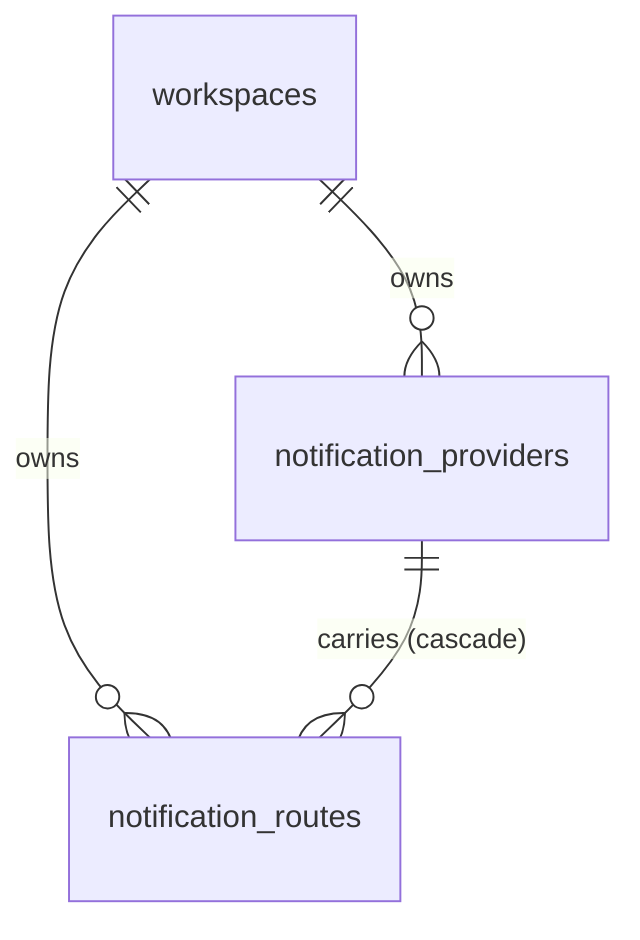
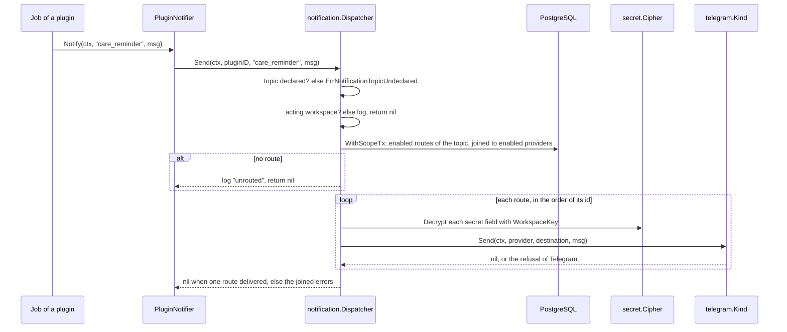

# Specification: The notification providers of a workspace and the routes of a notification

## 1. Summary

A plugin declares its notification topics as a capability, and sends through
`pluginapi.PluginNotifier`, which names the plugin to the hub. The hub package
`apps/hub/internal/notification` holds a registry of notification provider kinds, the
service that the routes of the deck call, and the dispatcher that delivers a notification
through each enabled notification route. Two scoped tables hold the records:
`public.notification_providers` and `public.notification_routes`. A secret field of a
notification provider takes the transit key of its workspace through `secret.Cipher`, as
`PSET` gives. `libs/notifier` and `libs/notifierapi` end, as `ADR-0013` decides.

`spec-scenarios.md` holds the scenarios. `api.yaml` holds the routes.

## 2. Coverage

| Requirement     | Where this specification realizes it                         |
| --------------- | ------------------------------------------------------------ |
| `NOTIF-FR-001`  | Section 4.1, `NOTIF-DD-001`, `NOTIF-SC-001`                  |
| `NOTIF-FR-002`  | `NOTIF-DD-001`, `NOTIF-SC-002`                               |
| `NOTIF-FR-003`  | `NOTIF-DD-002`, `NOTIF-SC-003`                               |
| `NOTIF-FR-004`  | Section 4.3, `NOTIF-DD-006`, `NOTIF-SC-004`                  |
| `NOTIF-FR-005`  | `NOTIF-DD-006`, `NOTIF-SC-004`                               |
| `NOTIF-FR-006`  | Section 4.3, `NOTIF-DD-007`, `NOTIF-SC-005`                  |
| `NOTIF-FR-007`  | Section 4.3, `NOTIF-SC-006`                                  |
| `NOTIF-FR-008`  | `NOTIF-DD-006`, `NOTIF-SC-006`                               |
| `NOTIF-FR-009`  | Section 4.2, `NOTIF-SC-007`                                  |
| `NOTIF-FR-010`  | Section 4.3, `NOTIF-SC-008`                                  |
| `NOTIF-FR-011`  | Section 4.5, `NOTIF-DD-004`, `NOTIF-SC-009`                  |
| `NOTIF-FR-012`  | Section 4.5, `NOTIF-SC-009`                                  |
| `NOTIF-FR-013`  | `NOTIF-DD-005`, Section 4.5, `NOTIF-SC-010`                  |
| `NOTIF-FR-014`  | `NOTIF-DD-008`, `NOTIF-SC-011`                               |
| `NOTIF-FR-015`  | `NOTIF-DD-008`, `NOTIF-SC-011`                               |
| `NOTIF-FR-016`  | Section 4.3, `NOTIF-SC-012`                                  |
| `NOTIF-FR-017`  | Section 4.2, `NOTIF-SC-013`                                  |
| `NOTIF-FR-018`  | Section 4.3, `NOTIF-SC-014`                                  |
| `NOTIF-FR-019`  | Section 4.3, `NOTIF-SC-014`                                  |
| `NOTIF-FR-020`  | Section 4.3, `NOTIF-SC-015`                                  |
| `NOTIF-FR-021`  | `NOTIF-DD-009`, `NOTIF-SC-016`                               |
| `NOTIF-FR-022`  | `NOTIF-DD-008`, `NOTIF-SC-017`                               |
| `NOTIF-FR-023`  | `NOTIF-DD-008`, `NOTIF-SC-018`                               |
| `NOTIF-FR-024`  | Section 4.4, `NOTIF-DD-003`, `NOTIF-SC-019`                  |
| `NOTIF-FR-025`  | `NOTIF-DD-003`, `NOTIF-SC-020`                               |
| `NOTIF-FR-026`  | `NOTIF-DD-003`, `NOTIF-SC-020`                               |
| `NOTIF-FR-027`  | `NOTIF-DD-003`, `NOTIF-SC-021`                               |
| `NOTIF-FR-028`  | `NOTIF-DD-003`, `NOTIF-SC-022`                               |
| `NOTIF-FR-029`  | `NOTIF-DD-002`, `NOTIF-SC-003`                               |
| `NOTIF-FR-030`  | `NOTIF-DD-010`, `NOTIF-SC-021`, `NOTIF-SC-022`               |
| `NOTIF-FR-031`  | `NOTIF-DD-010`, `NOTIF-SC-020`                               |
| `NOTIF-FR-032`  | `NOTIF-DD-011`, `NOTIF-SC-023`                               |
| `NOTIF-FR-033`  | `NOTIF-DD-006`, `NOTIF-SC-024`                               |
| `NOTIF-FR-034`  | `NOTIF-DD-006`, `NOTIF-SC-004`                               |
| `NOTIF-FR-035`  | `NOTIF-DD-010`, `NOTIF-SC-025`                               |
| `NOTIF-NFR-001` | `NOTIF-DD-012`, `NOTIF-SC-026`                               |
| `NOTIF-NFR-002` | `NOTIF-DD-012`, `NOTIF-SC-027`                               |
| `NOTIF-INV-001` | Section 4.2, `NOTIF-SC-028`                                  |
| `NOTIF-INV-002` | Section 4.2, `NOTIF-SC-028`                                  |
| `NOTIF-INV-003` | `NOTIF-DD-006`, `NOTIF-SC-024`                               |
| `NOTIF-INV-004` | `NOTIF-DD-013`, `NOTIF-SC-029`                               |

## 3. Guideline compliance

| Rule      | Guideline        | How this specification obeys it                                                      |
| --------- | ---------------- | ------------------------------------------------------------------------------------ |
| `NTF-001` | Notifications    | `NOTIF-DD-001`. `pluginapi.NotifyingPlugin`, a registry, and a registrar.            |
| `NTF-002` | Notifications    | `NOTIF-DD-002`. `PluginNotifier.Notify` takes a topic identifier only.               |
| `NTF-004` | Notifications    | `NOTIF-DD-003`. The dispatcher tries each route in order and joins the errors.       |
| `NTF-006` | Notifications    | `notification.KindRegistry` lives in the hub. No plugin reaches it.                  |
| `NTF-007` | Notifications    | `NOTIF-DD-004`, `NOTIF-DD-005`. A kind gives two models and a `Verify` method.       |
| `NTF-008` | Notifications    | Section 4.2, `NOTIF-DD-006`, `NOTIF-DD-013`.                                         |
| `PLG-006` | Plugin model     | `NotifyingPlugin`, `NotificationTopicRegistry`, `NotificationTopicRegistrar`.        |
| `PLG-007` | Plugin model     | A plugin reaches the sender through `Host.Notifier()`.                               |
| `PLG-011` | Plugin model     | `NotificationTopicRegistry.Register` returns `ErrNotificationTopicAlreadyRegistered`. |
| `ARC-008` | Architecture     | No rule names a plugin. A topic reaches the hub as data.                             |
| `DAT-009` | Data             | Each `id` declares `DEFAULT uuidv7()`. No insert names it.                           |
| `OWN-004` | Record ownership | Both tables are scoped to a workspace.                                               |
| `OWN-005` | Record ownership | `workspace_id` takes its value from `app.workspace_id`. No insert names it.          |
| `OWN-006` | Record ownership | Section 4.2 gives the forced policy of each table.                                   |
| `REP-003` | Repository       | Each repository takes `*sqlx.Tx` from `database.WithScopeTx`.                        |
| `SEC-012` | Security         | `NOTIF-DD-008`. The topic list and a new route read the enablements.                 |
| `SEC-013` | Security         | Section 4.3. `notifications.read` for a viewer, `notifications.write` for a manager. |
| `API-002` | The HTTP API     | A `PATCH` reads `If-Match`. A `POST` that creates reads `Idempotency-Key`.          |
| `API-003` | The HTTP API     | Every route lives under `/workspaces*`. The table needs no new row.                  |
| `ERR-003` | Errors           | Section 4.5 adds three hub problem types.                                            |
| `EXT-005` | External         | `NOTIF-DD-005`. A Telegram answer with `ok: false` is a refusal.                     |
| `LOG-005` | Logging          | `NOTIF-DD-010`. `model.NotificationProvider.LogValue` hides the fields.              |
| `JOB-007` | Jobs             | `NOTIF-DD-003`. An unrouted topic returns nil, so the run does not fail.             |
| `CFG-007` | Configuration    | `NOTIF-DD-013`. The `notifier` key leaves `config.Config`.                           |
| `BLD-004` | Build            | Build plan step 11 rebuilds every plugin after `libs/pluginapi` changes.             |
| `PKG-004` | Package layout   | Every new hub package lives under `apps/hub/internal`.                               |

## 4. Design

### 4.1 Components

| Path                                                                     | Action | Holds                                                                                   |
| ------------------------------------------------------------------------ | ------ | --------------------------------------------------------------------------------------- |
| `libs/pluginapi/notification.go`                                         | create | `Message`, `Attachment`, `NotificationTopic`, `NotifyingPlugin`, `NotificationSender`, `PluginNotifier`, `NewPluginNotifier`, `ErrNotificationTopicUndeclared` |
| `libs/pluginapi/host.go`                                                 | change | `Notifier() (NotificationSender, error)` replaces the `notifierapi` method              |
| `libs/pluginapi/go.mod`                                                  | change | Drop `libs/notifierapi`                                                                 |
| `apps/hub/db/migrations/20261011100000_table_notification_providers_create.*` | create | `public.notification_providers`, its policy, its trigger                          |
| `apps/hub/db/migrations/20261011100100_table_notification_routes_create.*` | create | `public.notification_routes`, its policy, its trigger                                 |
| `apps/hub/internal/model/notification.go`                                | create | `NotificationProvider`, `NotificationRoute`, `Destination`, `LogValue` of each          |
| `apps/hub/internal/repository/notification_provider.go`                  | create | `NotificationProviderRepository`, `NewNotificationProvider`                             |
| `apps/hub/internal/repository/notification_route.go`                     | create | `NotificationRouteRepository`, `NewNotificationRoute`                                   |
| `apps/hub/internal/notification/{doc,kind,registry}.go`                  | create | `Kind`, `KindRegistry`, `KindEntry`                                                     |
| `apps/hub/internal/notification/service.go`                              | create | `Service`, `Manager`, `TopicView`, `ProviderInput`, `RouteInput`                        |
| `apps/hub/internal/notification/dispatcher.go`                           | create | `Dispatcher`, which satisfies `pluginapi.NotificationSender`                            |
| `apps/hub/internal/notification/telegram/{doc,kind,send}.go`             | create | `telegram.Kind`, `ProviderFields`, `DestinationFields`. The send code moves from `libs/notifier/transport/telegram`. |
| `apps/hub/internal/registry/notification_topic.go`                       | create | `NotificationTopicRegistry`, `NotificationTopicEntry`                                   |
| `apps/hub/internal/registry/capability.go`                               | change | `CapNotificationTopics`                                                                 |
| `apps/hub/internal/plugin/registrar/notification_topic.go`               | create | `NotificationTopicRegistrar`                                                            |
| `apps/hub/internal/plugin/loader/loader.go`                              | change | `New` takes the topic registry. The registrar joins the list.                           |
| `apps/hub/internal/plugin/host/host.go`                                  | change | `Notifier()` answers the dispatcher                                                     |
| `apps/hub/internal/authz/hub.go`                                         | change | `PermissionNotificationsRead`, `PermissionNotificationsWrite`                           |
| `apps/hub/internal/handler/notification.go`                              | create | `handler.Notification`, every route of section 4.3                                      |
| `apps/hub/internal/domain/errs/errs.go`                                  | change | The sentinels of section 4.5                                                            |
| `apps/hub/internal/domain/problems/problems.go`                          | change | `NewNotificationRouteExists`, `NewDeliveryRefused`, `NewMessagingUnreachable`           |
| `apps/hub/internal/depresolver/notification.go`                          | create | `NotificationKinds`, `NotificationTopicRegistry`, `NotificationService`, `NotificationDispatcher`. Replaces `notifier.go`. |
| `apps/hub/internal/depresolver/{resolver,plugin,server}.go`              | change | The four providers replace the two of the notifier                                      |
| `apps/hub/internal/config/config.go`                                     | change | Drop the `Notifier` field                                                               |
| `libs/notifier/`, `libs/notifierapi/`                                    | delete | `ADR-0013`                                                                              |
| `go.work`, `.golangci.yaml`, `config.yaml`, `chart/values.yaml`          | change | Drop both modules and the `notifier` section. `ireturn` swaps `notifierapi.*` for `pluginapi.NotificationSender` and `notification.Kind`. |
| `apps/deck/src/lib/api/notifications.ts`                                 | create | The client of every route of section 4.3                                                |
| `apps/deck/src/routes/(dashboard)/w/[workspace]/settings/notifications/` | create | The page: the providers list, the topics list, the two dialogs                          |
| `apps/deck/src/lib/components/notifications/`                            | create | `ProviderDialog.svelte`, `RouteDialog.svelte`. Each renders `SchemaForm`.               |
| `apps/deck/src/lib/navigation/breadcrumbs.ts`, `apps/deck/src/lib/permissions.ts` | change | The trail of the page, and the two permissions                               |
| `specs/guidelines/errors.md`                                             | change | Three rows in the table of the hub types                                                |
| `specs/features/notif/api.yaml`                                          | create | Every route. See `SPC-002`.                                                             |

The signatures:

```go
// libs/pluginapi/notification.go

type Attachment struct{ Filename string; Content []byte; MIMEType string }
type Message struct{ Title string; Body string; Attachments []Attachment }

// NotificationTopic is one kind of notification that a plugin sends.
type NotificationTopic struct {
    ID          string
    Name        string
    Description string
}

type NotifyingPlugin interface {
    Plugin
    NotificationTopics() ([]NotificationTopic, error)
}

// NotificationSender delivers a notification of one plugin. The hub implements it.
type NotificationSender interface {
    Send(ctx context.Context, pluginID *PluginID, topicID string, msg Message) error
}

var ErrNotificationTopicUndeclared = errors.New("notification: the plugin does not declare the topic")

func NewPluginNotifier(sender NotificationSender, pluginID *PluginID) *PluginNotifier
func (n *PluginNotifier) Notify(ctx context.Context, topicID string, msg Message) error

// apps/hub/internal/notification/kind.go

// Kind is one external messaging service. Fields of both maps hold plaintext.
type Kind interface {
    ID() string
    Name() string
    ProviderModel() any
    DestinationModel() any
    Verify(ctx context.Context, provider map[string]any) error
    Send(ctx context.Context, provider, destination map[string]any, msg pluginapi.Message) error
}

type KindEntry struct {
    Kind        Kind
    Provider    *settings.Schema
    Destination *settings.Schema
}

func NewKindRegistry() *KindRegistry
func (r *KindRegistry) Register(kind Kind) error   // ErrNotificationKindAlreadyRegistered, ErrNilNotificationKind
func (r *KindRegistry) Get(id string) (KindEntry, bool)
func (r *KindRegistry) All() []KindEntry          // in the order of the identifiers

// apps/hub/internal/notification/service.go

type Service interface {
    Kinds() []KindEntry
    Providers(ctx context.Context) ([]model.NotificationProvider, error)        // secrets masked
    Provider(ctx context.Context, id string) (*model.NotificationProvider, error)
    CreateProvider(ctx context.Context, input ProviderInput) (*model.NotificationProvider, error)
    UpdateProvider(ctx context.Context, id string, input ProviderInput, ifMatch *time.Time) (*model.NotificationProvider, error)
    DeleteProvider(ctx context.Context, id string) error
    Topics(ctx context.Context) ([]TopicView, error)
    CreateRoute(ctx context.Context, input RouteInput) (*model.NotificationRoute, error)
    UpdateRoute(ctx context.Context, id string, input RouteInput, ifMatch *time.Time) (*model.NotificationRoute, error)
    DeleteRoute(ctx context.Context, id string) error
    TestRoute(ctx context.Context, id string) error
}

// ProviderInput and RouteInput carry pointers, so a PATCH changes the named members only.
type ProviderInput struct { Kind *string; Name *string; Fields map[string]any; Enabled *bool }
type RouteInput struct { PluginID *string; TopicID *string; ProviderID *string; Destination map[string]any; Enabled *bool }

// TopicView is one topic of a plugin that the acting workspace enables.
type TopicView struct {
    PluginID string
    Topic    pluginapi.NotificationTopic
    Routes   []model.NotificationRoute
    Unrouted bool
}

// apps/hub/internal/notification/telegram/kind.go
type ProviderFields struct {
    BotToken string `json:"botToken" jsonschema:"title=Bot token,format=password,writeOnly=true,required"`
}
type DestinationFields struct {
    ChatID   string `json:"chatId"   jsonschema:"title=Chat ID,pattern=^-?[0-9]+$,required"`
    ThreadID string `json:"threadId" jsonschema:"title=Thread ID,pattern=^[0-9]*$"`
}

// apps/hub/internal/registry/notification_topic.go
type NotificationTopicEntry struct { PluginID *pluginapi.PluginID; Topic pluginapi.NotificationTopic }
func (r *NotificationTopicRegistry) Register(pluginID *pluginapi.PluginID, topics ...pluginapi.NotificationTopic) error
func (r *NotificationTopicRegistry) Get(pluginID, topicID string) (NotificationTopicEntry, bool)
func (r *NotificationTopicRegistry) Of(pluginID string) []NotificationTopicEntry   // in the declared order
```

### 4.2 Data model

| Table                    | Schema   | Scope  | Migration                                                 | Realizes                                     |
| ------------------------ | -------- | ------ | --------------------------------------------------------- | -------------------------------------------- |
| `notification_providers` | `public` | scoped | `20261011100000_table_notification_providers_create.up.sql` | `NOTIF-FR-004` to `NOTIF-FR-010`, `NOTIF-INV-002`, `NOTIF-INV-003` |
| `notification_routes`    | `public` | scoped | `20261011100100_table_notification_routes_create.up.sql`  | `NOTIF-FR-016` to `NOTIF-FR-020`, `NOTIF-INV-001`, `NOTIF-INV-002` |

`notification_providers`:

| Column         | Type          | Null | Default                                              | Note                                    |
| -------------- | ------------- | ---- | ---------------------------------------------------- | --------------------------------------- |
| `id`           | `UUID`        | No   | `uuidv7()`                                           | Primary key                             |
| `workspace_id` | `UUID`        | No   | `NULLIF(current_setting('app.workspace_id', true), '')::uuid` | References `public.workspaces (id)` |
| `kind`         | `TEXT`        | No   |                                                      | The identifier of a kind                |
| `name`         | `TEXT`        | No   |                                                      | `CHECK (char_length(name) BETWEEN 1 AND 64)` |
| `fields`       | `JSONB`       | No   | `'{}'::jsonb`                                        | `model.Fields`, as `PSET` stores them   |
| `enabled`      | `BOOLEAN`     | No   | `TRUE`                                               |                                         |
| `created_at`   | `TIMESTAMPTZ` | No   | `NOW()`                                              |                                         |
| `updated_at`   | `TIMESTAMPTZ` | No   | `NOW()`                                              | `set_updated_at` trigger                |

Constraint `notification_providers_workspace_id_id_key UNIQUE (workspace_id, id)` serves
the composite foreign key below.

`notification_routes`:

| Column         | Type          | Null | Default                     | Note                                                   |
| -------------- | ------------- | ---- | --------------------------- | ------------------------------------------------------ |
| `id`           | `UUID`        | No   | `uuidv7()`                  | Primary key                                            |
| `workspace_id` | `UUID`        | No   | As the table above          | References `public.workspaces (id)`                    |
| `provider_id`  | `UUID`        | No   |                             | See the foreign key below                              |
| `plugin_id`    | `TEXT`        | No   |                             |                                                        |
| `topic_id`     | `TEXT`        | No   |                             |                                                        |
| `destination`  | `JSONB`       | No   | `'{}'::jsonb`               | Plain values. `NOTIF-DD-004` forbids a secret in it.   |
| `enabled`      | `BOOLEAN`     | No   | `TRUE`                      |                                                        |
| `created_at`   | `TIMESTAMPTZ` | No   | `NOW()`                     |                                                        |
| `updated_at`   | `TIMESTAMPTZ` | No   | `NOW()`                     | `set_updated_at` trigger                               |

- `notification_routes_provider_fkey FOREIGN KEY (workspace_id, provider_id) REFERENCES
  public.notification_providers (workspace_id, id) ON DELETE CASCADE`. The composite key
  enforces `NOTIF-INV-001`, and the cascade realizes `NOTIF-FR-009`.
- `notification_routes_unique_key UNIQUE (workspace_id, plugin_id, topic_id, provider_id,
  destination)` realizes `NOTIF-FR-017`. Two JSONB values with the same members compare
  equal, whatever the order of the members.
- Index `notification_routes_topic_idx (workspace_id, plugin_id, topic_id)` serves the
  dispatcher.

Each table enables and forces row level security, with one policy that
`plugin_workspace_settings_workspace_isolation` gives as the model: `USING` and
`WITH CHECK` on `workspace_id = NULLIF(current_setting('app.workspace_id', true), '')::uuid`.
That realizes `NOTIF-INV-002`.



### 4.3 Declarations

**HTTP routes.** Every path starts with `/workspaces/{workspaceId}`. Every route passes
`auth.Middleware`, `idempotency.Middleware`, and `workspace.Middleware`.

| Method   | Path                                           | Access | Permission            | Realizes                         |
| -------- | ---------------------------------------------- | ------ | --------------------- | -------------------------------- |
| `GET`    | `/notification-provider-kinds`                 | Member | `notifications.read`  | `NOTIF-FR-006`, `NOTIF-FR-016`   |
| `GET`    | `/notification-providers`                      | Member | `notifications.read`  | `NOTIF-FR-004`, `NOTIF-FR-005`   |
| `POST`   | `/notification-providers`                      | Member | `notifications.write` | `NOTIF-FR-006`, `NOTIF-FR-013`   |
| `GET`    | `/notification-providers/{providerId}`         | Member | `notifications.read`  | `NOTIF-FR-004`                   |
| `PATCH`  | `/notification-providers/{providerId}`         | Member | `notifications.write` | `NOTIF-FR-007`, `NOTIF-FR-008`, `NOTIF-FR-010` |
| `DELETE` | `/notification-providers/{providerId}`         | Member | `notifications.write` | `NOTIF-FR-009`                   |
| `GET`    | `/notification-topics`                         | Member | `notifications.read`  | `NOTIF-FR-014`, `NOTIF-FR-015`   |
| `POST`   | `/notification-routes`                         | Member | `notifications.write` | `NOTIF-FR-016`, `NOTIF-FR-017`   |
| `PATCH`  | `/notification-routes/{routeId}`               | Member | `notifications.write` | `NOTIF-FR-018`, `NOTIF-FR-020`   |
| `DELETE` | `/notification-routes/{routeId}`               | Member | `notifications.write` | `NOTIF-FR-019`                   |
| `POST`   | `/notification-routes/{routeId}/test-messages` | Member | `notifications.write` | `NOTIF-FR-021`                   |

`notifications.read` names the lowest role viewer. `notifications.write` names manager.

**Notification topics.** This feature adds no topic. Each plugin declares its own in its
specification, with the columns that `SPC-003` gives.

### 4.4 Flow



### 4.5 Errors

| Condition                                                    | Behavior                                         | Problem                     |
| ------------------------------------------------------------ | ------------------------------------------------ | --------------------------- |
| A field value fails the schema of the kind                   | Store nothing. Name each field.                  | `settings-invalid` (422)    |
| The kind is unknown                                          | Store nothing. Name `/kind`.                     | `validation-failed` (422)   |
| The name is empty or longer than 64 characters               | Store nothing. Name `/name`.                     | `validation-failed` (422)   |
| The route names an undeclared topic, or a plugin not enabled | Store nothing. Name `/topic_id` or `/plugin_id`. | `validation-failed` (422)   |
| The route names a provider that the workspace does not hold  | Store nothing. Name `/provider_id`.              | `validation-failed` (422)   |
| The route repeats another route                              | Store nothing.                                   | `notification-route-exists` (409) |
| Telegram answers `ok: false` to a check or a test message    | Store nothing. Detail: the `description` of Telegram. | `delivery-refused` (422) |
| Telegram does not answer within 10 seconds                   | Store nothing.                                   | `messaging-unreachable` (502) |
| The record moved since the read                              | Change nothing.                                  | `precondition-failed` (412) |
| The provider or the route does not exist in the workspace    | Change nothing.                                  | `not-found` (404)           |
| `secret.Cipher` fails                                        | Store nothing. Log the error with no value.      | `internal` (500)            |

New sentinels in `errs`: `ErrNotificationKindAlreadyRegistered`, `ErrNilNotificationKind`,
`ErrNotificationTopicAlreadyRegistered`, `ErrInvalidNotificationTopic`,
`ErrInvalidNotificationKind`, `ErrNotificationProviderNotFound`,
`ErrNotificationRouteNotFound`, `ErrNotificationRouteExists`, `ErrDeliveryRefused`,
`ErrMessagingUnreachable`.

## 5. Design decisions

### `NOTIF-DD-001`

**Realizes:** `NOTIF-FR-001`, `NOTIF-FR-002`
**Decision:** A plugin implements `pluginapi.NotifyingPlugin`. The registrar refuses a
topic whose identifier fails `^[a-z][a-z0-9_]{0,63}$`, a name outside 1 to 64 characters
after a trim, a description over 280 characters, or a second topic with one identifier.
It records `CapNotificationTopics` with the topic identifiers.
**Rationale:** The limits are those of `PLG-012`. The pattern keeps the identifier safe
in a path and in a log.
**Alternatives:** A topic that the hub learns at the first send. The deck then lists
nothing before the first run, and a manager cannot route it in advance.

### `NOTIF-DD-002`

**Realizes:** `NOTIF-FR-003`, `NOTIF-FR-029`
**Decision:** `Host.Notifier()` answers the `notification.Dispatcher`. The plugin binds it
once with `pluginapi.NewPluginNotifier(sender, meta.ID)`. The dispatcher answers
`ErrNotificationTopicUndeclared` for a topic that the registry does not hold for the plugin.
**Rationale:** The host is one value for every plugin. `PluginDB` and `PluginSettings`
bind the plugin identifier the same way.
**Alternatives:** One host for each plugin. It changes `pluginapi.Constructor` and the
loader for one value.

### `NOTIF-DD-003`

**Realizes:** `NOTIF-FR-024` to `NOTIF-FR-028`
**Decision:** The dispatcher reads the enabled routes of the topic whose provider is
enabled, in one `WithScopeTx`, ordered by `notification_routes.id`. It calls each route
in turn and joins the errors. It returns nil when one route delivers, when no route
exists, or when the context carries no acting workspace.
**Rationale:** No job sends to more than three routes. An order of the ids makes a log
repeatable.
**Alternatives:** One goroutine for each route. Faster for many routes, which no
workspace holds.

### `NOTIF-DD-004`

**Realizes:** `NOTIF-FR-011`, `NOTIF-FR-016`
**Decision:** `KindRegistry.Register` builds both schemas with `settings.Infer`. It
refuses a destination model that holds a field of the kind `secret`, and a field that
declares `x-maroid-scope=user`. A save validates with `settings.Validate`.
**Rationale:** One validator and one form serve the settings and the notifications. A
destination stays plain, so `NOTIF-FR-014` shows it and `NOTIF-FR-017` compares it.
**Alternatives:** A validation in each kind. Each kind then repeats it.

### `NOTIF-DD-005`

**Realizes:** `NOTIF-FR-013`
**Decision:** `telegram.Kind.Verify` calls `getMe` with the token, with a 10 second
limit. A create runs it. An update runs it when the save changes the token.
`ok: false` maps to `ErrDeliveryRefused`, and a timeout or a network error to
`ErrMessagingUnreachable`.
**Rationale:** `getMe` changes nothing at Telegram and proves the token.
**Alternatives:** A check that the token matches `^\d+:[\w-]{35}$`. It accepts a revoked token.

### `NOTIF-DD-006`

**Realizes:** `NOTIF-FR-004`, `NOTIF-FR-005`, `NOTIF-FR-008`, `NOTIF-FR-033`, `NOTIF-FR-034`, `NOTIF-INV-003`
**Decision:** `fields` holds `model.Fields`. The manager encrypts a secret entry with
`secret.WorkspaceKey` of the acting workspace. A read answers `settings.SecretMask` for a
held secret and the empty string for an absent one. A save that sends the mask, or omits
the field, keeps the stored entry.
**Rationale:** This is the contract of `PSET-DD-010`, so `SchemaForm` serves both.
**Alternatives:** A secret in its own column. The form then needs a second contract.

### `NOTIF-DD-007`

**Realizes:** `NOTIF-FR-006`
**Decision:** The name is trimmed before the check. Two providers of one workspace may
share a name.
**Rationale:** No requirement asks for a unique name.
**Alternatives:** A unique index on `(workspace_id, lower(name))`. A later feature adds it.

### `NOTIF-DD-008`

**Realizes:** `NOTIF-FR-014`, `NOTIF-FR-015`, `NOTIF-FR-022`, `NOTIF-FR-023`
**Decision:** `Topics` walks the enablements of the acting workspace, then the topics
that the registry holds for each plugin, and attaches the stored routes of each. A route
whose plugin is not enabled, or whose topic the registry does not hold, stays in the table
and reaches no answer and no delivery. `Unrouted` is true when no route is enabled or no
provider of a route is enabled.
**Rationale:** The rows stay, so a second enablement restores the routing with no input.
**Alternatives:** A delete on a disable. The owner chose to keep the rows.

### `NOTIF-DD-009`

**Realizes:** `NOTIF-FR-021`
**Decision:** `TestRoute` sends the title "Maroid test message" and a body that names
the plugin and the topic, through the route, even when the route or its provider is
disabled. It answers 204, or the problem of section 4.5.
**Rationale:** A manager checks a route before turning it on.
**Alternatives:** A test of a provider alone. A provider holds no destination to send to.

### `NOTIF-DD-010`

**Realizes:** `NOTIF-FR-030`, `NOTIF-FR-031`, `NOTIF-FR-035`
**Decision:** The dispatcher logs with the component `notification`. An unrouted topic
logs at `INFO` "notification unrouted". A run with no acting workspace logs at `WARN`
"notification has no workspace". A failed route logs at `ERROR` with `route_id`,
`provider_id`, `kind`, and the error. `LogValue` of `NotificationProvider` omits `fields`.
**Rationale:** An unrouted topic is a choice of the manager. A send with no workspace is
a fault of a plugin that a person reads.
**Alternatives:** One level for every drop. It hides the fault among the choices.

### `NOTIF-DD-011`

**Realizes:** `NOTIF-FR-032`
**Decision:** `telegram.Kind.Send` keeps the behavior of `libs/notifier/transport/telegram`:
a text message, a photo or a document for one attachment, and media groups for more. It
reads `chatId` and the optional `threadId` from the destination. The `x-debug` option ends.
**Rationale:** The behavior is in production today.
**Alternatives:** None considered.

### `NOTIF-DD-012`

**Realizes:** `NOTIF-NFR-001`, `NOTIF-NFR-002`
**Decision:** The dispatcher holds no cache. Each send reads the routes and decrypts the
secrets.
**Rationale:** A read at each send meets `NOTIF-NFR-001` with no invalidation. One indexed
query and one transit call take less than 50 milliseconds on the local network.
**Alternatives:** A cache of the decrypted tokens. It holds a secret in memory and needs
an invalidation on each save.

### `NOTIF-DD-013`

**Realizes:** `NOTIF-INV-004`
**Decision:** `config.Config` drops `Notifier`. A configuration file that still holds the
key starts the hub, because the decoder ignores an unknown key, and the hub logs nothing
about it.
**Rationale:** `CFG-003` gives no strict decode. A file that the hub ignores holds no route.
**Alternatives:** A start that refuses the old key. It needs a strict decode for one key.

## 6. Scenarios

`spec-scenarios.md` holds `NOTIF-SC-001` to `NOTIF-SC-029`.

## 7. Build plan

| #   | Step                                                                                      | Realizes                                | Done |
| --- | ----------------------------------------------------------------------------------------- | --------------------------------------- | ---- |
| 1   | `libs/pluginapi/notification.go`, and `Host.Notifier()`.                                  | `NOTIF-FR-001`, `NOTIF-FR-003`          | [ ]  |
| 2   | The topic registry, the registrar, the capability, the loader.                            | `NOTIF-FR-001`, `NOTIF-FR-002`          | [ ]  |
| 3   | The two migrations, the model, the two repositories.                                      | `NOTIF-FR-009`, `NOTIF-FR-017`, `NOTIF-INV-001`, `NOTIF-INV-002` | [ ]  |
| 4   | `notification.Kind`, `KindRegistry`, and `telegram.Kind` with `Verify` and `Send`.        | `NOTIF-FR-011`, `NOTIF-FR-013`, `NOTIF-FR-032` | [ ]  |
| 5   | `notification.Manager`: providers, with the protection of the secrets.                    | `NOTIF-FR-004` to `NOTIF-FR-010`, `NOTIF-FR-033` to `NOTIF-FR-035` | [ ]  |
| 6   | `notification.Manager`: topics, routes, and the test message.                             | `NOTIF-FR-014` to `NOTIF-FR-023`        | [ ]  |
| 7   | `notification.Dispatcher`, and `Host.Notifier()` in the hub.                              | `NOTIF-FR-024` to `NOTIF-FR-031`, `NOTIF-NFR-001`, `NOTIF-NFR-002` | [ ]  |
| 8   | The permissions, `handler.Notification`, the problems, `api.yaml`.                        | `NOTIF-FR-004` to `NOTIF-FR-021`        | [ ]  |
| 9   | The depresolver. Delete `libs/notifier`, `libs/notifierapi`, the `notifier` configuration. | `NOTIF-INV-004`                        | [ ]  |
| 10  | Each plugin that sends declares its topics and calls `Notify`. Its notification keys leave its configuration. | `NOTIF-FR-001`, `NOTIF-FR-003` | [ ]  |
| 11  | Rebuild and lint every plugin, as `BLD-004` gives.                                        | `NOTIF-FR-001`                          | [ ]  |
| 12  | The deck: the client, the page, the two dialogs, the trail.                               | `NOTIF-FR-004` to `NOTIF-FR-021`        | [ ]  |
| 13  | The manual scenarios against a real bot.                                                  | `NOTIF-FR-013`, `NOTIF-FR-021`, `NOTIF-FR-032` | [ ]  |

## 8. Out of scope for this specification

This specification postpones no requirement.

## Retired identifiers

This file has no retired identifier.
