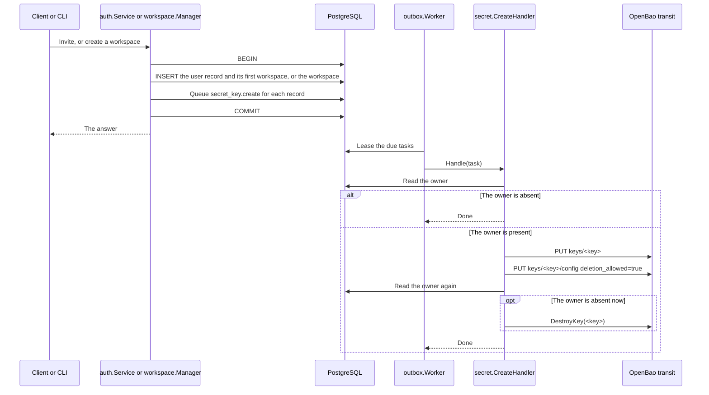

# Specification: The protection key of each user and each workspace

## 1. Summary

The transaction that creates a user record or a workspace queues a task of the type
`secret_key.create` in the outbox of `ADR-0027`. Its handler writes the transit key
`maroid-user-<id>` or `maroid-workspace-<id>`, then sets `deletion_allowed=true` on it.
A migration queues the same task for every user record and every workspace that exists.
`ADR-0028` lets the hub create a key under the two prefixes.

## 2. Coverage

| Requirement      | Where this specification realizes it                           |
| ---------------- | -------------------------------------------------------------- |
| `OWNKEY-FR-001`  | Section 4.4, `OWNKEY-SC-001`, `OWNKEY-SC-002`                  |
| `OWNKEY-FR-002`  | Section 4.4, `OWNKEY-SC-001`, `OWNKEY-SC-003`                  |
| `OWNKEY-FR-003`  | Section 4.4, `OWNKEY-SC-004`                                   |
| `OWNKEY-FR-004`  | Section 4.3, `OWNKEY-SC-005`                                   |
| `OWNKEY-FR-005`  | `OWNKEY-DD-002`, `OWNKEY-SC-006`, `OWNKEY-SC-007`              |
| `OWNKEY-FR-006`  | `OWNKEY-DD-002`, `OWNKEY-SC-001`, `OWNKEY-SC-006`              |
| `OWNKEY-FR-007`  | Section 4.2, `OWNKEY-DD-004`, `OWNKEY-SC-008`, `OWNKEY-SC-009` |
| `OWNKEY-FR-008`  | `OWNKEY-DD-003`, `OWNKEY-SC-010` to `OWNKEY-SC-012`            |
| `OWNKEY-FR-009`  | `OWNKEY-DD-005`, `OWNKEY-SC-013`                               |
| `OWNKEY-NFR-001` | `OWNKEY-SC-014`                                                |
| `OWNKEY-NFR-002` | `OWNKEY-SC-005`, `OWNKEY-SC-015`                               |
| `OWNKEY-NFR-003` | Section 4.3, `OWNKEY-DD-001`, `OWNKEY-DD-002`, `OWNKEY-SC-016` |

## 3. Guideline compliance

| Rule      | Guideline        | How this specification obeys it                                                                           |
| --------- | ---------------- | --------------------------------------------------------------------------------------------------------- |
| `JOB-009` | Jobs             | The task commits in the transaction that writes the record. The handler is idempotent. Section 4.4.       |
| `JOB-010` | Jobs             | The type `secret_key.create` names the domain `secret_key` and the action. One handler serves it.         |
| `OWN-002` | Record ownership | No user record ends, so the handler never destroys the key of a user. `OWNKEY-DD-003`.                    |
| `OWN-003` | Record ownership | The task names no owner. The handler reads `public.users` and `public.workspaces`, which no scope guards. |
| `DAT-009` | Data             | The backfill inserts no `id`. The column takes `uuidv7()`.                                                |
| `REP-003` | Repository       | The handler builds each repository from its transaction, as `ADR-0011` gives.                             |
| `TST-004` | Testing          | Each scenario names its layer.                                                                            |

## 4. Design

### 4.1 Components

| Path                                                                     | Action | Holds                                                                                                                   |
| ------------------------------------------------------------------------ | ------ | ----------------------------------------------------------------------------------------------------------------------- |
| `apps/hub/internal/secret/cipher.go`                                     | change | `OwnerKind`, `OwnerUser`, `OwnerWorkspace`, `Owner`, `Owner.Key`                                                        |
| `apps/hub/internal/secret/transit.go`                                    | change | `KeyCreator`, `Keys`, `Transit.CreateKey`                                                                               |
| `apps/hub/internal/secret/create.go`                                     | create | `TypeCreate`, `CreatePayload`, `CreateTask`, `CreateHandler`, `NewCreateHandler`                                        |
| `apps/hub/internal/domain/errs/errs.go`                                  | change | `ErrSecretKeyOwnerInvalid`                                                                                              |
| `apps/hub/internal/auth/service.go`                                      | change | `createWithWorkspace` queues the task of the user and of the first workspace                                            |
| `apps/hub/internal/workspace/service.go`                                 | change | `Manager.Create` queues the task of the workspace                                                                       |
| `apps/hub/internal/depresolver/{outbox,secret,resolver}.go`              | change | `SecretKeys` replaces `SecretKeyDestroyer`. `lazyKeys` replaces `lazyKeyDestroyer`. The registry gains `CreateHandler`. |
| `apps/hub/db/migrations/20261126100000_outbox_tasks_secret_key_create.*` | create | The backfill of `OWNKEY-DD-004`                                                                                         |
| `apps/hub/internal/testbao/testbao.go`                                   | change | The policy of section 4.3. `CreateKeys` keeps its behavior for a key made before.                                       |
| `apps/hub/internal/secret/create_test.go`                                | create | `OWNKEY-SC-005` to `OWNKEY-SC-007`, `OWNKEY-SC-010` to `OWNKEY-SC-012`, `OWNKEY-SC-015`, `OWNKEY-SC-016`                |
| `apps/hub/internal/secret/transit_test.go`                               | change | `OWNKEY-SC-007`, the second write of a key                                                                              |
| `apps/hub/internal/auth/service_test.go`                                 | change | `OWNKEY-SC-001`, `OWNKEY-SC-002`                                                                                        |
| `apps/hub/internal/workspace/service_test.go`                            | create | `OWNKEY-SC-003`, `OWNKEY-SC-004`, `OWNKEY-SC-014`                                                                       |
| `apps/hub/internal/repository/secret_key_backfill_migration_test.go`     | create | `OWNKEY-SC-008`, `OWNKEY-SC-009`                                                                                        |
| `apps/hub/internal/settings/secrets_test.go`                             | change | `OWNKEY-SC-013`                                                                                                         |

```go
// apps/hub/internal/secret/cipher.go

// OwnerKind names the kind of record that one protection key protects.
type OwnerKind string

const (
    OwnerUser      OwnerKind = "user"
    OwnerWorkspace OwnerKind = "workspace"
)

// Owner is the user record or the workspace that one protection key protects.
type Owner struct {
    Kind OwnerKind `json:"kind"`
    ID   string    `json:"id"`
}

// Key answers UserKey or WorkspaceKey of the owner, and ErrSecretKeyOwnerInvalid for
// an unknown kind or an empty identifier.
func (o Owner) Key() (Key, error)

// apps/hub/internal/secret/transit.go

// KeyCreator creates a named key that allows its destruction. A key that exists keeps
// every version and gains the permission to be destroyed.
type KeyCreator interface {
    CreateKey(ctx context.Context, key Key) error
}

// Keys creates and destroys the named keys.
type Keys interface {
    KeyCreator
    KeyDestroyer
}

// apps/hub/internal/secret/create.go

// TypeCreate names the task of the outbox that creates one protection key.
const TypeCreate = "secret_key.create"

// CreatePayload is the payload of a task of TypeCreate.
type CreatePayload = Owner

// CreateTask answers the task that creates the key of the owner. It acts for no
// owner, and its dedupe key keeps one task for one key.
func CreateTask(owner Owner) model.OutboxDraft

// CreateHandler creates the key of the owner that a task names. It implements
// outbox.Handler.
type CreateHandler struct { /* db *sqlx.DB, keys Keys, logger *slog.Logger */ }

func NewCreateHandler(logger *slog.Logger, db *sqlx.DB, keys Keys) *CreateHandler
```

### 4.2 Data model

This feature adds no table. Each task is a row of `public.outbox_tasks`:

| Type                | Owner | Payload                                       | Dedupe key                             | Queued by                                              |
| ------------------- | ----- | --------------------------------------------- | -------------------------------------- | ------------------------------------------------------ |
| `secret_key.create` | None  | `{"kind": "user" or "workspace", "id": <id>}` | `secret_key.create:maroid-<kind>-<id>` | `createWithWorkspace`, `Manager.Create`, the migration |

The migration `20261126100000_outbox_tasks_secret_key_create.up.sql`:

```sql
INSERT INTO public.outbox_tasks (type, payload, dedupe_key)
SELECT 'secret_key.create',
       jsonb_build_object('kind', 'user', 'id', id),
       'secret_key.create:maroid-user-' || id
FROM public.users
UNION ALL
SELECT 'secret_key.create',
       jsonb_build_object('kind', 'workspace', 'id', id),
       'secret_key.create:maroid-workspace-' || id
FROM public.workspaces
ON CONFLICT (dedupe_key) WHERE dedupe_key IS NOT NULL DO NOTHING;
```

The down migration deletes every task of the type `secret_key.create`. An older build
has no handler for it, and `JOB-010` keeps such a task forever.

### 4.3 Declarations

**Handlers of the outbox.** `JOB-010` gives the registry.

| Type                | Handle does                                                                                                             | Realizes                                                             |
| ------------------- | ----------------------------------------------------------------------------------------------------------------------- | -------------------------------------------------------------------- |
| `secret_key.create` | Reads the owner. Absent: done. Present: `CreateKey`, then reads the owner again. Absent now: `DestroyKey`. Section 4.4. | `OWNKEY-FR-001`, `OWNKEY-FR-002`, `OWNKEY-FR-004` to `OWNKEY-FR-008` |

**The policy of the secret store.** An instance applies it to the role of the hub
before it runs this feature. `testbao.policy` holds the same text.

| Path                                 | Capabilities               | Realizes                                                                               |
| ------------------------------------ | -------------------------- | -------------------------------------------------------------------------------------- |
| `transit/encrypt/maroid-user-*`      | `update`                   | `PSET-FR-015`, `OWNKEY-FR-009`                                                         |
| `transit/decrypt/maroid-user-*`      | `update`                   | `PSET-FR-015`                                                                          |
| `transit/encrypt/maroid-workspace-*` | `update`                   | `PSET-FR-015`, `OWNKEY-FR-009`                                                         |
| `transit/decrypt/maroid-workspace-*` | `update`                   | `PSET-FR-015`                                                                          |
| `transit/keys/maroid-user-*`         | `update`                   | `OWNKEY-FR-001`, `OWNKEY-FR-006`, `OWNKEY-NFR-003`                                     |
| `transit/keys/maroid-workspace-*`    | `read`, `update`, `delete` | `OWNKEY-FR-002`, `OWNKEY-FR-006`, `OWNKEY-FR-008`, `WSREMOVE-FR-008`, `OWNKEY-NFR-003` |

The glob covers `transit/keys/<name>/config` and `transit/keys/<name>/rotate`. The policy
names no path of export and no path of backup.

### 4.4 Flow



`createWithWorkspace` queues two tasks: the user record and the first workspace.
`Manager.Create` queues one. `maroid user invite` and the route of an invite both reach
`createWithWorkspace`. Each calls
`repository.NewOutboxTask(tx).Enqueue(ctx, secret.CreateTask(...))` before its commit,
so a rollback queues nothing. Neither calls OpenBao, which realizes `OWNKEY-FR-003`.

A failure of OpenBao or of the database returns the error, and the worker retries the
task under `JOB-009`. `OWNKEY-FR-004` holds with no code of this feature.

The handler logs one line at `info` for each key that it creates, with the key, and one
line at `info` when it skips or destroys the key of an absent owner.

### 4.5 Errors

| Condition                                     | Behavior                                       |
| --------------------------------------------- | ---------------------------------------------- |
| The payload names an unknown kind or no `id`. | `ErrSecretKeyOwnerInvalid`. The task retries.  |
| OpenBao refuses or does not answer.           | The error of `Transit`. The task retries.      |
| The read of the owner fails.                  | The error of the repository. The task retries. |
| The owner is absent at the first read.        | Done. No call to OpenBao.                      |
| The owner is absent at the second read.       | `DestroyKey`, then done. A failure retries.    |

A save of a secret before the task runs reaches `Transit.Encrypt`, which OpenBao
refuses with `permission denied`. The save answers its error of today, and writes no
row. `OWNKEY-DD-005`.

## 5. Design decisions

### `OWNKEY-DD-001`

**Realizes:** `OWNKEY-FR-001`, `OWNKEY-FR-002`, `OWNKEY-NFR-003`
**Decision:** The payload of `secret_key.create` names the kind and the identifier of
the owner, not the key. `Owner.Key` derives the name from `UserKeyPrefix` or
`WorkspaceKeyPrefix`. The task names no owner of `OWN-003`.
**Rationale:** A task, even a row that a defect or an attacker writes, can create no
key outside the two prefixes. The handler also needs the kind to read the owner. With
no owner, the worker sets no scope, as for `secret_key.destroy`, and both tables are
shared.
**Alternatives:** The key in the payload, as `secret_key.destroy`. The handler then
parses the name to find the owner. The workspace as the owner of the task. The worker
sets a scope that no read of the handler needs.

### `OWNKEY-DD-002`

**Realizes:** `OWNKEY-FR-005`, `OWNKEY-FR-006`, `OWNKEY-NFR-003`
**Decision:** `Transit.CreateKey` writes `transit/keys/<key>` with no body, then writes
`transit/keys/<key>/config` with `deletion_allowed=true`. The policy grants `update` on
the keys of a user, and `read`, `update`, and `delete` on the keys of a workspace.
**Rationale:** A check on OpenBao 2.6.2 confirmed three facts. A write of
`transit/keys/<name>` needs `update`, and `create` alone answers `permission denied`.
A second write of a key that holds two versions keeps two versions and answers success.
The write of the configuration needs `update`. Both writes are therefore idempotent,
and a key that an administrator created keeps every version and gains the permission to
be destroyed. The key of a user needs no `read` and no `delete`, because `OWN-002` ends
no user record.
**Alternatives:** `create` on the keys. OpenBao refuses the write with it. A read before
the write. It adds one call and changes no result. `deletion_allowed` in the body of the
first write. OpenBao ignores it there.

### `OWNKEY-DD-003`

**Realizes:** `OWNKEY-FR-008`
**Decision:** The handler reads the workspace before the creation and again after it.
When the second read finds no workspace, the handler destroys the key it created.
**Rationale:** A removal that commits before the second read leaves a key that the
handler destroys. A removal that commits after the second read queues its own
`secret_key.destroy`, which runs after the key exists. No order leaves a key. The
handler holds no lock across the call to OpenBao, so a slow store never delays a
removal.
**Alternatives:** Hold `FOR SHARE` on the workspace during the call to OpenBao. A store
that hangs holds the removal for the limit of 4 minutes of a task. `Remover.Remove` drops
the task. A task that a worker already leased still creates the key.

### `OWNKEY-DD-004`

**Realizes:** `OWNKEY-FR-007`
**Decision:** A migration of the hub queues one `secret_key.create` for each user record
and each workspace.
**Rationale:** The migration runs once, before the first start of the new build, and the
dedupe key keeps one task for one key. A cycle that leases a full batch starts the
next cycle at once, so the backfill does not wait for the poll between two batches.
**Alternatives:** A sweep at each start of the worker. It calls OpenBao for each record
at every start. A command for the administrator. It keeps a step by hand, which the
feature removes.

### `OWNKEY-DD-005`

**Realizes:** `OWNKEY-FR-009`
**Decision:** The paths of encrypt and decrypt keep `update` alone. A save before the
key exists fails at `Transit.Encrypt`, and the hub adds no answer for it.
**Rationale:** The owner accepts the gap of `OWNKEY-NFR-001`. A save fails before its
write, so it keeps nothing.
**Alternatives:** `create` on the path of encrypt. The save then creates a key with no
`deletion_allowed`, and a defect mints a key for any name under the prefix.

## 6. Scenarios

Every integration scenario runs against `testdb.Start` with the migrations of the hub,
and against `testbao.Start` with the policy of section 4.3, unless it names a stub.

### `OWNKEY-SC-001`

**Verifies:** `OWNKEY-FR-001`, `OWNKEY-FR-002`, `OWNKEY-FR-006`
**Layer:** integration

**Given** no user record of Nina.
**When** an administrator invites Nina, and the `outbox` worker runs.
**Then** `maroid-user-<Nina>` and `maroid-workspace-<first workspace>` exist, each with
`deletion_allowed=true`, and `public.outbox_tasks` holds no task of the type
`secret_key.create`.

### `OWNKEY-SC-002`

**Verifies:** `OWNKEY-FR-001`
**Layer:** integration

**Given** a trigger on `public.workspace_members` that raises on each insert.
**When** an administrator invites Nina.
**Then** the invite fails, and `public.outbox_tasks` holds no task of the type
`secret_key.create`.

### `OWNKEY-SC-003`

**Verifies:** `OWNKEY-FR-002`
**Layer:** integration

**Given** Nina, an active user record.
**When** Nina creates "Garden", and the `outbox` worker runs.
**Then** `maroid-workspace-<Garden>` exists with `deletion_allowed=true`.

### `OWNKEY-SC-004`

**Verifies:** `OWNKEY-FR-003`
**Layer:** integration

**Given** a stub `secret.Keys` that fails every call.
**When** Nina creates "Garden".
**Then** the answer holds "Garden", the stub records no call, and one task of the type
`secret_key.create` names "Garden".

### `OWNKEY-SC-005`

**Verifies:** `OWNKEY-FR-004`, `OWNKEY-NFR-002`
**Layer:** integration

**Given** a due `secret_key.create` of "Garden", and a stub `secret.Keys` whose
`CreateKey` fails two times, then succeeds.
**When** one worker runs a cycle, stops, and a second worker runs the next cycles.
**Then** `attempts` reads 1, then 2, and `run_after` waits 2 seconds, then 4. The second
worker creates the key on the third attempt, and the table holds no task.

### `OWNKEY-SC-006`

**Verifies:** `OWNKEY-FR-005`, `OWNKEY-FR-006`
**Layer:** integration

**Given** `maroid-workspace-<Home>` that the root token created and rotated once, with
`deletion_allowed=false`, and a setting of "Home" that version 1 protects.
**When** the handler runs a `secret_key.create` of "Home".
**Then** `latest_version` reads 2, `deletion_allowed` reads true, and the setting reads
its plaintext.

### `OWNKEY-SC-007`

**Verifies:** `OWNKEY-FR-005`
**Layer:** integration

**Given** OpenBao with no key of "Home".
**When** `Transit.CreateKey` runs two times for `maroid-workspace-<Home>`.
**Then** both calls succeed, and `latest_version` reads 1.

### `OWNKEY-SC-008`

**Verifies:** `OWNKEY-FR-007`
**Layer:** integration

**Given** the migrations before `20261126100000`, 3 user records, 5 workspaces, and a
task `secret_key.create` of one of the workspaces.
**When** the migration `20261126100000` runs up.
**Then** `public.outbox_tasks` holds 8 tasks of the type `secret_key.create`, one for
each record. The migration down leaves none.

### `OWNKEY-SC-009`

**Verifies:** `OWNKEY-FR-007`, `OWNKEY-FR-005`
**Layer:** integration

**Given** the state of `OWNKEY-SC-008` after the migration, and 2 of the 8 keys that the
root token created and rotated once.
**When** the `outbox` worker runs.
**Then** 8 keys exist. The 2 keys read `latest_version` 2.

### `OWNKEY-SC-010`

**Verifies:** `OWNKEY-FR-008`
**Layer:** integration

**Given** Nina creates "Test" and removes it before the worker runs.
**When** the `outbox` worker runs every due task.
**Then** no key `maroid-workspace-<Test>` exists, and the table holds no task.

### `OWNKEY-SC-011`

**Verifies:** `OWNKEY-FR-008`
**Layer:** integration

**Given** a stub `secret.Keys` whose `CreateKey` deletes "Test" from the database before
it returns.
**When** the handler runs the `secret_key.create` of "Test".
**Then** the stub records `CreateKey`, then `DestroyKey`, both for
`maroid-workspace-<Test>`, and the task is done.

### `OWNKEY-SC-012`

**Verifies:** `OWNKEY-FR-008`
**Layer:** integration

**Given** a stub `secret.Keys` that holds its keys in memory and fails every call while
it is down. It is down.
**When** Nina creates "Test", removes it, the worker runs three cycles, the stub comes
up, and the worker runs until the table holds no task.
**Then** the stub holds no key of "Test".

### `OWNKEY-SC-013`

**Verifies:** `OWNKEY-FR-009`
**Layer:** integration

**Given** "Garden", whose task has not run, and a plugin with a secret field of the
workspace.
**When** Nina saves the field, the worker runs, and Nina saves it again.
**Then** the first save fails, and `plugin_workspace_settings` holds no row of
"Garden". The second save succeeds.

### `OWNKEY-SC-014`

**Verifies:** `OWNKEY-NFR-001`
**Layer:** integration

**Given** an `outbox` worker that runs with `outbox.poll_interval` of `2s`.
**When** Nina creates "Garden" at the moment T.
**Then** a read of `transit/keys/maroid-workspace-<Garden>` answers data before T plus
10 seconds.

### `OWNKEY-SC-015`

**Verifies:** `OWNKEY-NFR-002`
**Layer:** integration

**Given** a due `secret_key.create` with 20 attempts, and a stub `secret.Keys` that
fails.
**When** the worker runs one cycle.
**Then** `run_after` falls at most 5 minutes after the failure, so with the poll of 2
seconds the next attempt starts within 6 minutes.

### `OWNKEY-SC-016`

**Verifies:** `OWNKEY-NFR-003`
**Layer:** integration

**Given** a client of the hub, logged in with the role of `testbao`.
**When** it writes `transit/keys/other-key`, encrypts under the absent
`maroid-workspace-<random>`, and reads `transit/export/encryption-key/maroid-user-<id>`.
**Then** each call answers `permission denied`, and the root token reads neither
`other-key` nor `maroid-workspace-<random>`.

## 7. Build plan

| #   | Step                                                                                                                                 | Realizes                                                              | Done |
| --- | ------------------------------------------------------------------------------------------------------------------------------------ | --------------------------------------------------------------------- | ---- |
| 1   | The policy of `testbao`, `Owner`, `Transit.CreateKey`, and `OWNKEY-SC-007`, `OWNKEY-SC-016`                                          | `OWNKEY-FR-005`, `OWNKEY-FR-006`, `OWNKEY-NFR-003`                    | [x]  |
| 2   | `CreateHandler`, the registry, `lazyKeys`, and `OWNKEY-SC-005`, `OWNKEY-SC-006`, `OWNKEY-SC-010` to `OWNKEY-SC-012`, `OWNKEY-SC-015` | `OWNKEY-FR-004` to `OWNKEY-FR-008`, `OWNKEY-NFR-002`                  | [x]  |
| 3   | The queue in `createWithWorkspace` and `Manager.Create`, and `OWNKEY-SC-001` to `OWNKEY-SC-004`, `OWNKEY-SC-013`, `OWNKEY-SC-014`    | `OWNKEY-FR-001` to `OWNKEY-FR-003`, `OWNKEY-FR-009`, `OWNKEY-NFR-001` | [x]  |
| 4   | The migration and `OWNKEY-SC-008`, `OWNKEY-SC-009`                                                                                   | `OWNKEY-FR-007`                                                       | [x]  |
| 5   | The changes of `ADR-0028` to `PSET-DD-004`, `PSECRET-DD-003`, and `WSREMOVE-DD-004`                                                  | `OWNKEY-NFR-003`                                                      | [x]  |

## Retired identifiers

This file has no retired identifier.
