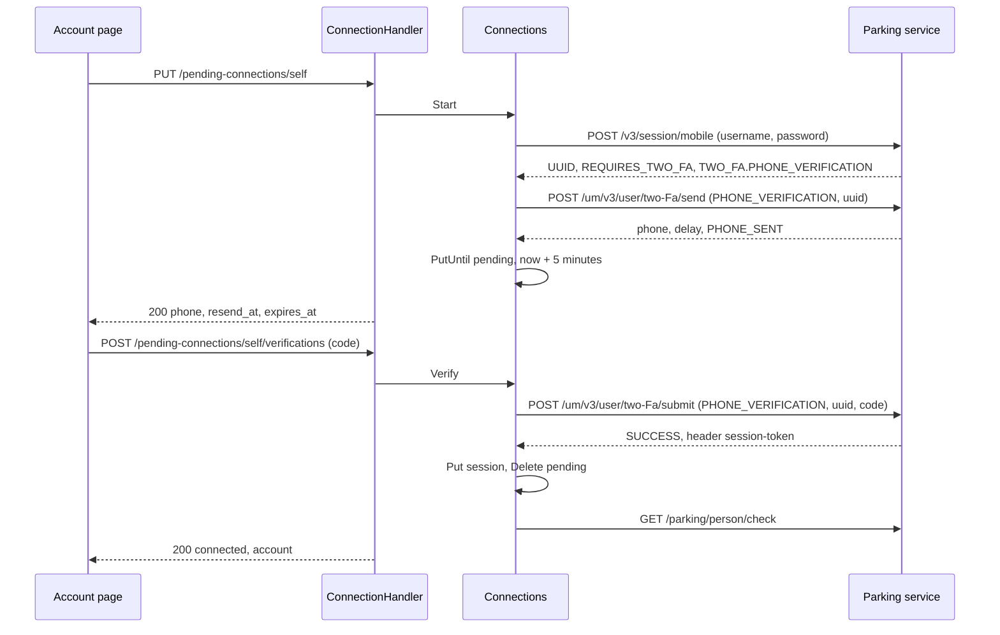
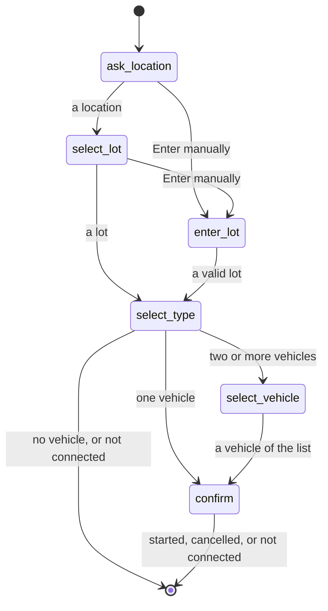

# Specification: The parking account of a user

## 1. Summary

The parking plugin stores a username and a password as user settings, and gains a
connection page in the deck. The page signs in to the parking service, asks it for an
SMS code, and stores the session token as the plugin secret `session` of `PSECRET`. A
rejection of the token by the parking service removes it, and the bot then answers with
a link that the host builds. `/start` reads the vehicles of the parking account and asks
for one when the account holds two or more. `spec-scenarios.md` holds the scenarios.
`PSECRET` must ship first.

## 2. Coverage

| Requirement        | Where this specification realizes it                         |
| ------------------ | ------------------------------------------------------------ |
| `PARKACC-FR-001`   | Section 4.3, `PARKACC-DD-010`, `PARKACC-SC-001`              |
| `PARKACC-FR-002`   | Section 4.3, `PARKACC-SC-001`                                |
| `PARKACC-FR-003`   | Section 4.3, `PARKACC-SC-001`                                |
| `PARKACC-FR-004`   | `api.yaml`, `PARKACC-SC-002`                                 |
| `PARKACC-FR-005`   | `api.yaml`, `PARKACC-DD-012`, `PARKACC-SC-003`               |
| `PARKACC-FR-006`   | `api.yaml`, `PARKACC-SC-004`                                 |
| `PARKACC-FR-007`   | `api.yaml`, `PARKACC-SC-005`                                 |
| `PARKACC-FR-008`   | `api.yaml`, Section 4.4, `PARKACC-SC-006`                    |
| `PARKACC-FR-009`   | Section 4.4, `PARKACC-SC-006`                                |
| `PARKACC-FR-010`   | Section 4.4, `PARKACC-SC-006`                                |
| `PARKACC-FR-011`   | `api.yaml`, `PARKACC-SC-006`                                 |
| `PARKACC-FR-012`   | `PARKACC-DD-006`, `PARKACC-SC-007`                           |
| `PARKACC-FR-013`   | `PARKACC-DD-006`, `PARKACC-SC-008`                           |
| `PARKACC-FR-014`   | `PARKACC-DD-001`, `PARKACC-SC-009`, `PARKACC-SC-010`         |
| `PARKACC-FR-015`   | `PARKACC-DD-006`, `PARKACC-SC-011`                           |
| `PARKACC-FR-016`   | `PARKACC-DD-002`, `PARKACC-SC-012`                           |
| `PARKACC-FR-017`   | `PARKACC-DD-007`, `PARKACC-SC-013`, `PARKACC-SC-014`         |
| `PARKACC-FR-018`   | `api.yaml`, `PARKACC-SC-015`                                 |
| `PARKACC-FR-019`   | `PARKACC-DD-003`, `PARKACC-SC-016`                           |
| `PARKACC-FR-020`   | `PARKACC-DD-001`, `PARKACC-SC-017`                           |
| `PARKACC-FR-021`   | `PARKACC-DD-004`, `PARKACC-SC-018`, `PARKACC-SC-019`         |
| `PARKACC-FR-022`   | `PARKACC-DD-005`, `PARKACC-SC-020`, `PARKACC-SC-021`         |
| `PARKACC-FR-023`   | Section 4.3, `PARKACC-DD-009`, `PARKACC-SC-022`              |
| `PARKACC-FR-024`   | `PARKACC-DD-008`, `PARKACC-SC-023`                           |
| `PARKACC-FR-025`   | `PARKACC-DD-008`, `PARKACC-SC-023`                           |
| `PARKACC-FR-026`   | Section 4.3, `PARKACC-SC-024`                                |
| `PARKACC-FR-027`   | `PARKACC-DD-008`, `PARKACC-SC-025`                           |
| `PARKACC-FR-028`   | Section 4.3, `PARKACC-SC-024`                                |
| `PARKACC-INV-001`  | `PARKACC-DD-001`, `PARKACC-SC-010`                           |
| `PARKACC-INV-002`  | `PARKACC-DD-001`, `PARKACC-SC-026`                           |
| `PARKACC-INV-003`  | `api.yaml`, `PARKACC-DD-011`, `PARKACC-SC-027`               |

## 3. Guideline compliance

| Rule      | Guideline         | How this specification obeys it                                                           |
| --------- | ----------------- | ----------------------------------------------------------------------------------------- |
| `PLG-006` | Plugin model      | The plugin adds the route, UI, and permission capabilities through the existing interfaces. |
| `PLG-007` | Plugin model      | The plugin reads the settings, the plugin secrets, and the page address through the host. |
| `ARC-008` | Architecture      | `PageLinker` names no plugin. Section 4.1.                                                |
| `OWN-004` | Record ownership  | The credentials and both plugin secrets take the user scope. Section 4.2.                |
| `CFG-007` | Configuration     | `AuthToken` and `VehicleID` leave the settings. Section 4.3.                             |
| `EXT-001` to `EXT-007` | External services | `service/api-client.go` holds every call. Each status that is not a success is an error. Section 4.1. |
| `LOG-008` | Logging           | No log line holds the password, the code, the token, or the identifier of a sign in.     |
| `SEC-013` | Security          | Each route and each command names a permission. Section 4.3.                             |
| `API-004` | HTTP API          | The routes mount under `/workspaces/{workspaceId}/plugins/dev.maroid.parking/api`.       |
| `ERR-002` | Errors            | Each new problem type has the form `/problems/dev.maroid.parking/<slug>`. Section 4.5.    |
| `RES-001` | REST              | `/connections/self` and `/pending-connections/self` keep the plural of `Z-134`.          |
| `UI-005` to `UI-009` | Web UI | The remote exports `routes` with `/account`, and reaches the API through `host.api`.   |
| `TG-005`  | Telegram          | `select_vehicle` is a step of `start_parking`. Section 4.4.                              |
| `PKG-001` | Package layout    | The plugin gains `handler/`, `model/`, and `ui/`. Section 4.1.                           |
| `BLD-003`, `BLD-004` | Build  | The build plan builds the UI before the `.so`, and rebuilds every plugin after the change of `pluginapi`. |

## 4. Design

### 4.1 Components

| Path                                                          | Action | Holds                                                                                      |
| ------------------------------------------------------------- | ------ | ------------------------------------------------------------------------------------------ |
| `libs/pluginapi/page.go`                                      | create | `PageLinker`, `ErrPageAddressAbsent`                                                       |
| `libs/pluginapi/host.go`                                      | change | `Host.Pages`                                                                               |
| `apps/hub/internal/plugin/host/page.go`                       | create | `pageLinker`, which implements `PageLinker` over `auth.deck_url`                           |
| `apps/hub/internal/plugin/host/host.go`                       | change | The `deckURL` argument of `New`, `Host.Pages`                                              |
| `apps/hub/internal/depresolver/plugin.go`                     | change | Passes `Config().Auth.DeckURL` to `pluginhost.New`                                         |
| `plugins/parking/config/config.go`                            | change | `UserSettings` with `Username` and `Password`                                              |
| `plugins/parking/dto/api-client.go`                           | change | `SignInData`, `SignInResult`, `CodeRequestData`, `CodeRequestResult`, `CodeSubmitData`, `CodeSubmitResult`, `Vehicle`. `StartParkingData` stays |
| `plugins/parking/model/{doc,connection,vehicle}.go`           | create | `ConnectionState`, `Connection`, `Account`, `PendingConnection`, `Vehicle`                 |
| `plugins/parking/service/api-client.go`                       | change | The methods below, `ErrNotConnected`, `ErrCredentialsRejected`, `ErrVerificationUnsupported`, `ErrCodeRejected` |
| `plugins/parking/service/connection.go`                       | create | `ConnectionService`, `Connections`, `NewConnections`, `ErrCredentialsAbsent`, `ErrPendingAbsent`, `ErrCodeWait` |
| `plugins/parking/handler/{doc,connection,problem}.go`         | create | `ConnectionHandler`, `NewConnectionHandler`, the problem types of section 4.5              |
| `plugins/parking/permission/permission.go`                    | change | `AccountConnect = "account.connect"`                                                       |
| `plugins/parking/embed.go`                                    | create | `uiAssets`, the embedded `ui/dist`                                                         |
| `plugins/parking/main.go`                                     | change | `UIManifest`, `Routes`, the third permission, `host.Secrets`, `host.Pages`                 |
| `plugins/parking/ui/`                                         | create | `package.json`, `vite.config.ts`, `src/entry.ts`, `src/api/connection.ts`, `src/api/types.ts`, `src/pages/account/Account.svelte` |
| `plugins/parking/telegram/command/helpers.go`                 | change | `replyFailure`, which answers `ErrNotConnected` with the link                              |
| `plugins/parking/telegram/command/{start,balance,status,stop}.go` | change | Each `Handle` returns through `replyFailure`. `start` reads the vehicles in the preflight |
| `plugins/parking/telegram/conversation/step/select_vehicle.go` | create | `SelectVehicle`                                                                           |
| `plugins/parking/telegram/conversation/step/{select_type,confirm,helpers}.go` | change | `select_type` routes to the vehicle, `confirm` passes the vehicle, `endNotConnected` |
| `plugins/parking/telegram/conversation/parking.go`            | change | Registers `SelectVehicle`                                                                  |

The contract in `libs/pluginapi/page.go`:

```go
// ErrPageAddressAbsent reports that the host cannot build the address of a page:
// the configuration names no deck, or the unit of work carries no acting workspace.
var ErrPageAddressAbsent = errors.New("page: no address")

// PageLinker builds the deck address of a page of a plugin, in the acting workspace.
type PageLinker interface {
    PageURL(ctx context.Context, pluginID *PluginID, path string) (string, error)
}
```

`pageLinker.PageURL` answers `<deck_url>/w/<acting workspace>/plugins/<plugin id><path>`,
with `url.JoinPath`. The deck route `(dashboard)/w/[workspace]/plugins/[plugin]/[...path]`
opens it.

The methods of `service.APIClientService`:

```go
SignIn(ctx context.Context, username, password string) (*dto.SignInResult, error)
RequestCode(ctx context.Context, signInID string) (*dto.CodeRequestResult, error)
SubmitCode(ctx context.Context, signInID, code string) (token string, err error)
ListVehicles(ctx context.Context) ([]model.Vehicle, error)
StartParking(ctx context.Context, placeNo, parkingType string, vehicleID int) (*dto.ParkingSession, error)
// GetParkingLots, GetParkingPlace, GetPerson, GetActiveSession, StopParking stay.
```

`ConnectionService`:

```go
Status(ctx context.Context) (*model.Connection, error)
Start(ctx context.Context) (*model.PendingConnection, error)
ResendCode(ctx context.Context) (*model.PendingConnection, error)
Verify(ctx context.Context, code string) (*model.Connection, error)
Disconnect(ctx context.Context) error
```

### 4.2 Data model

The feature adds no table. It writes two plugin secrets of the user scope:

| Name      | Value                                              | Expiry                                   | Realizes                              |
| --------- | -------------------------------------------------- | ---------------------------------------- | ------------------------------------- |
| `session` | The session token, as the parking service gives it | None                                     | `PARKACC-FR-014`, `PARKACC-FR-020`    |
| `pending` | JSON: `sign_in_id`, `phone`, `resend_at`           | 5 minutes after the last request of a code | `PARKACC-FR-016`, `PARKACC-FR-017` |

### 4.3 Declarations

**HTTP routes.** The prefix is `/workspaces/{workspaceId}/plugins/dev.maroid.parking/api`.
`api.yaml` holds the bodies and the status codes.

| Method   | Path                                           | Access        | Permission        | Realizes                                                   |
| -------- | ---------------------------------------------- | ------------- | ----------------- | ---------------------------------------------------------- |
| `GET`    | `/connections/self`                            | Authenticated | `account.connect` | `PARKACC-FR-004` to `PARKACC-FR-007`, `PARKACC-FR-019`     |
| `DELETE` | `/connections/self`                            | Authenticated | `account.connect` | `PARKACC-FR-018`                                           |
| `PUT`    | `/pending-connections/self`                    | Authenticated | `account.connect` | `PARKACC-FR-007` to `PARKACC-FR-013`                       |
| `POST`   | `/pending-connections/self/code-requests`      | Authenticated | `account.connect` | `PARKACC-FR-017`                                           |
| `POST`   | `/pending-connections/self/verifications`      | Authenticated | `account.connect` | `PARKACC-FR-014` to `PARKACC-FR-016`                       |

**Permissions.**

| Name              | Description                                            | Lowest   | Realizes         |
| ----------------- | ------------------------------------------------------ | -------- | ---------------- |
| `account.connect` | Read, connect, and disconnect your own parking account | `viewer` | `PARKACC-FR-023` |

**Settings.** Both fields take `x-maroid-scope=user` and are required.

| Field      | Kind        | Title    | Realizes                            |
| ---------- | ----------- | -------- | ----------------------------------- |
| `username` | free text   | Username | `PARKACC-FR-001`                    |
| `password` | secret      | Password | `PARKACC-FR-001`, `PARKACC-FR-002`  |

`authToken` and `vehicleId` leave `UserSettings` (`PARKACC-FR-003`). `PSET-FR-011`
removes their stored values at the next save.

**UI routes.**

| Page route | Navigation entry | Page             | Realizes                             |
| ---------- | ---------------- | ---------------- | ------------------------------------ |
| `/account` | "Account"        | `Account.svelte` | `PARKACC-FR-004` to `PARKACC-FR-018` |

**Telegram commands.** No command is new. Each one answers `ErrNotConnected` with the link.

| Command    | Scope     | Permission       | Validates | Handles                                                       | Realizes                            |
| ---------- | --------- | ---------------- | --------- | ------------------------------------------------------------- | ----------------------------------- |
| `/start`   | Workspace | `sessions.write` | Nothing   | Reads the person, the session, and the vehicles. Starts `start_parking` | `PARKACC-FR-021`, `PARKACC-FR-027` |
| `/balance` | Workspace | `sessions.read`  | Nothing   | Reads the person                                              | `PARKACC-FR-021`                    |
| `/status`  | Workspace | `sessions.read`  | Nothing   | Reads the session                                             | `PARKACC-FR-021`                    |
| `/stop`    | Workspace | `sessions.write` | Nothing   | Stops the session                                             | `PARKACC-FR-021`                    |

**Telegram conversation.**

| Identifier      | Entry step     | Steps                                                                               | Realizes                                          |
| --------------- | -------------- | ----------------------------------------------------------------------------------- | ------------------------------------------------- |
| `start_parking` | `ask_location` | `ask_location`, `select_lot`, `enter_lot`, `select_type`, `select_vehicle`, `confirm` | `PARKACC-FR-024` to `PARKACC-FR-026`, `PARKACC-FR-028` |

`select_vehicle` shows one button for each vehicle, with the text `<name> (<plate>)` and the
callback data `vehicle:<id>`, and a Cancel button. It accepts only an identifier of the
list that `select_type` stored in `Data["vehicles"]`. `confirm` names the vehicle in its text.

### 4.4 Flow

The connect flow:



The three sign in calls carry no `Authorization` header. Every call carries `ttl: 2592000000`.

The conversation:



### 4.5 Errors

| Condition                                              | Route answer                                                       | Bot answer                                |
| ------------------------------------------------------ | ------------------------------------------------------------------ | ----------------------------------------- |
| No `session` secret, or the parking service answers 401 | `GET`: 200 with `state: not_connected`                            | "Not connected" with the link             |
| The settings are absent                                | `PUT`: 422 `credentials-absent`. `GET` reports `credentials_stored: false` | Not reached: commands read no setting |
| The sign in answers 400, 401, 403, or 404              | 422 `credentials-rejected`                                         | Not reached                               |
| The sign in asks for no code by phone                  | 422 `verification-unsupported`                                     | Not reached                               |
| No `pending` secret, or it expired                     | 404 `/problems/http/not-found`                                     | Not reached                               |
| A code request before `resend_at`                      | 429 `code-wait`, with `Retry-After` in seconds                     | Not reached                               |
| The submit answers a status that is not a success, or a status other than `SUCCESS` | 422 `code-rejected`     | Not reached                               |
| The parking service answers 5xx, or fails to answer    | 502 `service-unavailable`. The token stays                         | "The parking service is unavailable."     |
| The page address fails with `ErrPageAddressAbsent`     | Not reached                                                        | "Not connected", and the text names the Account page of the plugin |

Each new type has the owner `dev.maroid.parking`. No detail names the password, the
code, the token, or the identifier of the sign in (`PARKACC-INV-003`, `LOG-008`).

## 5. Design decisions

### `PARKACC-DD-001`

**Realizes:** `PARKACC-FR-014`, `PARKACC-FR-020`, `PARKACC-INV-001`, `PARKACC-INV-002`
**Decision:** The token lives in the plugin secret `session` of the user scope, with no
expiry. `Verify` writes it with `Put`, which replaces the old one.
**Rationale:** `PSECRET-FR-005` holds one value for one name, so one user holds one
connection. The user scope serves no other user (`PSECRET-INV-002`). The old token serves
every command until the write, because `Verify` writes only after `SUCCESS`.
**Alternatives:** A table in the schema of the plugin. It repeats the protection that `PSECRET` gives.

### `PARKACC-DD-002`

**Realizes:** `PARKACC-FR-016`
**Decision:** `Start` and `ResendCode` write `pending` with `PutUntil` and an expiry 5
minutes after the call. `Verify` deletes it after `SUCCESS`.
**Rationale:** `PSECRET-FR-009` ends the pending connection with no job of the plugin. A
second request of a code restarts the 5 minutes, because the parking service sends a new code.
**Alternatives:** Keep the identifier of the sign in in the page, and send it back with the
code. The value then travels to a client, and a reload of the page loses it.

### `PARKACC-DD-003`

**Realizes:** `PARKACC-FR-019`
**Decision:** One function of `APIClient` sends each call that carries the token. On a
401 it deletes `session` and answers `ErrNotConnected`. A 403 is a failure, not a rejection.
**Rationale:** One place decides the end of a connection. The parking service gives no
expiry, and only a 401 names a token that it no longer accepts.
**Alternatives:** A check in each command. Seven call sites repeat one rule.

### `PARKACC-DD-004`

**Realizes:** `PARKACC-FR-021`
**Decision:** `replyFailure` in `command/helpers.go` and `endNotConnected` in
`step/helpers.go` answer `ErrNotConnected` with "Your parking account is not connected."
and a link to `/account`. Any other error goes back to the engine as today.
**Rationale:** A command and a step fail on the same error, so two helpers keep the text in two places at most.
**Alternatives:** A middleware of the hub. `ARC-008` forbids a rule of the hub that knows the error of one plugin.

### `PARKACC-DD-005`

**Realizes:** `PARKACC-FR-022`
**Decision:** `Host.Pages` returns a `PageLinker`. The hub builds the address from
`auth.deck_url`, the acting workspace, the plugin identifier, and the path.
**Rationale:** The shape of a deck route stays in the hub and the deck. A plugin names a path of its own remote.
**Alternatives:** `Host.DeckURL`. Each plugin then repeats the route shape of the deck.

### `PARKACC-DD-006`

**Realizes:** `PARKACC-FR-012`, `PARKACC-FR-013`, `PARKACC-FR-015`
**Decision:** A sign in that answers 400, 401, 403, or 404 is `ErrCredentialsRejected`. A
sign in whose status is not `REQUIRES_TWO_FA`, or whose `TWO_FA.PHONE_VERIFICATION` is
false, is `ErrVerificationUnsupported`. A submit that answers a 4xx, or a status other
than `SUCCESS`, is `ErrCodeRejected`. A `SUCCESS` with no `session-token` header is `ErrRequestFailed`.
**Rationale:** The capture holds no answer for wrong credentials or a wrong code. Build
step 8 records the real answers and corrects this table before the release.
**Alternatives:** Match a message text of the parking service. The text is Georgian and changes without notice.

### `PARKACC-DD-007`

**Realizes:** `PARKACC-FR-017`
**Decision:** `pending` stores `resend_at` as the time of the request plus `delay` seconds.
`ResendCode` refuses with `ErrCodeWait` before `resend_at`, and calls the send route again
with the same identifier after it. A `delay` that is not a number counts as 60.
**Rationale:** The refusal costs no call to the parking service. The capture shows the send
route takes only the identifier, so a second call sends a second code. Build step 8 confirms it.
**Alternatives:** A new sign in for each new code. It costs a second call and a second password check.

### `PARKACC-DD-008`

**Realizes:** `PARKACC-FR-024`, `PARKACC-FR-025`, `PARKACC-FR-027`
**Decision:** The preflight of `/start` reads the vehicles beside the person and the session,
and refuses when the list is empty. `select_type` reads the list again: one vehicle goes to
`confirm`, two or more go to `select_vehicle`, none ends the conversation.
**Rationale:** `Engine.Start` gives the entry step empty data, so the preflight cannot pass
the list on. The member learns of a missing vehicle before the location. The second read
costs one call, and catches a vehicle that the member removed in the meantime.
**Alternatives:** A read at the step alone. A member with no vehicle walks four steps for a refusal.

### `PARKACC-DD-009`

**Realizes:** `PARKACC-FR-023`
**Decision:** One permission, `account.connect`, guards the five routes, with `viewer` as the lowest role.
**Rationale:** The requirement gives one role for three actions. The read, the connect, and
the disconnect touch only the account of the caller.
**Alternatives:** A read and a write permission. Both would hold the same lowest role.

### `PARKACC-DD-010`

**Realizes:** `PARKACC-FR-001`
**Decision:** `username` is a free text field and `password` is a secret field, both of the user scope and both required.
**Rationale:** The username is a personal number or an email that the user reads back to
check it. `PSET-FR-004` returns it to that user alone.
**Alternatives:** A secret username. The user then cannot see which account the settings name.

### `PARKACC-DD-011`

**Realizes:** `PARKACC-INV-003`
**Decision:** No body of `api.yaml` holds the token, the password, or the identifier of the sign in.
`model.PendingConnection` carries `SignInID` with the JSON tag `-` in every answer.
**Rationale:** The identifier of the sign in plus a code yields a token, so it is a credential too.
**Alternatives:** None that meets the invariant.

### `PARKACC-DD-012`

**Realizes:** `PARKACC-FR-005`
**Decision:** `Status` calls `GetPerson` on each read of a connected account, and maps
`dailyFreeParkingLeft` to `free_parkings_left`.
**Rationale:** The read proves the token, and `DD-003` removes a rejected one in the same call.
**Alternatives:** Cache the person. A stale balance is worse than one call when the page opens.

## 6. Scenarios

`spec-scenarios.md` holds `PARKACC-SC-001` to `PARKACC-SC-028`.

## 7. Build plan

`PSECRET` ships first. Its build plan ends before step 1.

| #   | Step                                                                                         | Realizes                                         | Done |
| --- | -------------------------------------------------------------------------------------------- | ------------------------------------------------ | ---- |
| 1   | `pluginapi.PageLinker`, `Host.Pages`, and the hub `pageLinker`. Rebuild every plugin.        | `PARKACC-FR-022`                                 | [ ]  |
| 2   | `UserSettings`, the permission `account.connect`, and the plugin secrets in `main.go`        | `PARKACC-FR-001` to `PARKACC-FR-003`, `PARKACC-FR-023` | [ ]  |
| 3   | The DTOs, `model/`, and the API client: the token from `session`, the 401 rule, the sign in calls, the vehicles | `PARKACC-FR-009` to `PARKACC-FR-019` | [ ]  |
| 4   | `service/connection.go`                                                                      | `PARKACC-FR-004` to `PARKACC-FR-020`             | [ ]  |
| 5   | `handler/` and `api.yaml`                                                                    | `PARKACC-FR-004` to `PARKACC-FR-018`             | [ ]  |
| 6   | The bot: `replyFailure`, `endNotConnected`, the preflight, `select_vehicle`, `confirm`       | `PARKACC-FR-021`, `PARKACC-FR-024` to `PARKACC-FR-028` | [ ]  |
| 7   | `ui/`, `embed.go`, and `UIManifest`. Build the UI, then the `.so` (`BLD-003`).              | `PARKACC-FR-004` to `PARKACC-FR-018`             | [ ]  |
| 8   | `PARKACC-SC-028` against the parking service. Correct `PARKACC-DD-006` and `PARKACC-DD-007`. | `PARKACC-FR-012`, `PARKACC-FR-015`, `PARKACC-FR-017` | [ ]  |
| 9   | The tests of `spec-scenarios.md`. Lint and build the plugin and the hub.                     | Every statement                                  | [ ]  |

## Retired identifiers

This file has no retired identifier.
