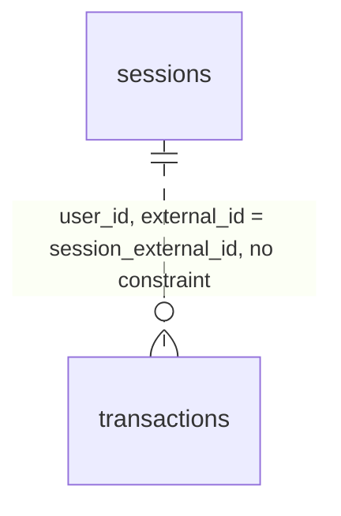
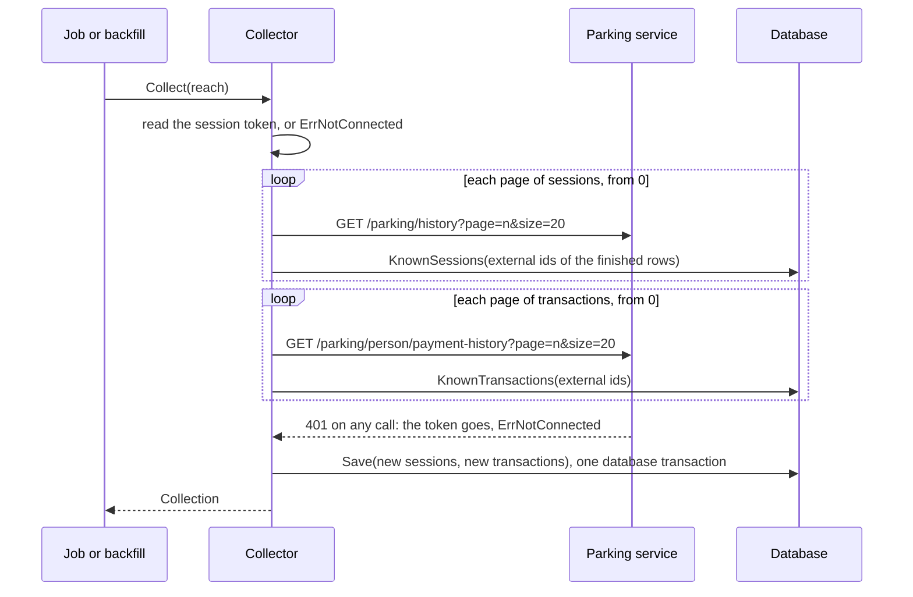

# Specification: The parking history of a user

## 1. Summary

The parking plugin gains a schema, `dev_maroid_parking`, with two tables of a user: the
sessions and the transactions. A cron job for each user reads the newest pages of
both lists from the parking service each hour, and writes the new rows in one database transaction. A
command reads every page for one user. Three pages and the read routes behind them are in
`spec-pages.md`. `spec-scenarios.md` holds the scenarios of this file. The connection of
`PARKACC` does not change.

## 2. Coverage

| Requirement        | Where this specification realizes it                                     |
| ------------------ | ------------------------------------------------------------------------ |
| `PARKHIST-FR-001`  | Section 4.3, `PARKHIST-SC-001`                                           |
| `PARKHIST-FR-002`  | Section 4.3, `PARKHIST-SC-001`                                           |
| `PARKHIST-FR-003`  | Section 4.3, `PARKHIST-SC-002`                                           |
| `PARKHIST-FR-004`  | `PARKHIST-DD-001`, `PARKHIST-SC-003`                                     |
| `PARKHIST-FR-005`  | `PARKHIST-DD-002`, `PARKHIST-SC-004`, `PARKHIST-SC-005`                  |
| `PARKHIST-FR-006`  | `PARKHIST-DD-002`, `PARKHIST-SC-006`                                     |
| `PARKHIST-FR-007`  | `PARKHIST-DD-002`, `PARKHIST-SC-006`                                     |
| `PARKHIST-FR-008`  | `PARKHIST-DD-003`, `PARKHIST-SC-007`                                     |
| `PARKHIST-FR-009`  | `PARKHIST-DD-004`, `PARKHIST-SC-008`, `PARKHIST-SC-009`                  |
| `PARKHIST-FR-010`  | Section 4.5, `PARKHIST-SC-010`                                           |
| `PARKHIST-FR-011`  | Section 4.2, `PARKHIST-SC-011`                                           |
| `PARKHIST-FR-012`  | Section 4.2, `PARKHIST-DD-005`, `PARKHIST-SC-012`                        |
| `PARKHIST-FR-013`  | `PARKHIST-DD-006`, `PARKHIST-SC-012`                                     |
| `PARKHIST-FR-014`  | Section 4.2, `PARKHIST-DD-006`, `PARKHIST-SC-013`                        |
| `PARKHIST-FR-015`  | `PARKHIST-DD-007`, `PARKHIST-SC-013`                                     |
| `PARKHIST-FR-016`  | `PARKHIST-DD-008`, `PARKHIST-SC-028`                                     |
| `PARKHIST-FR-017`  | Section 4.2, `PARKHIST-SC-010`                                           |
| `PARKHIST-FR-018`  | Section 4.3, `PARKHIST-DD-009`, `PARKHIST-SC-014`, `PARKHIST-SC-018`     |
| `PARKHIST-FR-019`  | Section 4.3, `PARKHIST-SC-014`                                           |
| `PARKHIST-FR-020`  | Section 4.5, `PARKHIST-SC-015`                                           |
| `PARKHIST-FR-021`  | `spec-pages.md`, `PARKHIST-DD-010`, `PARKHIST-SC-020`                    |
| `PARKHIST-FR-022`  | `spec-pages.md`, `PARKHIST-DD-016`, `PARKHIST-SC-021`                    |
| `PARKHIST-FR-023`  | `spec-pages.md`, `PARKHIST-DD-016`, `PARKHIST-SC-034`                    |
| `PARKHIST-FR-024`  | `spec-pages.md`, `PARKHIST-DD-016`, `PARKHIST-SC-034`                    |
| `PARKHIST-FR-025`  | `spec-pages.md`, `PARKHIST-DD-013`, `PARKHIST-SC-021`, `PARKHIST-SC-022` |
| `PARKHIST-FR-026`  | `spec-pages.md`, `PARKHIST-DD-013`, `PARKHIST-SC-021`                    |
| `PARKHIST-FR-027`  | `spec-pages.md`, `PARKHIST-DD-012`, `PARKHIST-SC-025`                    |
| `PARKHIST-FR-028`  | `spec-pages.md`, `PARKHIST-DD-014`, `PARKHIST-SC-023`                    |
| `PARKHIST-FR-029`  | `spec-pages.md`, `PARKHIST-DD-011`, `PARKHIST-SC-024`                    |
| `PARKHIST-FR-030`  | `spec-pages.md`, `PARKHIST-DD-011`, `PARKHIST-SC-024`                    |
| `PARKHIST-FR-031`  | `spec-pages.md`, `PARKHIST-DD-011`, `PARKHIST-SC-024`                    |
| `PARKHIST-FR-032`  | `spec-pages.md`, `PARKHIST-DD-015`, `PARKHIST-SC-025`, `PARKHIST-SC-026` |
| `PARKHIST-FR-033`  | `spec-pages.md`, `PARKHIST-SC-025`, `PARKHIST-SC-027`                    |
| `PARKHIST-FR-034`  | `spec-pages.md`, `PARKHIST-DD-005`, `PARKHIST-SC-025`                    |
| `PARKHIST-FR-035`  | `spec-pages.md`, `PARKHIST-DD-012`, `PARKHIST-SC-025`                    |
| `PARKHIST-FR-036`  | `spec-pages.md`, `PARKHIST-DD-011`, `PARKHIST-SC-028`                    |
| `PARKHIST-FR-037`  | `spec-pages.md`, `PARKHIST-DD-008`, `PARKHIST-DD-011`, `PARKHIST-SC-028` |
| `PARKHIST-FR-038`  | `spec-pages.md`, `PARKHIST-DD-007`, `PARKHIST-SC-028`                    |
| `PARKHIST-FR-039`  | `spec-pages.md`, `PARKHIST-DD-011`, `PARKHIST-SC-028`                    |
| `PARKHIST-FR-040`  | `spec-pages.md`, `PARKHIST-SC-029`                                       |
| `PARKHIST-FR-041`  | `spec-pages.md`, `PARKHIST-DD-015`, `PARKHIST-SC-029`                    |
| `PARKHIST-FR-042`  | `spec-pages.md`, `PARKHIST-DD-012`, `PARKHIST-SC-029`                    |
| `PARKHIST-FR-043`  | `spec-pages.md`, `PARKHIST-DD-016`, `PARKHIST-SC-030`                    |
| `PARKHIST-FR-044`  | `spec-pages.md`, `PARKHIST-DD-016`, `PARKHIST-SC-031`                    |
| `PARKHIST-FR-045`  | `spec-pages.md`, `PARKHIST-SC-032`                                       |
| `PARKHIST-NFR-001` | `spec-pages.md`, `PARKHIST-DD-012`, `PARKHIST-SC-033`                    |
| `PARKHIST-INV-001` | Section 4.2, `PARKHIST-SC-016`                                           |
| `PARKHIST-INV-002` | `PARKHIST-DD-006`, `api.yaml`, `PARKHIST-SC-017`                         |

## 3. Guideline compliance

| Rule                            | Guideline         | How this specification obeys it                                                                                                         |
| ------------------------------- | ----------------- | --------------------------------------------------------------------------------------------------------------------------------------- |
| `PLG-006`, `PLG-007`            | Plugin model      | The plugin adds the cron, command, and migration capabilities through the existing interfaces, and reaches the data by `host.Database`. |
| `ARC-008`                       | Architecture      | No file of the hub changes.                                                                                                             |
| `DAT-001`, `DAT-006`, `DAT-009` | Data              | Both tables live in `dev_maroid_parking`. Each `id` is `uuidv7()`. Each identifier of the parking service is a unique constraint.       |
| `DAT-008`                       | Data              | Both tables stay plain tables. A session and a transaction are events, not measurements (`PARKHIST-DD-005`).                            |
| `DAT-010`                       | Data              | `started_at`, `ended_at`, and `occurred_at` are `TIMESTAMPTZ` (`PARKHIST-DD-006`).                                                      |
| `OWN-004` to `OWN-008`          | Ownership         | Each table carries `user_id` and forced row level security. No repository filters by user.                                              |
| `OWN-009`                       | Ownership         | The collection runs with `CronScopePerUser`, because it writes tables that a user scopes.                                               |
| `CFG-001`                       | Configuration     | The schedule, the page limit, and the timeout are keys of the plugin config. Section 4.3.                                               |
| `EXT-001` to `EXT-007`          | External services | `service/api-client.go` holds both new calls. A status that is not 200 is `StatusError`. Every call ends after `request_timeout`.       |
| `LOG-003`, `LOG-008`            | Logging           | The collector adds `component=collector`. No log line holds the token, the wallet number, or the personal identifier.                   |
| `SEC-013`                       | Security          | Each new route names a permission. `spec-pages.md`, section 2.                                                                          |
| `JOB-005` to `JOB-007`          | Background jobs   | `history_collector` answers an error for one user. The scheduler logs it and runs the next user.                                        |
| `CLI-003` to `CLI-006`          | Command line      | `backfill` holds the collector and a logger with `component=command`. `PreRunE` checks the flag.                                        |
| `API-004`, `ERR-002`            | HTTP API, Errors  | The routes mount under the prefix of `PARKACC`. No new problem type. `spec-pages.md`, section 2.                                        |
| `RES-001`, `RES-005`, `RES-006` | REST              | Every amount travels as the money object. The two lists answer keyset pages.                                                            |
| `GO-005`                        | Go style          | Each new sentinel error lives in `errs/`.                                                                                               |
| `PKG-001`                       | Package layout    | The plugin gains `cli/`, `db/`, `job/`, and `repository/`. Section 4.1.                                                                 |
| `UI-005` to `UI-009`            | Web UI            | The remote adds three page routes, and reaches the API through `host.api`. `spec-pages.md`.                                             |
| `BLD-003`                       | Build             | The build plan builds the UI before the `.so`.                                                                                          |

## 4. Design

### 4.1 Components

Every path is under `plugins/parking/`. A file not named here follows the pensions plugin.

| Path                                      | Action | Holds                                                                                                                                                                                                                                                                            |
| ----------------------------------------- | ------ | -------------------------------------------------------------------------------------------------------------------------------------------------------------------------------------------------------------------------------------------------------------------------------- |
| `db/doc.go`, `db/migrations.go`           | create | `Migrations`, the embedded `migrations/*.sql`                                                                                                                                                                                                                                    |
| `db/migrations/20261128100000_*`          | create | `table_sessions_create`                                                                                                                                                                                                                                                          |
| `db/migrations/20261128100100_*`          | create | `table_transactions_create`                                                                                                                                                                                                                                                      |
| `config/config.go`                        | change | `Config` gains `RequestTimeout`, `CollectorPages`, and `CronSchedule` with `HistoryCollector` (section 4.3)                                                                                                                                                                      |
| `errs/errs.go`                            | change | `ErrUnexpectedAnswer`, `ErrPageLimit`, `ErrInvalidUser`                                                                                                                                                                                                                          |
| `model/history.go`                        | create | `Session`, `Transaction`, `TransactionKind` with its four values, `Reach` (`ReachRecent`, `ReachFull`), `Collection`                                                                                                                                                             |
| `dto/history.go`                          | create | `Page[T]`, `HistorySession`, `PaymentEntry`, `PageMeta`, and `ToModel` of each (`PARKHIST-DD-006`)                                                                                                                                                                               |
| `service/api-client.go`                   | change | `HistoryClient` holds `ParkingHistory` and `PaymentHistory`, and `APIClient` implements it. `NewAPIClient` sets the timeout                                                                                                                                                      |
| `repository/{doc,session,transaction}.go` | create | `Session.Known`, `Session.Upsert`, `Transaction.Known`, `Transaction.Upsert`                                                                                                                                                                                                     |
| `service/history_store.go`                | create | `HistoryStore` over `PluginDB`: `KnownSessions`, `KnownTransactions`, and `Save(ctx context.Context, sessions []model.Session, transactions []model.Transaction) (model.Collection, error)`, one transaction. `Collection` counts the inserted rows, from `RETURNING (xmax = 0)` |
| `service/collector.go`                    | create | `Collector.Collect(ctx context.Context, reach model.Reach) (model.Collection, error)`                                                                                                                                                                                            |
| `job/{doc,history_collector}.go`          | create | `HistoryCollector`, `NewHistoryCollector`                                                                                                                                                                                                                                        |
| `cli/{doc,backfill}.go`                   | create | `Backfill`, `NewBackfill`, `Command() *cobra.Command`                                                                                                                                                                                                                            |
| `main.go`                                 | change | `ParkingPlugin`: `Meta` (version `0.2.0`), `host.Database`, `CronJobs`, `Commands`, `Migrations`, and the parts of `spec-pages.md`                                                                                                                                               |
| `config.yaml` at the repository root      | change | The block of `parking.so` gains the defaults of section 4.3, as comments                                                                                                                                                                                                         |
| `chart/values.yaml`                       | change | The entry of `parking.so` gains `cron_schedule.history_collector`                                                                                                                                                                                                                |

The methods of the new `service.HistoryClient`. `APIClientService` already holds 10 methods, the limit of the linter. Each one sends through `send`, so a 401 removes
the session token and answers `errs.ErrNotConnected`, as `PARKACC-DD-003` gives:

```go
ParkingHistory(ctx context.Context, page int) (dto.Page[dto.HistorySession], error)
PaymentHistory(ctx context.Context, page int) (dto.Page[dto.PaymentEntry], error)
```

`dto.Page[T]` decodes `result.data` and `result.page` (`total`, `number`, `size`). `page` is the
index that the parking service counts from 0.

### 4.2 Data model

| Table          | Schema               | Scope | Realizes                                                  |
| -------------- | -------------------- | ----- | --------------------------------------------------------- |
| `sessions`     | `dev_maroid_parking` | User  | `PARKHIST-FR-011`, `PARKHIST-FR-012`, `PARKHIST-FR-017`   |
| `transactions` | `dev_maroid_parking` | User  | `PARKHIST-FR-011`, `PARKHIST-FR-014` to `PARKHIST-FR-017` |

Each table holds `id UUID PRIMARY KEY DEFAULT uuidv7()`, the `user_id` column of `OWN-005`,
`collected_at TIMESTAMPTZ NOT NULL DEFAULT now()`, and the policy `<table>_user_isolation` of
`OWN-006`, as the pensions plugin writes them. A comment on each table names the person. Each
amount is `NUMERIC(12, 2)`. Each upsert runs `ON CONFLICT (user_id, external_id) DO UPDATE` on
every value column, `WHERE (...) IS DISTINCT FROM (EXCLUDED...)`.

| Table          | Columns beside `id`, `user_id`, and `collected_at`                                                                                                                                                                                                                       | Unique key               |
| -------------- | ------------------------------------------------------------------------------------------------------------------------------------------------------------------------------------------------------------------------------------------------------------------------ | ------------------------ |
| `sessions`     | `external_id BIGINT`, `lot_number TEXT` (1 to 32 characters), `address TEXT`, `plate TEXT` (1 to 16 characters), `parking_type TEXT`, `started_at TIMESTAMPTZ`, `ended_at TIMESTAMPTZ`, `amount NUMERIC(12, 2)` (at least 0). `CHECK (ended_at >= started_at)`           | `user_id`, `external_id` |
| `transactions` | `external_id BIGINT`, `kind TEXT` (`top_up`, `parking_payment`, `permit_purchase`, `other`), `service_kind TEXT`, `amount NUMERIC(12, 2)` (at least 0), `balance_after NUMERIC(12, 2)`, `occurred_at TIMESTAMPTZ`, `session_external_id BIGINT` null, `description TEXT` | `user_id`, `external_id` |

`session_external_id` holds no foreign key, because the transaction of a session
can arrive before the session (`PARKHIST-DD-008`). The indexes of `spec-pages.md`,
section 2, join the migrations.



### 4.3 Declarations

**Configuration.** The existing `base_url` stays.

| Key                               | Type                 | Default      | Secret | Realizes                             |
| --------------------------------- | -------------------- | ------------ | ------ | ------------------------------------ |
| `request_timeout`                 | duration, above zero | `15s`        | No     | `PARKHIST-FR-009`                    |
| `collector_pages`                 | integer, 1 to 20     | `5`          | No     | `PARKHIST-FR-006`                    |
| `cron_schedule.history_collector` | cron                 | `15 * * * *` | No     | `PARKHIST-FR-001`, `PARKHIST-FR-002` |

**Cron job.**

| Identifier          | Schedule                          | Runs in            | Behavior                                                                            | Realizes                               |
| ------------------- | --------------------------------- | ------------------ | ----------------------------------------------------------------------------------- | -------------------------------------- |
| `history_collector` | `cron_schedule.history_collector` | `CronScopePerUser` | `Collect` with `ReachRecent`. `ErrNotConnected` logs a skip at info and answers nil | `PARKHIST-FR-001` to `PARKHIST-FR-010` |

**CLI command.** The registrar mounts it under `maroid dev-maroid-parking`.

| Command    | Flags                     | Does                                                                             | Realizes                               |
| ---------- | ------------------------- | -------------------------------------------------------------------------------- | -------------------------------------- |
| `backfill` | `--user` (UUID), required | `Collect` with `ReachFull`, then prints `<n> new sessions, <m> new transactions` | `PARKHIST-FR-018` to `PARKHIST-FR-020` |

The routes, the permission, the widget change, and the UI routes are in `spec-pages.md`.

### 4.4 Flow

`Collect` reads every page that it needs, then writes once:



| Call                                               | Answer read                                                                                                                                                |
| -------------------------------------------------- | ---------------------------------------------------------------------------------------------------------------------------------------------------------- |
| `GET /parking/history?page&size=20`                | `result.data[]`: `id`, `status`, `type`, `govNumber`, `parkingPlace.uniqueNumber`, `parkingPlace.address`, `startDate`, `endDate`, `amount`. `result.page` |
| `GET /parking/person/payment-history?page&size=20` | `result.data[]`: `id`, `operationType`, `amount`, `currentBalance`, `parkingId`, `additionalInformationForMobileEng`, `operationDate`. `result.page`       |

### 4.5 Errors

| Condition                                                    | Collection                                                                                                      | `backfill`                                       |
| ------------------------------------------------------------ | --------------------------------------------------------------------------------------------------------------- | ------------------------------------------------ |
| No `session` secret                                          | Skip, nil (`PARKHIST-FR-003`)                                                                                   | Fails with `ErrNotConnected` (`PARKHIST-FR-020`) |
| A call answers 401                                           | `send` deletes `session` and answers `ErrNotConnected`. The run logs a skip. Nothing stored (`PARKHIST-FR-010`) | Fails with `ErrNotConnected`                     |
| A call answers a status that is not 200, or no answer        | The run fails with `ErrRequestFailed`. Nothing stored                                                           | The same                                         |
| A row that does not decode, a bad time, or a negative amount | The run fails with `ErrUnexpectedAnswer`. Nothing stored                                                        | The same                                         |
| The full reach passes 500 pages of one list                  | Not reached                                                                                                     | Fails with `ErrPageLimit`. Nothing stored        |
| `--user` is not a UUID                                       | Not reached                                                                                                     | `PreRunE` fails with `ErrInvalidUser`. No call   |

The collected rows stay after `ErrNotConnected` (`PARKHIST-FR-017`): no path deletes a row.

## 5. Design decisions

### `PARKHIST-DD-001`

**Realizes:** `PARKHIST-FR-004`
**Decision:** The connection of `PARKACC` does not change. No route and no step of a connection
calls `Collect`.
**Rationale:** The owner decided on 2026-11-27 that a full read runs only from the command line.
The next scheduled run reads the recent pages within the hour.
**Alternatives:** A task in the outbox of `JOB-009` after a verification. It reads the full history
with no person to watch it.

### `PARKHIST-DD-002`

**Realizes:** `PARKHIST-FR-005`, `PARKHIST-FR-006`, `PARKHIST-FR-007`
**Decision:** `ReachRecent` reads page 0, then each next page, of each list. It stops after a page
whose rows Maroid all holds, after the last page of `result.page`, after an empty page, or after
`collector_pages` pages. A stop at the limit with a new row on the last page logs a warning with
`user_id`, the list, and the text "run backfill". `ReachFull` reads every page, and holds no stop
at a known page.
**Rationale:** The rows come newest first. The ledger orders by `operationDate`, and its `id` does
not grow with it (the capture holds `31725849` dated after `36638943`), so a known `id` proves no
order, while a full page of known rows does. A quiet hour costs one call of each list for each user.
**Alternatives:** A stop at the first known row. A late row with an earlier date then stays absent.

### `PARKHIST-DD-003`

**Realizes:** `PARKHIST-FR-008`
**Decision:** The collector keeps a session only when `status` is `FINISHED` and
`endDate` is present. Any other row counts as a held row for the stop of `PARKHIST-DD-002`.
**Rationale:** An active row has no end and a growing amount. Counted as held, it does not keep a
quiet hour reading a second page.
**Alternatives:** Store the active row, then update it. The stop of `PARKHIST-DD-002` then sees a
held row with a changed amount, and must compare values on each page.

### `PARKHIST-DD-004`

**Realizes:** `PARKHIST-FR-009`
**Decision:** `Collect` calls `HistoryStore.KnownSessions` or `KnownTransactions` in its own `WithTx` for each page, and writes
nothing until both lists are read. `HistoryStore.Save` writes both lists in one `WithTx`. Any
error rolls it back.
**Rationale:** A partial write leaves page 0 held, so the next run stops there and never reads the
failed page. The full reach writes about 900 rows, within one database transaction.
**Alternatives:** A write after each page. A failure then leaves a gap that no scheduled run fills.

### `PARKHIST-DD-005`

**Realizes:** `PARKHIST-FR-012`, `PARKHIST-FR-034`
**Decision:** A session is a free parking when its `amount` is 0. `parking_type` keeps the
`type` of the parking service (`BOTH`, `ONLY_FREE_PARKING`) for a later use. Both tables are plain.
**Rationale:** The capture holds `BOTH` sessions of 8 minutes with an amount of 0. The service did
not charge them, so they match the definition of a free parking. A user holds about 150 rows a
year, and a hypertable chunk of a few rows costs more than it saves.
**Alternatives:** `type` alone. A short session of `BOTH` then reads as paid at 0.00 GEL.

### `PARKHIST-DD-006`

**Realizes:** `PARKHIST-FR-013`, `PARKHIST-FR-014`, `PARKHIST-INV-002`
**Decision:** `HistorySession.ToModel` parses `startDate` and `endDate` with the layout
`2006-01-02T15:04:05.999999` in `time.LoadLocation("Asia/Tbilisi")`. `PaymentEntry.ToModel` parses
`operationDate` with `2006-01-02T15:04:05.000-0700`. The description is
`additionalInformationForMobileEng` with the outer spaces removed. The DTOs declare no field for
`walletNumber`, `personId`, or `ownerCode`.
**Rationale:** The two lists mark time in two ways. The hub embeds `time/tzdata`, so the zone loads
in the plugin. A member that Go does not decode cannot reach an answer or a log.
**Alternatives:** The local time in a `TIMESTAMP` column. `DAT-010` forbids it.

### `PARKHIST-DD-007`

**Realizes:** `PARKHIST-FR-015`, `PARKHIST-FR-038`
**Decision:** `kind` maps `FILL_BALANCE` to `top_up`, `ZONE_PARKING_PAYMENT` to `parking_payment`,
`CARD_PAYMENT` to `permit_purchase`, and any other value to `other`. `service_kind` keeps the value.
`amount` keeps the value of the parking service, with no sign. The direction comes from `kind`.
**Rationale:** The capture holds three kinds, each with a positive amount. A new kind then reaches
the page with its description, and a later mapping corrects the rows from `service_kind`.
**Alternatives:** A sign from the change of `balance_after` between two rows. It breaks at the first
row of a page and on a gap.

### `PARKHIST-DD-008`

**Realizes:** `PARKHIST-FR-016`, `PARKHIST-FR-037`
**Decision:** `session_external_id` holds `parkingId`. A read joins `sessions` on
`external_id` with a `LEFT JOIN`, so the policy limits both sides to the acting user.
**Rationale:** The capture confirms that `parkingId` of a payment equals `id` of its parking
session. The payment arrives at the end of the session, in the same hour.
**Alternatives:** A foreign key to `sessions.id`. The ledger can name a session
that the scheduled reach has not stored yet.

### `PARKHIST-DD-009`

**Realizes:** `PARKHIST-FR-018`, `PARKHIST-FR-020`
**Decision:** `backfill` sets the acting user with `pluginapi.ContextWithActingUser`, and no acting
workspace. `ReachFull` stops at 500 pages of one list with `ErrPageLimit`.
**Rationale:** The plugin secret has the user scope, so the acting user alone reaches it. 500
pages hold 10,000 rows, 20 times the capture. A parking service that answers pages with no end
then fails in place of a loop with no end.
**Alternatives:** A `--pages` flag. The administrator then guesses the size of a history.

## 6. Scenarios

`spec-scenarios.md` holds `PARKHIST-SC-001` to `PARKHIST-SC-019`. `spec-pages.md` holds the rest.

## 7. Build plan

| #   | Step                                                                                                                           | Realizes                                                                       | Done |
| --- | ------------------------------------------------------------------------------------------------------------------------------ | ------------------------------------------------------------------------------ | ---- |
| 1   | The migrations of section 4.2, with the indexes of `spec-pages.md`. Run them up, down, and up                                  | `PARKHIST-FR-011`, `PARKHIST-INV-001`                                          | [x]  |
| 2   | `errs/`, `model/history.go`, `config/`                                                                                         | `PARKHIST-FR-002`, `PARKHIST-FR-006`, `PARKHIST-FR-015`                        | [x]  |
| 3   | `dto/history.go` and the two methods of `service/api-client.go`                                                                | `PARKHIST-FR-012` to `PARKHIST-FR-016`, `PARKHIST-INV-002`                     | [x]  |
| 4   | `repository/`, `service/history_store.go`, and `service/collector.go`                                                          | `PARKHIST-FR-005` to `PARKHIST-FR-011`                                         | [x]  |
| 5   | `job/history_collector.go` and `cli/backfill.go`                                                                               | `PARKHIST-FR-001` to `PARKHIST-FR-004`, `PARKHIST-FR-018` to `PARKHIST-FR-020` | [x]  |
| 6   | The reads of `spec-pages.md`: `repository/`, `service/history_read.go`, the DTOs                                               | `PARKHIST-FR-025` to `PARKHIST-FR-042`, `PARKHIST-NFR-001`                     | [x]  |
| 7   | The read handlers, the widget link, and `api.yaml`                                                                             | `PARKHIST-FR-021` to `PARKHIST-FR-045`                                         | [x]  |
| 8   | `ui/`: the three pages of `spec-pages.md`. `main.go`, `config.yaml`. Build the UI, then the `.so` (`BLD-003`)                  | `PARKHIST-FR-022` to `PARKHIST-FR-044`                                         | [x]  |
| 9   | The tests of `spec-scenarios.md` and of `spec-pages.md`, with `PARKHIST-SC-033`. Lint and build the plugin with `GOWORK=off`   | Every statement                                                                | [ ]  |
| 10  | `PARKHIST-SC-019` against the parking service, then `backfill` of the history. Correct `PARKHIST-DD-002` and `PARKHIST-DD-006` | `PARKHIST-FR-005`, `PARKHIST-FR-013`, `PARKHIST-FR-018`                        | [ ]  |
| 11  | The entry of `parking.so` in `chart/values.yaml`, with the schedule of section 4.3                                             | `PARKHIST-FR-001`, `PARKHIST-FR-002`                                           | [ ]  |

## Retired identifiers

This file has no retired identifier.
