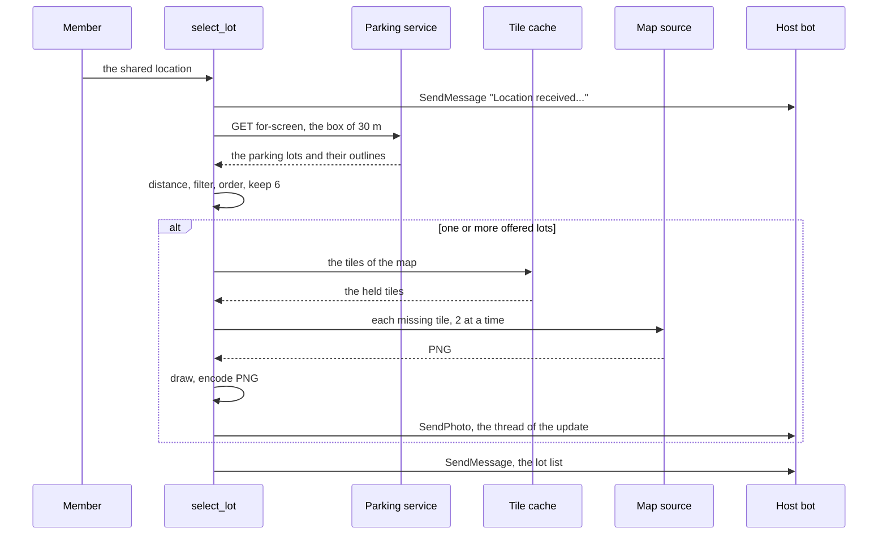

# Specification: The map of the nearby parking lots

## 1. Summary

The `select_lot` step of the `start_parking` conversation searches 30 m around the shared
location, orders the parking lots by distance, and keeps the 6 nearest. When it offers a
parking lot, it draws a map of the offered lots and the pin on tiles of a map source, and
sends it as a photo before the lot list. The plugin draws the map itself, holds the
tiles in memory, and sends the lot list alone when the map fails. `pluginapi.TelegramBot`
gains `SendPhoto` (`ADR-0029`). `spec-scenarios.md` holds the scenarios.

## 2. Coverage

| Requirement       | Where this specification realizes it                                |
| ----------------- | ------------------------------------------------------------------- |
| `PARKMAP-FR-001`  | `PARKMAP-DD-001`, `PARKMAP-SC-001` to `PARKMAP-SC-004`              |
| `PARKMAP-FR-002`  | `PARKMAP-DD-002`, `PARKMAP-SC-002`, `PARKMAP-SC-005`                |
| `PARKMAP-FR-003`  | `PARKMAP-DD-003`, `PARKMAP-SC-006`                                  |
| `PARKMAP-FR-004`  | `PARKMAP-DD-003`, `PARKMAP-SC-007`                                  |
| `PARKMAP-FR-005`  | Section 4.4, `PARKMAP-SC-008`, `PARKMAP-SC-009`                     |
| `PARKMAP-FR-006`  | `PARKMAP-DD-007`, `PARKMAP-SC-016`                                  |
| `PARKMAP-FR-007`  | `PARKMAP-DD-007`, `PARKMAP-DD-008`, `PARKMAP-SC-017`                |
| `PARKMAP-FR-008`  | `PARKMAP-DD-007`, `PARKMAP-SC-016`                                  |
| `PARKMAP-FR-009`  | `PARKMAP-DD-007`, `PARKMAP-SC-018`                                  |
| `PARKMAP-FR-010`  | `PARKMAP-DD-006`, `PARKMAP-SC-019`                                  |
| `PARKMAP-FR-011`  | `PARKMAP-DD-006`, `PARKMAP-SC-020`                                  |
| `PARKMAP-FR-012`  | `PARKMAP-DD-007`, Section 4.3, `PARKMAP-SC-021`                     |
| `PARKMAP-FR-013`  | Section 4.4, `PARKMAP-SC-010`                                       |
| `PARKMAP-FR-014`  | `PARKMAP-DD-011`, Section 4.5, `PARKMAP-SC-011` to `PARKMAP-SC-014` |
| `PARKMAP-FR-015`  | `PARKMAP-DD-013`, `PARKMAP-SC-015`                                  |
| `PARKMAP-FR-016`  | `PARKMAP-DD-014`, Section 4.3, `PARKMAP-SC-022`                     |
| `PARKMAP-FR-017`  | `PARKMAP-DD-009`, `PARKMAP-SC-023`                                  |
| `PARKMAP-FR-018`  | `PARKMAP-DD-012`, `ADR-0029`, `PARKMAP-SC-024`                      |
| `PARKMAP-FR-019`  | `PARKMAP-DD-012`, `PARKMAP-SC-025`                                  |
| `PARKMAP-NFR-001` | `PARKMAP-DD-011`, `PARKMAP-SC-026`                                  |
| `PARKMAP-NFR-002` | `PARKMAP-DD-010`, `PARKMAP-SC-027`                                  |
| `PARKMAP-NFR-003` | `PARKMAP-DD-010`, `PARKMAP-SC-028`                                  |
| `PARKMAP-NFR-004` | `PARKMAP-DD-010`, `PARKMAP-SC-029`                                  |
| `PARKMAP-INV-001` | Section 4.4, `PARKMAP-SC-008`                                       |
| `PARKMAP-INV-002` | `PARKMAP-DD-009`, `PARKMAP-SC-023`                                  |

## 3. Guideline compliance

| Rule      | Guideline         | How this specification obeys it                                                                  |
| --------- | ----------------- | ------------------------------------------------------------------------------------------------ |
| `TG-005`  | Telegram          | The map is part of `select_lot`. The conversation keeps its steps. Section 4.3.                  |
| `TG-007`  | Telegram          | The step sends the photo through `pluginapi.TelegramBot`. `PARKMAP-DD-012`.                      |
| `ARC-008` | Architecture      | `SendPhoto` of the host wraps telego and names no plugin. `ADR-0029`.                            |
| `BLD-002` | Build and release | `golang.org/x/image` and `golang.org/x/sync` take the versions of `apps/hub`. Section 4.1.       |
| `BLD-004` | Build and release | Step 1 of the build plan builds every plugin and loads each one.                                 |
| `PLG-009` | Plugin model      | The tile cache lives in memory. A restart drops it. `PARKMAP-DD-010`.                            |
| `EXT-001` | External services | The tile client lives in `service/`. `PARKMAP-DD-009`.                                           |
| `EXT-002` | External services | The tile client uses resty, and sets `Accept: image/png` once (`ADR-0030`).                      |
| `EXT-004` | External services | Each tile request carries the context of the step, with the deadline of `PARKMAP-DD-011`.        |
| `EXT-005` | External services | A tile status other than 200 is an error. No map goes out with a missing tile. `PARKMAP-DD-009`. |
| `EXT-007` | External services | `errs.ErrMapSource` names a failure of the map source, wrapped with the status.                  |
| `CFG-003` | Configuration     | `config.MapConfig` declares each default and each validation in a tag. Section 4.3.              |
| `CFG-005` | Configuration     | The plugin reads the map source from its configuration map.                                      |
| `LOG-005` | Logging           | The failure of a map is an `error` attribute. `PARKMAP-DD-013`.                                  |
| `LOG-007` | Logging           | The message is lowercase and names the event. `PARKMAP-DD-013`.                                  |
| `PKG-001` | Package layout    | The search, the tile client, the cache, and the drawing live in `service/` (`ADR-0017`).         |
| `GO-007`  | Go style          | Each new service declares its interface and asserts the implementation.                          |
| `TST-004` | Testing           | Each scenario names its layer. `spec-scenarios.md`.                                              |

## 4. Design

### 4.1 Components

| Path                                                         | Action | Holds                                                                                                                                                                            |
| ------------------------------------------------------------ | ------ | -------------------------------------------------------------------------------------------------------------------------------------------------------------------------------- |
| `libs/pluginapi/telegram.go`                                 | Change | `TelegramBot.SendPhoto(ctx context.Context, params *telego.SendPhotoParams) (*telego.Message, error)`.                                                                           |
| `apps/hub/internal/plugin/host/telegram.go`                  | Change | `telegramBotWrapper.SendPhoto`, which calls `telego.Bot.SendPhoto`.                                                                                                              |
| `plugins/jasmine/telegram/command/care_test.go`              | Change | The fake `bot` gains `SendPhoto`.                                                                                                                                                |
| `plugins/parking/config/config.go`                           | Change | `MapConfig`, and the field `Config.Map` with `mapstructure:"map"`.                                                                                                               |
| `plugins/parking/errs/errs.go`                               | Change | `ErrMapSource = errors.New("parking: map source failed")`.                                                                                                                       |
| `plugins/parking/model/lot.go`                               | Create | `ParkingLot{Number, Address string; Outline orb.Polygon}` and `NearbyLot{ParkingLot; Distance float64}`.                                                                         |
| `plugins/parking/dto/api-client.go`                          | Change | `func (l ParkingLot) ToModel() (model.ParkingLot, error)`. It reads `Polygon` with `wkt.UnmarshalPolygon`.                                                                       |
| `plugins/parking/service/nearby.go`                          | Create | `LotFinder` and `NearbyLots`. `PARKMAP-DD-001` to `PARKMAP-DD-004`.                                                                                                              |
| `plugins/parking/service/tile-client.go`                     | Create | `TileSource` and `TileClient`. `PARKMAP-DD-009`.                                                                                                                                 |
| `plugins/parking/service/tile-cache.go`                      | Create | `TileCache`. `PARKMAP-DD-010`.                                                                                                                                                   |
| `plugins/parking/service/lot-map.go`                         | Create | `LotMapRenderer` and `LotMap`: the zoom, the tiles, the encode. `PARKMAP-DD-006`.                                                                                                |
| `plugins/parking/service/lot-map-draw.go`                    | Create | The outlines, the labels, the pin, and the attribution. `PARKMAP-DD-007`, `PARKMAP-DD-008`.                                                                                      |
| `plugins/parking/telegram/conversation/step/select_lot.go`   | Change | `SelectLot` takes a `service.LotFinder`, a `service.LotMapRenderer`, and a `*slog.Logger`. Section 4.4.                                                                          |
| `plugins/parking/telegram/conversation/step/vehicle_test.go` | Change | `fakeBot` gains `SendPhoto`, and records each photo.                                                                                                                             |
| `plugins/parking/telegram/conversation/parking.go`           | Change | `NewParkingConversation` passes the finder, the renderer, and the logger to `NewSelectLot`.                                                                                      |
| `plugins/parking/main.go`                                    | Change | `New` builds `NearbyLots`, `TileClient`, `TileCache`, and `LotMap`.                                                                                                              |
| `plugins/parking/go.mod`                                     | Change | Adds `github.com/paulmach/orb v0.14.0`, `github.com/fogleman/gg v1.3.0`, `github.com/golang/freetype`, and `golang.org/x/image v0.48.0`. Promotes `golang.org/x/sync` to direct. |

The signatures of the new services:

```go
type LotFinder interface {
	FindNearby(ctx context.Context, lat, lng float64) ([]model.NearbyLot, error)
}

type TileSource interface {
	Tile(ctx context.Context, zoom, x, y int) ([]byte, error)
}

type LotMapRenderer interface {
	Render(ctx context.Context, lat, lng float64, lots []model.NearbyLot) ([]byte, error)
}

func NewNearbyLots(client APIClientService, logger *slog.Logger) *NearbyLots
func NewTileClient(cfg config.MapConfig) *TileClient
func NewTileCache(limit int, ttl time.Duration) *TileCache
func NewLotMap(tiles TileSource, cache *TileCache, cfg config.MapConfig) (*LotMap, error)
```

`NewLotMap` parses the two fonts of `golang.org/x/image/font/gofont`, and fails on an
error. `TileCache` takes its clock as a field `now func() time.Time`, so a test moves it.

### 4.2 Data model

This feature adds no table.

### 4.3 Declarations

**Telegram conversation.** The conversation exists. `select_lot` changes. The other steps
stay as `PARKACC` gives them.

| Identifier      | Entry step     | Steps                                                                                 | Realizes                                                                 |
| --------------- | -------------- | ------------------------------------------------------------------------------------- | ------------------------------------------------------------------------ |
| `start_parking` | `ask_location` | `ask_location`, `select_lot`, `enter_lot`, `select_type`, `select_vehicle`, `confirm` | `PARKMAP-FR-001` to `PARKMAP-FR-005`, `PARKMAP-FR-013`, `PARKMAP-FR-014` |

**Configuration scheme.** The keys live under `config` of the parking plugin.

| Key               | Type     | Default                                          | Validation                                            | Secret | Realizes          |
| ----------------- | -------- | ------------------------------------------------ | ----------------------------------------------------- | ------ | ----------------- |
| `map.tile_url`    | string   | `https://tile.openstreetmap.org/{z}/{x}/{y}.png` | `required,url,contains={z},contains={x},contains={y}` | No     | `PARKMAP-FR-016`  |
| `map.attribution` | string   | `© OpenStreetMap contributors`                   | `required`                                            | No     | `PARKMAP-FR-012`  |
| `map.max_zoom`    | int      | `19`                                             | `min=15,max=22`                                       | No     | `PARKMAP-FR-011`  |
| `map.timeout`     | duration | `3s`                                             | `gt=0,lte=4s`                                         | No     | `PARKMAP-NFR-001` |

### 4.4 Flow



The deadline of `PARKMAP-DD-011` covers each step from the tile cache to `SendPhoto`.
When it passes, or when a step fails, the step logs the failure and sends the lot list.

#### The step

`SelectLot.OnEnter`:

1. Send "Location received. Looking up nearby parking lots..." and remove the reply keyboard, as today.
2. Call `LotFinder.FindNearby`. On an error, return it, as today.
3. When the slice holds one or more lots, call `sendMap` with the slice. `sendMap` returns nothing.
4. Build the lot list from the same slice, in its order, and send it, as today.

`sendMap` derives a context with the deadline of `map.timeout`, calls `LotMapRenderer.Render`,
and calls `TelegramBot.SendPhoto`. The map and the keyboard read one slice, so
`PARKMAP-INV-001` holds. With no lot, the step calls neither, and sends the text of today.

### 4.5 Errors

| Condition                              | Behavior                                                                                | Message to the member                       |
| -------------------------------------- | --------------------------------------------------------------------------------------- | ------------------------------------------- |
| The parking service fails              | `OnEnter` returns the error, as today. No map.                                          | As today                                    |
| One outline does not parse             | `NearbyLots` drops the lot and logs `parking lot outline not read` at warn, with `lot`. | None                                        |
| A tile answers a status other than 200 | `ErrMapSource` with the status. The step logs it and sends the lot list.                | None                                        |
| The deadline of `map.timeout` passes   | The step logs `context.DeadlineExceeded` and sends the lot list.                        | None                                        |
| `SendPhoto` fails                      | The step logs the error and sends the lot list.                                         | None                                        |
| The search offers no lot               | No map. The text of today.                                                              | "No parking lots found near your location." |

## 5. Design decisions

### `PARKMAP-DD-001`

**Realizes:** `PARKMAP-FR-001`
**Decision:** `NearbyLots` asks the parking service for the box of 30 m on each side of the shared location, then keeps each lot at 30 m or less. The box offset is `30 / 6371008.8` radians of latitude, and that value divided by `cos(lat)` for longitude.
**Rationale:** The parking service returns each lot whose outline crosses the box: a query with the box `41.6924` to `41.6944` returned `A979`, whose outline starts at `41.69197`. Each point within 30 m lies in the box, so the box misses no lot. A lot in a corner of the box can lie at 42 m, so the filter stays.
**Alternatives:** A box of 30 m with no filter. It offers a lot at 42 m, against `PARKMAP-FR-001`.

### `PARKMAP-DD-002`

**Realizes:** `PARKMAP-FR-002`
**Decision:** `NearbyLots` projects each outline to meters on a plane that touches the earth at the shared location: `x = Δlng · cos(lat) · R`, `y = Δlat · R`, `R = 6371008.8` m, angles in radians. The distance is 0 when `planar.PolygonContains` holds, else `planar.DistanceFrom` of the projected outline.
**Rationale:** Over 100 m the error of the plane is below 1 mm. The two `orb` functions measure to the nearest point of the boundary, as `PARKMAP-FR-002` demands.
**Alternatives:** The distance to the centroid. `PARKMAP-FR-002` forbids it. A haversine to each vertex. It misses the middle of a long edge.

### `PARKMAP-DD-003`

**Realizes:** `PARKMAP-FR-003`, `PARKMAP-FR-004`
**Decision:** `NearbyLots` sorts by the distance, then by the zone letter, then by the integer after the letter, and keeps the first 6. Two distances that differ by less than 0.01 m are equal.
**Rationale:** The lot number is a zone letter and an integer (`lotNumberRegex`). An integer compare puts `A12` before `A102`, as a person reads them. The tolerance stops a float noise from deciding the order.
**Alternatives:** A string compare. It puts `A102` before `A12`.

### `PARKMAP-DD-004`

**Realizes:** `PARKMAP-FR-001`
**Decision:** A lot whose outline does not parse leaves the search. `NearbyLots` logs it at warn and keeps the other lots.
**Rationale:** The plugin cannot measure the distance of a lot with no outline. One bad row must not stop a parking session. "Enter manually" still reaches the lot.
**Alternatives:** Fail the step with `ErrUnexpectedAnswer`. One bad row then blocks every parking session on that street.

### `PARKMAP-DD-005`

**Realizes:** `PARKMAP-FR-005` to `PARKMAP-FR-012`
**Decision:** The plugin draws the map itself, with `github.com/fogleman/gg` for the shapes and the text. It fetches the tiles with its own client and cache.
**Rationale:** `go-staticmaps` fetches each tile with `http.DefaultClient`: no context, no deadline, against `EXT-002` and `EXT-004`. It caches on disk, which outlives a restart (`PLG-009`). It logs through the `log` package (`LOG-001`). The parts that the map needs are about 300 lines.
**Alternatives:** `go-staticmaps` with its disk cache off and a goroutine that the step abandons at the deadline. Each map downloads every tile again, against `PARKMAP-NFR-003`, and the download runs on after the deadline.

### `PARKMAP-DD-006`

**Realizes:** `PARKMAP-FR-010`, `PARKMAP-FR-011`
**Decision:** The image is 800 by 600 pixels, PNG, on Web Mercator tiles of 256 pixels. The zoom is the highest value from `map.max_zoom` down to 15 at which the pixel bounds of every outline point and the pin fit inside the image less 48 pixels on each side. At 15 the map uses 15. The center of the image is the center of those bounds.
**Rationale:** At zoom 19 in Tbilisi one pixel is 0.22 m, so the image covers 178 m by 133 m. A search of 30 m and a lot of 60 m fit at 19 or 18. The margin of 48 pixels keeps a label and the pin inside. Zoom 20 returns no tile in Tbilisi.
**Alternatives:** A fixed zoom of 19. A lot of 90 m then leaves the image, against `PARKMAP-FR-010`.

### `PARKMAP-DD-007`

**Realizes:** `PARKMAP-FR-006`, `PARKMAP-FR-007`, `PARKMAP-FR-008`, `PARKMAP-FR-009`, `PARKMAP-FR-012`
**Decision:** The map draws in this order:

1. The tiles.
2. Each outline: a fill of its color at alpha `0x80`, and a line of 2 pixels at full alpha.
   The colors follow the order of the lots: `#2563EB`, `#16A34A`, `#D97706`, `#9333EA`, `#0D9488`, `#DB2777`.
3. Each label: a rounded rectangle of the lot color with a white border of 1.5 pixels,
   and the lot number in white, Go Bold of 15 points.
4. The pin: a red `#DC2626` circle of 9 pixels radius, 18 pixels above the location, joined to the location by a triangle, with a line of 1 pixel in `#7F1D1D`.
5. The attribution: `map.attribution` in Go Regular of 11 points, on a white strip at alpha `0xC0` along the bottom left corner.

**Rationale:** Six lots get six colors, so `PARKMAP-FR-008` holds at the limit of `PARKMAP-FR-003`. The pin draws last, so no label hides it. The experiment showed these sizes readable in a Telegram chat.
**Alternatives:** Labels after the pin. A label then hides the pin when the member stands inside a lot.

### `PARKMAP-DD-008`

**Realizes:** `PARKMAP-FR-007`
**Decision:** Each label tries three points in this order: the centroid of the outline, then the points at 25 % and at 75 % of the outline along its longest edge, through the centroid. The label takes the first point at which its rectangle meets neither the rectangle of the pin nor an earlier label. When every point fails, it takes the centroid.
**Rationale:** A lot is about 3 m wide and up to 60 m long. The three points stay on the outline. The pin stands at the curb, often next to the centroid of the nearest lot.
**Alternatives:** The centroid only. The owner rejected it: the label hides the pin.

### `PARKMAP-DD-009`

**Realizes:** `PARKMAP-FR-017`, `PARKMAP-INV-002`
**Decision:** `TileClient` is a resty client with no base URL. It replaces `{z}`, `{x}`, and `{y}` in `map.tile_url`. It sets `User-Agent: Maroid/1.0 (parking map)` and `Accept: image/png` once. It sends no cookie, no token, and no other header. A status other than 200 returns `ErrMapSource` with the status. `LotMap` fetches the missing tiles 2 at a time with `errgroup.SetLimit(2)`.
**Rationale:** The usage policy of `tile.openstreetmap.org` demands a User-Agent that names the client and allows 2 parallel downloads. A map of 800 by 600 pixels needs at most 20 tiles. The client shares nothing with `APIClient`, so no session token reaches the map source.
**Alternatives:** The `a.`, `b.`, and `c.` hosts. The policy names them obsolete.

### `PARKMAP-DD-010`

**Realizes:** `PARKMAP-NFR-002`, `PARKMAP-NFR-003`, `PARKMAP-NFR-004`
**Decision:** `TileCache` holds the PNG bytes of each tile in memory, under the key `zoom/x/y`. It drops the least recently used tile when the sum of the bytes passes 50 MB, and drops a tile 7 days after its download. A mutex guards it. `LotMap` decodes each tile when it draws.
**Rationale:** A tile of OpenStreetMap is 10 to 40 KB, so 50 MB holds more than 1 200 tiles, about 60 maps of distinct streets. The PNG bytes give the size that `PARKMAP-NFR-004` counts. A decode of 20 tiles takes less than 50 ms.
**Alternatives:** Decoded images. An RGBA tile is 256 KB, so 50 MB holds 200 tiles.

### `PARKMAP-DD-011`

**Realizes:** `PARKMAP-FR-014`, `PARKMAP-NFR-001`
**Decision:** One deadline of `map.timeout` (default 3 s) covers the tile fetch, the draw, the encode, and `SendPhoto`. When it passes, or when one part fails, the step sends the lot list without the map.
**Rationale:** The budget of `PARKMAP-NFR-001` is 5 s: about 0.3 s for the first message, 1 s for the parking service, 3 s for the map, and 0.3 s for the lot list. The validation `lte=4s` keeps a configuration from breaking it.
**Alternatives:** A deadline on the tile fetch only. A slow upload to Telegram then passes the 5 s.

### `PARKMAP-DD-012`

**Realizes:** `PARKMAP-FR-018`, `PARKMAP-FR-019`
**Decision:** The step calls `SendPhoto` with the chat, the `MessageThreadID`, and the `DirectMessagesTopicID` of the update, and the photo as `tu.FileFromBytes(png, "parking-map.png")`. The photo has no caption and no keyboard.
**Rationale:** The other messages of the step set the same three values. The lot list carries the text and the buttons, so the later steps edit a text message, as today.
**Alternatives:** The map as the lot list with a caption. The owner rejected it: every later step must then edit a caption.

### `PARKMAP-DD-013`

**Realizes:** `PARKMAP-FR-015`
**Decision:** The step logs `parking map not sent` at warn, with `slog.Any("error", err)` and `slog.Int("lots", n)`. The record holds no latitude and no longitude.
**Rationale:** The record names the failure for the owner. A location is personal data, and the failure needs none.
**Alternatives:** A log at error. A map is optional, and the parking session goes on.

### `PARKMAP-DD-014`

**Realizes:** `PARKMAP-FR-016`, `PARKMAP-FR-012`
**Decision:** `config.MapConfig` holds `TileURL`, `Attribution`, `MaxZoom`, and `Timeout`, with the defaults of section 4.3. A change of `map.tile_url` takes effect at the next start of the hub.
**Rationale:** A second map source has its own address, its own licence text, and its own deepest zoom. The cache key holds no address, and a restart empties the cache.
**Alternatives:** A list of map sources in the code. A new source then needs a release.

## 6. Scenarios

`spec-scenarios.md` holds `PARKMAP-SC-001` to `PARKMAP-SC-030`.

## 7. Build plan

| #   | Step                                                                                                                | Realizes                                                                                                       | Done |
| --- | ------------------------------------------------------------------------------------------------------------------- | -------------------------------------------------------------------------------------------------------------- | ---- |
| 1   | `ADR-0029`: `TelegramBot.SendPhoto`, the hub wrapper, and the two test fakes. Build every plugin and load each one. | `PARKMAP-FR-018`                                                                                               | [x]  |
| 2   | `ADR-0030`: correct `EXT-002`.                                                                                      | `PARKMAP-FR-017`                                                                                               | [x]  |
| 3   | `config.MapConfig`, `errs.ErrMapSource`, `model.ParkingLot`, `model.NearbyLot`, and `dto.ParkingLot.ToModel`.       | `PARKMAP-FR-016`                                                                                               | [x]  |
| 4   | `NearbyLots`: the box, the distance, the order, and the limit.                                                      | `PARKMAP-FR-001` to `PARKMAP-FR-004`                                                                           | [x]  |
| 5   | `TileClient` and `TileCache`.                                                                                       | `PARKMAP-FR-017`, `PARKMAP-NFR-003`, `PARKMAP-NFR-004`, `PARKMAP-INV-002`                                      | [ ]  |
| 6   | `LotMap`: the zoom, the draw, the labels, and the attribution.                                                      | `PARKMAP-FR-006` to `PARKMAP-FR-012`, `PARKMAP-NFR-002`                                                        | [ ]  |
| 7   | `select_lot`, the conversation, and `main.go`.                                                                      | `PARKMAP-FR-005`, `PARKMAP-FR-013` to `PARKMAP-FR-015`, `PARKMAP-FR-019`, `PARKMAP-NFR-001`, `PARKMAP-INV-001` | [ ]  |
| 8   | Lint and build the parking plugin, `apps/hub`, and `libs/pluginapi` (`BLD-001`). Run `PARKMAP-SC-030`.              | All                                                                                                            | [ ]  |

## Retired identifiers

This file has no retired identifier.
