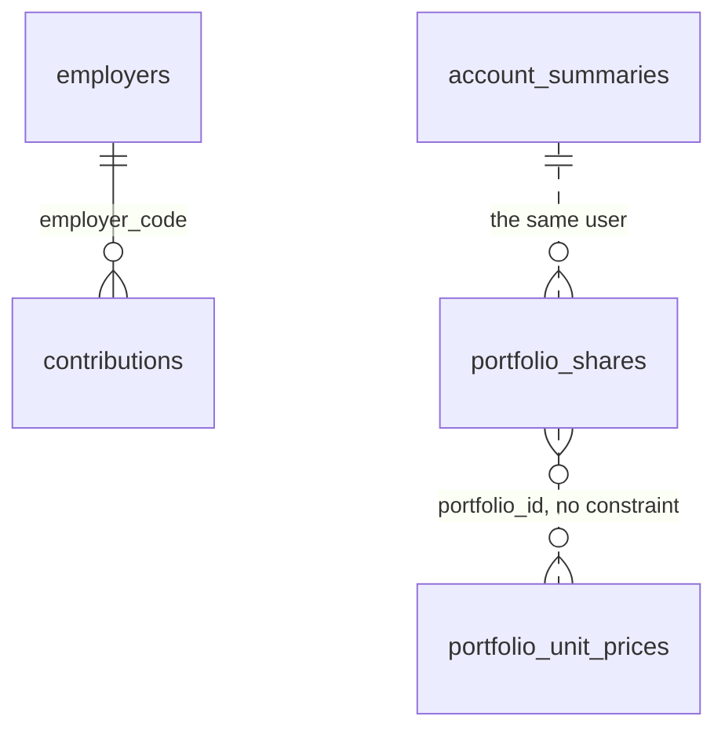
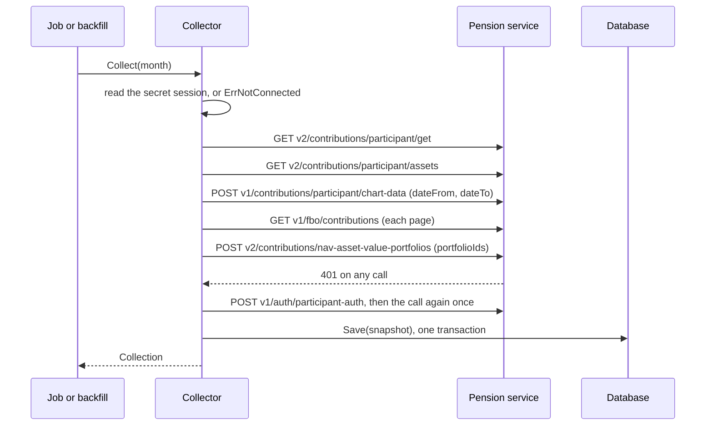

# Specification: The pension account of a user

## 1. Summary

The pension plugin keeps the username and the password as user settings, and gains a
connection page in the deck. The page signs in to the pension service and stores the
access token as the user plugin secret `session`. A cron job for each user reads the
previous month of each connected user, and writes it in one transaction. A command
collects an earlier period for one user. New migrations replace the tables of the plugin.
A widget and three pages read the stored data. `spec-pages.md` holds their routes, their
decisions, and their scenarios. `spec-scenarios.md` holds the other scenarios.

## 2. Coverage

| Requirement       | Where this specification realizes it                                             |
| ----------------- | -------------------------------------------------------------------------------- |
| `PENSION-FR-001`  | Section 4.3, `PENSION-SC-001`                                                    |
| `PENSION-FR-002`  | Section 4.3, `PENSION-SC-001`                                                    |
| `PENSION-FR-003`  | `api.yaml`, `PENSION-SC-002`                                                     |
| `PENSION-FR-004`  | `api.yaml`, `PENSION-SC-003`                                                     |
| `PENSION-FR-005`  | `api.yaml`, `PENSION-DD-004`, `PENSION-SC-004`                                   |
| `PENSION-FR-006`  | Section 4.5, `PENSION-SC-005`, `PENSION-SC-047`                                  |
| `PENSION-FR-007`  | Section 4.3, `PENSION-SC-006`                                                    |
| `PENSION-FR-008`  | `PENSION-DD-001`, `PENSION-SC-006` to `PENSION-SC-008`                           |
| `PENSION-FR-009`  | Section 4.3, `PENSION-SC-009`                                                    |
| `PENSION-FR-010`  | `PENSION-DD-002`, `PENSION-SC-010`, `PENSION-SC-011`                             |
| `PENSION-FR-011`  | `PENSION-DD-002`, `PENSION-SC-012`, `PENSION-SC-046`                             |
| `PENSION-FR-012`  | Section 4.2, `PENSION-SC-009`                                                    |
| `PENSION-FR-013`  | Section 4.3, `PENSION-SC-013`                                                    |
| `PENSION-FR-014`  | Section 4.3, `PENSION-SC-014`                                                    |
| `PENSION-FR-015`  | Section 4.3, `PENSION-SC-015`                                                    |
| `PENSION-FR-016`  | `PENSION-DD-005`, `PENSION-SC-016`, `PENSION-SC-017`                             |
| `PENSION-FR-017`  | Section 4.4, `PENSION-SC-018`                                                    |
| `PENSION-FR-018`  | `PENSION-DD-008`, `PENSION-SC-019`                                               |
| `PENSION-FR-019`  | `PENSION-DD-007`, `PENSION-SC-020`                                               |
| `PENSION-FR-020`  | `PENSION-DD-006`, `PENSION-SC-021`, `PENSION-SC-022`                             |
| `PENSION-FR-021`  | Section 4.2, `PENSION-DD-009`, `PENSION-SC-023`                                  |
| `PENSION-FR-022`  | Section 4.2, `PENSION-SC-024`                                                    |
| `PENSION-FR-023`  | Section 4.3, `PENSION-DD-010`, `PENSION-SC-025`                                  |
| `PENSION-FR-024`  | `PENSION-DD-010`, `PENSION-SC-026`                                               |
| `PENSION-FR-025`  | Section 4.5, `PENSION-SC-027`                                                    |
| `PENSION-FR-026`  | Section 4.3, `PENSION-SC-028`                                                    |
| `PENSION-FR-027`  | `spec-pages.md`, `PENSION-DD-012`, `PENSION-SC-032`                              |
| `PENSION-FR-028`  | `spec-pages.md`, `PENSION-DD-012`, `PENSION-SC-033`                              |
| `PENSION-FR-029`  | `spec-pages.md`, `PENSION-DD-012`, `PENSION-SC-033`                              |
| `PENSION-FR-030`  | `spec-pages.md`, `PENSION-DD-012`, `PENSION-SC-033`                              |
| `PENSION-FR-031`  | `spec-pages.md`, `PENSION-DD-012`, `PENSION-SC-032`                              |
| `PENSION-FR-032`  | `spec-pages.md`, `api.yaml`, `PENSION-SC-034`                                    |
| `PENSION-FR-033`  | `spec-pages.md`, `api.yaml`, `PENSION-SC-034`                                    |
| `PENSION-FR-034`  | `PENSION-DD-016`, `PENSION-DD-017`, `PENSION-SC-035`, `PENSION-SC-036`           |
| `PENSION-FR-035`  | `PENSION-DD-016`, `PENSION-SC-035`                                               |
| `PENSION-FR-036`  | `PENSION-DD-014`, `PENSION-SC-037`                                               |
| `PENSION-FR-037`  | `PENSION-DD-014`, `PENSION-SC-037`                                               |
| `PENSION-FR-038`  | `PENSION-DD-014`, `PENSION-SC-037`                                               |
| `PENSION-FR-039`  | `PENSION-DD-019`, `PENSION-DD-020`, `PENSION-SC-038`, `PENSION-SC-040`           |
| `PENSION-FR-040`  | `spec-pages.md`, section 2, `PENSION-DD-020`, `PENSION-SC-038`, `PENSION-SC-039` |
| `PENSION-FR-041`  | `PENSION-DD-015`, `PENSION-SC-038`                                               |
| `PENSION-FR-042`  | `PENSION-DD-019`, `PENSION-SC-041`                                               |
| `PENSION-FR-043`  | `PENSION-DD-018`, `PENSION-SC-042`                                               |
| `PENSION-FR-044`  | `PENSION-DD-013`, `PENSION-SC-034`                                               |
| `PENSION-FR-045`  | `PENSION-DD-013`, `PENSION-SC-034`                                               |
| `PENSION-FR-046`  | `PENSION-DD-013`, `PENSION-SC-043`                                               |
| `PENSION-FR-047`  | `spec-pages.md`, section 2, `PENSION-SC-044`                                     |
| `PENSION-NFR-001` | `PENSION-DD-015`, `PENSION-SC-045`                                               |
| `PENSION-INV-001` | `PENSION-DD-001`, `PENSION-SC-007`                                               |
| `PENSION-INV-002` | Section 4.2, `PENSION-SC-029`                                                    |
| `PENSION-INV-003` | `api.yaml`, `PENSION-DD-004`, `PENSION-SC-030`                                   |
| `PENSION-INV-004` | `PENSION-DD-004`, `PENSION-SC-030`                                               |

## 3. Guideline compliance

| Rule                            | Guideline         | How this specification obeys it                                                                                                   |
| ------------------------------- | ----------------- | --------------------------------------------------------------------------------------------------------------------------------- |
| `PLG-006`, `PLG-007`            | Plugin model      | The plugin adds each capability through the existing interfaces, and reaches the settings, the secrets, and the data by the host. |
| `ARC-008`                       | Architecture      | No file of the hub changes.                                                                                                       |
| `DAT-001`, `DAT-006`, `DAT-009` | Data              | Every table lives in `dev_maroid_pensions`. Each `id` is `uuidv7()`. Each natural key is a unique constraint. Section 4.2.        |
| `DAT-008`                       | Data              | The asset values and the unit prices stay plain tables, by the decision of the owner (`PENSION-DD-011`).                          |
| `DAT-010`                       | Data              | `collected_at` is `TIMESTAMPTZ`. A day of the pension service is `DATE`, never a local time (`PENSION-DD-005`).                   |
| `OWN-004` to `OWN-008`          | Ownership         | Each table of a user carries `user_id` and forced row level security. Each shared table says why. No repository filters by user.  |
| `OWN-009`                       | Ownership         | The collection runs with `CronScopePerUser`, because it writes tables that a user scopes.                                         |
| `CFG-007`                       | Configuration     | The credentials are user settings. Section 4.3.                                                                                   |
| `EXT-001` to `EXT-007`          | External services | `service/api-client.go` holds every call. A status that is not a success is an error with the status. Section 4.4.                |
| `LOG-003`, `LOG-008`            | Logging           | Each service adds `component`. No log line holds the password, the token, the name, or the personal number.                       |
| `SEC-013`                       | Security          | Each route names `account.connect`. Section 4.3.                                                                                  |
| `JOB-005`, `JOB-007`            | Background jobs   | `account_collector` answers an error for one user. The scheduler logs it and runs the next user.                                  |
| `CLI-003` to `CLI-006`          | Command line      | `backfill` holds the collector and a logger with `component=command`. `PreRunE` checks the flags.                                 |
| `API-004`                       | HTTP API          | The routes mount under `/workspaces/{workspaceId}/plugins/dev.maroid.pensions/api`.                                               |
| `ERR-002`                       | Errors            | Each problem type has the form `/problems/dev.maroid.pensions/<slug>`. Section 4.5.                                               |
| `RES-001` (`Z-173`)             | REST              | The asset value travels as the money object.                                                                                      |
| `RES-002`                       | REST              | `/connections/self` follows the electricity plugin (`ADR-0015`).                                                                  |
| `GO-005`                        | Go style          | Every sentinel error lives in `errs/`.                                                                                            |
| `PKG-001`                       | Package layout    | The plugin gains `cli/`, `errs/`, `handler/`, `permission/`, and `ui/`. Section 4.1.                                              |
| `UI-005` to `UI-009`            | Web UI            | The remote exports `/account`, and reaches the API through `host.api`.                                                            |
| `BLD-003`                       | Build             | The build plan builds the UI before the `.so`.                                                                                    |

## 4. Design

### 4.1 Components

Every path is under `plugins/pensions/`. A file not named here follows the electricity plugin.

| Path                                         | Action | Holds                                                                                                                                                                                        |
| -------------------------------------------- | ------ | -------------------------------------------------------------------------------------------------------------------------------------------------------------------------------------------- |
| `db/migrations/20261127100000_*`             | create | `tables_previous_drop`: drops `contributions` and `organizations`. The down file creates them as `20261009234500` left them                                                                  |
| `db/migrations/20261127100100_*` to `..0600` | create | `table_employers_create`, `table_contributions_create`, `table_asset_values_create`, `table_portfolio_unit_prices_create`, `table_account_summaries_create`, `table_portfolio_shares_create` |
| `config/config.go`                           | change | `Config` (section 4.3). `UserSettings` stays                                                                                                                                                 |
| `errs/errs.go`                               | create | `ErrRequestFailed`, `ErrSessionRejected`, `ErrNotConnected`, `ErrCredentialsAbsent`, `ErrCredentialsRejected`, `ErrReversedPeriod`, `ErrPeriodNotEnded`                                      |
| `model/connection.go`                        | create | `ConnectionState`, `Connection` with `State`, `CredentialsStored`, `Holder *Holder`. `Holder` with `FullName`, `AssetValue`                                                                  |
| `model/session.go`                           | create | `Session` with `Token`. `MarshalSecret`, `ParseSession`                                                                                                                                      |
| `model/period.go`                            | create | `Month`, `ParseMonth`, `Month.First`, `Month.Last`, `Month.After`, `Period`, `Period.Months`, `PreviousMonth(now time.Time) Month`                                                           |
| `model/contribution.go`                      | change | `Contribution` (section 4.2). `Contribution.Hash` goes                                                                                                                                       |
| `model/employer.go`                          | create | `Employer` with `Code`, `Name`                                                                                                                                                               |
| `model/{asset_value,unit_price,summary}.go`  | create | `AssetValue`, `PortfolioUnitPrice`, `AccountSummary`, `PortfolioShare`, `Participant` with `FullName` and `Summary`                                                                          |
| `model/collection.go`                        | create | `Snapshot`: everything one collection writes. `Collection`: the counts that `Collect` answers                                                                                                |
| `model/organization.go`                      | delete | `Employer` replaces it                                                                                                                                                                       |
| `dto/api-client.go`                          | change | `SignInRequest`, `SignInResponse`, `ParticipantResponse`, `AssetResponse`, `ChartRequest`, `ChartResponse`, `NavRequest`, `NavPortfolio`, `ContributionsPage`, `Contribution`                |
| `dto/connection.go`                          | create | `ConnectionResponse`, `HolderResponse`, `MoneyResponse`, `NewConnectionResponse`                                                                                                             |
| `service/api-client.go`                      | change | `APIClient` with the methods below, `StatusError`                                                                                                                                            |
| `service/account.go`                         | create | `account`: `credentials`, `session`, `signIn`, `forgetSession`, and `callWith` (`PENSION-DD-002`)                                                                                            |
| `service/connection.go`                      | create | `Connections`: `Status`, `Connect`, `Disconnect`                                                                                                                                             |
| `service/collector.go`                       | create | `Collector.Collect(ctx context.Context, month model.Month) (model.Collection, error)`                                                                                                        |
| `service/store.go`                           | create | `Store` over `PluginDB`: `Save(ctx context.Context, snapshot model.Snapshot) error`, one transaction                                                                                         |
| `repository/contribution.go`                 | change | `Contribution.Upsert` replaces `Insert`                                                                                                                                                      |
| `repository/employer.go`                     | create | `Employer.Upsert`                                                                                                                                                                            |
| `repository/{asset_value,unit_price}.go`     | create | `AssetValue.Upsert`, `PortfolioUnitPrice.Upsert`                                                                                                                                             |
| `repository/{summary,portfolio_share}.go`    | create | `AccountSummary.Put`, `PortfolioShare.Replace`                                                                                                                                               |
| `repository/organization.go`                 | delete | `repository/employer.go` replaces it                                                                                                                                                         |
| `job/account_collector.go`                   | create | `AccountCollector`. `job/contributions_collector.go` goes                                                                                                                                    |
| `cli/{doc,backfill}.go`                      | create | `Backfill`, `NewBackfill`, `Command() *cobra.Command`                                                                                                                                        |
| `handler/{doc,connection,problem}.go`        | create | `ConnectionHandler`, `NewConnectionHandler`, the problem types of section 4.5                                                                                                                |
| `permission/permission.go`                   | create | `AccountConnect = "account.connect"`                                                                                                                                                         |
| `embed.go`                                   | create | `uiAssets`, the embedded `ui/dist`                                                                                                                                                           |
| `main.go`                                    | change | `PensionsPlugin`: `Meta` (version `0.2.0`), `SettingsModel`, `CronJobs`, `Migrations`, `Commands`, `Permissions`, `Routes`, `Widgets`, `UIManifest`                                          |
| `ui/`                                        | create | The UI of the electricity plugin: `src/pages/account/Account.svelte`, `src/api/connection.ts`, and the pages of `spec-pages.md`                                                              |
| `config.yaml` at the repository root         | change | The block of `pensions.so` with the defaults of section 4.3                                                                                                                                  |

The methods of `service.APIClientService`. Each method sends `Authorization: Bearer <token>`,
except `SignIn`:

```go
SignIn(ctx context.Context, username, password string) (model.Session, error)
Participant(ctx context.Context, session model.Session) (model.Participant, error)
PortfolioShares(ctx context.Context, session model.Session) ([]model.PortfolioShare, error)
AssetValues(ctx context.Context, session model.Session, month model.Month) ([]model.AssetValue, error)
PortfolioUnitPrices(ctx context.Context, session model.Session, portfolioIDs []int64) ([]model.PortfolioUnitPrice, error)
Contributions(ctx context.Context, session model.Session, month model.Month) ([]model.Contribution, error)
```

`GetParticipantInfo` and the `hash` of a contribution go.

### 4.2 Data model

The session lives in the user plugin secret `session`, with no expiry: the JSON object
`{"token": "<accessToken>"}`. The refresh token is not kept (`PENSION-DD-003`).

| Table                   | Schema                | Scope  | Realizes                                             |
| ----------------------- | --------------------- | ------ | ---------------------------------------------------- |
| `employers`             | `dev_maroid_pensions` | Shared | `PENSION-FR-016`                                     |
| `contributions`         | `dev_maroid_pensions` | User   | `PENSION-FR-016`, `PENSION-FR-021`, `PENSION-FR-012` |
| `asset_values`          | `dev_maroid_pensions` | User   | `PENSION-FR-017`, `PENSION-FR-022`                   |
| `portfolio_unit_prices` | `dev_maroid_pensions` | Shared | `PENSION-FR-018`, `PENSION-FR-022`                   |
| `account_summaries`     | `dev_maroid_pensions` | User   | `PENSION-FR-019`                                     |
| `portfolio_shares`      | `dev_maroid_pensions` | User   | `PENSION-FR-019`                                     |

Every table holds `id UUID PRIMARY KEY DEFAULT uuidv7()` and `collected_at TIMESTAMPTZ NOT
NULL DEFAULT now()`. Each table of a user holds the `user_id` column of `OWN-005`, which cascades on nothing,
and the policy `<table>_user_isolation` of `OWN-006`. Each money value and
each count of units is `NUMERIC`. Each upsert runs `ON CONFLICT ... DO UPDATE` on every value
column, `WHERE (...) IS DISTINCT FROM (EXCLUDED...)`. The write of `account_summaries` carries no
`WHERE`, because `collected_at` dates the summary that the person reads and moves on each collection.

| Table                   | Columns beside `id`, `user_id`, and `collected_at`                                                                                                                                                                                           | Unique key                      |
| ----------------------- | -------------------------------------------------------------------------------------------------------------------------------------------------------------------------------------------------------------------------------------------- | ------------------------------- |
| `employers`             | `code TEXT` (1 to 64 characters), `name TEXT`                                                                                                                                                                                                | `code`                          |
| `contributions`         | `basis_id UUID`, `source TEXT`, `contribution_type TEXT`, `paid_on DATE`, `closed_on DATE` null, `salary_year SMALLINT` null, `salary_month SMALLINT` null (1 to 12), `gross_salary`, `amount` null, `units` null, `employer_code TEXT` null | `user_id`, `basis_id`, `source` |
| `asset_values`          | `valued_on DATE`, `asset_value`, `units`, `unit_price`                                                                                                                                                                                       | `user_id`, `valued_on`          |
| `portfolio_unit_prices` | `portfolio_id BIGINT`, `priced_on DATE`, `unit_price`, `net_asset_value` null, `units` null                                                                                                                                                  | `portfolio_id`, `priced_on`     |
| `account_summaries`     | `asset_value`, `units`, `gain`, `withheld_amount`, `person_contributions`, `employer_contributions`, `state_contributions`, `total_contributions`                                                                                            | `user_id`                       |
| `portfolio_shares`      | `portfolio_id BIGINT`, `portfolio_name_ka`, `portfolio_name_en`, `asset_manager_name_ka`, `asset_manager_name_en`, `ticker`, `risk_tier_name_ka`, `risk_tier_name_en`, `target_share`, `current_share`, `amount`, `units`, `unit_price`      | `user_id`, `portfolio_id`       |

`contributions.employer_code` references `employers (code) ON DELETE RESTRICT`. The two shared
tables carry `COMMENT ON TABLE`: an employer and a unit price name no person, and two
users of one employer or one portfolio read the same row. The comment of each table of a user
names the person. No route reads a shared table directly, so a user reads an employer or
a unit price only through a row of their own. `contributions` carries the two indexes of
`spec-pages.md`, section 2.



### 4.3 Declarations

**HTTP routes.** The prefix is `/workspaces/{workspaceId}/plugins/dev.maroid.pensions/api`.
`api.yaml` holds the bodies and the status codes.

| Method   | Path                | Access        | Permission        | Realizes                                                                 |
| -------- | ------------------- | ------------- | ----------------- | ------------------------------------------------------------------------ |
| `GET`    | `/connections/self` | Authenticated | `account.connect` | `PENSION-FR-003` to `PENSION-FR-006`, `PENSION-FR-010`, `PENSION-FR-011` |
| `PUT`    | `/connections/self` | Authenticated | `account.connect` | `PENSION-FR-007`, `PENSION-FR-008`                                       |
| `DELETE` | `/connections/self` | Authenticated | `account.connect` | `PENSION-FR-009`, `PENSION-FR-012`                                       |

**Permissions.**

| Name              | Description                                            | Lowest   | Realizes         |
| ----------------- | ------------------------------------------------------ | -------- | ---------------- |
| `account.connect` | Read, connect, and disconnect your own pension account | `viewer` | `PENSION-FR-026` |

**Settings.** Both fields take `x-maroid-scope=user` and are required. They do not change.

| Field      | Kind      | Title    | Realizes                           |
| ---------- | --------- | -------- | ---------------------------------- |
| `username` | free text | Username | `PENSION-FR-001`                   |
| `password` | secret    | Password | `PENSION-FR-001`, `PENSION-FR-002` |

**Configuration.**

| Key                               | Type                   | Default                        | Secret | Realizes                           |
| --------------------------------- | ---------------------- | ------------------------------ | ------ | ---------------------------------- |
| `base_url`                        | URL, no trailing slash | `https://api7.pensions.ge/api` | No     | `PENSION-FR-008`                   |
| `request_timeout`                 | duration, above zero   | `15s`                          | No     | `PENSION-FR-006`                   |
| `cron_schedule.account_collector` | cron                   | `0 10 1 * *`                   | No     | `PENSION-FR-013`, `PENSION-FR-014` |

`cron_schedule.contributions_collector` goes. The decoder ignores the old key.

**Cron job.**

| Identifier          | Schedule                          | Runs in            | Behavior                                                                                                  | Realizes                             |
| ------------------- | --------------------------------- | ------------------ | --------------------------------------------------------------------------------------------------------- | ------------------------------------ |
| `account_collector` | `cron_schedule.account_collector` | `CronScopePerUser` | `Collect` with `PreviousMonth` in `ActingTimeZone`. `ErrNotConnected` logs a skip at info and answers nil | `PENSION-FR-013` to `PENSION-FR-020` |

**CLI command.** The registrar mounts it under `maroid dev-maroid-pensions`.

| Command    | Flags                                                           | Does                                                                        | Realizes                             |
| ---------- | --------------------------------------------------------------- | --------------------------------------------------------------------------- | ------------------------------------ |
| `backfill` | `--user` (UUID), `--from` and `--to` (`YYYY-MM`), each required | `Collect` for each month of the period, and prints the counts of each month | `PENSION-FR-023` to `PENSION-FR-025` |

**UI route.**

| Page route | Navigation entry | Page             | Realizes                             |
| ---------- | ---------------- | ---------------- | ------------------------------------ |
| `/account` | "Account"        | `Account.svelte` | `PENSION-FR-003` to `PENSION-FR-009` |

`Account.svelte` repeats the page of the electricity plugin with no customer list. The
connected state shows "Connected as <full name>" and the asset value.

### 4.4 Flow

`Collect` reads the whole month first, and writes nothing until every call succeeds:



| Call                                               | Request                                                                      | Answer read                                                                                                              |
| -------------------------------------------------- | ---------------------------------------------------------------------------- | ------------------------------------------------------------------------------------------------------------------------ |
| `POST v1/auth/participant-auth`                    | `username`, `passwordOne`, `passwordTwo: ""`, `languageCode: "ka-GE"`        | `accessToken`                                                                                                            |
| `GET v2/contributions/participant/get`             | None                                                                         | `firstName`, `lastName`, `cummSavings`, `gain`, `totalWithheldAmount`, `empContr`, `orgContr`, `govtContr`, `totalContr` |
| `GET v2/contributions/participant/assets`          | None                                                                         | Each item: `portfolioId`, the names `Ge` and `En`, `ticker`, `targetShare`, `shareReal`, `amount`, `units`, `unitPrice`  |
| `POST v1/contributions/participant/chart-data`     | `dateFrom`, `dateTo`: the first and the last day of the month, `YYYY-MM-DD`  | `result[]`: `date`, `cummSavings`, `cummUnits`, `unitPrice`. A non-null `errors` is `ErrRequestFailed`                   |
| `GET v1/fbo/contributions`                         | `pageNumber`, `pageSize=100`, `startDate`, `endDate`                         | `data.result[]` and `data.pageCount`. `status` other than `success`, or `code` other than 200, fails                     |
| `POST v2/contributions/nav-asset-value-portfolios` | `portfolioIds`: each `portfolioId` of the assets. No call when there is none | Each `netAssetValue[]`: `portfolioId`, `navDate`, `closingUnitPrice`, `closingNav`, `closingUnits`                       |

The DTOs decode only the members above, so `personalId` never reaches a value of Go. A list of
contributions that names more than 50 pages is `ErrRequestFailed`. Every call ends after
`request_timeout`. A failure wraps the status and at most 512 bytes of the body.

### 4.5 Errors

| Condition                                                          | Route answer                                                                                      | Collection                                       |
| ------------------------------------------------------------------ | ------------------------------------------------------------------------------------------------- | ------------------------------------------------ |
| No `session` secret                                                | `GET`: 200 `not_connected`. `DELETE`: 204                                                         | Skip (`PENSION-FR-015`)                          |
| A call answers 401                                                 | Sign in again once (`PENSION-DD-002`)                                                             | Sign in again once                               |
| The settings are absent                                            | `PUT`: 422 `credentials-absent`. `GET` reports `credentials_stored: false`                        | Error `ErrCredentialsAbsent`                     |
| The sign in rejects the credentials (`PENSION-DD-003`)             | `PUT`: 422 `credentials-rejected`. `GET`: the session goes, and the answer is 200 `not_connected` | Error `ErrCredentialsRejected`. The session goes |
| The service answers 5xx, a body that does not decode, or no answer | 502 `service-unavailable`. The session stays                                                      | Error `ErrRequestFailed`. Nothing stored         |
| `backfill` for a user with no connection                           | Not reached                                                                                       | The command fails with `ErrNotConnected`         |
| `backfill` with `--from` after `--to`                              | Not reached                                                                                       | `PreRunE` fails with `ErrReversedPeriod`         |
| `backfill` with `--to` after the previous month                    | Not reached                                                                                       | `PreRunE` fails with `ErrPeriodNotEnded`         |
| `backfill` with a month that does not parse, or a bad `--user`     | Not reached                                                                                       | `PreRunE` fails. No service is called            |

Each problem type has the owner `dev.maroid.pensions`. No detail names the password, the
token, the name, or the personal number.

## 5. Design decisions

### `PENSION-DD-001`

**Realizes:** `PENSION-FR-008`, `PENSION-INV-001`
**Decision:** `PUT /connections/self` signs in, writes `session` with `Put`, reads the participant,
and answers 200 with the connection. It collects nothing.
**Rationale:** No code by phone exists, so no pending state exists. A repeat replaces the one
session that `PSECRET-FR-005` holds for a name. The electricity plugin made the same choice.
**Alternatives:** `POST /connections`. It overstates a repeat.

### `PENSION-DD-002`

**Realizes:** `PENSION-FR-010`, `PENSION-FR-011`
**Decision:** A 401 from any call after the sign in is `ErrSessionRejected`. `account.callWith`
signs in with the stored credentials, writes the new `session`, and repeats the call once.
`ErrCredentialsRejected` from that sign in deletes `session`. A second `ErrSessionRejected`
is `ErrRequestFailed`.
**Rationale:** The pension service gives no end time that the plugin reads. One repeat bounds
the cost. Build step 9 confirms that an ended token answers 401.
**Alternatives:** Sign in at each action and store no session. Each page view then costs two calls.

### `PENSION-DD-003`

**Realizes:** `PENSION-FR-008`, `PENSION-FR-011`
**Decision:** A sign in that answers 400, 401, or 403, or 200 with no `accessToken`, is
`ErrCredentialsRejected`. Any other failure is `ErrRequestFailed`. The plugin keeps no refresh
token, and calls no refresh route.
**Rationale:** The old client treated an empty `accessToken` as a failure. Build step 9 records
the real answer to a wrong password, and corrects this decision. A new sign in needs no person,
so a refresh saves one call at most.
**Alternatives:** Match the `message` text. It is Georgian, and it changes with no notice.

### `PENSION-DD-004`

**Realizes:** `PENSION-FR-005`, `PENSION-INV-003`, `PENSION-INV-004`
**Decision:** `Status` reads the participant on each read of a connected account. The answer
holds `holder.full_name`, `firstName` and `lastName` with one space, and `holder.asset_value`, the
money object of `cummSavings` in `GEL`. `dto.ParticipantResponse` declares no field for `personalId`.
**Rationale:** The read proves the token, and `PENSION-DD-002` removes a rejected one in the same
call. A member that Go does not decode cannot reach an answer or a log.
**Alternatives:** Show what the last collection stored. A connection that died after it then reads as working.

### `PENSION-DD-005`

**Realizes:** `PENSION-FR-016`, `PENSION-FR-017`
**Decision:** `PreviousMonth(now)` answers the month before the month of `now` in the location
of `now`. The job passes `time.Now().In(pluginapi.ActingTimeZone(ctx))`. A date of the pension
service reads as the calendar date of its first 10 characters, and is stored as `DATE`.
**Rationale:** The hub sets the time zone of each user on the context of a run for each user.
The service marks a time of Tbilisi with `Z` on some members and with no zone on others, so a
conversion would move a date across midnight.
**Alternatives:** The months of Tbilisi for every user, as the electricity plugin does. It breaks
the example of `PENSION-FR-016` for a user in another zone.

### `PENSION-DD-006`

**Realizes:** `PENSION-FR-020`
**Decision:** `Collect` makes every call before it writes. `Store.Save` writes the whole
`Snapshot` in one `WithTx`: the employers, the contributions, the asset values, the unit prices,
the summary, and the shares. Any error rolls the transaction back.
**Rationale:** A failure on page 3 of the contributions then leaves the rows of the month as
they were. A month of one user holds at most a few hundred rows, and the unit prices about 2000.
**Alternatives:** A write after each call. A failure then leaves part of a month.

### `PENSION-DD-007`

**Realizes:** `PENSION-FR-019`
**Decision:** `AccountSummary.Put` upserts on `user_id`. `PortfolioShare.Replace` deletes every
row that the policy shows, then inserts the shares of the snapshot. `units` of the summary is the
sum of `units` of the shares, because the participant answers no units.
**Rationale:** The service answers the current summary only. A portfolio that the person left must
leave the shares. The delete names no user (`OWN-008`); the policy limits it to the acting user.
**Alternatives:** One summary row for each collection. No requirement reads an old summary.

### `PENSION-DD-008`

**Realizes:** `PENSION-FR-018`, `PENSION-FR-022`
**Decision:** `PortfolioUnitPrice.Upsert` writes the whole answer in one statement:
`INSERT ... SELECT * FROM unnest($1::bigint[], $2::date[], ...)` with the upsert of section 4.2.
**Rationale:** One portfolio answers about 2000 rows. One statement costs one round trip, and the
`WHERE` of the upsert rewrites no row that did not change.
**Alternatives:** One insert for each row. It costs 2000 round trips for each user each month.

### `PENSION-DD-009`

**Realizes:** `PENSION-FR-021`
**Decision:** The identity of a contribution is `user_id`, `basis_id`, and `source`. A collection
that reads a known contribution updates its values.
**Rationale:** On 2026-11-27, 488 contributions of one account held 196 values of `basisId`. The
pair of `basisId` and `source` was unique for all 488. The amount stays out of the key, so a
correction replaces the value.
**Alternatives:** A hash of every member, as the old plugin did. A corrected amount then adds a row.

### `PENSION-DD-010`

**Realizes:** `PENSION-FR-023`, `PENSION-FR-024`
**Decision:** `backfill` sets the acting user with `pluginapi.ContextWithActingUser`, and no acting
workspace. `PreRunE` refuses `--to` after `PreviousMonth` of the current time in the zone
UTC-12. `run` calls `Collect` once for each month of the period, and stops at the first
failure. Each month is one transaction.
**Rationale:** A plugin cannot read the record of the user (`DAT-003`), so the command has no time
zone. UTC-12 is the last zone to end a month, so the month ends there after it ends for any user,
and at most 26 hours late. A failure names its month, and the months before it stay stored.
**Alternatives:** A `--time-zone` flag. The administrator then types a value that the hub already holds.

### `PENSION-DD-011`

**Realizes:** `PENSION-FR-017`, `PENSION-FR-018`
**Decision:** `asset_values` and `portfolio_unit_prices` are plain tables, not hypertables.
**Rationale:** The owner decided on 2026-11-27 that the size does not call for `DAT-008`: a few
asset values a month for each user, and about 2000 unit prices for each portfolio, with one new
row each working day.
**Alternatives:** A hypertable, as `DAT-008` gives. A unique key must then hold the date, and a
chunk of a few rows costs more than it saves.

## 6. Scenarios

`spec-scenarios.md` holds `PENSION-SC-001` to `PENSION-SC-031`.

## 7. Build plan

| #   | Step                                                                                                                                           | Realizes                                                                   | Done |
| --- | ---------------------------------------------------------------------------------------------------------------------------------------------- | -------------------------------------------------------------------------- | ---- |
| 1   | The migrations of section 4.2, with the indexes of `spec-pages.md`. Run them up, down, and up                                                  | `PENSION-FR-012`, `PENSION-FR-021`, `PENSION-FR-022`, `PENSION-INV-002`    | [x]  |
| 2   | `errs/`, `model/`, `config/`, and `permission/`                                                                                                | `PENSION-FR-001`, `PENSION-FR-002`, `PENSION-FR-014`                       | [x]  |
| 3   | The DTOs and `service/api-client.go`                                                                                                           | `PENSION-FR-016` to `PENSION-FR-018`, `PENSION-INV-004`                    | [x]  |
| 4   | `service/account.go` and `service/connection.go`                                                                                               | `PENSION-FR-003` to `PENSION-FR-011`                                       | [x]  |
| 5   | `repository/`, `service/store.go`, and `service/collector.go`                                                                                  | `PENSION-FR-016` to `PENSION-FR-022`                                       | [x]  |
| 6   | `job/account_collector.go` and `cli/backfill.go`                                                                                               | `PENSION-FR-013` to `PENSION-FR-015`, `PENSION-FR-023` to `PENSION-FR-025` | [x]  |
| 7   | The connection handler and its part of `api.yaml`                                                                                              | `PENSION-FR-003` to `PENSION-FR-009`, `PENSION-FR-026`                     | [x]  |
| 8   | The reads of `spec-pages.md`: `repository/`, `service/store_read.go`, `service/reader.go`, the DTOs                                            | `PENSION-FR-032` to `PENSION-FR-043`, `PENSION-NFR-001`                    | [x]  |
| 9   | The read handlers, the widget, and their part of `api.yaml`                                                                                    | `PENSION-FR-027` to `PENSION-FR-047`                                       | [x]  |
| 10  | `ui/`: the account page and the three pages of `spec-pages.md`. `embed.go`, `main.go`, `config.yaml`. Build the UI, then the `.so` (`BLD-003`) | `PENSION-FR-003` to `PENSION-FR-009`, `PENSION-FR-032` to `PENSION-FR-045` | [x]  |
| 11  | `PENSION-SC-031` against the pension service, then `backfill` of the history. Correct `PENSION-DD-002` and `PENSION-DD-003`                    | `PENSION-FR-008`, `PENSION-FR-010`, `PENSION-FR-011`, `PENSION-FR-023`     | [ ]  |
| 12  | The tests of `spec-scenarios.md` and of `spec-pages.md`, with `PENSION-SC-045`. Lint and build the plugin                                      | Every statement                                                            | [x]  |
| 13  | The entry of `pensions.so` in `chart/values.yaml`, with the schedule of section 4.3                                                            | `PENSION-FR-013`, `PENSION-FR-014`                                         | [x]  |

## Retired identifiers

This file has no retired identifier.
