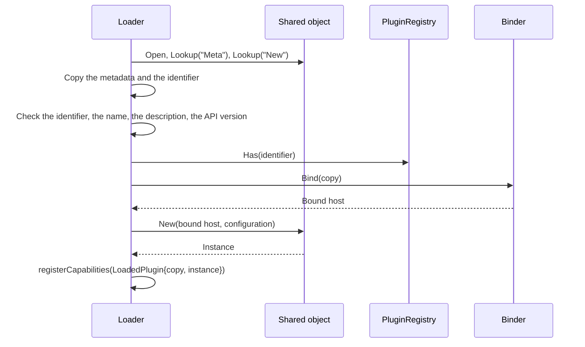

# Specification: The host services bound to one plugin

## 1. Summary

A plugin exports its metadata as the symbol `Meta`. The loader reads and checks it
before it calls `New`, keeps a copy, and builds a bound host from that copy. The bound
services become interfaces in `libs/pluginapi` with no plugin identifier parameter, and
the hub implements them in `apps/hub/internal/plugin/host`.

## 2. Coverage

| Requirement       | Where this specification realizes it                                   |
| ----------------- | ---------------------------------------------------------------------- |
| `PLGBIND-FR-001`  | Section 4.3, `PLGBIND-DD-001`, `PLGBIND-SC-001`                        |
| `PLGBIND-FR-002`  | Section 4.4, `PLGBIND-DD-001`, `PLGBIND-SC-002`                        |
| `PLGBIND-FR-003`  | Section 4.4, `PLGBIND-DD-002`, `PLGBIND-SC-003` to `PLGBIND-SC-005`    |
| `PLGBIND-FR-004`  | Section 4.1, `PLGBIND-DD-005`, `PLGBIND-SC-007`                        |
| `PLGBIND-FR-005`  | `PLGBIND-DD-001`, `PLGBIND-DD-003`, `PLGBIND-SC-008`, `PLGBIND-SC-009` |
| `PLGBIND-FR-006`  | Section 4.1, `PLGBIND-DD-004`, `PLGBIND-SC-010`                        |
| `PLGBIND-FR-007`  | Section 4.1, `PLGBIND-DD-004`, `PLGBIND-SC-011`                        |
| `PLGBIND-FR-008`  | Section 4.1, `PLGBIND-DD-004`, `PLGBIND-SC-012`                        |
| `PLGBIND-FR-009`  | Section 4.1, `PLGBIND-DD-004`, `PLGBIND-SC-013`                        |
| `PLGBIND-FR-010`  | Section 4.1, `PLGBIND-DD-004`, `PLGBIND-SC-014`                        |
| `PLGBIND-FR-011`  | `PLGBIND-DD-007`, `PLGBIND-SC-015`                                     |
| `PLGBIND-FR-012`  | `PLGBIND-DD-006`, `PLGBIND-SC-016`                                     |
| `PLGBIND-FR-013`  | `PLGBIND-DD-006`, `PLGBIND-SC-016`                                     |
| `PLGBIND-NFR-001` | `PLGBIND-DD-004`, `PLGBIND-SC-017`                                     |
| `PLGBIND-INV-001` | `PLGBIND-DD-001`, `PLGBIND-DD-005`, `PLGBIND-SC-009`                   |
| `PLGBIND-INV-002` | `PLGBIND-DD-002`, `PLGBIND-DD-004`, `PLGBIND-SC-006`, `PLGBIND-SC-011` |

## 3. Guideline compliance

| Rule      | Guideline    | How this specification obeys it                                                                     |
| --------- | ------------ | --------------------------------------------------------------------------------------------------- |
| `PLG-002` | Plugin model | Section 4.3. The loader looks up `Meta`, then `New`.                                                |
| `PLG-003` | Plugin model | `PLGBIND-DD-002` parses the identifier again before the constructor.                                |
| `PLG-004` | Plugin model | `PLGBIND-DD-002` checks the API version before the constructor.                                     |
| `PLG-007` | Plugin model | Each bound service is a method of `pluginapi.Host`.                                                 |
| `PLG-011` | Plugin model | `PLGBIND-DD-002` asks the plugin registry before the constructor. The registry keeps its own check. |
| `PLG-012` | Plugin model | `validateMetadata` runs before the constructor.                                                     |
| `PLG-013` | Plugin model | Section 8. The design adds no check that only an attack would defeat.                               |
| `DAT-001` | Data         | `boundDB` derives the schema from the copied identifier.                                            |
| `DAT-004` | Data         | `Host.Database` answers `pluginapi.PluginDB`. No method answers `*sqlx.DB`.                         |
| `OWN-005` | Ownership    | `boundDB.WithTx` sets the acting user and the acting workspace, as today.                           |
| `LOG-004` | Logging      | `PLGBIND-DD-007`. The binder adds the three attributes.                                             |
| `ARC-008` | Architecture | The loader and the binder treat each plugin the same way.                                           |
| `BLD-004` | Build        | Build plan step 9 rebuilds every plugin.                                                            |
| `GO-003`  | Go style     | Every new exported interface and method carries a documentation comment.                            |
| `GO-004`  | Go style     | Each bound service wraps an error of the hub with the wording of today.                             |

## 4. Design

### 4.1 Components

**`libs/pluginapi`**

| File                                                                             | Change                                                                                                                                                                        |
| -------------------------------------------------------------------------------- | ----------------------------------------------------------------------------------------------------------------------------------------------------------------------------- |
| `plugin.go`                                                                      | `Plugin` becomes `any`. `PLGBIND-DD-008`.                                                                                                                                     |
| The capability interfaces                                                        | Drop the embedding of `Plugin`. `PLGBIND-DD-008`.                                                                                                                             |
| `host.go`                                                                        | The `Host` of section 4.2.                                                                                                                                                    |
| `database.go`                                                                    | `PluginDB` becomes an interface with `WithTx`. Delete `NewPluginDB` and the struct.                                                                                           |
| `secret.go`                                                                      | `PluginSecrets` becomes an interface with `Get`, `Put`, `PutUntil`, `Delete`. Delete `SecretProvider`, `NewPluginSecrets`, and the struct. `SecretScope` and the errors stay. |
| `settings.go`                                                                    | `PluginSettings` becomes an interface with `Get`. Delete `SettingsProvider`, `NewPluginSettings`, and the struct. `ErrSettingsAbsent` stays.                                  |
| `notification.go`                                                                | `PluginNotifier` becomes an interface with `Notify`. Delete `NotificationSender`, `NewPluginNotifier`, and the struct. The rest stays.                                        |
| `page.go`                                                                        | Replace `PageLinker` with `PluginPages`, whose `PageURL(ctx, path)` takes no identifier.                                                                                      |
| `host_test.go`                                                                   | Create. `PLGBIND-SC-016`.                                                                                                                                                     |
| `database_test.go`, `secret_test.go`, `settings_test.go`, `notification_test.go` | Move to `apps/hub/internal/plugin/host`, with their scenario citations.                                                                                                       |

The signatures of the methods of each bound interface equal the methods of the struct
that it replaces. `PluginPages.PageURL` drops the identifier.

**`apps/hub/internal/plugin/host`**

| File          | Change                                                                                                                                  |
| ------------- | --------------------------------------------------------------------------------------------------------------------------------------- |
| `host.go`     | `New(deps Dependencies) (*Binder, error)`. `Binder.Bind(meta pluginapi.Metadata) *Host`. `Host` holds the bound services of one plugin. |
| `database.go` | Create. `boundDB{pool *sqlx.DB; schema string}` with the `WithTx` body of `libs/pluginapi/database.go`.                                 |
| `secret.go`   | Create. `SecretStore` interface (the methods of `pluginsecret.Store`), and `boundSecrets{store; id}`.                                   |
| `settings.go` | Create. `SettingsReader` interface (`Settings(ctx, *pluginapi.PluginID)`), and `boundSettings{reader; id}`.                             |
| `notifier.go` | Create. `NotificationSender` interface (`Send` of `notification.Dispatcher`), and `boundNotifier{sender; id}`.                          |
| `page.go`     | `pageLinker` becomes `boundPages{deckURL string; id *pluginapi.PluginID}`.                                                              |

`Dependencies` keeps its fields. `Settings`, `Secrets`, and `Notifier` take the three
interfaces above. They are exported, because `Dependencies` is. The loader no longer needs `Dependencies.Logger` from a host,
so `loader.New` takes the logger. `PLGBIND-DD-005`.

**`apps/hub/internal/registry`**

| File              | Change                                                                                                                                                              |
| ----------------- | ------------------------------------------------------------------------------------------------------------------------------------------------------------------- |
| `plugin.go`       | Create `LoadedPlugin{Meta pluginapi.Metadata; Instance pluginapi.Plugin}`. The registry stores it. Add `Has(pluginID string) bool`. `All` answers `[]LoadedPlugin`. |
| `plugin_entry.go` | Read `plg.Meta` in place of `plg.Meta()`.                                                                                                                           |

**Other files of the hub**

| File                                            | Change                                                                                                                         |
| ----------------------------------------------- | ------------------------------------------------------------------------------------------------------------------------------ |
| `internal/plugin/loader/loader.go`              | Section 4.3 and 4.4.                                                                                                           |
| `internal/plugin/registrar/*.go` (15 files)     | `Supports` and `Register` take `registry.LoadedPlugin`. A registrar type-asserts `loaded.Instance` and reads `loaded.Meta.ID`. |
| `internal/workspace/enablement.go`              | `PluginCatalog` declares `Has`, and `loaded` calls it.                                                                         |
| `internal/user/service.go`                      | `PluginCatalog` declares `Has`, and `loaded` calls it.                                                                         |
| `internal/pluginsecret/store.go`                | Delete the assertion `var _ pluginapi.SecretProvider`.                                                                         |
| `internal/settings/service.go`                  | Delete the assertion `_ pluginapi.SettingsProvider`.                                                                           |
| `internal/notification/dispatcher.go`           | Delete the assertion `var _ pluginapi.NotificationSender`.                                                                     |
| `internal/depresolver/plugin.go`, `resolver.go` | `PluginHost` becomes `PluginBinder`. `buildPluginLoader` passes the binder and `c.Logger()`.                                   |

**`libs/testdb`**

| File        | Change                                                                                               |
| ----------- | ---------------------------------------------------------------------------------------------------- |
| `plugin.go` | Create. `PluginDB(instance *Instance, id *pluginapi.PluginID) pluginapi.PluginDB`. `PLGBIND-DD-009`. |

**Plugins** (`gwp`, `jasmine`, `parking`, `pensions`, `tbilisi-energy`, `telasi`, `telmico`)

| Change                                                                                                                                                             | Files                                                                                                                                                                                                                                                                                                                        |
| ------------------------------------------------------------------------------------------------------------------------------------------------------------------ | ---------------------------------------------------------------------------------------------------------------------------------------------------------------------------------------------------------------------------------------------------------------------------------------------------------------------------- |
| Replace the `pluginID` variable and the `Meta()` method with `var Meta = pluginapi.Metadata{...}`. Delete the assertion `_ pluginapi.Plugin`.                      | `main.go`                                                                                                                                                                                                                                                                                                                    |
| Take each bound service from the host. Delete each `pluginapi.NewPlugin*` call and the logger attributes.                                                          | `main.go`                                                                                                                                                                                                                                                                                                                    |
| A field or a parameter of type `*pluginapi.PluginDB`, `*pluginapi.PluginSecrets`, `*pluginapi.PluginSettings`, or `*pluginapi.PluginNotifier` takes the interface. | `gwp/service/` (5 files), `jasmine/handler/` (7), `jasmine/widget/attention.go`, `jasmine/job/care_reminder.go`, `jasmine/mqtt/subscriber/measurement.go`, `parking/service/` (2), `pensions/job/contributions_collector.go`, `tbilisi-energy/service/` (5), `telasi/job/billing_items_collector.go`, `telmico/service/` (6) |
| `Care` and `Notice` take `pluginapi.PluginPages` and drop the identifier.                                                                                          | `jasmine/telegram/command/care.go`, `parking/telegram/command/notice.go`                                                                                                                                                                                                                                                     |
| A fake implements the bound interface. A store test takes `testdb.PluginDB`.                                                                                       | `*/handler/fakes_test.go`, `*/service/*_test.go`, `jasmine/handler/setup_test.go`                                                                                                                                                                                                                                            |

### 4.2 The contract

```go
// libs/pluginapi/host.go
type Host interface {
	Logger() *slog.Logger
	Database() (PluginDB, error)
	Secrets() (PluginSecrets, error)
	Settings() (PluginSettings, error)
	Notifier() (PluginNotifier, error)
	Pages() (PluginPages, error)
	TelegramBot() (TelegramBot, error)
	TelegramConversationEngine() conversation.Engine
}

// The symbols of a plugin.
var Meta = pluginapi.Metadata{
	ID:          pluginapi.ParsePluginID("dev.maroid.gwp"),
	Name:        "GWP",
	Description: "Water bills and usage from Georgian Water and Power.",
	Version:     "0.2.0",
	APIVersion:  pluginapi.APIVersion,
}

var New pluginapi.Constructor = func(host pluginapi.Host, cfg map[string]any) (pluginapi.Plugin, error) {...}
```

`loader.MetadataSymbol = "Meta"` joins `loader.ConstructorSymbol = "New"`.

### 4.3 Flow



`Load(path, cfg)` calls `openSymbols(path)`, then `load(meta, constructor, cfg)`.
`openSymbols` takes a `symbolLookup` interface with the `Lookup` method of
`*plugin.Plugin`, so a unit test passes a fake. `load` runs the rest of the order.

### 4.4 Errors

The loader stops at the first failure and registers nothing.

| Condition                                  | Error                                  | Message                                            |
| ------------------------------------------ | -------------------------------------- | -------------------------------------------------- |
| The object exports no `Meta`               | the error of `Lookup`                  | `cannot find metadata in plugin "<path>": <cause>` |
| `Meta` is not a `pluginapi.Metadata`       | `errs.ErrUnexpectedPluginSymbolType`   | `<sentinel>: "Meta" (<path>)`                      |
| `Meta.ID` is nil                           | `errs.ErrInvalidPluginID`              | `<sentinel>: plugin "<path>"`                      |
| `Meta.ID` does not parse again             | `errs.ErrInvalidPluginID`              | `<sentinel>: "<id>" in plugin "<path>"`            |
| The name or the description breaks a limit | `errs.ErrInvalidPluginMetadata`        | As today.                                          |
| The API version differs                    | `errs.ErrIncompatiblePluginAPIVersion` | As today.                                          |
| The registry holds the identifier          | `errs.ErrPluginAlreadyRegistered`      | `<sentinel>: <id> (<path>)`                        |
| The constructor fails                      | the error of the constructor           | As today.                                          |

## 5. Design decisions

### `PLGBIND-DD-001`

**Realizes:** `PLGBIND-FR-001`, `PLGBIND-FR-002`, `PLGBIND-FR-005`, `PLGBIND-INV-001`
**Decision:** The loader dereferences the `*pluginapi.Metadata` that `Lookup("Meta")`
answers, copies the `PluginID` that `Meta.ID` points to, and stores a pointer to that
copy in its own `Metadata`. Every later read uses the copy.
**Rationale:** `Meta.ID` is a pointer that the plugin also holds. A copy of the struct
alone still shares the identifier, and a later write by the plugin would change it.
**Alternatives:** A `string` identifier in `Metadata`. The owner kept `*PluginID`, so
a plugin declares the identifier as today.

### `PLGBIND-DD-002`

**Realizes:** `PLGBIND-FR-003`, `PLGBIND-INV-002`
**Decision:** `load` runs four checks before it calls `Bind` and `New`: the identifier is
not nil and `ParsePluginID(id.String())` accepts it, `validateMetadata`, the API version,
and `PluginRegistry.Has`.
**Rationale:** A plugin can build a `PluginID` without `ParsePluginID`, so a non-nil
pointer proves no form. A duplicate would get a host bound to the identifier of a
loaded plugin, and its constructor would reach that data.
**Alternatives:** The duplicate check at registration alone. The constructor of the
second plugin already ran with the bound host of the first.

### `PLGBIND-DD-003`

**Realizes:** `PLGBIND-FR-005`
**Decision:** `registry.LoadedPlugin` joins the copied metadata and the instance. The
plugin registry, every registrar, the catalog, the enablements, and the user manager read
the metadata from it.
**Rationale:** One value carries the identifier that the hub read. No component calls
into the plugin to learn its name.
**Alternatives:** A map from the instance to its metadata. Every reader then needs the
map, and an instance that holds a slice or a map is not a valid key.

### `PLGBIND-DD-004`

**Realizes:** `PLGBIND-FR-006` to `PLGBIND-FR-010`, `PLGBIND-NFR-001`, `PLGBIND-INV-002`
**Decision:** Each bound service is an interface in `libs/pluginapi`. An unexported struct
in `apps/hub/internal/plugin/host` implements it, and holds the identifier copy in an
unexported field.
**Rationale:** A plugin cannot name the concrete type, so it cannot build one. A plugin
test fakes the interface with no provider. A struct field that is unexported reaches no
plugin without `unsafe`.
**Alternatives:** Keep the structs in `libs/pluginapi`, and let the host build them.
Smaller change, but the exported constructors stay in the contract of a plugin.

### `PLGBIND-DD-005`

**Realizes:** `PLGBIND-FR-004`, `PLGBIND-INV-001`
**Decision:** `host.Binder` holds the shared dependencies. `Bind` answers a new `*Host`
for each call. `Host` exposes no setter, and each bound service holds the identifier by
the copy of `PLGBIND-DD-001`.
**Rationale:** The dependencies exist once, and the bound services exist once for each
plugin. The loader keeps no reference to a host after `New`.
**Alternatives:** One host that reads the identifier from the context of each call. The
plugin builds the context, so it could pass any identifier.

### `PLGBIND-DD-006`

**Realizes:** `PLGBIND-FR-012`, `PLGBIND-FR-013`
**Decision:** `libs/pluginapi` loses `SecretProvider`, `SettingsProvider`,
`NotificationSender`, `PageLinker`, and every `NewPlugin*` constructor. `Host.Database`
answers `PluginDB`. The hub declares the unbound interfaces where it consumes them.
**Rationale:** A type that takes an identifier is useless to a plugin once no host method
answers one. Removing it keeps the contract to what a plugin calls.
**Alternatives:** Keep the unbound interfaces exported for the hub. The hub does not
need `libs/pluginapi` to declare them.

### `PLGBIND-DD-007`

**Realizes:** `PLGBIND-FR-011`
**Decision:** `Bind` answers a logger with `plugin`, `plugin_version`, and
`plugin_api_version` from the copy. Each plugin deletes its own `With` call.
**Rationale:** `LOG-004` names the hub. The copy holds all three values before `New`.
**Alternatives:** The hub adds `plugin` alone. Two places then build one logger.

### `PLGBIND-DD-008`

**Realizes:** `PLGBIND-FR-005`
**Decision:** `pluginapi.Plugin` becomes `any`, and stays the result type of
`Constructor`. The capability interfaces drop the embedding of `Plugin`. A plugin drops
its assertion against `pluginapi.Plugin`, and keeps each assertion against a capability.
**Rationale:** A method that names the plugin would give a second source of the metadata.
The name of the result type tells an author what `New` builds.
**Alternatives:** Keep the embedding. It adds no method, and it suggests a contract that
does not exist. Delete `Plugin`. `Constructor` would answer `any`, which names nothing.

### `PLGBIND-DD-009`

**Realizes:** `PLGBIND-FR-006`
**Decision:** `testdb.PluginDB` builds a `PluginDB` over the pool of a test instance, with
the statement of `boundDB.WithTx`. A plugin store test calls it.
**Rationale:** A plugin test cannot import `apps/hub` (`PLG-007`). A test instance
needs the search path and the scope of production.
**Alternatives:** A shared package that both the hub and `libs/testdb` import. A
package that a plugin imports and that builds a `PluginDB` brings back the problem. The
copy is three lines, and `PLGBIND-SC-010` checks the version of the hub.

## 6. Scenarios

### `PLGBIND-SC-001`

**Verifies:** `PLGBIND-FR-001`
**Layer:** unit

**Given** a fake lookup that answers valid metadata for `dev.maroid.probe`
**When** the loader loads it, and the constructor builds a page address from its host
**Then** the address names `dev.maroid.probe`

### `PLGBIND-SC-002`

**Verifies:** `PLGBIND-FR-002`
**Layer:** unit

**Given** a fake lookup with no `Meta`, and a second one whose `Meta` is a string
**When** the loader opens each
**Then** each error names the path, the second wraps `ErrUnexpectedPluginSymbolType`, and the constructor does not run

### `PLGBIND-SC-003`

**Verifies:** `PLGBIND-FR-003`
**Layer:** unit

**Given** metadata with a nil identifier, and metadata with `&PluginID{Name: "GWP"}`
**When** the loader loads each
**Then** each error wraps `ErrInvalidPluginID`, and the constructor does not run

### `PLGBIND-SC-004`

**Verifies:** `PLGBIND-FR-003`
**Layer:** unit

**Given** metadata with the API version `v0`
**When** the loader loads it
**Then** the error wraps `ErrIncompatiblePluginAPIVersion`, and the constructor does not run

### `PLGBIND-SC-005`

**Verifies:** `PLGBIND-FR-003`
**Layer:** unit

**Given** the refused names and descriptions of `PCAP-SC-010`
**When** the loader loads each
**Then** each error wraps `ErrInvalidPluginMetadata`, and the constructor does not run

### `PLGBIND-SC-006`

**Verifies:** `PLGBIND-INV-002`
**Layer:** unit

**Given** a loaded `dev.maroid.gwp`
**When** the loader loads a second object that declares `dev.maroid.gwp`
**Then** the error wraps `ErrPluginAlreadyRegistered`, and the second constructor does not run

### `PLGBIND-SC-007`

**Verifies:** `PLGBIND-FR-004`
**Layer:** unit

**Given** a binder
**When** it binds `dev.maroid.gwp` and `dev.maroid.telasi`
**Then** the two hosts differ, and the pages of each name its own identifier

### `PLGBIND-SC-008`

**Verifies:** `PLGBIND-FR-005`
**Layer:** unit

**Given** a loaded `dev.maroid.gwp` that declares migrations
**When** the migration registry reports its entries
**Then** it holds the migrations under `dev.maroid.gwp`

### `PLGBIND-SC-009`

**Verifies:** `PLGBIND-FR-005`, `PLGBIND-INV-001`
**Layer:** unit

**Given** a loaded `dev.maroid.gwp`
**When** the plugin sets the `Name` of its own `Meta.ID` to `telasi`
**Then** the plugin registry, a page address of the bound host, and the logger still name `dev.maroid.gwp`

### `PLGBIND-SC-010`

**Verifies:** `PLGBIND-FR-006`
**Layer:** integration

**Given** the fixture of the moved `database_test.go`, and a `boundDB` for `dev.maroid.jasmine`
**When** a transaction reads the table `plants` with no schema
**Then** it reads `dev_maroid_jasmine.plants`. The `IDENT` scenarios of the file pass after the move.

### `PLGBIND-SC-011`

**Verifies:** `PLGBIND-FR-007`, `PLGBIND-INV-002`
**Layer:** unit

**Given** an in-memory secret store keyed by the plugin, and the bound secrets of `dev.maroid.gwp` and `dev.maroid.telasi`
**When** `gwp` puts `token` and `telasi` gets `token` in the same scope
**Then** `telasi` gets `ErrSecretAbsent`, and `gwp` reads its value. `PSECRET-SC-025` moves into this test file.

### `PLGBIND-SC-012`

**Verifies:** `PLGBIND-FR-008`
**Layer:** unit

**Given** a fake settings reader that records the identifier
**When** the bound settings of `dev.maroid.gwp` answer `Get`
**Then** the reader received `dev.maroid.gwp`

### `PLGBIND-SC-013`

**Verifies:** `PLGBIND-FR-009`
**Layer:** unit

**Given** a fake sender that records the identifier, and answers `ErrNotificationTopicUndeclared` for a topic of another plugin
**When** the bound notifier of `dev.maroid.gwp` sends `new-reading`, then `new-bill`
**Then** the sender received `dev.maroid.gwp` both times, and the second call answers `ErrNotificationTopicUndeclared`

### `PLGBIND-SC-014`

**Verifies:** `PLGBIND-FR-010`
**Layer:** unit

**Given** the bound pages of `dev.maroid.parking` and an acting workspace
**When** it builds the address of `/account`
**Then** the address is `<deck>/w/<workspace>/plugins/dev.maroid.parking/account`. `PARKACC-SC-020` and `PARKACC-SC-021` move into this test file.

### `PLGBIND-SC-015`

**Verifies:** `PLGBIND-FR-011`
**Layer:** unit

**Given** a binder over a logger that records into a buffer
**When** the logger of the bound host of `dev.maroid.gwp` at version `0.2.0` writes a record
**Then** the record holds `plugin=dev.maroid.gwp`, `plugin_version=0.2.0`, and `plugin_api_version=v1`

### `PLGBIND-SC-016`

**Verifies:** `PLGBIND-FR-012`, `PLGBIND-FR-013`
**Layer:** unit

**Given** the type `pluginapi.Host` and the type of each value that its methods answer
**When** a test walks every method of them by reflection
**Then** no parameter has the type `*pluginapi.PluginID`, and no answer has the type `*sqlx.DB` or `*sql.DB`

### `PLGBIND-SC-017`

**Verifies:** `PLGBIND-NFR-001`
**Layer:** manual

**Given** `libs/pluginapi/{database,secret,settings,notification,page}.go`
**When** the reviewer reads each method of `PluginSecrets`, `PluginSettings`, `PluginNotifier`, and `PluginPages`
**Then** each parameter and each answer is a `context.Context`, a string, a `SecretScope`, a `time.Time`, a `Message`, a `map[string]any`, or an `error`. A count of 0 other types passes.

## 7. Build plan

| #   | Step                                                                                                                     | Realizes                                   | Done |
| --- | ------------------------------------------------------------------------------------------------------------------------ | ------------------------------------------ | ---- |
| 1   | `libs/pluginapi`: the empty `Plugin`, the bound interfaces, the `Host`. `PLGBIND-SC-016`.                                | FR-012, FR-013, NFR-001                    | [x]  |
| 2   | `libs/testdb`: `PluginDB`.                                                                                               | FR-006                                     | [x]  |
| 3   | `plugin/host`: `Binder`, the bound services, the moved tests. `PLGBIND-SC-007`, `PLGBIND-SC-010` to `PLGBIND-SC-015`.    | FR-004, FR-006 to FR-011, INV-002          | [x]  |
| 4   | `registry`: `LoadedPlugin`, `Has`, the catalog.                                                                          | FR-005                                     | [x]  |
| 5   | The registrars, the enablements, the user manager.                                                                       | FR-005                                     | [x]  |
| 6   | The loader: `openSymbols`, `load`, the checks. `PLGBIND-SC-001` to `PLGBIND-SC-006`, `PLGBIND-SC-008`, `PLGBIND-SC-009`. | FR-001 to FR-003, FR-005, INV-001, INV-002 | [x]  |
| 7   | `depresolver`: the binder and the logger of the loader. Delete the provider assertions.                                  | FR-004                                     | [x]  |
| 8   | Each of the seven plugins: `Meta`, the constructor, the field types, the fakes, the tests.                               | FR-001, FR-011                             | [x]  |
| 9   | Lint and build the hub, `libs/pluginapi`, `libs/testdb`, and every plugin (`BLD-001`, `BLD-004`). `PLGBIND-SC-017`.      | All                                        | [x]  |

The hub and the plugins do not build between step 1 and step 8. One branch holds the
whole plan.

## 8. Out of scope for this specification

- A plugin that calls `set_config` inside its own transaction. `PLG-013` accepts it.
  A database account for each plugin brings it back.
- The code that a plugin runs in `init` during `plugin.Open`. It runs before the loader
  reads `Meta`. Only a plugin outside the process closes it.

## Retired identifiers

This file has no retired identifier.
