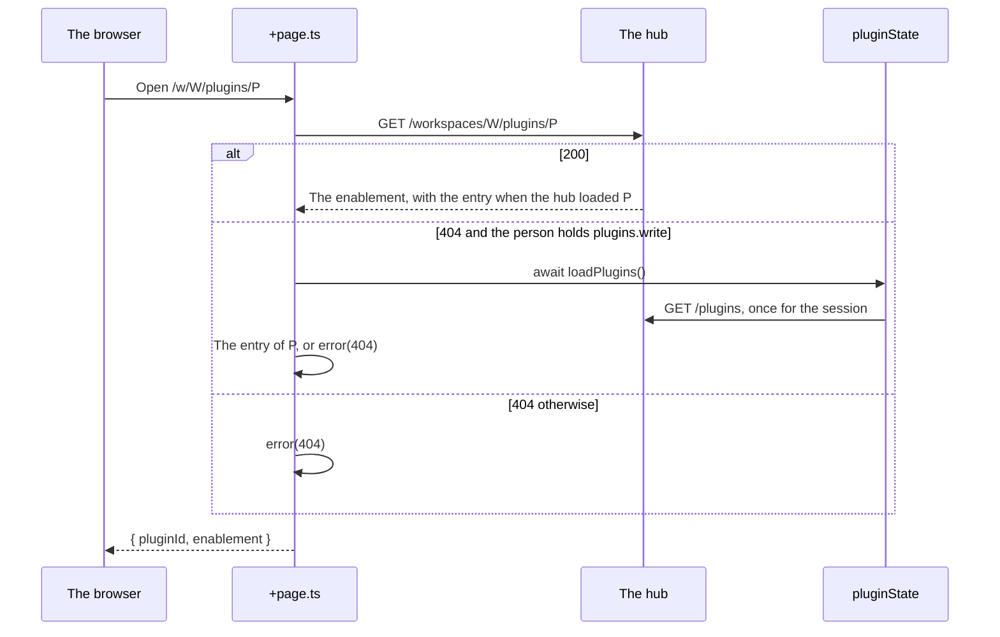

# Specification: The detail page of a plugin

## 1. Summary

The deck serves the plugin detail page at `/w/<workspace>/plugins/<plugin>`. It reads
the enablement of the plugin and the report that `PCAP` gives, and renders every
capability with every item. The hub gains one check: a navigation entry at the root
of the address of a plugin stops the load. No HTTP route changes.

## 2. Coverage

| Requirement       | Where this specification realizes it                       |
| ----------------- | ---------------------------------------------------------- |
| `PLGINFO-FR-001`  | Section 4.1, `PLGINFO-DD-001`, `PLGINFO-SC-001`            |
| `PLGINFO-FR-002`  | Section 4.4, `PLGINFO-DD-002`, `PLGINFO-SC-002`            |
| `PLGINFO-FR-003`  | Section 4.3, `PLGINFO-SC-003`                              |
| `PLGINFO-FR-004`  | Section 4.3, `PLGINFO-DD-003`, `PLGINFO-SC-004`            |
| `PLGINFO-FR-005`  | Section 4.3, `PLGINFO-DD-003`, `PLGINFO-SC-005`            |
| `PLGINFO-FR-006`  | `PLGINFO-DD-003`, `PLGINFO-SC-006`                         |
| `PLGINFO-FR-007`  | Section 4.3, `PLGINFO-DD-002`, `PLGINFO-SC-007`            |
| `PLGINFO-FR-008`  | Section 4.3, `PLGINFO-DD-004`, `PLGINFO-SC-008`            |
| `PLGINFO-FR-009`  | Section 4.3, `PLGINFO-SC-009`                              |
| `PLGINFO-FR-010`  | Section 4.3, `PLGINFO-SC-010`                              |
| `PLGINFO-FR-011`  | Section 4.3, `PLGINFO-DD-002`, `PLGINFO-SC-011`            |
| `PLGINFO-FR-012`  | Section 4.5, `PLGINFO-DD-005`, `PLGINFO-SC-012`, section 8 |
| `PLGINFO-NFR-001` | `PLGINFO-DD-002`, `PLGINFO-SC-013`                         |
| `PLGINFO-INV-001` | `PLGINFO-DD-003`, `PLGINFO-SC-005`                         |

## 3. Guideline compliance

| Rule      | Guideline          | How this specification obeys it                                                                        |
| --------- | ------------------ | ------------------------------------------------------------------------------------------------------ |
| `UI-001`  | Web user interface | The page is a route of `apps/deck`. Section 4.1.                                                       |
| `UI-005`  | Web user interface | `ADR-0020` forbids a navigation entry at the root. Section 4.5.                                        |
| `ARC-008` | Architecture       | One column map renders every plugin. No branch names a plugin. `PLGINFO-DD-003`.                       |
| `SEC-012` | Security           | The page reads the enablement from the hub, and shows its state. `PLGINFO-DD-002`.                     |
| `SEC-013` | Security           | The permission column of each item shows the value of the report. Section 4.3.                         |
| `OWN-011` | Ownership          | The permissions capability shows the role of the report. Section 4.3.                                  |
| `TS-002`  | Frontend style     | Each new component uses runes.                                                                         |
| `TST-004` | Testing            | The hub check is a unit test. The deck has no test runner, so each deck scenario is manual. Section 6. |
| `GO-004`  | Go style           | The registrar wraps `ErrRootUIRoute` with the route and the plugin. Section 4.5.                       |

## 4. Design

### 4.1 Components

| Path                                                                           | Action | Holds                                                                                                                                                                                                                                       |
| ------------------------------------------------------------------------------ | ------ | ------------------------------------------------------------------------------------------------------------------------------------------------------------------------------------------------------------------------------------------- |
| `specs/adr/the-root-of-a-plugin-address.md`                                    | create | `ADR-0020`.                                                                                                                                                                                                                                 |
| `specs/guidelines/web-ui.md`                                                   | change | `UI-005`: an entry of `UIManifest.Routes` is not at the root, and the hub refuses a plugin whose entry is.                                                                                                                                  |
| `libs/pluginapi/ui.go`                                                         | change | The documentation of `UIRoute`: its path is not the root.                                                                                                                                                                                   |
| `apps/hub/internal/domain/errs/errs.go`                                        | change | `ErrRootUIRoute = errors.New("ui manifest: navigation entry at the root of the plugin")`.                                                                                                                                                   |
| `apps/hub/internal/plugin/registrar/ui.go`                                     | change | `Register` refuses a route for which `isRoot(path)` holds. `isRoot` reports `strings.Trim(path, "/") == ""`.                                                                                                                                |
| `apps/hub/internal/plugin/registrar/ui_test.go`                                | change | `PLGINFO-SC-012`.                                                                                                                                                                                                                           |
| `apps/deck/src/lib/api/types.ts`                                               | change | `APIRoute`, `TelegramCommand`, and `MCPTool` gain `permission`. `Permission{name, role}`. `Capabilities` gains `permissions`, as `PCAP` `api.yaml` gives it, and `notification_topics`, a list of topic identifiers, as the hub reports it. |
| `apps/deck/src/lib/api/enablements.ts`                                         | change | `get(workspaceId, pluginId): Promise<EnabledPlugin \| null>`, a `GET` of the route that `PLUGACC` already serves.                                                                                                                           |
| `apps/deck/src/lib/state/plugins.svelte.ts`                                    | change | `loadPlugins` keeps the promise of the request in flight and answers it to a second caller, so a caller can await the list.                                                                                                                 |
| `apps/deck/src/lib/plugins/capabilities.ts`                                    | change | `Column`, `COLUMNS`, `columnsOf(name)`, `itemsOf(plugin, name)`. `PLGINFO-DD-003`.                                                                                                                                                          |
| `apps/deck/src/lib/plugins/switch.ts`                                          | create | `switchPlugin(workspaceId, pluginId, on): Promise<string \| null>`. Answers the message of a refusal, or null. Holds `failureMessage` from the list page.                                                                                   |
| `apps/deck/src/lib/components/plugins/PluginSummary.svelte`                    | change | Takes `href?: ResolvedPathname`. With it, the name is a link.                                                                                                                                                                               |
| `apps/deck/src/lib/components/plugins/CapabilityPanel.svelte`                  | create | Props `plugin`, `name`, `entryHref?: (path: string) => ResolvedPathname`. Renders one capability. Section 4.3.                                                                                                                              |
| `apps/deck/src/routes/(dashboard)/w/[workspace]/plugins/[plugin]/+page.ts`     | create | The load of section 4.4. Answers `{ pluginId, enablement }`. Declares `depends('app:plugin-detail')`.                                                                                                                                       |
| `apps/deck/src/routes/(dashboard)/w/[workspace]/plugins/[plugin]/+page.svelte` | create | The page of section 4.3.                                                                                                                                                                                                                    |
| `apps/deck/src/routes/(dashboard)/w/[workspace]/plugins/+page.svelte`          | change | Passes `href` of the detail page to each `PluginSummary` of both lists. `toggle` calls `switchPlugin`.                                                                                                                                      |
| `apps/deck/src/lib/navigation/breadcrumbs.ts`                                  | change | A case for the new route. `pluginCrumb` links to the detail page. `needsPlugins` names the new route. `PLGINFO-DD-006`.                                                                                                                     |
| `apps/deck/src/lib/components/layout/Breadcrumbs.svelte`                       | change | Passes `[...enabledState.plugins, ...pluginState.plugins]`, so a plugin that the workspace does not use still has its name.                                                                                                                 |
| `apps/deck/src/lib/components/layout/Sidebar.svelte`                           | change | The item "Plugins" marks itself active on the new route.                                                                                                                                                                                    |

### 4.2 Data model

This feature adds no table.

### 4.3 The page

`entry` is `enablement?.plugin`, else the entry of `pluginState` for the identifier.
`inUse` is `enablement !== null`.

| Part         | Content                                                                                                                                                                                        | Realizes                           |
| ------------ | ---------------------------------------------------------------------------------------------------------------------------------------------------------------------------------------------- | ---------------------------------- |
| Header       | `displayNameOf(entry, pluginId)` as the title, the version as a badge, the identifier in mono, and the description when the entry holds one. With no entry, the title is the identifier alone. | `PLGINFO-FR-003`                   |
| State        | "In use in <workspace>.", or "Not in use in <workspace>.". With `inUse` and no entry: an `Alert` of kind `info`, "The hub did not load this plugin. Its records and its settings stay."        | `PLGINFO-FR-007`, `PLGINFO-FR-011` |
| Switch       | The toggle of the list, when `holds(workspace, PERMISSION.pluginsWrite)`. A refusal shows an `Alert` of kind `error` with the message of `switchPlugin`.                                       | `PLGINFO-FR-008`                   |
| Configure    | A link to `.../[plugin]/settings` when `inUse`, `hasCapability(entry, 'settings')`, and `isMember(workspaceId)`. The condition of the list page.                                               | `PLGINFO-FR-009`                   |
| Capabilities | A `Section` "Capabilities". One `CapabilityPanel` for each name of `capabilitiesOf(entry)`. With none: the empty state "This plugin declares no capability." With no entry, no section.        | `PLGINFO-FR-004`                   |

`CapabilityPanel` renders the label of `labelOf(name)` as its heading, then:

| Capability               | Body                                                                                                           | Realizes                           |
| ------------------------ | -------------------------------------------------------------------------------------------------------------- | ---------------------------------- |
| `settings`, `migrations` | One line: "Declared. It holds no item." No table.                                                              | `PLGINFO-FR-005`                   |
| `ui`                     | A table of the navigation entries: label, path. With `entryHref`, the label links to the page of the path.     | `PLGINFO-FR-005`, `PLGINFO-FR-010` |
| Every other capability   | A table with the columns of `columnsOf(name)`, one row for each item of `itemsOf`, in the order of the report. | `PLGINFO-FR-005`                   |

The page passes `entryHref` only when `inUse`.

The panels sit one to a row. A long value breaks after `/`, `.`, or `:`.

`COLUMNS` holds, for each capability with items, the fields of `PCAP` `api.yaml` in
its order:

| Capability               | Columns                                   |
| ------------------------ | ----------------------------------------- |
| `api`                    | Method, Path, Permission                  |
| `cli`                    | Command                                   |
| `cron`                   | Job, Schedule                             |
| `mqtt`                   | Subscriber, Topic                         |
| `telegram_commands`      | Command, Description, Permission          |
| `telegram_conversations` | Conversation, Entry                       |
| `mcp_tools`              | Tool, Description, Permission             |
| `widgets`                | Key, Title, Kind, Size, Permission        |
| `permissions`            | Permission, Lowest role                   |
| `notification_topics`    | Topic. The item is the identifier itself. |

A column that holds an identifier, a path, an expression, or a permission renders in
mono. `Description` and `Title` render in the body font.

### 4.4 Flow

After a switch, the page calls `invalidate('app:plugin-detail')` and
`loadEnabled(workspaceId, true)`, so the page, the list, and the navigation read the
new state.

### 4.5 Errors

| Condition                                                      | Behavior                                                                                                                                       | Realizes         |
| -------------------------------------------------------------- | ---------------------------------------------------------------------------------------------------------------------------------------------- | ---------------- |
| The workspace does not use P, and the person may not enable P. | `error(404, 'This workspace has no plugin at this address.')`.                                                                                 | `PLGINFO-FR-002` |
| The enablement read fails with a status other than 404.        | The load throws, and the error page of the deck shows.                                                                                         | none             |
| The list of `GET /plugins` fails.                              | The load throws.                                                                                                                               | none             |
| The hub refuses a switch.                                      | The `Alert` shows the message, and the page reloads its state.                                                                                 | `PLGINFO-FR-008` |
| A navigation entry is `/` or empty.                            | `UIRegistrar.Register` answers `fmt.Errorf("checking the route %s of plugin %s: %w", path, id, errs.ErrRootUIRoute)`. The hub stops its start. | `PLGINFO-FR-012` |

## 5. Design decisions

### `PLGINFO-DD-001`

**Realizes:** `PLGINFO-FR-001`, `PLGINFO-FR-012`
**Decision:** The page is `routes/(dashboard)/w/[workspace]/plugins/[plugin]/+page.svelte`. The name of each row of the list page links to it.
**Rationale:** The router of the deck ranks a page of `[plugin]` above the rest parameter `[...path]` for the address with no further segment, so no change to the loader of the remotes is needed. `ADR-0020` gives the address.
**Alternatives:** The whole row as a link. The row already holds a toggle and the link "Configure", and a link around them nests one target in another.

### `PLGINFO-DD-002`

**Realizes:** `PLGINFO-FR-002`, `PLGINFO-FR-007`, `PLGINFO-FR-011`, `PLGINFO-NFR-001`
**Decision:** The load reads the one enablement. On a 404, and only for a person who holds `plugins.write`, it reads the entry from `pluginState`. No hub route changes.
**Rationale:** The enablement carries the entry of a loaded plugin, and states a plugin that the hub did not load. `GET /plugins` answers the plugins of the allowlist, which are the plugins a manager may enable. One opening costs one request, or two for a plugin not in use, whatever the count of capabilities.
**Alternatives:** A new route `GET /plugins/{id}`. It repeats a fact that two routes carry. `enabledState`. It drops an enablement with no entry, so `PLGINFO-FR-011` fails.

### `PLGINFO-DD-003`

**Realizes:** `PLGINFO-FR-004`, `PLGINFO-FR-005`, `PLGINFO-FR-006`, `PLGINFO-INV-001`
**Decision:** One map from a capability to its columns, and one component that renders a table from it. A cell shows the value of the report as a string, with no change.
**Rationale:** Eleven capabilities share one shape: a list of flat records. One map keeps the page in step with `PCAP`, and a cell that copies the value cannot state a fact the report does not carry. The order of the panels comes from `capabilitiesOf`, which the list page reads.
**Alternatives:** One component for each capability. Eleven files for one table. A raw view of the JSON. It shows the fields, and a person reads keys instead of labels.

### `PLGINFO-DD-004`

**Realizes:** `PLGINFO-FR-008`
**Decision:** `switchPlugin` holds the call and the message of a refusal. The list page and the detail page both call it.
**Rationale:** The requirement asks for the outcome of the list. One function gives one outcome.
**Alternatives:** A copy of `toggle` in the new page. Two copies of the message rules drift apart.

### `PLGINFO-DD-005`

**Realizes:** `PLGINFO-FR-012`
**Decision:** `UIRegistrar.Register` refuses a navigation entry at the root. The deck does not check the keys of `routes`.
**Rationale:** The owner chose the hub check alone. The registrar already refuses an entry with a parameter segment, and the author reads the error at the first start.
**Alternatives:** The loader of the deck also throws for a key at `/`. Section 8 holds it.

### `PLGINFO-DD-006`

**Realizes:** none. The plugin crumb named "a place that carries no page of its own". The plugin now has one.
**Decision:** The plugin crumb of every plugin trail links to the detail page.
**Rationale:** A crumb with a target that exists and no link reads as broken.
**Alternatives:** Keep the crumb plain. The detail page then has one way in.

## 6. Scenarios

A deck scenario runs against `pnpm hub:serve` and `pnpm deck:dev`, in workspace H.
Jasmine is in use in H. Telasi is on the allowlist of manager M and not in use. V is
a viewer of H.

### `PLGINFO-SC-001`

**Verifies:** `PLGINFO-FR-001`
**Layer:** manual

**Given** M on the plugins page of H
**When** M selects the name "Jasmine", then goes back and selects "Telasi"
**Then** each opens `/w/H/plugins/<id>` with that plugin

### `PLGINFO-SC-002`

**Verifies:** `PLGINFO-FR-002`
**Layer:** manual

**Given** V and M
**When** M opens Telasi, V opens Jasmine, V opens Telasi, and M opens `/w/H/plugins/dev.maroid.absent`
**Then** M and V see the page, V sees the not-found page for Telasi, and M sees the not-found page for the absent identifier

### `PLGINFO-SC-003`

**Verifies:** `PLGINFO-FR-003`
**Layer:** manual

**Given** Jasmine declares a description and Telasi declares none
**When** M opens both pages
**Then** each shows its name, identifier, and version, Jasmine shows its description, and Telasi shows no space for one

### `PLGINFO-SC-004`

**Verifies:** `PLGINFO-FR-004`
**Layer:** manual

**Given** the chips of Jasmine on the list page
**When** M opens its page, then opens it again with the answer of the enablement overridden in the browser to `"capabilities": {}`
**Then** the panels follow the order of the chips, and the override shows "This plugin declares no capability."

### `PLGINFO-SC-005`

**Verifies:** `PLGINFO-FR-005`, `PLGINFO-INV-001`
**Layer:** manual

**Given** the answer of `GET /workspaces/H/plugins/dev.maroid.jasmine`
**When** M opens the page of Jasmine
**Then** each row of each table matches one item of the answer field by field, each item has one row, settings shows "Declared. It holds no item.", and no panel exists for a capability the answer lacks

### `PLGINFO-SC-006`

**Verifies:** `PLGINFO-FR-006`
**Layer:** manual

**Given** a job of Jasmine with the schedule of its report
**When** M opens the page
**Then** the schedule reads as the report gives it, and each path of the API panel holds `{workspaceId}`

### `PLGINFO-SC-007`

**Verifies:** `PLGINFO-FR-007`
**Layer:** manual

**When** M opens Jasmine, then Telasi
**Then** Jasmine reads "In use in H." and Telasi reads "Not in use in H."

### `PLGINFO-SC-008`

**Verifies:** `PLGINFO-FR-008`
**Layer:** manual

**Given** M on the page of Telasi, and V on the page of Jasmine
**When** M turns Telasi on, turns it off, then turns it on with the `PUT` blocked in the browser
**Then** the first switch shows "In use in H." and the list shows Telasi under "In use", the second shows the message of the failure and keeps the state, and V sees no switch

### `PLGINFO-SC-009`

**Verifies:** `PLGINFO-FR-009`
**Layer:** manual

**When** M opens Jasmine, M opens Telasi, and an administrator who is not a member of H opens Jasmine
**Then** only the first shows "Configure", and it opens the settings of Jasmine

### `PLGINFO-SC-010`

**Verifies:** `PLGINFO-FR-010`
**Layer:** manual

**When** M opens Jasmine, then a plugin with navigation entries that H does not use
**Then** Jasmine shows four labels that open their pages, and the second shows its labels with no link

### `PLGINFO-SC-011`

**Verifies:** `PLGINFO-FR-011`
**Layer:** manual

**Given** H uses gwp, and the hub starts without `build/plugins/gwp.so`
**When** M opens `/w/H/plugins/dev.maroid.gwp`
**Then** the page shows the identifier, the warning, and the switch, and turning it off removes gwp from the list

### `PLGINFO-SC-012`

**Verifies:** `PLGINFO-FR-012`
**Layer:** unit

**Given** a plugin whose navigation entries are, in turn, `/`, the empty path, and `/overview`
**When** `UIRegistrar.Register` runs
**Then** the first two answer an error that wraps `errs.ErrRootUIRoute` and register nothing, and the third registers

### `PLGINFO-SC-013`

**Verifies:** `PLGINFO-NFR-001`
**Layer:** manual

**Given** the network panel of the browser, after the first load of the deck
**When** M opens Jasmine, then a plugin with the fewest capabilities
**Then** each opening sends the same count of requests to the hub, at most two, and none names a capability

## 7. Build plan

| #   | Step                                                                                                                                          | Realizes                                                                 | Done |
| --- | --------------------------------------------------------------------------------------------------------------------------------------------- | ------------------------------------------------------------------------ | ---- |
| 1   | Accept `ADR-0020`. Change `UI-005`. Add the row to the index of `specs/adr/`.                                                                 | `PLGINFO-FR-012`                                                         | [x]  |
| 2   | Write `PLGINFO-SC-012`. Add `ErrRootUIRoute` and the check. Change the documentation of `UIRoute`. Lint and build the hub, then every plugin. | `PLGINFO-FR-012`                                                         | [x]  |
| 3   | `enablements.get`, the awaitable `loadPlugins`, and `switchPlugin`. Move the list page onto `switchPlugin`.                                   | `PLGINFO-FR-008`, `PLGINFO-NFR-001`                                      | [x]  |
| 4   | `COLUMNS`, `columnsOf`, `itemsOf`, and `CapabilityPanel`.                                                                                     | `PLGINFO-FR-004`, `PLGINFO-FR-005`, `PLGINFO-FR-006`                     | [x]  |
| 5   | The load and the page.                                                                                                                        | `PLGINFO-FR-002`, `PLGINFO-FR-003`, `PLGINFO-FR-007` to `PLGINFO-FR-011` | [x]  |
| 6   | The link on each row of the list, the trail, and the active item of the sidebar. Lint and check the deck.                                     | `PLGINFO-FR-001`                                                         | [x]  |
| 7   | Run `PLGINFO-SC-001` to `PLGINFO-SC-013`, except `PLGINFO-SC-012`.                                                                            | Every statement                                                          | [x]  |

## 8. Out of scope for this specification

- A key of `routes` at `/` in a remote. `PLGINFO-FR-012` holds for the navigation
  entries alone. The owner chose the hub check. A defect report of a plugin whose
  root page never opens brings back a check in the loader of the deck.

## Retired identifiers

This file has no retired identifier.
