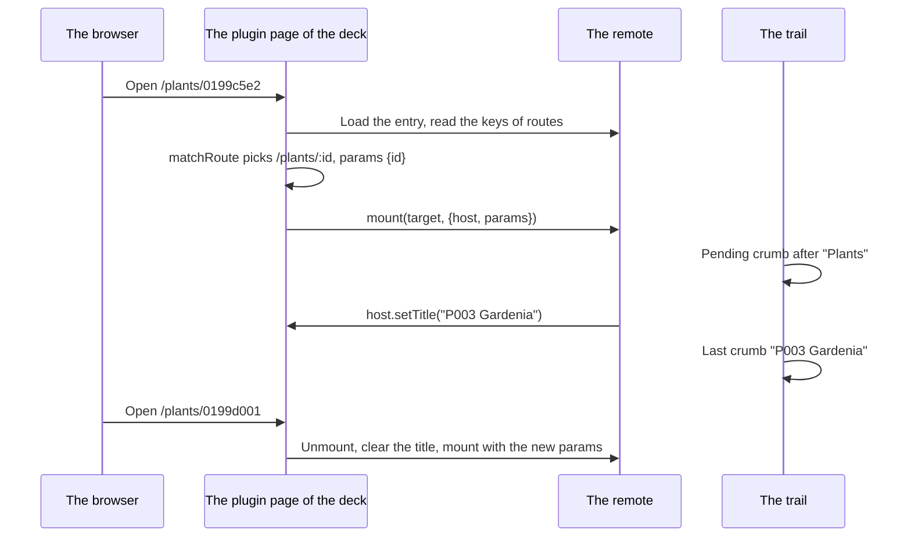

# Specification: The pages of a plugin, with the parameters of their address

## 1. Summary

The deck matches a plugin address against the page routes of the remote, where a
segment of the form `:name` takes any one value, and mounts the page with the values.
The trail and the navigation follow the navigation entries, and the page names the
last link of the trail. The hub refuses a navigation entry with a parameter segment.
The jasmine plant view moves to `/plants/:id`. `ADR-0012` changes `UI-005` and `UI-008`.

## 2. Coverage

| Requirement        | Where this specification realizes it |
| ------------------ | ------------------------------------ |
| `PLROUTE-FR-001`   | Section 4.1, 4.3, `PLROUTE-DD-001`, `PLROUTE-SC-001`, `PLROUTE-SC-002` |
| `PLROUTE-FR-002`   | Section 4.3, `PLROUTE-DD-001`, `PLROUTE-SC-002` |
| `PLROUTE-FR-003`   | Section 4.3, `PLROUTE-DD-002`, `PLROUTE-SC-003` |
| `PLROUTE-FR-004`   | Section 4.3, `PLROUTE-DD-003`, `PLROUTE-SC-003` |
| `PLROUTE-FR-005`   | Section 4.4, `PLROUTE-SC-004` |
| `PLROUTE-FR-006`   | Section 4.4, `PLROUTE-SC-005` |
| `PLROUTE-FR-007`   | Section 4.5, `PLROUTE-SC-006` |
| `PLROUTE-FR-008`   | Section 4.5, `PLROUTE-SC-007` |
| `PLROUTE-FR-009`   | Section 4.3, `PLROUTE-SC-008` |
| `PLROUTE-FR-010`   | Section 4.3, `PLROUTE-SC-009` |
| `PLROUTE-FR-011`   | Section 4.3, `PLROUTE-DD-004`, `PLROUTE-SC-009` |
| `PLROUTE-FR-012`   | Section 4.3, `PLROUTE-DD-004`, `PLROUTE-SC-009` |
| `PLROUTE-FR-013`   | Section 4.6, `PLROUTE-SC-010` |
| `PLROUTE-FR-014`   | Section 4.6, `PLROUTE-SC-010` |
| `PLROUTE-FR-015`   | Section 4.6, `PLROUTE-SC-011` |
| `PLROUTE-FR-016`   | Section 4.6, `PLROUTE-SC-012` |
| `PLROUTE-INV-001`  | Section 4.5, `PLROUTE-DD-002`, `PLROUTE-SC-003` |

## 3. Guideline compliance

| Rule                 | Guideline      | How this specification obeys it |
| -------------------- | -------------- | ------------------------------- |
| `UI-005`, `UI-008`   | Web UI         | `ADR-0012` changes both. Section 4.3 gives the new contract. |
| `UI-006`             | Web UI         | A page reads `params` and calls `host.setTitle`. It imports nothing of the deck. |
| `UI-007`             | Web UI         | A page builds a link with `host.href`, never by hand. |
| `ARC-008`            | Architecture   | The matcher, the trail, and the refusal treat every plugin alike. |
| `PLG-007`            | Plugin model   | The hub checks the manifest in its registrar. `libs/pluginapi` does not change. |
| `GO-005`, `GO-008`   | Go style       | `ErrInvalidUIRoute` lives in `apps/hub/internal/domain/errs`. |
| `TS-002`             | Frontend style | A page takes `params` through `$props`. |
| `BLD-001`, `BLD-004` | Build          | Section 7 runs the checks of the hub, the deck, `libs/plugin-sdk`, and the jasmine remote. |
| `TST-004`            | Testing        | The deck has no test runner, and the owner keeps it so. Every deck scenario is manual. |

## 4. Design

### 4.1 Components

| Path | Action | Holds |
| ---- | ------ | ----- |
| `specs/guidelines/web-ui.md` | change | `UI-005` and `UI-008` as `ADR-0012` gives them. |
| `apps/hub/internal/domain/errs/errs.go` | change | `ErrInvalidUIRoute = errors.New("ui manifest: navigation entry with a parameter segment")`. |
| `apps/hub/internal/plugin/registrar/ui.go` | change | `Register` refuses a manifest whose route path holds a segment that starts with `:`. |
| `apps/hub/internal/plugin/registrar/ui_test.go` | create | `PLROUTE-SC-007`. |
| `libs/plugin-sdk/src/types.ts` | change | `RouteParams = Record<string, string>`. `PluginHost.setTitle(title: string): void`. |
| `libs/plugin-sdk/src/index.ts` | change | Export `RouteParams`. |
| `apps/deck/src/lib/plugins/routes.ts` | create | `matchRoute(keys: string[], path: string): RouteMatch \| null`, `activeEntry(paths: string[], path: string): string \| null`. `RouteMatch{key, params, parameterized}`. |
| `apps/deck/src/lib/plugins/loader.ts` | change | `loadPluginRoute(pluginId, subpath): Promise<PluginRoute \| null>` replaces `loadPluginMount`. `PluginRoute{mount, params, parameterized}`. Null when no key matches. |
| `apps/deck/src/lib/state/title.svelte.ts` | create | `pageTitle` state, `{ value: string \| null }`. |
| `apps/deck/src/routes/(dashboard)/w/[workspace]/plugins/[plugin]/[...path]/+page.ts` | change | Returns `{ route, pluginId }`. |
| `apps/deck/src/routes/(dashboard)/w/[workspace]/plugins/[plugin]/[...path]/+page.svelte` | change | Mounts with `{ host, params }`. `host.setTitle` sets `pageTitle`. The cleanup of the mount clears it. A null route shows the not-found page of section 4.5. |
| `apps/deck/src/lib/navigation/breadcrumbs.ts` | change | `Crumb` gains `pending?: boolean`. `crumbsFor` takes `title` and `parameterized`. Section 4.3. |
| `apps/deck/src/lib/components/layout/Breadcrumbs.svelte` | change | Passes `pageTitle.value` and `page.data.route?.parameterized`. A pending crumb renders as a skeleton. |
| `apps/deck/src/lib/components/layout/Sidebar.svelte` | change | The active entry of a plugin comes from `activeEntry`. |
| `plugins/jasmine/ui/src/entry.ts` | change | `"/plants/:id"` mounts `pages/plants/Plant.svelte`. |
| `plugins/jasmine/ui/src/pages/plants/Plant.svelte` | create | Takes `host` and `params`. Reads the environments, and renders `PlantView`. |
| `plugins/jasmine/ui/src/pages/plants/PlantView.svelte` | change | Loses the back button, `onclose`, and `onchanged`. Calls `host.setTitle`. Shows the not-found block of section 4.6. After a delete, `host.navigate('/plants')`. |
| `plugins/jasmine/ui/src/pages/plants/Plants.svelte` | change | Loses `opened` and `PlantView`. |
| `plugins/jasmine/ui/src/pages/plants/PlantList.svelte` | change | The name of each plant is a link to `host.href('/plants/' + id)`. The checkbox stays outside the link. |
| `specs/features/garden/spec.md` | change | Retires `GARDEN-DD-010`, and adds `GARDEN-DD-011` that points at `PLROUTE`. |

### 4.2 Data model

This feature adds no table.

### 4.3 Declarations

**The page route contract.** `ADR-0012` gives it, and the deck applies it to every remote.

| Element | Rule | Realizes |
| ------- | ---- | -------- |
| A key of `routes` | Segments divided by `/`. A segment of the form `:name`, where `name` matches `[A-Za-z][A-Za-z0-9_]*`, is a parameter segment. Any other segment is fixed. | `PLROUTE-FR-001` |
| A parameter segment | Matches one non-empty segment of the address. The value is the segment decoded with `decodeURIComponent`. A segment that does not decode matches nothing. | `PLROUTE-FR-002`, `PLROUTE-FR-004` |
| The prop `params` | The mounter receives `{ host, params }`. `params` maps each name to its value, and is `{}` for a key with no parameter. | `PLROUTE-FR-004` |
| `host.setTitle(title)` | Sets the last link of the trail. The deck clears it when the page unmounts. | `PLROUTE-FR-011` |
| `UIManifest.Routes` | Lists the navigation entries. A path with a parameter segment stops the load of the plugin. | `PLROUTE-FR-008` |

**The trail of a plugin page.** `crumbsFor` builds, after the plugin crumb:

| Crumb | Rule | Realizes |
| ----- | -------- | -------- |
| A navigation entry | Each navigation entry whose path is a leading part of the address, in whole segments, in order of length. Each links to its path. | `PLROUTE-FR-010` |
| The last crumb | The page title, when the page gave one. Else, for a parameterized route, a pending crumb. Else the label of the matched navigation entry, or `titleOf` of the last segment. | `PLROUTE-FR-011`, `PLROUTE-FR-012` |

A segment that no navigation entry declares, and that is not the last, takes no crumb.

**The active navigation entry.** `activeEntry` answers the path of the entry that is the
longest leading part of the address, in whole segments, or null. `PLROUTE-FR-009`.

### 4.4 Flow

A change of the address reruns the load of the page, so a second value of the same
key unmounts the page and mounts it again. A reload and a new tab take the same
path, because the address holds every value. `PLROUTE-FR-005`, `PLROUTE-FR-006`.

### 4.5 Errors

| Condition | Behavior | Realizes |
| --------- | -------- | -------- |
| No key of `routes` matches the address. | The deck shows "Not found", the lead "This plugin has no page at this address.", and a link to the first navigation entry. A plugin with no navigation entry shows no link. | `PLROUTE-FR-007` |
| Two keys match with the same fixed and parameter segments at every position. | `loadPluginRoute` throws an error that names both keys. The remote holds a defect. | `PLROUTE-INV-001` |
| A navigation entry holds a parameter segment. | `UIRegistrar.Register` answers `fmt.Errorf("checking the route %s of plugin %s: %w", path, id, errs.ErrInvalidUIRoute)`. The hub stops its start, as for every registrar error. | `PLROUTE-FR-008` |
| The remote does not load. | The error of today stays. | none |

### 4.6 The plant page of jasmine

| Element | Behavior | Realizes |
| ------- | -------- | -------- |
| Address | `/plants/<id>`, the internal identifier. | `PLROUTE-FR-013` |
| Page title | `host.setTitle("<display_id> <common_name>")` after each read of the plant. | `PLROUTE-FR-014` |
| Absent plant | A 404 answer shows the header "Not found", the lead "This workspace holds no plant with this address.", and a link to `/plants`. The title becomes "Not found". | `PLROUTE-FR-015` |
| Delete | After the delete lands, `host.navigate('/plants')`. | `PLROUTE-FR-016` |

## 5. Design decisions

### `PLROUTE-DD-001`

**Realizes:** `PLROUTE-FR-001`, `PLROUTE-FR-002`
**Decision:** A key holds parameter segments of the form `:name`, each one whole segment. The deck matches segment by segment, and a key matches only an address of the same count of segments.
**Rationale:** The owner chose the syntax. One comparison for each segment holds every record page of the plugins today.
**Alternatives:** `[name]`, the form of the file routes of the deck. It reads as a file name in a plain object. A pattern with a wildcard. `PLROUTE` puts it out of scope.

### `PLROUTE-DD-002`

**Realizes:** `PLROUTE-FR-003`, `PLROUTE-INV-001`
**Decision:** Among the keys that match, the deck compares two keys at the first segment where one is fixed and the other a parameter, and keeps the fixed one. Two keys with no such segment are a defect of the remote, and the load throws.
**Rationale:** The rule depends on the keys alone, never on the order of the declaration, so one address opens one page.
**Alternatives:** The first key in the order of the object. The page then depends on the order of the source. A count of fixed segments. `/a/:x/c` and `/a/b/:y` tie on it.

### `PLROUTE-DD-003`

**Realizes:** `PLROUTE-FR-004`
**Decision:** The deck passes the values as the prop `params` of the mount, next to `host`.
**Rationale:** The values belong to one mount. `TS-002` reads a prop with `$props`, and a second value of the same key mounts the page again, so the prop never changes in place.
**Alternatives:** `host.params`. The host of one page then carries a value that changes under it.

### `PLROUTE-DD-004`

**Realizes:** `PLROUTE-FR-011`, `PLROUTE-FR-012`
**Decision:** `host.setTitle` writes one state of the deck, which the trail reads. The unmount of the page clears it, and the trail shows a skeleton while a parameterized route has no title.
**Rationale:** The owner chose `setTitle`. The trail already shows a skeleton while the plugins load, so a person reads one form of waiting.
**Alternatives:** The label of the navigation entry until the title arrives. It names the list on the page of one record.

### `PLROUTE-DD-005`

**Realizes:** `PLROUTE-FR-008`
**Decision:** `UIRegistrar.Register` checks each path of `UIManifest.Routes` and refuses the plugin.
**Rationale:** Every other registrar refuses a wrong declaration at the load, and the author reads the error at the first start.
**Alternatives:** Skip the entry and log a warning. A missing entry in the navigation then goes unnoticed.

## 6. Scenarios

The deck has no test runner, so every deck scenario is manual. A manual scenario runs
against `pnpm hub:serve` and `pnpm deck:dev`, in workspace H with jasmine enabled.

### `PLROUTE-SC-001`

**Verifies:** `PLROUTE-FR-001`
**Layer:** manual

**Given** `P003` in H.
**When** the owner opens `/plants/<P003 id>`.
**Then** the plant page of `P003` shows.

### `PLROUTE-SC-002`

**Verifies:** `PLROUTE-FR-001`, `PLROUTE-FR-002`
**Layer:** manual

**Given** jasmine declares `/plants/:id`.
**When** the owner opens `/plants/` and `/plants/a/b`.
**Then** `/plants/` shows the plant list, which the trimmed path `/plants` matches, and `/plants/a/b` shows the not-found page.

### `PLROUTE-SC-003`

**Verifies:** `PLROUTE-FR-003`, `PLROUTE-FR-004`, `PLROUTE-INV-001`
**Layer:** manual

**Given** a local change to `entry.ts` of jasmine that adds `/plants/new`, a probe key `/probe/:value` whose page prints `params`, and then `/plants/:key`. The change is reverted after the check.
**When** the owner opens `/plants/new`, then `/probe/Office%20north`, then, with `/plants/:key` added, `/plants/<P003 id>`.
**Then** `/plants/new` opens its fixed page. The probe prints `{"value":"Office north"}`. The third load fails with an error that names `/plants/:id` and `/plants/:key`.

### `PLROUTE-SC-004`

**Verifies:** `PLROUTE-FR-005`
**Layer:** manual

**Given** the page of `P001`.
**When** the owner follows a link to `P002`, then presses the back button of the browser.
**Then** the page shows `P002`, then `P001`, each with its own title in the trail.

### `PLROUTE-SC-005`

**Verifies:** `PLROUTE-FR-006`
**Layer:** manual

**Given** the page of `P003`.
**When** the owner reloads it, then opens its address in a new tab.
**Then** both show the page of `P003`.

### `PLROUTE-SC-006`

**Verifies:** `PLROUTE-FR-007`
**Layer:** manual

**Given** jasmine, whose first navigation entry is "Needs attention".
**When** the owner opens `/plants/a/b`.
**Then** the deck shows "Not found" with a link to "Needs attention".

### `PLROUTE-SC-007`

**Verifies:** `PLROUTE-FR-008`
**Layer:** integration

**Given** a plugin whose manifest lists `/plants` and `/plants/:id`, and a plugin whose manifest lists `/plants` alone.
**When** `UIRegistrar.Register` runs for each.
**Then** the first answers an error that wraps `errs.ErrInvalidUIRoute` and names `/plants/:id`, and the registry holds no manifest for it. The second registers.

### `PLROUTE-SC-008`

**Verifies:** `PLROUTE-FR-009`
**Layer:** manual

**Given** the page of `P003`.
**When** the owner reads the navigation.
**Then** "Plants" is the active entry, and its group is open.

### `PLROUTE-SC-009`

**Verifies:** `PLROUTE-FR-010`, `PLROUTE-FR-011`, `PLROUTE-FR-012`
**Layer:** manual

**Given** the network of the browser throttled to "Slow 3G".
**When** the owner opens the page of `P003`, then renames it to "Cape jasmine".
**Then** the trail ends with a skeleton after "Plants", then with "P003 Gardenia", then with "P003 Cape jasmine". "Plants" links to `/plants`. No crumb shows the identifier.

### `PLROUTE-SC-010`

**Verifies:** `PLROUTE-FR-013`, `PLROUTE-FR-014`
**Layer:** manual

**Given** the plant list.
**When** the owner opens "Gardenia" from its line, and opens it a second time with the middle button.
**Then** the address is `/plants/<P003 id>` in both tabs, and the trail ends with "P003 Gardenia".

### `PLROUTE-SC-011`

**Verifies:** `PLROUTE-FR-015`
**Layer:** manual

**Given** the address of a deleted plant, and the address of a plant of G.
**When** the owner opens each in H.
**Then** each shows "Not found" with a link to `/plants`.

### `PLROUTE-SC-012`

**Verifies:** `PLROUTE-FR-016`
**Layer:** manual

**Given** the page of `P003`.
**When** the owner deletes it and confirms.
**Then** the deck shows `/plants`, and `P003` is absent.

## 7. Build plan

| #   | Step | Realizes | Done |
| --- | ---- | -------- | ---- |
| 1   | Accept `ADR-0012`. Change `UI-005` and `UI-008`. Add the row to the index of `specs/adr/`. | `PLROUTE-FR-001`, `PLROUTE-FR-008`, `PLROUTE-FR-011` | [x] |
| 2   | The hub: `ErrInvalidUIRoute`, the check in `UIRegistrar`, `PLROUTE-SC-007`. `cd apps/hub && golangci-lint run ./...`, `go build ./apps/hub/...`. | `PLROUTE-FR-008` | [x] |
| 3   | `libs/plugin-sdk`: `RouteParams`, `setTitle`. `pnpm --filter @maroid/plugin-sdk check`. | `PLROUTE-FR-004`, `PLROUTE-FR-011` | [x] |
| 4   | The deck: `routes.ts`, the loader, the plugin page, the title state, the trail, the navigation. `pnpm --filter @maroid/deck lint`, `pnpm --filter @maroid/deck check`. | `PLROUTE-FR-001` to `PLROUTE-FR-012`, `PLROUTE-INV-001` | [x] |
| 5   | Jasmine: the plant route and the pages, and the change to the GARDEN spec. The remote build, then the `.so`. `BLD-003`, `BLD-004`. | `PLROUTE-FR-013` to `PLROUTE-FR-016` | [x] |
| 6   | The manual scenarios. | Every manual scenario | [x] |

## 8. Out of scope for this specification

This specification postpones no requirement.

## Retired identifiers

This file has no retired identifier.
