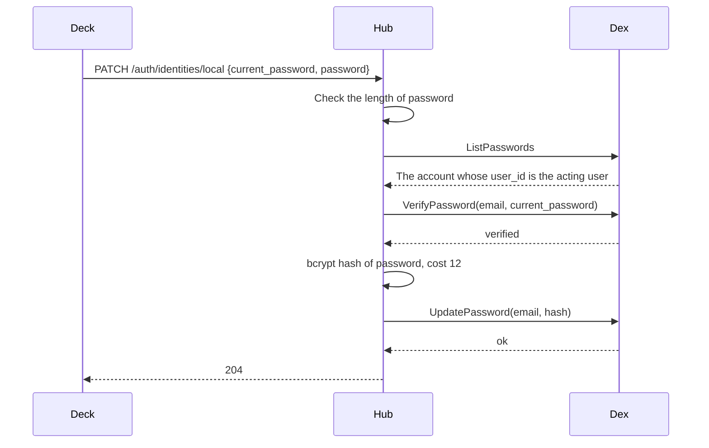

# Specification: The profile that a person changes on their own record

## 1. Summary

`GET` and `PATCH /users/self` read and rename the record of the acting user.
`PATCH /auth/identities/local` sets a new password on their own local account, after
Dex verifies the current one. The profile page of the deck turns its name section on
and gains a password section.

The record gains an optional `time_zone`, which `PATCH /users/self` sets and clears.
Every entry point that resolves an acting user puts the zone of that record into the
context, where a plugin reads it through `pluginapi.ActingTimeZone`. The deck and
every plugin page show and read a moment in that zone, else in the zone of the
browser. A core migration adds the column.

## 2. Coverage

| Requirement       | Where this specification realizes it                                   |
| ----------------- | ---------------------------------------------------------------------- |
| `PROFILE-FR-001`  | Section 4.2, `PROFILE-DD-001`, `PROFILE-SC-001`                        |
| `PROFILE-FR-002`  | Section 4.2, `PROFILE-SC-002`, `PROFILE-SC-003`                        |
| `PROFILE-FR-004`  | `PROFILE-DD-004`, `PROFILE-SC-005`                                     |
| `PROFILE-FR-005`  | `PROFILE-DD-004`, `PROFILE-SC-005`, `PROFILE-SC-012`                   |
| `PROFILE-FR-006`  | Section 4.2, `PROFILE-SC-006`, `PROFILE-SC-007`                        |
| `PROFILE-FR-007`  | `PROFILE-DD-003`, `PROFILE-SC-008`                                     |
| `PROFILE-FR-008`  | Section 4.1, `PROFILE-SC-009`                                          |
| `PROFILE-FR-009`  | Section 4.3, `PROFILE-SC-010`                                          |
| `PROFILE-FR-010`  | Section 4.3, `PROFILE-SC-006`                                          |
| `PROFILE-FR-011`  | `PROFILE-DD-001`, `PROFILE-DD-007`, `PROFILE-SC-004`, `PROFILE-SC-016` |
| `PROFILE-FR-012`  | `PROFILE-DD-007`, `PROFILE-DD-010`, `PROFILE-SC-013`, `PROFILE-SC-020` |
| `PROFILE-FR-013`  | `PROFILE-DD-005`, `PROFILE-DD-006`, `PROFILE-SC-013`                   |
| `PROFILE-FR-014`  | `PROFILE-DD-006`, `PROFILE-SC-014`                                     |
| `PROFILE-FR-015`  | `PROFILE-DD-007`, `PROFILE-SC-015`                                     |
| `PROFILE-FR-016`  | `PROFILE-DD-009`, `PROFILE-SC-020`                                     |
| `PROFILE-FR-017`  | `PROFILE-DD-009`, `PROFILE-SC-021`                                     |
| `PROFILE-FR-018`  | `PROFILE-DD-009`, `PROFILE-SC-020`, `PROFILE-SC-022`                   |
| `PROFILE-FR-019`  | `PROFILE-DD-008`, `PROFILE-SC-017`, `PROFILE-SC-018`, `PROFILE-SC-019` |
| `PROFILE-FR-020`  | `PROFILE-DD-008`, `PROFILE-SC-017`, `PROFILE-SC-018`                   |
| `PROFILE-NFR-001` | Section 4.4, `PROFILE-SC-011`                                          |
| `PROFILE-INV-001` | `PROFILE-DD-001`, `PROFILE-DD-002`, `PROFILE-SC-003`                   |
| `PROFILE-INV-002` | `PROFILE-DD-005`, `PROFILE-SC-013`                                     |
| `PROFILE-INV-003` | `PROFILE-DD-005`, `PROFILE-SC-023`                                     |
| `PROFILE-INV-004` | `PROFILE-DD-008`, `PROFILE-SC-024`                                     |

## 3. Guideline compliance

| Rule      | Guideline      | How this specification obeys it                                                                                      |
| --------- | -------------- | -------------------------------------------------------------------------------------------------------------------- |
| `SEC-001` | Security       | Section 4.3 hashes the new password in memory. No row, log, or answer holds either password.                         |
| `SEC-004` | Security       | The resolver refuses a blocked record before either route runs.                                                      |
| `SEC-011` | Security       | `PATCH /users/self` decodes the names and `time_zone` alone. The other fields stay with an administrator.            |
| `API-003` | HTTP API       | `/users/self` is an Authenticated exception under `/users*`. `PROFILE-DD-001`. The table of `API-003` holds the row. |
| `API-007` | HTTP API       | `/users/self` answers `ETag`, and its change reads `If-Match`.                                                       |
| `Z-143`   | REST           | `self` names the record that the session gives, as `/auth/sessions/self` does.                                       |
| `ERR-001` | Errors         | Every refusal answers a problem of section 4.4. No new problem type.                                                 |
| `LOG-008` | Logging        | No log line carries `current_password` or `password`.                                                                |
| `OWN-002` | Ownership      | No route creates a user record.                                                                                      |
| `SPC-002` | Spec artifacts | `User`, `Password`, and `IdPUnavailable` move to `specs/api/components.yaml`, because a second fragment needs them.  |
| `RES-001` | REST           | Every moment of a body stays UTC with the `Z` suffix. The client converts. `ADR-0024`.                               |
| `DAT-010` | Data           | `time_zone` is `TEXT` with the IANA name. No column changes its instant. `ADR-0024`.                                 |
| `DAT-011` | Data           | The column comes from a core migration, before any plugin migration.                                                 |
| `PLG-007` | Plugin model   | A plugin reads the zone through `pluginapi`, never through a package of the hub.                                     |
| `UI-006`  | Web UI         | A plugin page reads the zone and the four helpers from `@maroid/plugin-sdk`.                                         |
| `BLD-004` | Build          | `libs/pluginapi` changes, so every plugin builds again.                                                              |
| `DEP-001` | Dependencies   | `Container` holds the one `timezone.Cache`. Each entry point receives it as a constructor argument.                  |
| `PRC-002` | Process        | No library joins. `time/tzdata` is the standard library, and `Intl` is the browser.                                  |

## 4. Design

### 4.1 Components

| Path                                                                                     | Action | Holds                                                                                            |
| ---------------------------------------------------------------------------------------- | ------ | ------------------------------------------------------------------------------------------------ |
| `apps/hub/internal/dex/client.go`                                                        | change | `VerifyPassword` on `dex.Client` and `GRPC`                                                      |
| `apps/hub/internal/dex/dextest/memory.go`                                                | change | `VerifyPassword` compares with the stored hash                                                   |
| `apps/hub/internal/provider/local.go`                                                    | change | `PasswordChange`, `ChangeOwn` on `LocalAccounts` and `Accounts`                                  |
| `apps/hub/internal/auth/verifier.go`                                                     | change | `Claims.Profile`, the profile that a token gives an identity                                     |
| `apps/hub/internal/handler/user.go`                                                      | change | The route group of `/users/self`. `GetSelf`, `ChangeSelf`. `time_zone` on the input and the body |
| `apps/hub/internal/user/service.go`                                                      | change | `Change.TimeZone`. `Change` counts the administrators only for a change of `status` or the mark  |
| `apps/hub/internal/handler/auth.go`                                                      | change | `PATCH /identities/{provider}`, `ChangeOwnPassword`, `Claims.Profile`. `time_zone` on `Me`       |
| `apps/deck/src/lib/api/{users,identities}.ts`                                            | change | `users.self`, `users.changeSelf`, `identities.changePassword`                                    |
| `libs/api-client/src/{client,types}.ts`                                                  | change | `patchTagged`, the write that answers the new entity tag                                         |
| `apps/deck/src/routes/(dashboard)/profile/+page.svelte`                                  | change | The name form saves. The password section.                                                       |
| `specs/api/components.yaml`                                                              | change | `User` with `time_zone`, `Password`, `IdPUnavailable`                                            |
| `specs/features/{plugacc,idprov}/api.yaml`                                               | change | Reference the three moved components                                                             |
| `specs/guidelines/http-api.md`                                                           | change | `API-003` gains the row of `/users/self`                                                         |
| `specs/features/profile/api.yaml`                                                        | create | The routes of section 4.2, `SelfChange.time_zone`                                                |
| `apps/hub/db/migrations/<ts>_table_users_time_zone_add`                                  | create | `time_zone TEXT` on `public.users`, `CHECK (time_zone <> '')`. `PROFILE-DD-005`                  |
| `apps/hub/internal/model/user.go`                                                        | change | `User.TimeZone *string`                                                                          |
| `apps/hub/internal/repository/user.go`                                                   | change | `userColumns` and `userColumnsOfU` name `time_zone`. `Update` writes it                          |
| `apps/hub/internal/timezone/timezone.go`                                                 | create | `Parse`, `Cache`. `PROFILE-DD-006`, `PROFILE-DD-008`                                             |
| `apps/hub/cmd/hub.go`                                                                    | change | `import _ "time/tzdata"`                                                                         |
| `apps/hub/internal/domain/errs`                                                          | change | `ErrTimeZoneUnknown`                                                                             |
| `apps/hub/internal/depresolver`                                                          | change | The provider of `timezone.Cache`                                                                 |
| `apps/hub/internal/auth/middleware.go`                                                   | change | Sets the zone of the record in the context                                                       |
| `apps/hub/internal/telegram/middleware/acting_user.go`                                   | change | `resolveActingUser` answers the record. Sets its zone                                            |
| `apps/hub/internal/worker/cron.go`                                                       | change | `runForEachUser` sets the zone of each user                                                      |
| `apps/hub/internal/mcpserver/acting_user.go`                                             | change | Sets the zone of the record of the token                                                         |
| `libs/pluginapi/actinguser.go`                                                           | change | `ContextWithActingTimeZone`, `ActingTimeZone`                                                    |
| `libs/plugin-sdk/src/time.ts`                                                            | create | `formatMoment`, `toMoment`, `toLocalInput`, `today`. `PROFILE-DD-009`                            |
| `libs/plugin-sdk/src/types.ts`                                                           | change | `PluginHost.timeZone`                                                                            |
| `apps/deck/src/lib/api/types.ts`                                                         | change | `time_zone` on `User` and on the person of the session                                           |
| `apps/deck/src/lib/state/user.svelte.ts`                                                 | change | `timeZone()`, the zone of the session, or undefined                                              |
| `apps/deck/src/lib/components/profile/TimeZoneForm.svelte`                               | create | The time zone section. `PROFILE-DD-010`                                                          |
| `apps/deck/src/lib/components/users/InvitationNotice.svelte`                             | change | `formatMoment` in `timeZone()`                                                                   |
| `apps/deck/src/routes/(dashboard)/w/[workspace]/plugins/[plugin]/[...path]/+page.svelte` | change | `host.timeZone`                                                                                  |
| `plugins/jasmine/ui/src/lib/format.ts`                                                   | change | The moment helpers call the helpers of the SDK with `host.timeZone`                              |
| `specs/features/extid/api.yaml`                                                          | change | `CurrentUser.time_zone`                                                                          |

```go
// apps/hub/internal/dex/client.go
// VerifyPassword answers whether the password matches the local account of the
// address. errs.ErrLocalAccountNotFound when Dex holds no account for it.
VerifyPassword(ctx context.Context, email string, password []byte) (bool, error)

// apps/hub/internal/provider/local.go
type PasswordChange struct {
    Current []byte
    New     []byte
}

// ChangeOwn sets a new password after Dex verifies the current one.
ChangeOwn(ctx context.Context, userID string, change PasswordChange) error

// apps/hub/internal/auth/verifier.go
// Profile answers the profile that the token gives the identity.
func (c *Claims) Profile() model.Profile

// apps/hub/internal/handler/user.go
type selfChangeInput struct {
    FirstName *string `json:"first_name"`
    LastName  *string `json:"last_name"`
    TimeZone  *string `json:"time_zone"`
}

// apps/hub/internal/handler/auth.go
type ownPasswordInput struct {
    CurrentPassword string `json:"current_password"`
    Password        string `json:"password"`
}

// apps/hub/internal/timezone/timezone.go
// Parse answers the location that the name gives. errs.ErrTimeZoneUnknown for a
// name that the database does not hold, for "", and for "Local".
func Parse(name string) (*time.Location, error)

// Cache loads each location one time.
type Cache struct{ locations sync.Map }

// Of answers the location of the name, or UTC for nil. It answers UTC and logs a
// warning for a name that no longer loads.
func (c *Cache) Of(ctx context.Context, name *string) *time.Location

// libs/pluginapi/actinguser.go
// ContextWithActingTimeZone returns a context that carries the time zone of the
// acting user.
func ContextWithActingTimeZone(ctx context.Context, location *time.Location) context.Context

// ActingTimeZone returns the time zone of the acting user of the context. It
// returns UTC when the context carries none.
func ActingTimeZone(ctx context.Context) *time.Location
```

```ts
// libs/plugin-sdk/src/time.ts. An undefined zone is the zone of the browser.
export function formatMoment(value: string, timeZone?: string): string;
export function toMoment(local: string, timeZone?: string): string | undefined;
export function toLocalInput(value: string | Date, timeZone?: string): string;
export function today(timeZone?: string): string;

// libs/plugin-sdk/src/types.ts, on PluginHost
/** The time zone of the person, or undefined when the record holds none. */
timeZone: string | undefined;
```

`GRPC.VerifyPassword` sends `api.VerifyPasswordReq{Email, Password}` under the deadline
of `dex.timeout`, and passes a failure through `failure`. `not_found` maps to
`errs.ErrLocalAccountNotFound`.

`User.Register` keeps one `router.Route("/users")`, because chi refuses a second mount
of one prefix. `auth.Middleware` and `idempotency.Middleware` stay on the route. A
group with no `auth.RequireAdministrator` holds `GET` and `PATCH /self`. A second group
with `auth.RequireAdministrator` holds every route that exists today. chi matches the
static segment `self` before `{userId}`.

`GetSelf` and `ChangeSelf` read the record from `auth.UserIDFromContext`. `ChangeSelf`
passes `user.Change{FirstName, LastName, TimeZone}` with `trimmed` to
`user.Service.Change`, with the version of `If-Match`. It answers the `userBody` and the `ETag` that `Change` answers.

`user.Manager.Change` locks and counts the active administrators only when the change
names `Status` or `Administrator`. A change of the names or the zone leaves the count as
it is, so an instance with no active administrator still accepts it.

`ChangeSelf` passes `time_zone` through `timezone.Parse` before `Change`. An empty
string clears the zone, as an empty name clears a name.

The deck reads `users.self` with `client.getTagged`, sends the `ETag` back on
`users.changeSelf`, which answers the record and its new `ETag` through
`client.patchTagged`, and refreshes `userState` after a change, so the sidebar shows the
new name. The password form holds the current password, the new one, and the new one
again. Save stays disabled until the two new entries match.

### 4.2 Declarations

**HTTP routes.** `api.yaml` holds the bodies and the status codes.

| Method  | Path                          | Access        | Permission | Realizes                                                                                    |
| ------- | ----------------------------- | ------------- | ---------- | ------------------------------------------------------------------------------------------- |
| `GET`   | `/users/self`                 | Authenticated | none       | `PROFILE-FR-001`, `PROFILE-INV-001`                                                         |
| `PATCH` | `/users/self`                 | Authenticated | none       | `PROFILE-FR-002`, `PROFILE-FR-011`, `PROFILE-FR-013` to `PROFILE-FR-015`, `PROFILE-INV-001` |
| `PATCH` | `/auth/identities/{provider}` | Authenticated | none       | `PROFILE-FR-006`, `PROFILE-FR-007`, `PROFILE-FR-009`, `PROFILE-FR-010`, `PROFILE-INV-001`   |

`PATCH /auth/identities/{provider}` accepts `local` alone. `GET /auth/identities` does
not change. `GET /auth/sessions/self` of `EXTID` gains `time_zone`. `PROFILE-DD-007`.

### 4.3 Flow



`ChangeOwn` checks the new password with `hashPassword` before it calls Dex, so a short
password costs no call. `passwordOf` finds the account by the identifier of the record,
as `Reset` does. A record with no account stops there with
`errs.ErrLocalAccountNotFound`. The hub ends no session and revokes no token.

### 4.4 Errors

| Condition                                           | Behavior | Type                                       |
| --------------------------------------------------- | -------- | ------------------------------------------ |
| A member other than the names and `time_zone`       | 400      | `member-unknown`, names the member         |
| `time_zone` that `timezone.Parse` refuses           | 422      | `validation-failed`, `/time_zone`          |
| `If-Match` names a version that moved               | 412      | `precondition-failed`                      |
| `current_password` or `password` absent             | 422      | `validation-failed`, pointer of the member |
| `current_password` does not match                   | 422      | `validation-failed`, `/current_password`   |
| `password` under 12 characters or over 72 bytes     | 422      | `validation-failed`, `/password`           |
| A provider other than `local`, or no local account  | 404      | `not-found`                                |
| Dex refuses the connection, or passes `dex.timeout` | 503      | `not-ready`, dependency `dex`              |

`ChangeOwn` answers a `provider.FieldError` at `/current_password` for the fifth row, as
it answers one at `/password` for the sixth.
`dex.timeout` defaults to 5 seconds, which `PROFILE-NFR-001` asks. Dex holds the
password until `UpdatePassword` succeeds, so a timeout before it changes nothing.

## 5. Design decisions

### `PROFILE-DD-001`

**Realizes:** `PROFILE-FR-001`, `PROFILE-FR-002`, `PROFILE-FR-011`, `PROFILE-INV-001`
**Decision:** `GET` and `PATCH /users/self` serve the record of the acting user. The
input of `PATCH` declares the two names and `time_zone` alone, so the decoder refuses
every other member.
**Rationale:** The session names the record, so no request can name another one. The
body and the `ETag` match `/users/{userId}`, so the deck reuses `UserRecord`. A field
that the input does not declare cannot reach `user.Service.Change`.
**Alternatives:** `PATCH /users/{userId}` for the own identifier needs a check on each
field inside a route of an administrator, and one missed check grants a field.
`PATCH /auth/sessions/self` patches a session, not a record.

### `PROFILE-DD-002`

**Realizes:** `PROFILE-FR-006`, `PROFILE-INV-001`
**Decision:** `PATCH /auth/identities/local` changes the password of the acting user.
**Rationale:** `/auth/identities` already holds the identities of the acting user, and
`DELETE` there already branches on `local`. `API-003` needs no second exception.
**Alternatives:** `PATCH /users/self/identities/local` mirrors the route of an
administrator, but adds a second exception under `/users*`.

### `PROFILE-DD-003`

**Realizes:** `PROFILE-FR-007`
**Decision:** Dex verifies the current password through `VerifyPassword` before the hub
sends `UpdatePassword`. The two calls are not atomic.
**Rationale:** Dex holds the hash, and `SEC-001` keeps it out of the hub. Two changes
that race need the same current password, and the last one wins, which the person sees
at the next sign in. Dex compares at cost 12, near 250 ms, which slows a guess.
**Alternatives:** The hub reads the hash and compares it. `ListPasswords` answers no
hash, and holding one breaks `SEC-001`.

### `PROFILE-DD-004`

**Realizes:** `PROFILE-FR-004`, `PROFILE-FR-005`
**Decision:** The deck shows the password section when `GET /auth/identities` lists
`local` with `attached: true`. The `username` of that identity is the email address.
**Rationale:** `IDPROV` writes the address as the `username` of the local identity, and
the list names only the providers that Dex holds. No new route answers what one already
answers. Dex fills no `preferred_username` for a local account, and it sends the name
of the password, which `Accounts.Give` sets to the address, as `name`. A sign in through
the local provider therefore syncs `name` into the `username` of the identity, so the
address survives each sign in. `Claims.Profile` holds the rule for every write of a
profile: a sign in, an attach, and a redemption.
**Alternatives:** A field on `/users/self` duplicates the list and ties a record to a
provider.

### `PROFILE-DD-005`

**Realizes:** `PROFILE-FR-013`, `PROFILE-FR-015`, `PROFILE-INV-002`, `PROFILE-INV-003`
**Decision:** `public.users` gains `time_zone TEXT NULL CHECK (time_zone <> '')`. A
null is no zone. No row receives a value in the migration.
**Rationale:** A null keeps "chose nothing" apart from "chose UTC", which
`PROFILE-FR-017` needs. The zone is a name, so a change of it touches no moment.
**Alternatives:** `NOT NULL DEFAULT 'UTC'` loses the difference. A table of its own
adds a join to every read of the record for one column.

### `PROFILE-DD-006`

**Realizes:** `PROFILE-FR-013`, `PROFILE-FR-014`
**Decision:** `timezone.Parse` accepts a name that `time.LoadLocation` loads, except
"" and "Local". The hub imports `time/tzdata`, so the database lives in the binary.
**Rationale:** The image of the hub holds a database today, and a build on another
base may hold none. The binary database gives the hub and every plugin in the
process the same list. "Local" names the zone of the server, not a zone of the
database.
**Alternatives:** A list of names in the code goes stale with each release of the
database. A check of the form of the name accepts `Asia/Tbilsi`.

### `PROFILE-DD-007`

**Realizes:** `PROFILE-FR-011`, `PROFILE-FR-012`, `PROFILE-FR-015`
**Decision:** `SelfChange` declares `time_zone`. `User` and `CurrentUser` answer it,
absent when the record holds none, as `APIFMT-FR-009` gives.
**Rationale:** The deck reads `/auth/sessions/self` at the start, so it holds the
zone before the first page draws a moment. The route of an administrator reads the
same `User` and shows the zone read only, because its input declares no `time_zone`.
**Alternatives:** A route `/users/self/time-zone` adds a route and an `ETag` for one
member of a record that `PATCH /users/self` already changes.

### `PROFILE-DD-008`

**Realizes:** `PROFILE-FR-019`, `PROFILE-FR-020`, `PROFILE-INV-004`
**Decision:** Each entry point that resolves a record sets the acting user and the
`*time.Location` of the same record: `auth.Middleware`, the Telegram `ActingUser`
middleware, `CronWorker.runForEachUser`, and the MCP `actingUserMiddleware`. They
load it through one `timezone.Cache` of the container. A file task, and a run for a
workspace, set none, so `ActingTimeZone` answers UTC.
**Rationale:** Each entry point holds the record already, so the zone costs no
query. A plugin reads the zone of the context, and no function of `pluginapi` takes
the identifier of a user, so a plugin cannot read the zone of another person.
**Alternatives:** A service `Host.Users().TimeZone(ctx)` reads the row on each call.
A string in the context leaves each plugin to load it and to handle the error.

### `PROFILE-DD-009`

**Realizes:** `PROFILE-FR-016`, `PROFILE-FR-017`, `PROFILE-FR-018`
**Decision:** `@maroid/plugin-sdk` holds four helpers that take an optional zone and
pass it to `Intl.DateTimeFormat`. `toMoment` reads the wall time in the zone: it
reads the offset of the zone one day before and one day after the wall time read as
UTC, and subtracts each offset from the wall time. It keeps each result that the zone
formats back to the same wall time, and answers the earliest. A repeated wall time
therefore takes the first of its two moments. A wall time in a gap of daylight saving
time keeps no result, so `toMoment` subtracts the offset of the day before, and the
moment moves forward by the gap. The deck passes `timeZone()`, and a plugin page
passes `host.timeZone`.
**Rationale:** An undefined zone is the default of `Intl`, which is the browser, so
`PROFILE-FR-017` needs no branch. The deck and every plugin share one conversion.
**Alternatives:** A date library adds a dependency for four functions. A helper in
each plugin repeats the conversion and its daylight saving time cases.

### `PROFILE-DD-010`

**Realizes:** `PROFILE-FR-012`, `PROFILE-FR-013`, `PROFILE-FR-015`
**Decision:** The profile page gains a "Time zone" section between "Name" and
"Password". It holds an input with a list of `Intl.supportedValuesOf('timeZone')`
and `UTC`, a Save button, and a Clear button. With no zone set, the section says that
the shell uses the zone of the browser, and names it.
**Rationale:** The list filters as the person types, with no new component. A
refusal of the hub shows at the field, as a refusal of a name does.
**Alternatives:** A `select` of about 420 names offers no filter. A map adds a
component and an image for one value.

## 6. Scenarios

A unit scenario runs against `dextest.Memory`. Nina holds a local account
`nina@home.example` with the password `correct-horse-1`, and a Telegram identity. Beka
holds a Telegram identity only. Zura is an administrator.

### `PROFILE-SC-001`

**Verifies:** `PROFILE-FR-001`
**Layer:** unit

**Given** Nina signed in.
**When** she sends `GET /users/self`.
**Then** the answer is
200 with her record and an `ETag`.

### `PROFILE-SC-002`

**Verifies:** `PROFILE-FR-002`
**Layer:** unit

**Given** Nina's first name is "Nnia".
**When** she sends `PATCH /users/self` with
`first_name` "Nina", then with `last_name` "".
**Then** both answer 200. The record
holds "Nina", no last name, and the same identities, workspaces, and allowlist.

### `PROFILE-SC-003`

**Verifies:** `PROFILE-FR-002`, `PROFILE-INV-001`
**Layer:** unit

**Given** Nina is no administrator.
**When** she sends `PATCH /users/{Beka}` with
`first_name` "X".
**Then** the answer is 403, and the record of Beka does not change.

### `PROFILE-SC-004`

**Verifies:** `PROFILE-FR-011`
**Layer:** unit

**Given** Nina is no administrator.
**When** she sends `PATCH /users/self` with
`first_name` "Nina" and `is_administrator` true, then with `status` "active".
**Then** both answer 400 `member-unknown`, and no field of the record changes.

### `PROFILE-SC-005`

**Verifies:** `PROFILE-FR-004`, `PROFILE-FR-005`
**Layer:** manual

**Given** the compose deployment.
**When** Nina opens the profile page signed in with
Telegram, then Beka opens it, then Zura removes the local provider and Nina opens it
again.
**Then** Nina first sees the section with `nina@home.example` read only. Beka
sees no section. Nina last sees no section.

### `PROFILE-SC-006`

**Verifies:** `PROFILE-FR-006`, `PROFILE-FR-010`
**Layer:** unit

**When** Nina sends `PATCH /auth/identities/local` with `current_password`
"correct-horse-1" and `password` "battery-staple-2".
**Then** the answer is 204. Dex
verifies "battery-staple-2" and refuses "correct-horse-1". Her session still answers
`GET /auth/sessions/self`.

### `PROFILE-SC-007`

**Verifies:** `PROFILE-FR-006`
**Layer:** unit

**When** Beka sends the request of `PROFILE-SC-006`, and Nina sends it with the provider
`telegram`.
**Then** both answer 404, and Dex calls no `UpdatePassword`.

### `PROFILE-SC-008`

**Verifies:** `PROFILE-FR-007`
**Layer:** unit

**When** Nina sends a wrong `current_password`, then no `current_password`.
**Then** both answer 422 at `/current_password`, and Dex still verifies
"correct-horse-1".

### `PROFILE-SC-009`

**Verifies:** `PROFILE-FR-008`
**Layer:** manual

**When** Nina types "battery-staple-2" and then "battery-staple-3".
**Then** Save stays
disabled, and the deck sends no request.

### `PROFILE-SC-010`

**Verifies:** `PROFILE-FR-009`
**Layer:** unit

**When** Nina sends a correct `current_password` with a `password` of 11 characters,
then one of 73 bytes.
**Then** both answer 422 at `/password`, and Dex receives no call.

### `PROFILE-SC-011`

**Verifies:** `PROFILE-NFR-001`
**Layer:** unit

**Given** `dex.timeout` is 5 seconds, and the fake Dex answers `codes.DeadlineExceeded`
to `UpdatePassword`.
**When** Nina sends the request of `PROFILE-SC-006`.
**Then** the
answer is 503 `not-ready` with the dependency `dex`, and Dex still verifies
"correct-horse-1".

### `PROFILE-SC-012`

**Verifies:** `PROFILE-FR-005`
**Layer:** unit

**Given** Nina holds a local identity whose `username` is `nina@home.example`.
**When** she signs in through the local provider with a token whose `name` is
`nina@home.example` and that carries no `preferred_username`.
**Then** `GET /auth/identities` lists `local` with `username` `nina@home.example`.

### `PROFILE-SC-013`

**Verifies:** `PROFILE-FR-012`, `PROFILE-FR-013`, `PROFILE-INV-002`
**Layer:** unit

**When** Nina sends `PATCH /users/self` with `time_zone` "Asia/Tbilisi", then "UTC".
**Then** both answer 200 with that `time_zone`. `GET /users/self` and
`GET /auth/sessions/self` answer "UTC". `created_at` ends with `Z`.

### `PROFILE-SC-014`

**Verifies:** `PROFILE-FR-014`
**Layer:** unit

**Given** Nina holds "Asia/Tbilisi".
**When** Nina sends `time_zone` "+04:00", then "Asia/Tbilsi", then "Local".
**Then** each answers 422 at `/time_zone`, and the record holds "Asia/Tbilisi".

### `PROFILE-SC-015`

**Verifies:** `PROFILE-FR-015`
**Layer:** unit

**Given** Nina holds "Asia/Tbilisi", and Beka holds no zone.
**When** each sends `time_zone` "".
**Then** both answer 200, and neither body holds a `time_zone` member.

### `PROFILE-SC-016`

**Verifies:** `PROFILE-FR-011`
**Layer:** unit

**When** Nina, no administrator, sends `time_zone` "Europe/Berlin" and
`is_administrator` true.
**Then** the answer is 400 `member-unknown`, and neither field changes.

### `PROFILE-SC-017`

**Verifies:** `PROFILE-FR-019`, `PROFILE-FR-020`
**Layer:** unit

**When** `ActingTimeZone` reads a context with no zone, then one with
`Asia/Tbilisi`.
**Then** it answers UTC, then `Asia/Tbilisi`.

### `PROFILE-SC-018`

**Verifies:** `PROFILE-FR-019`, `PROFILE-FR-020`
**Layer:** unit

**Given** Nina holds "Asia/Tbilisi", Beka holds no zone, and a fake job records
`ActingTimeZone` on each run.
**When** the worker runs the job for each user, then for each workspace.
**Then** the job records `Asia/Tbilisi` for Nina, UTC for Beka, and UTC for each
workspace.

### `PROFILE-SC-019`

**Verifies:** `PROFILE-FR-019`
**Layer:** unit

**Given** Nina holds "Asia/Tbilisi".
**When** an update from the Telegram account of Nina passes the `ActingUser`
middleware, and a request with the session of Nina passes `auth.Middleware`.
**Then** the next handler of each reads `Asia/Tbilisi`.

### `PROFILE-SC-020`

**Verifies:** `PROFILE-FR-012`, `PROFILE-FR-016`, `PROFILE-FR-018`
**Layer:** manual

**Given** the compose deployment, a browser at `Europe/Berlin` in winter, and Nina
with "Asia/Tbilisi".
**When** Nina opens an invitation that expires at 18:30 UTC, and logs a watering at
22:00 in the form of the garden.
**Then** the profile page shows "Asia/Tbilisi". The invitation shows 22:30. The hub
stores the watering at 18:00 UTC, and the maintenance log shows 22:00.

### `PROFILE-SC-021`

**Verifies:** `PROFILE-FR-017`
**Layer:** manual

**Given** the browser runs at UTC+1, and Beka holds no zone.
**When** Beka opens the invitation of `PROFILE-SC-020` and the profile page.
**Then** the invitation shows 19:30. The time zone section names the zone of the
browser.

### `PROFILE-SC-022`

**Verifies:** `PROFILE-FR-018`
**Layer:** manual

**Given** Nina holds "Europe/Berlin".
**When** Nina logs a watering at 02:30 on 2026-03-29, then at 02:30 on 2026-10-25.
**Then** the hub stores 01:30 UTC for the first, which the shell shows as 03:30. It
stores 00:30 UTC for the second, the first of the two moments at 02:30.

### `PROFILE-SC-023`

**Verifies:** `PROFILE-INV-003`
**Layer:** unit

**Given** Nina holds "Asia/Tbilisi".
**When** Nina changes the zone to "Europe/Berlin".
**Then** `GET /users/self` answers the `created_at` that it answered before. Only
`time_zone` and `updated_at` differ.

### `PROFILE-SC-024`

**Verifies:** `PROFILE-INV-004`
**Layer:** manual

**When** the reviewer reads `libs/pluginapi`.
**Then** no exported function takes the identifier of a user and answers a time zone.

## 7. Build plan

| #   | Step                                                                   | Realizes                                                                 | Done |
| --- | ---------------------------------------------------------------------- | ------------------------------------------------------------------------ | ---- |
| 1   | The row of `API-003`. The three components move to `components.yaml`.  | `PROFILE-FR-001`                                                         | [x]  |
| 2   | `GET` and `PATCH /users/self`, and the two groups of `User.Register`   | `PROFILE-FR-001`, `PROFILE-FR-002`, `PROFILE-FR-011`, `PROFILE-INV-001`  | [x]  |
| 3   | `dex.Client.VerifyPassword`, the fake, `LocalAccounts.ChangeOwn`       | `PROFILE-FR-007`, `PROFILE-NFR-001`                                      | [x]  |
| 4   | `PATCH /auth/identities/{provider}`                                    | `PROFILE-FR-006` to `PROFILE-FR-010`                                     | [x]  |
| 5   | The deck: the name form saves, the password section                    | `PROFILE-FR-001`, `PROFILE-FR-002`, `PROFILE-FR-004` to `PROFILE-FR-008` | [x]  |
| 6   | The migration, `timezone`, `time/tzdata`, the field of the record      | `PROFILE-FR-013`, `PROFILE-FR-014`, `PROFILE-INV-002`, `PROFILE-INV-003` | [x]  |
| 7   | `time_zone` on `/users/self`, `/auth/sessions/self`, the API documents | `PROFILE-FR-011` to `PROFILE-FR-015`                                     | [x]  |
| 8   | `pluginapi`, the four entry points. Build every plugin. `BLD-004`      | `PROFILE-FR-019`, `PROFILE-FR-020`, `PROFILE-INV-004`                    | [x]  |
| 9   | The SDK helpers, `host.timeZone`, the deck, the time zone section      | `PROFILE-FR-012`, `PROFILE-FR-016` to `PROFILE-FR-018`                   | [x]  |
| 10  | The garden pages read `host.timeZone`. Build the UI before the `.so`   | `PROFILE-FR-016` to `PROFILE-FR-018`                                     | [x]  |

## 8. Out of scope for this specification

This specification postpones no requirement.

## Retired identifiers

This file has no retired identifier.
