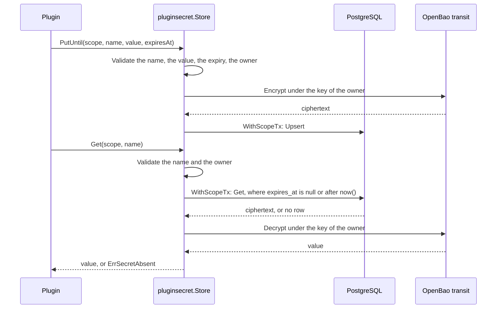

# Specification: The secrets that a plugin writes

## 1. Summary

The host gives a plugin a `pluginapi.SecretProvider`, and the plugin binds it to its
identifier with `pluginapi.NewPluginSecrets`. The hub stores each plugin secret in one
of two scoped tables, one for each scope, and protects the value with the transit key
of its owner that `PSET-DD-004` gives. Two jobs of the hub delete the expired rows every
hour, one for each user and one for each workspace. `ADR-0014` permits the second.
`spec-scenarios.md` holds the scenarios.

## 2. Coverage

| Requirement        | Where this specification realizes it                      |
| ------------------ | --------------------------------------------------------- |
| `PSECRET-FR-001`   | Section 4.1, `PSECRET-DD-001`, `PSECRET-SC-001`           |
| `PSECRET-FR-002`   | Section 4.1, `PSECRET-DD-001`, `PSECRET-SC-002`           |
| `PSECRET-FR-003`   | Section 4.4, `PSECRET-SC-001`                             |
| `PSECRET-FR-004`   | Section 4.5, `PSECRET-DD-004`, `PSECRET-SC-003`, `PSECRET-SC-004` |
| `PSECRET-FR-005`   | Section 4.2, `PSECRET-SC-005`                             |
| `PSECRET-FR-006`   | Section 4.4, `PSECRET-SC-001`                             |
| `PSECRET-FR-007`   | Section 4.1, `PSECRET-SC-006`, `PSECRET-SC-007`           |
| `PSECRET-FR-008`   | `PSECRET-DD-010`, `PSECRET-SC-008`                        |
| `PSECRET-FR-009`   | `PSECRET-DD-004`, `PSECRET-SC-008`, `PSECRET-SC-009`, `PSECRET-SC-010` |
| `PSECRET-FR-010`   | Section 4.3, `PSECRET-DD-005`, `PSECRET-SC-011`, `PSECRET-SC-012`, `PSECRET-SC-013` |
| `PSECRET-FR-011`   | Section 4.2, `PSECRET-SC-014`                             |
| `PSECRET-FR-012`   | `PSECRET-DD-006`, `PSECRET-SC-015`                        |
| `PSECRET-FR-013`   | `PSECRET-DD-006`, `PSECRET-SC-016`                        |
| `PSECRET-FR-014`   | `PSECRET-DD-008`, `PSECRET-SC-017`                        |
| `PSECRET-FR-015`   | `PSECRET-DD-008`, `PSECRET-SC-018`                        |
| `PSECRET-FR-016`   | `PSECRET-DD-003`, `PSECRET-SC-019`                        |
| `PSECRET-FR-017`   | `PSECRET-DD-003`, `PSECRET-SC-020`                        |
| `PSECRET-FR-018`   | Section 4.5, `PSECRET-SC-021`                             |
| `PSECRET-FR-019`   | Section 4.5, `PSECRET-SC-022`                             |
| `PSECRET-FR-020`   | `PSECRET-DD-009`, `PSECRET-SC-023`                        |
| `PSECRET-NFR-001`  | `PSECRET-SC-024`                                          |
| `PSECRET-INV-001`  | `PSECRET-DD-002`, `PSECRET-SC-025`                        |
| `PSECRET-INV-002`  | Section 4.2, `PSECRET-DD-001`, `PSECRET-SC-026`           |
| `PSECRET-INV-003`  | `PSECRET-DD-003`, `PSECRET-SC-019`                        |

## 3. Guideline compliance

| Rule      | Guideline        | How this specification obeys it                                                            |
| --------- | ---------------- | ------------------------------------------------------------------------------------------ |
| `PLG-007` | Plugin model     | A plugin reaches the store through `Host.Secrets`. Section 4.1.                           |
| `ARC-008` | Architecture     | The store holds no plugin identifier and no name of a plugin secret. Section 4.1.          |
| `OWN-004` | Record ownership | One table for each scope. Each migration states its scope. Section 4.2.                   |
| `OWN-005` | Record ownership | Each table takes its owner column from the session. No insert names it. Section 4.2.      |
| `OWN-006` | Record ownership | Each table forces its policy. Section 4.2.                                                |
| `OWN-007` | Record ownership | The store opens each transaction with `database.WithScopeTx`. Section 4.4.                |
| `OWN-008` | Record ownership | `repository.PluginSecret` writes no owner filter. Section 4.1.                            |
| `OWN-009` | Record ownership | `ADR-0014` changes the rule. The workspace job runs for every workspace. Section 4.3.     |
| `DAT-002` | Data             | The hub owns both tables in `public`. Section 4.2.                                        |
| `DAT-005` | Data             | Each migration has an up file and a down file. Section 4.2.                               |
| `DAT-009` | Data             | Each `id` declares `DEFAULT uuidv7()`. Section 4.2.                                       |
| `REP-003` | Repository       | The store builds `repository.PluginSecret` from the transaction. Section 4.4.             |
| `EXT-005` | External services| A failure of the transit engine is an error, never `ErrSecretAbsent`. Section 4.5.        |
| `LOG-008` | Logging          | No error and no log line holds a value. Section 4.5.                                      |
| `JOB-005` | Jobs             | Each sweep declares its identifier, schedule, and scope. Section 4.3.                    |
| `PKG-005` | Package layout   | `pluginsecret` names the glossary term `GLO-plugin-secret`. Section 4.1.                  |
| `GO-004`  | Go style         | Each error wraps its cause with `fmt.Errorf("doing the thing: %w", err)`.                |
| `BLD-004` | Build            | `Host` changes, so the build plan rebuilds and loads every plugin. Section 7.             |

## 4. Design

### 4.1 Components

| Path                                                                              | Action | Holds                                                                                          |
| --------------------------------------------------------------------------------- | ------ | ---------------------------------------------------------------------------------------------- |
| `libs/pluginapi/secret.go`                                                        | create | `SecretScope`, `SecretScopeUser`, `SecretScopeWorkspace`, `SecretProvider`, `PluginSecrets`, `NewPluginSecrets`, `ErrSecretAbsent`, `ErrSecretInvalid`, `ErrSecretScopeAbsent` |
| `libs/pluginapi/host.go`                                                          | change | `Host.Secrets`                                                                                 |
| `libs/pluginapi/cron.go`                                                          | change | The comment of `CronScopePerWorkspace` names the run of a job of the hub                       |
| `apps/hub/db/migrations/20261012100000_table_plugin_user_secrets_create.{up,down}.sql`      | create | `public.plugin_user_secrets`                                                  |
| `apps/hub/db/migrations/20261012100100_table_plugin_workspace_secrets_create.{up,down}.sql` | create | `public.plugin_workspace_secrets`                                             |
| `apps/hub/internal/model/plugin_secret.go`                                        | create | `PluginSecret`                                                                                 |
| `apps/hub/internal/repository/plugin_secret.go`                                   | create | `PluginSecretRepository`, `PluginSecret`, `NewPluginSecret`                                    |
| `apps/hub/internal/pluginsecret/{doc,store,validate,sweep}.go`                    | create | `Store`, `NewStore`, `Sweep`, `NewSweep`, `UserSweepJobID`, `WorkspaceSweepJobID`              |
| `apps/hub/internal/plugin/host/host.go`                                           | change | The `secrets` field, the `secrets` argument of `New`, `Host.Secrets`                           |
| `apps/hub/internal/depresolver/secret.go`                                         | change | `Container.PluginSecretStore`                                                                  |
| `apps/hub/internal/depresolver/resolver.go`                                       | change | The `pluginSecretStore` field of `Container`                                                   |
| `apps/hub/internal/depresolver/plugin.go`                                         | change | Passes `PluginSecretStore` to `pluginhost.New`                                                 |
| `apps/hub/internal/depresolver/cron.go`                                           | change | `coreCronJobs` adds the two sweeps                                                            |
| `apps/hub/internal/worker/cron.go`                                                | change | `WorkspaceLister.AllWorkspaces`. `Prepare` accepts a job of the hub for each workspace         |
| `apps/hub/internal/workspace/enablement.go`                                       | change | `Enablements.AllWorkspaces`                                                                    |
| `apps/hub/internal/repository/workspace.go`                                       | change | `Workspace.ListIDs`                                                                            |
| `apps/hub/internal/domain/errs/errs.go`                                           | change | Removes `ErrCronScopeWithoutPlugin`                                                            |

The contract in `libs/pluginapi/secret.go`:

```go
// SecretScope names the owner of a plugin secret.
type SecretScope string

const (
    SecretScopeUser      SecretScope = "user"
    SecretScopeWorkspace SecretScope = "workspace"
)

var (
    ErrSecretAbsent      = errors.New("plugin secret: absent")
    ErrSecretInvalid     = errors.New("plugin secret: invalid")
    ErrSecretScopeAbsent = errors.New("plugin secret: the unit of work carries no owner of the scope")
)

// SecretProvider reads and writes the plugin secrets of the acting user and of the
// acting workspace. The hub implements it, and Host hands it to a plugin.
type SecretProvider interface {
    ReadSecret(ctx context.Context, pluginID *PluginID, scope SecretScope, name string) (string, error)
    // A zero expiresAt stores the plugin secret with no expiry.
    WriteSecret(ctx context.Context, pluginID *PluginID, scope SecretScope, name, value string, expiresAt time.Time) error
    DeleteSecret(ctx context.Context, pluginID *PluginID, scope SecretScope, name string) error
}

// PluginSecrets binds a SecretProvider to one plugin.
type PluginSecrets struct { provider SecretProvider; pluginID *PluginID }

func NewPluginSecrets(provider SecretProvider, pluginID *PluginID) *PluginSecrets
func (s *PluginSecrets) Get(ctx context.Context, scope SecretScope, name string) (string, error)
func (s *PluginSecrets) Put(ctx context.Context, scope SecretScope, name, value string) error
func (s *PluginSecrets) PutUntil(ctx context.Context, scope SecretScope, name, value string, expiresAt time.Time) error
func (s *PluginSecrets) Delete(ctx context.Context, scope SecretScope, name string) error
```

`Host` gains `Secrets() (SecretProvider, error)`.

The repository in `apps/hub/internal/repository/plugin_secret.go`:

```go
type PluginSecretRepository interface {
    // Get returns nil when no row holds the name, or when the row expired.
    Get(ctx context.Context, scope pluginapi.SecretScope, pluginID, name string) (*model.PluginSecret, error)
    Upsert(ctx context.Context, scope pluginapi.SecretScope, pluginID, name, ciphertext string, expiresAt *time.Time) error
    Delete(ctx context.Context, scope pluginapi.SecretScope, pluginID, name string) error
    DeleteExpired(ctx context.Context, scope pluginapi.SecretScope) (int64, error)
}
```

`pluginsecret.Store` implements `pluginapi.SecretProvider` over `*sqlx.DB` and
`secret.Cipher`. `NewStore(db *sqlx.DB, cipher secret.Cipher) *Store`.
`pluginsecret.Sweep` implements `pluginapi.CronJob`.
`NewSweep(logger *slog.Logger, db *sqlx.DB, scope pluginapi.SecretScope) *Sweep`.

### 4.2 Data model

| Table                      | Schema   | Scope                | Migration                                                    | Realizes                           |
| -------------------------- | -------- | -------------------- | ------------------------------------------------------------ | ---------------------------------- |
| `plugin_user_secrets`      | `public` | scoped, to a user    | `20261012100000_table_plugin_user_secrets_create.up.sql`     | `PSECRET-FR-001`, `PSECRET-INV-002` |
| `plugin_workspace_secrets` | `public` | scoped, to a workspace | `20261012100100_table_plugin_workspace_secrets_create.up.sql` | `PSECRET-FR-002`, `PSECRET-INV-002` |

`plugin_user_secrets`:

| Column       | Type          | Constraint                                                                 |
| ------------ | ------------- | -------------------------------------------------------------------------- |
| `id`         | `UUID`        | `PRIMARY KEY DEFAULT uuidv7()`                                             |
| `user_id`    | `UUID`        | `NOT NULL`, the default and the reference of `OWN-005`                     |
| `plugin_id`  | `TEXT`        | `NOT NULL`                                                                 |
| `name`       | `TEXT`        | `NOT NULL`, `CHECK (name ~ '^[a-z0-9._-]{1,64}$')`                         |
| `ciphertext` | `TEXT`        | `NOT NULL`                                                                 |
| `expires_at` | `TIMESTAMPTZ` | Null for no expiry                                                         |
| `created_at` | `TIMESTAMPTZ` | `NOT NULL DEFAULT NOW()`                                                   |
| `updated_at` | `TIMESTAMPTZ` | `NOT NULL DEFAULT NOW()`, the trigger `set_updated_at`                    |

- `plugin_user_secrets_user_plugin_name_key UNIQUE (user_id, plugin_id, name)`.
  It realizes `PSECRET-FR-005`: `Upsert` writes `ON CONFLICT` on it, and replaces
  `ciphertext` and `expires_at`.
- `plugin_user_secrets_expires_at` on `(expires_at) WHERE expires_at IS NOT NULL`, for the sweep.
- The policy `plugin_user_secrets_user_isolation` of `OWN-006` on `user_id`, enabled and forced.
- The comment of `OWN-004`: a token of a personal account belongs to one person in every workspace.

`plugin_workspace_secrets` holds the same columns, with `workspace_id` in place of
`user_id`, the constraint `plugin_workspace_secrets_workspace_plugin_name_key`, the index
`plugin_workspace_secrets_expires_at`, and the policy
`plugin_workspace_secrets_workspace_isolation`.

No reference cascades. The hub deletes no user and no workspace (`OWN-002`, `OWN-010`).
A disable of a plugin deletes no row (`PSECRET-FR-011`).

### 4.3 Declarations

**Cron jobs.** `coreCronJobs` registers both. Each sweep runs `DeleteExpired` in one
transaction of `database.WithScopeTx`, and logs the count of the deleted rows when it
is above zero.

| Identifier                       | Schedule     | Runs in                          | Behavior                                    | Realizes         |
| -------------------------------- | ------------ | -------------------------------- | ------------------------------------------- | ---------------- |
| `plugin_user_secrets_sweep`      | `30 * * * *` | Each active user                 | Deletes each expired row of the acting user | `PSECRET-FR-010` |
| `plugin_workspace_secrets_sweep` | `45 * * * *` | Each workspace of the instance   | Deletes each expired row of the acting workspace | `PSECRET-FR-010` |

### 4.4 Flow



The store calls the transit engine outside the transaction, so no connection waits on a
call to OpenBao. `PSECRET-FR-006` holds because `Upsert` commits before `WriteSecret`
returns, and `Get` reads from a later transaction.

### 4.5 Errors

| Condition                                                   | Answer to the plugin                                     | Message                                           |
| ----------------------------------------------------------- | -------------------------------------------------------- | ------------------------------------------------- |
| The scope holds no row under the name, or the row expired   | `ErrSecretAbsent`                                        | `reading the plugin secret %q: %w`                |
| The name, the value, or the expiry fails `PSECRET-DD-006`   | `ErrSecretInvalid`                                       | Names the name and the rule. Never the value.     |
| The scope is not one of the two                             | `ErrSecretInvalid`                                       | Names the scope                                   |
| The unit of work carries no owner of the scope              | `ErrSecretScopeAbsent`                                   | Names the scope                                   |
| The transit engine fails or answers no data                 | An error that wraps `errs.ErrProtectionUnavailable` or the cause of `secret.Transit` | Names the key, never the value or the ciphertext |
| The database fails                                          | The wrapped error                                        | Names the operation, the scope, and the name      |

No error and no log line carries the value or the ciphertext (`PSECRET-FR-019`). The
sweep logs only its identifier and the count.

## 5. Design decisions

### `PSECRET-DD-001`

**Realizes:** `PSECRET-FR-001`, `PSECRET-FR-002`, `PSECRET-INV-002`
**Decision:** One table for each scope, as `PSET` does for its settings.
**Rationale:** `OWN-004` scopes a table to a workspace or to a user, never to both. Each
table carries one policy of `OWN-006`, so the isolation needs no new kind of policy.
**Alternatives:** One table with two nullable owner columns and two policies. It breaks
`OWN-004`, and a row with both columns null passes no policy and stays for ever.

### `PSECRET-DD-002`

**Realizes:** `PSECRET-INV-001`
**Decision:** The plugin binds the provider to its own identifier with
`NewPluginSecrets`, and each query of the repository filters on `plugin_id`.
**Rationale:** `pluginapi.NewPluginSettings` binds the settings in the same way. A plugin
runs in the process of the hub, so a binding that the hub made would stop no hostile
plugin. The filter stops a plugin that names its own identifier from reading a value
of another plugin.
**Alternatives:** A host for each plugin that the loader binds after `Meta`. It changes
the loader and the construction of every plugin for a protection that the process
cannot give.

### `PSECRET-DD-003`

**Realizes:** `PSECRET-FR-016`, `PSECRET-FR-017`, `PSECRET-INV-003`
**Decision:** The store encrypts each value with `secret.Cipher`, under
`secret.UserKey` of the acting user or `secret.WorkspaceKey` of the acting workspace.
**Rationale:** `PSET-DD-004` already gives one transit key to each owner. An
administrator who destroys one key makes the settings and the plugin secrets of that
owner unreadable with one action. The hub creates no key.
**Alternatives:** A key for each plugin secret. It needs a create permission at
OpenBao that `PSET-DD-004` refuses to the hub. The key value engine of OpenBao. A plugin
secret then spans two stores, and the policy of `OWN-006` no longer isolates it.

### `PSECRET-DD-004`

**Realizes:** `PSECRET-FR-004`, `PSECRET-FR-009`
**Decision:** `Get` of the repository returns no row when `expires_at` is not null and
not after `now()`. The store answers `ErrSecretAbsent` for no row.
**Rationale:** The clock of the database decides the expiry for the read and for the
sweep, so the two never disagree. A plugin tells absent from a failure with `errors.Is`.
**Alternatives:** Compare the expiry in Go after the read. Two clocks then decide one
state, and a skew of seconds makes the sweep and the read disagree.

### `PSECRET-DD-005`

**Realizes:** `PSECRET-FR-010`
**Decision:** Two jobs of the hub delete the expired rows at minute 30 and at minute 45
of every hour. The user job runs for each active user. The workspace job runs for each
workspace of the instance, which `ADR-0014` permits.
**Rationale:** An hourly run deletes a row no later than 1 hour and the length of one
run after its expiry, inside the 24 hours that the requirement gives. A run inside the
scope of its owner reaches each row through the forced policy, as the idempotency sweep does.
**Alternatives:** A delete in each read and each write of a scope. A scope that no unit of
work touches keeps its rows. A policy that lets a shared job delete across scopes.
`ADR-0014` lists why it lost.

### `PSECRET-DD-006`

**Realizes:** `PSECRET-FR-012`, `PSECRET-FR-013`, `PSECRET-FR-009`
**Decision:** `validate.go` checks the name against `^[a-z0-9._-]{1,64}$`, the value
against 1 to 16384 characters counted with `utf8.RuneCountInString`, and a non-zero
expiry against `time.Now()`. The migration repeats the name check in a constraint.
**Rationale:** The check runs before the call to the transit engine, so a rejected write
costs no call to OpenBao. The constraint stops a write that skips the store.
**Alternatives:** A check in the database alone. The value then reaches OpenBao before
the rejection.

### `PSECRET-DD-007`

**Realizes:** `PSECRET-FR-001`, `PSECRET-FR-002`
**Decision:** `Host` gains `Secrets`. `pluginapi.APIVersion` stays `v1`. The build plan
rebuilds every plugin and loads each one (`BLD-004`).
**Rationale:** The change adds a method and changes no existing one. `Host.Settings`
came the same way. The Go plugin loader refuses a plugin that an older `pluginapi`
built, so a stale plugin fails at the load and not in a run.
**Alternatives:** Raise the API version to `v2`. Every plugin changes one line for a
change that breaks none of them.

### `PSECRET-DD-008`

**Realizes:** `PSECRET-FR-014`, `PSECRET-FR-015`
**Decision:** The store answers `ErrSecretScopeAbsent` before it opens a transaction
when `pluginapi.ActingUserFromContext` or `pluginapi.ActingWorkspaceFromContext`
returns the empty string for the scope of the call.
**Rationale:** The policy shows no row to a session with no owner, and the read would
then answer `ErrSecretAbsent`. A plugin would ask the person to connect when the cause
is a defect in the entry point.
**Alternatives:** Let the policy decide. A read answers absent, and a write fails on the
`NOT NULL` of the owner column with an error of the database.

### `PSECRET-DD-009`

**Realizes:** `PSECRET-FR-020`
**Decision:** Only `depresolver` imports `pluginsecret`. No package of a route imports it.
**Rationale:** A route that cannot reach the store cannot return a value. A test of the
imports proves it, so a later change that adds such an import fails the build of the tests.
**Alternatives:** A review rule. Nothing fails when the review misses it.

### `PSECRET-DD-010`

**Realizes:** `PSECRET-FR-008`
**Decision:** `PluginSecrets.Put` stores no expiry and `PutUntil` stores the given one.
`SecretProvider.WriteSecret` reads a zero `time.Time` as no expiry.
**Rationale:** A call site states its intent in the name of the method, and a session
token never passes a zero time by accident.
**Alternatives:** A duration. A pending sign in of 5 minutes reads well, but "an expiry
in the past" then has no value to reject.

## 6. Scenarios

`spec-scenarios.md` holds `PSECRET-SC-001` to `PSECRET-SC-026`.

## 7. Build plan

| #   | Step                                                                                                   | Realizes                                         | Done |
| --- | ------------------------------------------------------------------------------------------------------ | ------------------------------------------------ | ---- |
| 1   | Accept `ADR-0014`. Write the new text of `OWN-009`. Mark the last paragraph of section 3 of `features/plugacc/spec-clients.md` as replaced. | `PSECRET-FR-010` | [x]  |
| 2   | `libs/pluginapi/secret.go`, `Host.Secrets`, the comment of `CronScopePerWorkspace`. Lint `libs/pluginapi`. | `PSECRET-FR-001` to `PSECRET-FR-008`, `PSECRET-INV-001` | [x]  |
| 3   | The two migrations                                                                                     | `PSECRET-FR-005`, `PSECRET-FR-012`, `PSECRET-INV-002` | [x]  |
| 4   | `model.PluginSecret` and `repository.PluginSecret`                                                     | `PSECRET-FR-003` to `PSECRET-FR-009`             | [x]  |
| 5   | `pluginsecret.Store` and `validate.go`                                                                 | `PSECRET-FR-001` to `PSECRET-FR-019`             | [x]  |
| 6   | `Host.Secrets` in the hub, `Container.PluginSecretStore`, the argument of `pluginhost.New`             | `PSECRET-FR-001`, `PSECRET-FR-020`               | [x]  |
| 7   | `Workspace.ListIDs`, `Enablements.AllWorkspaces`, the cron worker, the removal of `ErrCronScopeWithoutPlugin` | `PSECRET-FR-010`                          | [x]  |
| 8   | `pluginsecret.Sweep` and the two entries of `coreCronJobs`                                             | `PSECRET-FR-010`                                 | [x]  |
| 9   | The tests of `spec-scenarios.md`                                                                       | Every statement                                  | [x]  |
| 10  | Lint and build the hub. Build every plugin and load each one (`BLD-004`).                              | `PSECRET-DD-007`                                 | [ ]  |

Step 7 replaces the test that `worker/cron_test.go` holds for `ErrCronScopeWithoutPlugin`.
`ADR-0014` changes the rule that the test verified, so `TST-003` permits the change.

## Retired identifiers

This file has no retired identifier.
