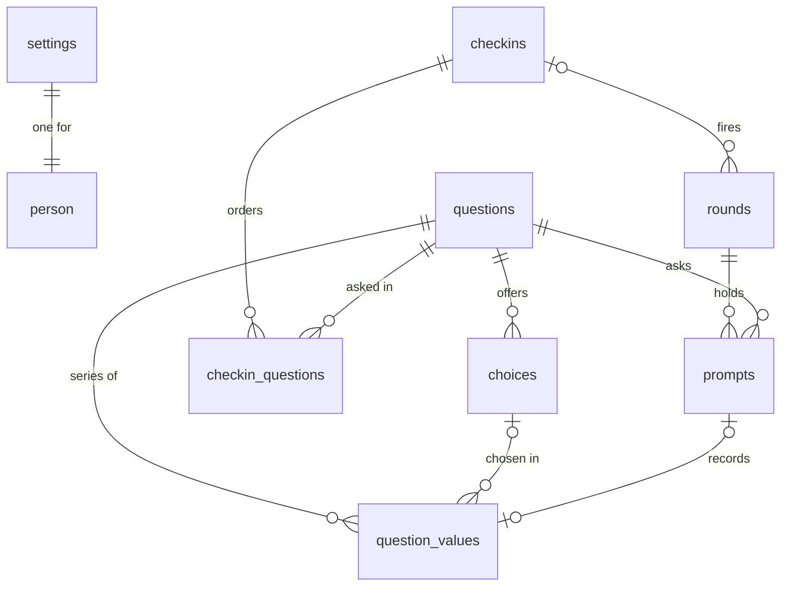

# Specification: The data model of pulse

`spec.md` holds the design. This file holds the tables of the schema `pulse`.

## 4.2 Data model

| Table               | Schema  | Scope  | Migration                                       | Realizes                                                           |
| ------------------- | ------- | ------ | ----------------------------------------------- | ------------------------------------------------------------------ |
| `settings`          | `pulse` | scoped | `20261124100000_table_settings_create`          | `PULSE-FR-001` to `PULSE-FR-003`                                   |
| `questions`         | `pulse` | scoped | `20261124100100_table_questions_create`         | `PULSE-FR-023` to `PULSE-FR-025`                                   |
| `choices`           | `pulse` | scoped | `20261124100200_table_choices_create`           | `PULSE-FR-026`                                                     |
| `checkins`          | `pulse` | scoped | `20261124100300_table_checkins_create`          | `PULSE-FR-005` to `PULSE-FR-008`, `PULSE-FR-027`                   |
| `checkin_questions` | `pulse` | scoped | `20261124100400_table_checkin_questions_create` | `PULSE-FR-027`, `PULSE-FR-028`                                     |
| `rounds`            | `pulse` | scoped | `20261124100500_table_rounds_create`            | `PULSE-FR-010` to `PULSE-FR-015`, `PULSE-INV-003`                  |
| `prompts`           | `pulse` | scoped | `20261124100600_table_prompts_create`           | `PULSE-FR-013` to `PULSE-FR-022`                                   |
| `question_values`   | `pulse` | scoped | `20261124100700_table_question_values_create`   | `PULSE-FR-030` to `PULSE-FR-034`, `PULSE-INV-002`, `PULSE-INV-004` |

Every table is scoped to a user, because each row belongs to one person in every
workspace (`OWN-004`, `PULSE-INV-001`). Each migration states that reason in a
comment, enables and forces row level security with the policy
`<table>_user_isolation` on `user_id` (`OWN-006`), and adds the trigger
`set_updated_at`. Each `user_id` is the column of `OWN-005`. A reference between two
tables names `user_id` too, so both rows belong to one person. Each unique key starts
with `user_id` (`OWN-005`). `<scope>` below stands
for that column.



```sql
CREATE TABLE settings
(
    id           UUID        NOT NULL PRIMARY KEY DEFAULT uuidv7(),
    <scope>,
    enabled      BOOLEAN     NOT NULL DEFAULT false,
    seeded_at    TIMESTAMPTZ,
    paused_until TIMESTAMPTZ,
    created_at   TIMESTAMPTZ NOT NULL DEFAULT now(),
    updated_at   TIMESTAMPTZ NOT NULL DEFAULT now(),
    CONSTRAINT settings_user_key UNIQUE (user_id)
);

CREATE TABLE questions
(
    id            UUID        NOT NULL PRIMARY KEY DEFAULT uuidv7(),
    <scope>,
    type          TEXT        NOT NULL
        CHECK (type IN ('scale', 'boolean', 'number', 'choice', 'text', 'location')),
    prompt        TEXT        NOT NULL CHECK (char_length(prompt) BETWEEN 1 AND 200),
    -- The type of the question decodes and validates it. PULSE-DD-018.
    config        JSONB       NOT NULL DEFAULT '{}' CHECK (jsonb_typeof(config) = 'object'),
    archived_at   TIMESTAMPTZ,
    created_at    TIMESTAMPTZ NOT NULL DEFAULT now(),
    updated_at    TIMESTAMPTZ NOT NULL DEFAULT now(),
    CONSTRAINT questions_user_id_key UNIQUE (user_id, id)
);

CREATE TABLE choices
(
    id          UUID        NOT NULL PRIMARY KEY DEFAULT uuidv7(),
    <scope>,
    question_id UUID        NOT NULL,
    position    SMALLINT    NOT NULL,
    label       TEXT        NOT NULL CHECK (char_length(label) BETWEEN 1 AND 32),
    created_at  TIMESTAMPTZ NOT NULL DEFAULT now(),
    updated_at  TIMESTAMPTZ NOT NULL DEFAULT now(),
    CONSTRAINT choices_user_id_key UNIQUE (user_id, id),
    -- A reorder swaps two positions inside one statement.
    CONSTRAINT choices_position_key UNIQUE (user_id, question_id, position)
        DEFERRABLE INITIALLY DEFERRED,
    CONSTRAINT choices_question_fkey FOREIGN KEY (user_id, question_id)
        REFERENCES questions (user_id, id) ON DELETE CASCADE
);

CREATE TABLE checkins
(
    id          UUID        NOT NULL PRIMARY KEY DEFAULT uuidv7(),
    <scope>,
    name        TEXT        NOT NULL CHECK (char_length(name) BETWEEN 1 AND 40),
    local_times TIME[]      NOT NULL CHECK (cardinality(local_times) BETWEEN 1 AND 6),
    -- ISO weekdays, 1 for Monday. An empty array is every day.
    weekdays    SMALLINT[]  NOT NULL DEFAULT '{}' CHECK (weekdays <@ '{1,2,3,4,5,6,7}'),
    enabled     BOOLEAN     NOT NULL DEFAULT true,
    fires_after TIMESTAMPTZ NOT NULL DEFAULT now(),
    created_at  TIMESTAMPTZ NOT NULL DEFAULT now(),
    updated_at  TIMESTAMPTZ NOT NULL DEFAULT now(),
    CONSTRAINT checkins_user_id_key UNIQUE (user_id, id)
);

CREATE TABLE checkin_questions
(
    <scope>,
    checkin_id  UUID        NOT NULL,
    question_id UUID        NOT NULL,
    position    SMALLINT    NOT NULL,
    created_at  TIMESTAMPTZ NOT NULL DEFAULT now(),
    updated_at  TIMESTAMPTZ NOT NULL DEFAULT now(),
    PRIMARY KEY (user_id, checkin_id, question_id),
    CONSTRAINT checkin_questions_position_key UNIQUE (user_id, checkin_id, position),
    CONSTRAINT checkin_questions_checkin_fkey FOREIGN KEY (user_id, checkin_id)
        REFERENCES checkins (user_id, id) ON DELETE CASCADE,
    CONSTRAINT checkin_questions_question_fkey FOREIGN KEY (user_id, question_id)
        REFERENCES questions (user_id, id) ON DELETE CASCADE
);

CREATE TABLE rounds
(
    id               UUID        NOT NULL PRIMARY KEY DEFAULT uuidv7(),
    <scope>,
    checkin_id       UUID,
    checkin_name     TEXT        NOT NULL,
    occurrence_at    TIMESTAMPTZ NOT NULL,
    state            TEXT        NOT NULL DEFAULT 'offered'
        CHECK (state IN ('offered', 'started', 'done', 'declined', 'expired')),
    start_message_id TEXT,
    created_at       TIMESTAMPTZ NOT NULL DEFAULT now(),
    updated_at       TIMESTAMPTZ NOT NULL DEFAULT now(),
    CONSTRAINT rounds_user_id_key UNIQUE (user_id, id),
    -- PULSE-INV-003: One occurrence fires at most one round.
    CONSTRAINT rounds_occurrence_key UNIQUE (user_id, checkin_id, occurrence_at),
    CONSTRAINT rounds_checkin_fkey FOREIGN KEY (user_id, checkin_id)
        REFERENCES checkins (user_id, id) ON DELETE SET NULL (checkin_id)
);

CREATE INDEX rounds_open_idx ON rounds (user_id, occurrence_at)
    WHERE state IN ('offered', 'started');
CREATE UNIQUE INDEX rounds_start_message_idx ON rounds (user_id, start_message_id);

CREATE TABLE prompts
(
    id          UUID        NOT NULL PRIMARY KEY DEFAULT uuidv7(),
    <scope>,
    round_id    UUID        NOT NULL,
    question_id UUID        NOT NULL,
    position    SMALLINT    NOT NULL,
    state       TEXT        NOT NULL DEFAULT 'pending'
        CHECK (state IN ('pending', 'waiting', 'answered', 'skipped', 'expired')),
    message_id  TEXT,
    created_at  TIMESTAMPTZ NOT NULL DEFAULT now(),
    updated_at  TIMESTAMPTZ NOT NULL DEFAULT now(),
    CONSTRAINT prompts_user_id_key UNIQUE (user_id, id),
    CONSTRAINT prompts_position_key UNIQUE (user_id, round_id, position),
    CONSTRAINT prompts_round_fkey FOREIGN KEY (user_id, round_id)
        REFERENCES rounds (user_id, id) ON DELETE CASCADE,
    CONSTRAINT prompts_question_fkey FOREIGN KEY (user_id, question_id)
        REFERENCES questions (user_id, id) ON DELETE CASCADE
);

CREATE UNIQUE INDEX prompts_message_idx ON prompts (user_id, message_id);

CREATE TABLE question_values
(
    id            UUID             NOT NULL PRIMARY KEY DEFAULT uuidv7(),
    <scope>,
    question_id   UUID             NOT NULL,
    type          TEXT             NOT NULL,
    occurred_at   TIMESTAMPTZ      NOT NULL,
    answered_at   TIMESTAMPTZ      NOT NULL,
    source        TEXT             NOT NULL CHECK (source ~ '^[a-z][a-z0-9_]{0,31}$'),
    prompt_id     UUID,
    number_value  NUMERIC,
    boolean_value BOOLEAN,
    choice_id     UUID,
    text_value    TEXT CHECK (char_length(text_value) BETWEEN 1 AND 1000),
    latitude      DOUBLE PRECISION CHECK (latitude BETWEEN -90 AND 90),
    longitude     DOUBLE PRECISION CHECK (longitude BETWEEN -180 AND 180),
    created_at    TIMESTAMPTZ      NOT NULL DEFAULT now(),
    updated_at    TIMESTAMPTZ      NOT NULL DEFAULT now(),
    -- PULSE-FR-025: A question with a value is never deleted.
    CONSTRAINT question_values_question_fkey FOREIGN KEY (user_id, question_id)
        REFERENCES questions (user_id, id) ON DELETE RESTRICT,
    -- PULSE-FR-026: A choice that a value records is never removed.
    CONSTRAINT question_values_choice_fkey FOREIGN KEY (user_id, choice_id)
        REFERENCES choices (user_id, id) ON DELETE RESTRICT,
    -- PULSE-INV-002: One question of one round holds at most one value.
    CONSTRAINT question_values_prompt_key UNIQUE (user_id, prompt_id),
    CONSTRAINT question_values_prompt_fkey FOREIGN KEY (user_id, prompt_id)
        REFERENCES prompts (user_id, id) ON DELETE SET NULL (prompt_id),
    -- The type chooses the one column that holds the value.
    CONSTRAINT question_values_shape_check CHECK (
        (type IN ('scale', 'number') AND number_value IS NOT NULL
            AND num_nulls(boolean_value, choice_id, text_value, latitude, longitude) = 5)
        OR (type = 'boolean' AND boolean_value IS NOT NULL
            AND num_nulls(number_value, choice_id, text_value, latitude, longitude) = 5)
        OR (type = 'choice' AND choice_id IS NOT NULL
            AND num_nulls(number_value, boolean_value, text_value, latitude, longitude) = 5)
        OR (type = 'text' AND text_value IS NOT NULL
            AND num_nulls(number_value, boolean_value, choice_id, latitude, longitude) = 5)
        OR (type = 'location' AND num_nonnulls(latitude, longitude) = 2
            AND num_nulls(number_value, boolean_value, choice_id, text_value) = 4))
);

CREATE INDEX question_values_series_idx
    ON question_values (user_id, question_id, occurred_at DESC, id DESC);
CREATE INDEX question_values_choice_idx ON question_values (user_id, choice_id)
    WHERE choice_id IS NOT NULL;

-- PULSE-INV-004: A value keeps its question and its type.
CREATE TRIGGER question_values_frozen
    BEFORE UPDATE OF question_id, type ON question_values
    FOR EACH ROW
EXECUTE FUNCTION pulse_refuse_change();
```

`pulse_refuse_change()` raises `check_violation` when `NEW.question_id <>
OLD.question_id` or `NEW.type <> OLD.type`. The migration of `question_values`
creates it.

### The config of each type

`model.ScaleConfig` and `model.NumberConfig` decode `questions.config`, and
`Validate` checks it on each write. A violation answers 422 at
`/config/<member>`.

| Type                      | `config`                                  | Limits                                                                                      |
| ------------------------- | ----------------------------------------- | ------------------------------------------------------------------------------------------- |
| scale                     | `min`, `max`, `low_label`, `high_label`   | `min` and `max` whole, `max - min` from 1 to 9. A label holds 1 to 24 characters.           |
| number                    | `min`, `max`, `unit`, `quick_values`      | `min < max`. `unit` holds 1 to 16 characters. At most 8 distinct quick values, each inside. |
| choice                    | `{}` in the column, `choices` on the wire | 2 to 12 choices, each a row of `choices`. A label holds 1 to 32 characters.                 |
| yes or no, text, location | `{}`                                      | none                                                                                        |

A type other than choice holds no row of `choices`. A change of the type replaces the
config and deletes the choices, which only a question with no value allows
(`PULSE-FR-024`).

### The defaults

`catalog.Defaults` holds the check-ins of `PULSE-FR-029` and these questions. The
short name only links a check-in of the catalog to its questions, and no column
stores it. `catalog.Seed` inserts them in the transaction of the first turn-on
(`PULSE-DD-001`).

| Name             | Type     | Prompt                           | Unit   | Limits  | Labels           | Quick values |
| ---------------- | -------- | -------------------------------- | ------ | ------- | ---------------- | ------------ |
| `mood`           | scale    | How is your mood?                |        | 1, 5    | bad, great       |              |
| `sleep_hours`    | number   | How many hours did you sleep?    | h      | 0, 24   |                  | 6, 7, 8, 9   |
| `sleep_quality`  | scale    | How well did you sleep?          |        | 1, 5    | badly, very well |              |
| `weight`         | number   | Weight                           | kg     | 30, 250 |                  |              |
| `energy`         | scale    | How is your energy?              |        | 1, 5    | drained, full    |              |
| `alcohol_drinks` | number   | How many alcoholic drinks today? | drinks | 0, 30   |                  | 0, 1, 2, 3   |
| `exercised`      | boolean  | Did you exercise today?          |        |         |                  |              |
| `meditated`      | boolean  | Did you meditate today?          |        |         |                  |              |
| `main_thing`     | text     | The main thing today?            |        |         |                  |              |
| `location`       | location | Where are you?                   |        |         |                  |              |
| `week_rating`    | scale    | How was your week?               |        | 1, 5    | bad, great       |              |
| `week_note`      | text     | A note on the week?              |        |         |                  |              |

## 5. Design decisions

### `PULSE-DD-012`

**Realizes:** `PULSE-FR-028`, `PULSE-FR-030`, `PULSE-INV-004`
**Decision:** A value references its question by UUID, with `ON DELETE RESTRICT`,
and copies its type. One typed column holds the value, and a check ties the column to
the type. Pulse never updates a value.
**Rationale:** The question is the series, so the mood of four check-ins is one
series. An archived question keeps its values. The foreign key refuses the delete of
a question with values, with no read first. A later importer picks or creates a
question before it writes.
**Alternatives:** A metric name on each value: a second name that the person keeps
unique, a format rule, and a conflict for a taken name. One `JSONB` column: a chart
reads it with a cast, and nothing checks the shape.

### `PULSE-DD-013`

**Realizes:** `PULSE-FR-026`
**Decision:** A choice is a row of `choices` with a UUID. A value of a choice
references it in `choice_id`, with `ON DELETE RESTRICT`. The button value is
`c:<choice id>`, 38 bytes, within the 64 bytes of `message.ButtonValueMax`. A change
of a question names each kept choice by its `id`. A choice with no `id` is new, and a
choice left out is deleted.
**Rationale:** A label edit keeps the series whole. The foreign key refuses the
removal of a choice that a value records, with no read first. Each row gets its
identifier from `DAT-009`.
**Alternatives:** A key that the person types, in a `JSONB` array: a name to invent,
and no foreign key guards it. The label as the value: a rename splits the history.

### `PULSE-DD-014`

**Realizes:** `PULSE-FR-024`, `PULSE-FR-025`, `PULSE-FR-026`
**Decision:** A change of the type is one `UPDATE` with `NOT EXISTS` on a value of
the question. No row affected while the question exists answers 409
`question-has-values`. A delete relies on the foreign keys: a violation of
`question_values_question_fkey` answers 409 `question-has-values`, and of
`question_values_choice_fkey` answers 409 `choice-in-use`.
**Rationale:** One statement holds no race with a round that records the first value.
**Alternatives:** A count, then the write: a round records a value between the two.

### `PULSE-DD-018`

**Realizes:** `PULSE-FR-023`, `PULSE-FR-026`
**Decision:** `questions.config` is one `JSONB` object with the members of the type.
The Go type of each question type decodes it and validates it on each write. The
column checks only that it holds an object. The API mirrors it in `config`, with one
schema for each type, and shows the choices of a choice in `config.choices`, though
the table `choices` stores them.
**Rationale:** Only pulse reads these members: the markup, the parse of a reply, and
the deck form. No query filters or groups by them, so a column for each buys nothing.
A schema for each type tells a client which members a type takes.
**Alternatives:** A column for each member: six columns that most types leave null,
and a check for each type. The choices inside `config`: no foreign key from a value
to its choice.

## Retired identifiers

This file has no retired identifier.
