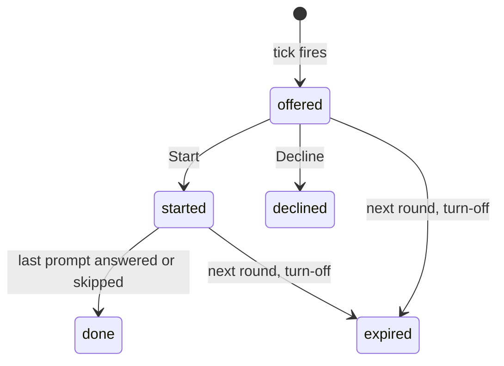

# Specification: The round on Telegram

`spec.md` holds the design. This file holds the states of a round, its messages, and
the handling of a press and a reply. Every message goes through `message.Messenger`
(`TGMSG`).

## 4.4 Flow

### The states

A prompt is `pending` until its turn, `waiting` while its message stands, then
`answered`, `skipped`, or `expired`. One prompt of a round waits at a time.

### The messages

| Moment           | Text                                           | Markup                                        | Realizes       |
| ---------------- | ---------------------------------------------- | --------------------------------------------- | -------------- |
| Start prompt     | `Evening check-in, 7 questions.`               | Start `start`, Decline `decline`              | `PULSE-FR-011` |
| Started          | `Evening check-in, 7 questions. Started.`      | none                                          | `PULSE-FR-013` |
| Declined         | `Evening check-in: declined.`                  | none                                          | `PULSE-FR-012` |
| Done             | `Evening check-in: done.`                      | none                                          | `PULSE-FR-015` |
| Expired          | `Evening check-in: expired.`                   | none                                          | `PULSE-FR-010` |
| Scale            | `How is your mood? (1 bad, 5 great)`           | one row `v:1` to `v:5`, then Skip `skip`      | `PULSE-FR-017` |
| Yes or no        | `Did you exercise today?`                      | Yes `y`, No `n`, then Skip                    | `PULSE-FR-017` |
| Choice           | `What did you drink?`                          | two choices a row, `c:<choice id>`, then Skip | `PULSE-FR-017` |
| Number           | `Weight (kg)`                                  | quick values `v:<n>`, then Skip, a claim      | `PULSE-FR-018` |
| Text             | `The main thing today?`                        | Skip, a claim                                 | `PULSE-FR-019` |
| Location         | `Where are you?`                               | keyboard: Send location, Skip; a claim        | `PULSE-FR-020` |
| Answered         | `How is your mood? 4`, `Weight (kg) 72.5`      | none                                          | `PULSE-FR-014` |
| Skipped          | `How is your mood? skipped`                    | none                                          | `PULSE-FR-016` |
| Expired question | `How is your mood? expired`                    | none                                          | `PULSE-FR-010` |
| Retry, number    | `Send a number from 30 to 250, or press Skip.` | none                                          | `PULSE-FR-018` |
| Retry, text      | `Send at most 1000 characters, or press Skip.` | none                                          | `PULSE-FR-019` |
| Retry, location  | `Share a location, or press Skip.`             | none                                          | `PULSE-FR-020` |
| After a location | `Location saved.` or `Skipped.`                | remove the keyboard                           | `PULSE-FR-020` |
| Location expired | `The location question expired.`               | remove the keyboard                           | `PULSE-FR-010` |
| Closed, a notice | `This check-in is closed.`                     | the answer of the press                       | `PULSE-FR-021` |

A check-in with one question reads `1 question`. A scale with no label shows no
parentheses. A number shows its unit in parentheses. A scale of more than 5 values
takes two rows. A number prints with no trailing zero, `72.5`, `8`.

### A press

`telegram.Receiver.OnTelegramPress(ctx, press)` finds the round by
`start_message_id` or the prompt by `message_id`. No row: the notice
`This check-in is closed.` (`PULSE-FR-021`).

- `start` on an offered round: the round becomes started, the first prompt waiting.
  Edit the start prompt to "Started", then send the first question.
- `decline` on an offered round: the round becomes declined. Edit the start prompt.
- `v:<n>`, `y`, `n`, `c:<choice id>`, or `skip` on a waiting prompt of a started round: in
  one transaction, the prompt becomes answered or skipped, an answer inserts its
  value, and the next pending prompt becomes waiting, or the round becomes done.
  After the commit: edit the question, release its claim, then send the next question
  or edit the start prompt to "done".
- Anything else: the notice `This check-in is closed.`

Each change of state is one `UPDATE ... WHERE state = <expected> RETURNING`. No row
returned means another press or a tick won, and the press gets the closed notice
(`PULSE-DD-009`).

### A reply

`OnTelegramReply(ctx, reply)` finds the prompt by `reply.Message`. It parses by type:

| Type     | Accepts                                                                          | Else                   |
| -------- | -------------------------------------------------------------------------------- | ---------------------- |
| number   | `^-?[0-9]+([.,][0-9]+)?$`, from `config.min` to `config.max`, at most 6 decimals | retry, the claim stays |
| text     | 1 to 1000 characters after trim. "Skip" is a text here.                          | retry, the claim stays |
| location | `reply.Location`, or the text `Skip` from the keyboard                           | retry, the claim stays |

An accepted reply runs the step of a press with that value. A reply on a prompt that
no longer waits releases the claim and gets no message.

### The expiry

`round.Service.Expire(ctx, rounds)` runs after the commit that marked the rounds
expired. For each round it edits the start prompt to "expired". For each prompt that
waited it edits the question to "expired" and releases the claim. A location prompt
that waited sends `The location question expired.` to remove the keyboard. A failure
of an edit or a release is logged with the round, and the expiry goes on.

### The claim

A number, text, or location question sends with `ClaimReplyUntil` of now plus 29
days, inside `message.Lifetime`. An answer, a skip, and an expiry release it. A round
that never expires keeps its question for 29 days at most.

## 5. Design decisions

### `PULSE-DD-008`

**Realizes:** `PULSE-FR-011` to `PULSE-FR-017`
**Decision:** A round keeps `message.ID` of its start prompt, and a prompt keeps the
one of its question. A button value names only the action: `start`, `decline`,
`skip`, `y`, `n`, `v:<n>`, `c:<choice id>`.
**Rationale:** `TGMSG` gives the press with its `message.ID`, so the row comes from a
unique index. The longest value, `c:<choice id>`, holds 38 of the 64 bytes, and a forged
value reaches only a row of the acting user.
**Alternatives:** The prompt identifier in each value: a choice then needs 76 bytes,
over the limit of 64.

### `PULSE-DD-009`

**Realizes:** `PULSE-FR-021`, `PULSE-INV-002`
**Decision:** Each step is a conditional update on the expected state, in the
transaction that inserts the value. The unique key on `prompt_id` backs it.
**Rationale:** A double tap and a tick that expires the round race. The first update
wins, and the second press reads the closed notice.
**Alternatives:** A lock on the round: the same result with a longer hold.

### `PULSE-DD-010`

**Realizes:** `PULSE-FR-018` to `PULSE-FR-020`, `PULSE-FR-022`
**Decision:** Only a number, a text, or a location question claims a reply. A scale,
a yes or no, and a choice take a button alone.
**Rationale:** `TG-008` sends a plain message to the oldest open claim. A question
with buttons claims nothing, so a stray message of the person reaches the rest of the
bot.
**Alternatives:** Every question claims: "4" typed on a scale would count, and a
message for another plugin would answer a mood.

### `PULSE-DD-011`

**Realizes:** `PULSE-FR-020`
**Decision:** A location question shows a reply keyboard, and the answer, the skip,
and the expiry each send one short message that removes it.
**Rationale:** Telegram removes a reply keyboard only with a new message, and a
message holds one markup (`TGMSG-DD-001`), so the next question cannot carry the
removal and its buttons both.
**Alternatives:** A location question last in each check-in, with the removal on the
done edit: an edit cannot remove a reply keyboard.

## Retired identifiers

This file has no retired identifier.
