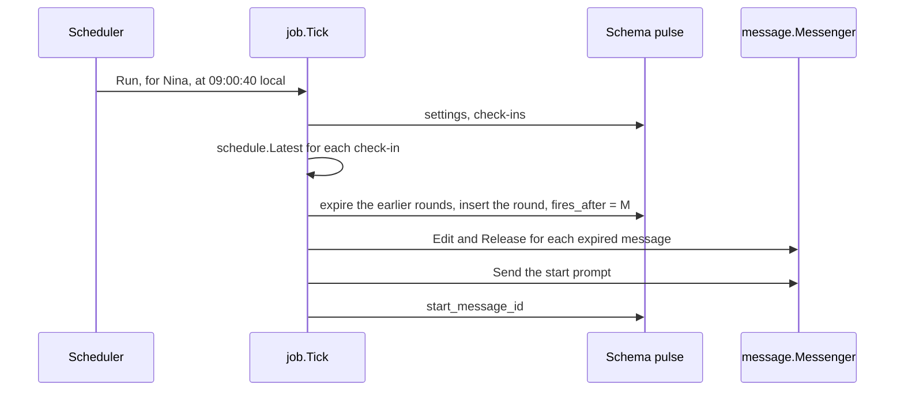

# Specification: The schedule of pulse

`spec.md` holds the design. This file holds the tick, the time math, the turn-on, and
the pause.

## 4.4 Flow

### The turn-on, the turn-off, and the pause

`settings.Service.Put(ctx, enabled, pausedUntil)` runs in one transaction:

1. With no row, insert one. `enabled` false to true with `seeded_at` null runs
   `catalog.Seed` and sets `seeded_at` (`PULSE-FR-001`).
2. `enabled` false to true sets `fires_after = now()` on every check-in of the person
   (`PULSE-FR-008`).
3. `enabled` true to false collects the open rounds for the expiry of the round flow
   (`PULSE-FR-002`), after the commit.

`/pause <arg>` takes `YYYY-MM-DD`, the start of that day in the zone of the person, or
a duration `<n>d` or `<n>h`, with `n` from 1 to 366 days or 1 to 8784 hours. The
moment must lie in the future and at most 366 days ahead. `/resume` and a `PUT` with
`paused_until` null clear it (`PULSE-FR-003`).

### The tick

The job `tick` runs every minute for each active user (`OWN-009`). `job.Tick.Run`:

1. Read `settings`. No row or `enabled` false: return. No other read and no write
   (`PULSE-NFR-002`). The turn-on seeds in its own transaction, so `enabled` implies
   the defaults.
2. Read the enabled check-ins that hold at least one question that is not archived.
3. For each, `schedule.Latest(checkin, zone, floor, now)` answers the latest
   occurrence in the window, where `floor = max(fires_after, paused_until, now - 60m)`
   (`PULSE-FR-006`, `PULSE-FR-007`, `PULSE-FR-003`). The zone is
   `pluginapi.ActingTimeZone(ctx)`.
4. Let `M` be the latest occurrence of all. Every check-in whose occurrence equals `M`
   fires, ordered by name. Every other check-in with an occurrence sets
   `fires_after` to its occurrence and does not fire (`PULSE-FR-006`).
5. In one transaction: mark each offered or started round with `occurrence_at < M`
   expired, with its waiting and pending prompts; insert each new round with
   `ON CONFLICT ON CONSTRAINT rounds_occurrence_key DO NOTHING`, and its prompts in
   the order of the check-in, each `pending`; set `fires_after = M` on each fired
   check-in.
6. After the commit, run the expiry of the round flow for the expired rounds, then
   send the start prompt of each inserted round, and store `start_message_id`.

A send that answers `message.ErrUnreachable` or `message.ErrNoAccount` marks the round
expired and logs a warning with the user and the round. Any other error stays on the
round as offered with no message, and the job answers it (`JOB-007`).

### The time math

`schedule.Latest` walks the local dates from the date of `now` back to the date of
`floor`, at most 2 dates in practice. For each date whose ISO weekday the check-in
holds, or every date when it holds none, it resolves each local time with
`schedule.Resolve(date, clock, zone)`, and keeps the latest moment `m` with
`floor < m <= now`.

`schedule.Resolve` builds `time.Date` in the zone and compares the wall clock:

- Equal, and one hour earlier shows the same wall clock: a repeated hour. It answers
  the earlier moment, and `fires_after` keeps the later one from firing
  (`PULSE-FR-009`).
- Not equal: a skipped hour. It answers the wall clock read as UTC, less the offset
  one day before, so the moment moves forward by the length of the gap
  (`PULSE-FR-009`).
- Otherwise it answers the moment of `time.Date`.

`time.Date` picks either moment of a repeated hour, so `Resolve` never relies on its
choice.

A change of the time zone of a person needs no write. The next tick reads the new
zone, and the next local time after `fires_after` fires (`PULSE-FR-005`).

## 5. Design decisions

### `PULSE-DD-003`

**Realizes:** `PULSE-FR-005`, `PULSE-NFR-001`, `PULSE-NFR-002`
**Decision:** One job for each user every minute, `* * * * *`, reads the check-ins of
the person and decides. The schedule of a check-in lives in its row, not in the
scheduler.
**Rationale:** `CronJobMeta.Schedule` is static, and each person holds their own
times in their own zone. A job every minute gives an occurrence at most 60 seconds of
delay plus the run. A person who never turned pulse on costs one indexed read.
**Alternatives:** A job for each check-in: the registry holds a static list. A shared
job over every person: `OWN-009` gives a shared job no table that a user scopes.

### `PULSE-DD-004`

**Realizes:** `PULSE-FR-006`, `PULSE-FR-008`, `PULSE-INV-003`
**Decision:** `fires_after` is the one mark of a check-in. A fire, a skip, a turn-on,
and a change of times or of the flag set it. An occurrence fires only after it.
**Rationale:** One column answers "fired already", "skipped", and "created after this
time". A restart reads it from the database (`PLG-009`).
**Alternatives:** A list of fired occurrences: a row for each minute that only a
comparison needs.

### `PULSE-DD-005`

**Realizes:** `PULSE-FR-006`, `PULSE-FR-007`
**Decision:** The window of an occurrence is 60 minutes. Only the latest occurrence
inside it fires, with each check-in due at that same minute.
**Rationale:** `JOB-006` skips a minute while a slow run holds the job, and the window
absorbs it. An answer about a morning that arrives at noon misleads the series.
**Alternatives:** No window: a hub that starts at noon asks "How did you sleep?". A
window of 15 minutes: one slow deploy loses a check-in.

### `PULSE-DD-006`

**Realizes:** `PULSE-FR-009`
**Decision:** A skipped local time moves forward by the length of the gap. A
repeated local time fires at its first moment.
**Rationale:** `toMoment` of `@maroid/plugin-sdk` reads a local time the same way, so
the deck and the schedule give one local time one moment.
**Alternatives:** The first minute after the gap: 02:30 fires at 03:00, and the deck
shows 03:30 for the same input. Skip the occurrence: a check-in at 02:30 misses a day
each spring.

### `PULSE-DD-007`

**Realizes:** `PULSE-INV-003`, `PULSE-FR-010`
**Decision:** The round row and `fires_after` commit before the send. A unique key on
the check-in and the occurrence refuses a second round. A process that stops between
the commit and the send leaves one round with no message.
**Rationale:** At most one message for each occurrence is the promise. A lost start
prompt costs one check-in. A second prompt costs trust.
**Alternatives:** Send first, then insert: a failed insert sends the prompt again at
the next minute.

## Retired identifiers

This file has no retired identifier.
