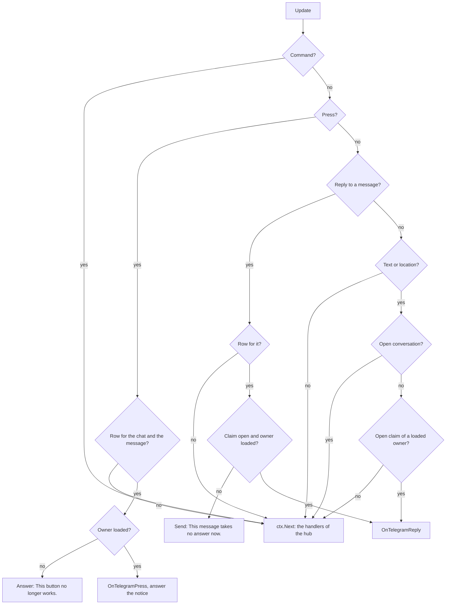

# Specification: The Telegram messages of a plugin

## 1. Summary

The host gives each plugin a `message.Messenger`. It sends a plugin message to the
acting user, changes it, and releases its reply claim. The hub records each plugin
message in `public.telegram_messages`. A middleware of the bot routes a press and a
claimed reply back to the plugin that sent the message, in the order of `TG-008`.

## 2. Coverage

| Requirement     | Where this specification realizes it                        |
| --------------- | ----------------------------------------------------------- |
| `TGMSG-FR-001`  | Section 4.4, `TGMSG-DD-002`, `TGMSG-SC-001`, `TGMSG-SC-002` |
| `TGMSG-FR-002`  | Section 4.5, `TGMSG-SC-003`                                 |
| `TGMSG-FR-003`  | `TGMSG-DD-002`, `TGMSG-SC-004`                              |
| `TGMSG-FR-004`  | `TGMSG-DD-009`, `TGMSG-SC-005`                              |
| `TGMSG-FR-005`  | `TGMSG-DD-001`, `TGMSG-SC-006`                              |
| `TGMSG-FR-006`  | `TGMSG-DD-001`, `TGMSG-SC-006`                              |
| `TGMSG-FR-007`  | `TGMSG-DD-001`, `TGMSG-SC-006`                              |
| `TGMSG-FR-008`  | Section 4.5, `TGMSG-SC-007`                                 |
| `TGMSG-FR-009`  | `TGMSG-DD-003`, `TGMSG-SC-008`                              |
| `TGMSG-FR-010`  | `TGMSG-DD-005`, `TGMSG-SC-009`                              |
| `TGMSG-FR-011`  | `TGMSG-DD-006`, `TGMSG-SC-010`                              |
| `TGMSG-FR-012`  | `TGMSG-DD-006`, `TGMSG-SC-011`                              |
| `TGMSG-FR-013`  | `TGMSG-DD-007`, `TGMSG-SC-007`, `TGMSG-SC-013`              |
| `TGMSG-FR-014`  | `TGMSG-DD-007`, `TGMSG-SC-014`                              |
| `TGMSG-FR-015`  | `TGMSG-DD-005`, `TGMSG-SC-013`                              |
| `TGMSG-FR-016`  | `TGMSG-DD-005`, `TGMSG-SC-014`                              |
| `TGMSG-FR-017`  | `TGMSG-DD-005`, `TGMSG-SC-015`                              |
| `TGMSG-FR-018`  | `TGMSG-DD-005`, `TGMSG-SC-016`                              |
| `TGMSG-FR-019`  | `TGMSG-DD-005`, `TGMSG-SC-017`                              |
| `TGMSG-FR-020`  | `TGMSG-DD-008`, `TGMSG-SC-009`                              |
| `TGMSG-FR-021`  | `TGMSG-DD-010`, `TGMSG-SC-020`                              |
| `TGMSG-INV-001` | `TGMSG-DD-001`, `TGMSG-DD-002`, `TGMSG-SC-001`              |
| `TGMSG-INV-002` | Section 4.2, `TGMSG-SC-008`, `TGMSG-SC-012`                 |
| `TGMSG-INV-003` | `TGMSG-DD-007`, `TGMSG-SC-018`                              |

## 3. Guideline compliance

| Rule      | Guideline    | How this specification obeys it                                                                    |
| --------- | ------------ | -------------------------------------------------------------------------------------------------- |
| `TG-006`  | Telegram     | A claim is a column of `public.telegram_messages`. The conversation store stays in memory.         |
| `TG-007`  | Telegram     | `TelegramBot` stays as it is. `message.Messenger` is the second service. `TGMSG-DD-001`.           |
| `TG-008`  | Telegram     | The middleware of section 4.4 follows the order. `TGMSG-DD-005`.                                   |
| `OWN-003` | Ownership    | The middleware clears the acting workspace before it calls a plugin. `TGMSG-DD-008`.               |
| `OWN-004` | Ownership    | `public.telegram_messages` is scoped to a user.                                                    |
| `OWN-006` | Ownership    | The table forces row level security. Section 4.2.                                                  |
| `OWN-008` | Ownership    | The repository names no `user_id`. The default and the policy set and filter it.                   |
| `PLG-006` | Plugin model | `TelegramMessagePlugin`, `TelegramMessageRegistry`, `TelegramMessageRegistrar`.                    |
| `PLG-007` | Plugin model | `Host.TelegramMessenger()`. The plugin imports nothing from `apps/hub`.                            |
| `ARC-008` | Architecture | The routing reads the owner from the record. No branch names a plugin.                             |
| `DAT-009` | Data         | `id` is `DEFAULT uuidv7()`. The insert names no `id`.                                              |
| `DAT-010` | Data         | `claim_until`, `created_at`, and `updated_at` are `TIMESTAMPTZ`.                                   |
| `LOG-007` | Logging      | A record names the event. The text, the value, and the location of a person stay out. Section 4.5. |
| `BLD-004` | Build        | `libs/pluginapi` changes, so every plugin builds again.                                            |

## 4. Design

### 4.1 Components

| Path                                                                          | Change | Holds                                                                                 |
| ----------------------------------------------------------------------------- | ------ | ------------------------------------------------------------------------------------- |
| `libs/pluginapi/telegram/message/message.go`                                  | create | The types, `Messenger`, the errors, and the limits of section 4.3                     |
| `libs/pluginapi/telegram.go`                                                  | change | `TelegramMessagePlugin`, beside the other capabilities of Telegram                    |
| `libs/pluginapi/host.go`                                                      | change | `Host.TelegramMessenger() (message.Messenger, error)`                                 |
| `apps/hub/db/migrations/<ts>_table_telegram_messages_create`                  | create | The table of section 4.2                                                              |
| `apps/hub/internal/model/telegram_message.go`                                 | create | `TelegramMessage`, the row                                                            |
| `apps/hub/internal/repository/telegram_message.go`                            | create | `Insert`, `ByTelegram`, `ByID`, `OpenClaims`, `Release`, `Purge`                      |
| `apps/hub/internal/telegram/pluginmsg/service.go`                             | create | `Service.Send`, `Edit`, `Release` for one plugin identifier. `TGMSG-DD-002`, `DD-009` |
| `apps/hub/internal/telegram/pluginmsg/markup.go`                              | create | `Validate`, and the markup of telego for a `message.Message`. `TGMSG-DD-001`          |
| `apps/hub/internal/telegram/pluginmsg/router.go`                              | create | `Router`, the middleware of the bot. `TGMSG-DD-005`, `DD-006`, `DD-008`               |
| `apps/hub/internal/telegram/telegramtest/api.go`                              | create | A fake of the Bot API for tests. `TGMSG-DD-011`                                       |
| `apps/hub/internal/telegram/conversation/engine.go`                           | change | `Holds(telegramUserID string) bool`                                                   |
| `apps/hub/internal/telegram/handler.go`                                       | change | `Router` after `ActingWorkspace`. The last handler answers an orphan press            |
| `apps/hub/internal/registry/telegram_message.go`                              | create | `TelegramMessageRegistry`: plugin identifier to receiver                              |
| `apps/hub/internal/registry/capability.go`                                    | change | `CapTelegramMessages Capability = "telegram_messages"`                                |
| `apps/hub/internal/plugin/registrar/telegram_message.go`                      | create | `TelegramMessageRegistrar`. It records the capability as `true`                       |
| `apps/hub/internal/plugin/loader/loader.go`                                   | change | The registrar joins the list                                                          |
| `apps/hub/internal/plugin/host/telegram_messenger.go`                         | create | `boundMessenger`, the service bound to one plugin                                     |
| `apps/hub/internal/plugin/host/host.go`                                       | change | `Dependencies.TelegramMessages`, `Host.TelegramMessenger()`                           |
| `apps/hub/internal/depresolver`                                               | change | The providers of `pluginmsg.Service` and `pluginmsg.Router`                           |
| `specs/features/pcap/api.yaml`                                                | change | `Capabilities.telegram_messages: boolean`                                             |
| `apps/deck/src/lib/api/types.ts`, `apps/deck/src/lib/plugins/capabilities.ts` | change | `telegram_messages`, the label "Bot messages"                                         |

### 4.2 Data model

| Table               | Schema   | Scope  | Migration                                    | Realizes                                                           |
| ------------------- | -------- | ------ | -------------------------------------------- | ------------------------------------------------------------------ |
| `telegram_messages` | `public` | scoped | `<ts>_table_telegram_messages_create.up.sql` | `TGMSG-FR-009` to `TGMSG-FR-018`, `TGMSG-INV-002`, `TGMSG-INV-003` |

```sql
CREATE TABLE public.telegram_messages
(
    id          UUID        NOT NULL PRIMARY KEY DEFAULT uuidv7(),
    user_id     UUID        NOT NULL
        DEFAULT NULLIF(current_setting('app.user_id', true), '')::uuid
        REFERENCES public.users (id) ON DELETE CASCADE,
    plugin_id   TEXT        NOT NULL,
    chat_id     BIGINT      NOT NULL,
    message_id  BIGINT      NOT NULL,
    claim_until TIMESTAMPTZ,
    created_at  TIMESTAMPTZ NOT NULL DEFAULT now(),
    updated_at  TIMESTAMPTZ NOT NULL DEFAULT now(),
    CONSTRAINT telegram_messages_chat_message_key UNIQUE (chat_id, message_id),
    CONSTRAINT telegram_messages_claim_check
        CHECK (claim_until <= created_at + INTERVAL '30 days')
);

CREATE INDEX telegram_messages_open_claim_idx
    ON public.telegram_messages (user_id, created_at)
    WHERE claim_until IS NOT NULL;
```

The migration enables and forces row level security, with the policy
`telegram_messages_user_isolation` of `public.telegram_chats`, and the trigger
`set_updated_at`. The down migration drops the table.

A row lives 30 days. Every read adds `created_at > now() - INTERVAL '30 days'`.
`Purge` deletes the older rows of the acting user. A claim is open while
`claim_until > now()`. The policy hides the row of another person, so a press of
Beka on a message of Nina finds no row (`TGMSG-INV-002`).

### 4.3 Declarations

**The contract of a plugin.** `libs/pluginapi/telegram/message/message.go`, package
`message`, beside `telegram/conversation`. The hub imports it as `messageapi`.

```go
package message

const (
    Lifetime       = 30 * 24 * time.Hour
    ButtonValueMax = 64   // bytes
    TextMax        = 4096 // characters
)

type ID string // the id of the row, a UUID

type Message struct {
    Text            string
    Buttons         [][]Button // inline rows under the text
    Keyboard        [][]Key    // a reply keyboard, instead of Buttons
    RemoveKeyboard  bool       // removes the reply keyboard of an earlier message
    ClaimReplyUntil time.Time  // the zero value claims nothing
}

type Button struct{ Label, Value string }
type Key struct {
    Label           string
    RequestLocation bool
}

type Messenger interface {
    Send(ctx context.Context, msg Message) (ID, error)
    Edit(ctx context.Context, id ID, text string, buttons [][]Button) error
    Release(ctx context.Context, id ID) error
}

type Press struct {
    Message ID
    Value   string
}

type Reply struct {
    Message  ID        // the claimed message
    Text     string
    Location *Location // set for a shared location, with an empty Text
}

type Location struct{ Latitude, Longitude float64 }

var (
    ErrNoActingUser = errors.New("telegram: the unit of work has no acting user")
    ErrNoAccount    = errors.New("telegram: the acting user holds no Telegram account")
    ErrUnreachable  = errors.New("telegram: Telegram refuses to deliver to the person")
    ErrInvalid      = errors.New("telegram: the message is invalid")
    ErrUnknown      = errors.New("telegram: the plugin sent no such message")
)
```

The capability interface stays in `libs/pluginapi/telegram.go`, beside
`TelegramCommandPlugin` and `TelegramConversationPlugin`:

```go
// TelegramMessagePlugin receives a press and a reply on its plugin messages.
type TelegramMessagePlugin interface {
    // OnTelegramPress answers the notice that the client shows, or "" for none.
    OnTelegramPress(ctx context.Context, press message.Press) (string, error)
    OnTelegramReply(ctx context.Context, reply message.Reply) error
}
```

Each error that the service answers wraps one of these, so a plugin tests it with
`errors.Is`.

**The capability.**

| Capability          | Report | Registrar                  | Realizes       |
| ------------------- | ------ | -------------------------- | -------------- |
| `telegram_messages` | `true` | `TelegramMessageRegistrar` | `TGMSG-FR-021` |

### 4.4 Flow

**Send.** `Service.Send(ctx, pluginID, msg)`:

1. Read the acting user. None answers `message.ErrNoActingUser`.
2. `Validate(msg)`. A failure answers `message.ErrInvalid`, before any call.
3. In a scoped transaction, read the Telegram identity of the acting user. None
   answers `message.ErrNoAccount`. The chat is its `provider_user_id`.
4. Call `sendMessage` with the markup of `TGMSG-DD-001`.
5. In a scoped transaction, run `Purge`, then `Insert` the plugin, the chat, the
   message identifier of Telegram, and `claim_until`. Answer the `id`.

**Edit.** `ByID(id, pluginID)`, then `editMessageText` with the text and the inline
markup. No row answers `message.ErrUnknown`. The answer "message is not
modified" of Telegram is a success.

**Release.** `Release(id, pluginID)` sets `claim_until` to `NULL`. No row answers
`message.ErrUnknown`. A second release is a success.

**Route.** `Router` runs after `ActingUser` and `ActingWorkspace`:



A command is a message whose first entity is `bot_command` at offset 0. "Open claim
of a loaded owner" reads `OpenClaims`, oldest `created_at` first, and takes the first
row whose plugin the registry holds.

The last handler of the bot, after the conversation engine, answers a press that no
handler took with "This button no longer works.": a press with no row, no prefix of
the hub, and no open conversation.

### 4.5 Errors

| Condition                                                    | Behavior                                                | Message                            |
| ------------------------------------------------------------ | ------------------------------------------------------- | ---------------------------------- |
| A send with no acting user                                   | Answers the error. No call to Telegram.                 | `message.ErrNoActingUser`          |
| An empty text, a text over 4096 characters                   | Answers the error. No call.                             | `message.ErrInvalid`               |
| A button with an empty label, a value empty or over 64 bytes | Answers the error. No call.                             | `message.ErrInvalid`               |
| Two of `Buttons`, `Keyboard`, `RemoveKeyboard`               | Answers the error. No call.                             | `message.ErrInvalid`               |
| A claim at or before now, or after now plus 30 days          | Answers the error. No call.                             | `message.ErrInvalid`               |
| An edit with an empty text or an invalid button              | Answers the error. No call.                             | `message.ErrInvalid`               |
| No Telegram identity                                         | Answers the error. No call.                             | `message.ErrNoAccount`             |
| Telegram answers 403, or 400 "chat not found"                | Answers the error. Writes no row.                       | `message.ErrUnreachable`           |
| Any other failure of Telegram                                | Answers the wrapped error. Writes no row.               | the error of telego                |
| The insert fails after the send                              | Logs an error with the plugin. Answers the error.       | the wrapped error                  |
| `OnTelegramPress` answers an error                           | Logs it with the plugin and the row. Answers the press. | "Something went wrong. Try again." |
| `OnTelegramReply` answers an error                           | Logs it with the plugin and the row. Sends a message.   | "Something went wrong. Try again." |

A record of the log names the plugin, the row, and the Telegram user. It never
carries a text, a value, or a location.

## 5. Design decisions

### `TGMSG-DD-001`

**Realizes:** `TGMSG-FR-005` to `TGMSG-FR-008`, `TGMSG-INV-001`
**Decision:** `pluginapi/telegram/message` declares its own message types. The hub converts them:
`Buttons` to an `InlineKeyboardMarkup` with the value as `callback_data`, `Keyboard`
to a `ReplyKeyboardMarkup` with `resize_keyboard` and `one_time_keyboard`, and
`RemoveKeyboard` to a `ReplyKeyboardRemove`. The message names no chat.
**Rationale:** A type with no chat field makes `TGMSG-INV-001` hold at compile time.
The hub validates what Telegram would refuse, so the plugin learns it before a call.
Telegram takes one markup for each message, so the three fields exclude each other.
**Alternatives:** `telego.SendMessageParams` carries a `ChatID` that the hub would
overwrite, and every field that Telegram offers, which the hub would then test.

### `TGMSG-DD-002`

**Realizes:** `TGMSG-FR-001`, `TGMSG-FR-003`, `TGMSG-INV-001`
**Decision:** The chat is the `provider_user_id` of the identity of the provider
`telegram` of the acting user. `public.telegram_chats` stays out of the send.
**Rationale:** The private chat of a person with the bot carries the identifier of
that person in Telegram. The identity exists from the first sign in, and
`telegram_chats` holds a row only after a workspace selection.
**Alternatives:** The chat of `telegram_chats`: a person who never chose a workspace
would get `message.ErrNoAccount` while the bot can reach them.

### `TGMSG-DD-003`

**Realizes:** `TGMSG-FR-009`, `TGMSG-FR-012`, `TGMSG-FR-013`
**Decision:** A read ignores a row older than 30 days. Each send deletes the older
rows of the acting user in its transaction. No job purges.
**Rationale:** The read filter gives the 30 days exactly. The purge keeps the rows of
an active person bounded at no cost of a job. `OWN-009` would run a purge job for
each active user, and it would skip a blocked user anyway.
**Alternatives:** A job for each user every night: one more registry entry for the
same bound. A shared job cannot read a table that a user scopes.

### `TGMSG-DD-004`

**Realizes:** `TGMSG-FR-001`, `TGMSG-FR-004`
**Decision:** The service calls Telegram first, and inserts the row after the answer.
**Rationale:** The row needs the message identifier that Telegram answers. A refused
send writes no row. A press in the few milliseconds between the answer and the
insert finds no row and reads "This button no longer works."
**Alternatives:** Insert a row first, then fill the identifier: a refused send leaves
a row to delete, and the same press still finds no identifier.

### `TGMSG-DD-005`

**Realizes:** `TGMSG-FR-010`, `TGMSG-FR-015` to `TGMSG-FR-019`
**Decision:** One middleware of telego, `Router`, after `ActingUser` and
`ActingWorkspace`, takes a press, a reply, and a plain message that a plugin owns,
and passes every other update to `ctx.Next`. It asks the engine `Holds` for the open
conversation of the sender.
**Rationale:** A middleware sees each update before the handlers, so the order of
`TG-008` lives in one function. The handlers of today stay as they are.
**Alternatives:** A handler with a predicate for each case: a predicate of telego
takes no context, so it cannot read the row under the policy.

### `TGMSG-DD-006`

**Realizes:** `TGMSG-FR-011`, `TGMSG-FR-012`
**Decision:** The router calls `answerCallbackQuery` after `OnTelegramPress`, with
the notice, or with "Something went wrong. Try again." on an error. A press that
reaches no receiver gets "This button no longer works." from the router or from the
last handler.
**Rationale:** A client shows a spinner until the bot answers. One answer for each
press, in one place, leaves no spinner behind.
**Alternatives:** The plugin answers the press: each plugin repeats it, and a failed
plugin leaves the spinner.

### `TGMSG-DD-007`

**Realizes:** `TGMSG-FR-013`, `TGMSG-FR-014`, `TGMSG-INV-003`
**Decision:** A claim is the column `claim_until` of the row of its message. A send
sets it. `Release` sets `NULL`. A delivered reply does not release the claim.
**Rationale:** A claim always names one message, so one row holds both. A plugin
that refuses an answer, a weight of 900 kg for example, keeps the claim and asks
again.
**Alternatives:** A table of claims: a join on every plain message for no other fact.
A release at the delivery: the plugin would claim again after each refusal.

### `TGMSG-DD-008`

**Realizes:** `TGMSG-FR-020`
**Decision:** The router calls the plugin with
`pluginapi.ContextWithActingWorkspace(ctx, "")` and an empty role. The acting user
and the time zone stay from `ActingUser`.
**Rationale:** `ActingWorkspace` set the workspace that the chat selected. A plugin
message belongs to no workspace, so the plugin must not read one.
**Alternatives:** Skip `ActingWorkspace` for a routed update: the order of the
middlewares would depend on the update.

### `TGMSG-DD-009`

**Realizes:** `TGMSG-FR-004`
**Decision:** A `telegoapi.Error` with the code 403, or the code 400 and a
description that holds "chat not found", maps to `message.ErrUnreachable`.
**Rationale:** Telegram answers 403 for a person who blocked the bot, and 400 "chat
not found" for one who never opened it. The plugin acts the same on both.
**Alternatives:** Pass the error of telego: the plugin would read a library that
`TG-007` keeps away from it.

### `TGMSG-DD-010`

**Realizes:** `TGMSG-FR-021`
**Decision:** `TelegramMessageRegistrar` records `telegram_messages` as `true`. The
deck names it "Bot messages", with the panel of a capability that holds no item.
**Rationale:** The capability holds no list, as `migrations` holds none. `PLGINFO`
already draws such a panel.

### `TGMSG-DD-011`

**Realizes:** every scenario that calls Telegram
**Decision:** `telegramtest.NewBot(t)` answers a `*telego.Bot` over a fake
`telegoapi.Caller`. The fake records each method with its parameters, answers a
message identifier that grows by one, and answers an error that a test sets for one
chat.
**Rationale:** No test calls Telegram. The router and the service share one fake.

## 6. Scenarios

Nina holds a Telegram identity `7001` and a local account. Beka holds a Telegram
identity `7002`. Zura holds a local account only. Plugin P implements
`TelegramMessagePlugin` and records each call. Plugin Q sends messages as well.

### `TGMSG-SC-001`

**Verifies:** `TGMSG-FR-001`, `TGMSG-INV-001`
**Layer:** unit

**Given** a context with Nina as the acting user.
**When** P sends "Good morning".
**Then** the fake records one `sendMessage` to chat `7001`, and one row of Nina names P.

### `TGMSG-SC-002`

**Verifies:** `TGMSG-FR-001`
**Layer:** unit

**Given** a context with Beka as the acting user.
**When** P sends "Hi".
**Then** the call goes to chat `7002`, and Nina reads no row.

### `TGMSG-SC-003`

**Verifies:** `TGMSG-FR-002`
**Layer:** unit

**Given** a context with a workspace and no acting user.
**When** P sends "Hi".
**Then** the answer wraps `message.ErrNoActingUser`, and the fake records no call.

### `TGMSG-SC-004`

**Verifies:** `TGMSG-FR-003`
**Layer:** unit

**When** P sends "Hi" for Zura.
**Then** the answer wraps `message.ErrNoAccount`, and the fake records no call.

### `TGMSG-SC-005`

**Verifies:** `TGMSG-FR-004`
**Layer:** unit

**Given** the fake answers 403 for chat `7001`, and 400 "chat not found" for `7002`.
**When** P sends to Nina, then to Beka.
**Then** both answers wrap `message.ErrUnreachable`, and no row exists.

### `TGMSG-SC-006`

**Verifies:** `TGMSG-FR-005` to `TGMSG-FR-007`
**Layer:** unit

**When** P sends "Mood?" with the buttons 1 to 5 and Skip in two rows, then
"Where are you?" with the keys "Send location" (location) and "Skip", then "Saved"
with `RemoveKeyboard`.
**Then** the fake records an inline keyboard with the six values, a reply keyboard
whose first key requests the location, and a markup that removes the keyboard.

### `TGMSG-SC-007`

**Verifies:** `TGMSG-FR-008`, `TGMSG-FR-013`
**Layer:** unit

**When** P sends an empty text, a button value of 65 bytes, buttons with a keyboard,
`RemoveKeyboard` with buttons, and a claim 31 days away.
**Then** each answer wraps `message.ErrInvalid`, and the fake records no call.
A claim 29 days away succeeds.

### `TGMSG-SC-008`

**Verifies:** `TGMSG-FR-009`, `TGMSG-INV-002`
**Layer:** unit

**Given** P sent M to Nina, and Q sent N to Nina.
**When** P edits M to "Mood: 4" with no button, P edits N, and P edits M after its
`created_at` moved 31 days back.
**Then** the first records `editMessageText` for M. The second and the third answer
`message.ErrUnknown`.

### `TGMSG-SC-009`

**Verifies:** `TGMSG-FR-010`, `TGMSG-FR-020`
**Layer:** unit

**Given** P sent M to Nina with the button "4". Nina's chat selected a workspace.
**When** Nina presses "4".
**Then** P receives `message.Press{M, "4"}`, with Nina as the acting user and no
acting workspace.

### `TGMSG-SC-010`

**Verifies:** `TGMSG-FR-011`
**Layer:** unit

**When** Nina presses a button and P answers "Saved", then presses again and P
answers an error.
**Then** the fake records `answerCallbackQuery` with "Saved", then with "Something
went wrong. Try again."

### `TGMSG-SC-011`

**Verifies:** `TGMSG-FR-012`
**Layer:** unit

**When** Nina presses a button of a row whose plugin the registry does not hold, and
a button of a message with no row, with no open conversation.
**Then** each press gets "This button no longer works.", and no plugin receives it.

### `TGMSG-SC-012`

**Verifies:** `TGMSG-INV-002`
**Layer:** unit

**Given** P sent M to Nina.
**When** an update from Beka presses a button with the chat and the message of M.
**Then** P receives nothing, and the press gets "This button no longer works."

### `TGMSG-SC-013`

**Verifies:** `TGMSG-FR-013`, `TGMSG-FR-015`
**Layer:** unit

**Given** P sent "Weight in kg?" with a claim, and "Where are you?" with a claim.
**When** Nina replies "72.5" to the first, and shares a location in reply to the
second.
**Then** P receives the text on the first message, and the latitude and the
longitude on the second.

### `TGMSG-SC-014`

**Verifies:** `TGMSG-FR-014`, `TGMSG-FR-016`
**Layer:** unit

**Given** P sent M with a claim, then released it.
**When** Nina replies "72.5" to M.
**Then** P receives nothing, and the fake records "This message takes no answer now."

### `TGMSG-SC-015`

**Verifies:** `TGMSG-FR-017`
**Layer:** unit

**Given** P holds an open claim, and the engine holds an open conversation for Nina.
**When** Nina sends "AB-123-CD".
**Then** the update reaches `ctx.Next`, and P receives nothing.

### `TGMSG-SC-016`

**Verifies:** `TGMSG-FR-018`
**Layer:** unit

**Given** P sent M1, then M2, each with a claim. No conversation is open.
**When** Nina sends "72.5", then P releases M1, then Nina sends "73".
**Then** P receives "72.5" on M1 and "73" on M2. With no claim open, a third message
reaches `ctx.Next`.

### `TGMSG-SC-017`

**Verifies:** `TGMSG-FR-019`
**Layer:** unit

**Given** P holds an open claim.
**When** Nina sends "/help".
**Then** the update reaches `ctx.Next`, and P receives nothing.

### `TGMSG-SC-018`

**Verifies:** `TGMSG-INV-003`
**Layer:** unit

**Given** P sent M with a claim through one `Service`.
**When** a second `Router`, built over the same database, receives "72.5" from Nina.
**Then** P receives "72.5" on M.

### `TGMSG-SC-019`

**Verifies:** `TGMSG-FR-009`
**Layer:** unit

**Given** Nina holds a row 31 days old, and Beka holds one too.
**When** P sends a message to Nina.
**Then** Nina's old row is gone, and Beka's stays.

### `TGMSG-SC-020`

**Verifies:** `TGMSG-FR-021`
**Layer:** unit

**When** the loader registers P, and a plugin that does not implement the interface.
**Then** the capabilities of P report `telegram_messages: true`, and the other plugin
reports none. The plugin page of P shows the panel "Bot messages" (manual).

## 7. Build plan

| #   | Step                                                                        | Realizes                                                           | Done |
| --- | --------------------------------------------------------------------------- | ------------------------------------------------------------------ | ---- |
| 1   | The guideline text of `ADR-0025`: `TG-006` to `TG-008`, `OWN-003`, glossary | `TGMSG-FR-020`                                                     | [x]  |
| 2   | The migration, the model, the repository                                    | `TGMSG-FR-009`, `TGMSG-INV-002`, `TGMSG-INV-003`                   | [x]  |
| 3   | The `message` package, `Host.TelegramMessenger`. Every plugin. `BLD-004`    | `TGMSG-INV-001`                                                    | [x]  |
| 4   | `telegramtest`, `Service`, the bound messenger                              | `TGMSG-FR-001` to `TGMSG-FR-009`, `TGMSG-FR-013`, `TGMSG-FR-014`   | [x]  |
| 5   | The registry, the registrar, the capability, `PCAP`, the deck label         | `TGMSG-FR-021`                                                     | [x]  |
| 6   | `Router`, `Engine.Holds`, the last handler                                  | `TGMSG-FR-010` to `TGMSG-FR-012`, `TGMSG-FR-015` to `TGMSG-FR-020` | [x]  |

## 8. Out of scope for this specification

- A manual scenario on Telegram itself. The first plugin that sends a plugin message,
  `pulse`, runs one.
- A press or a reply in a workspace. `ADR-0025` names the condition: a plugin that
  needs it.

## Retired identifiers

This file has no retired identifier.
