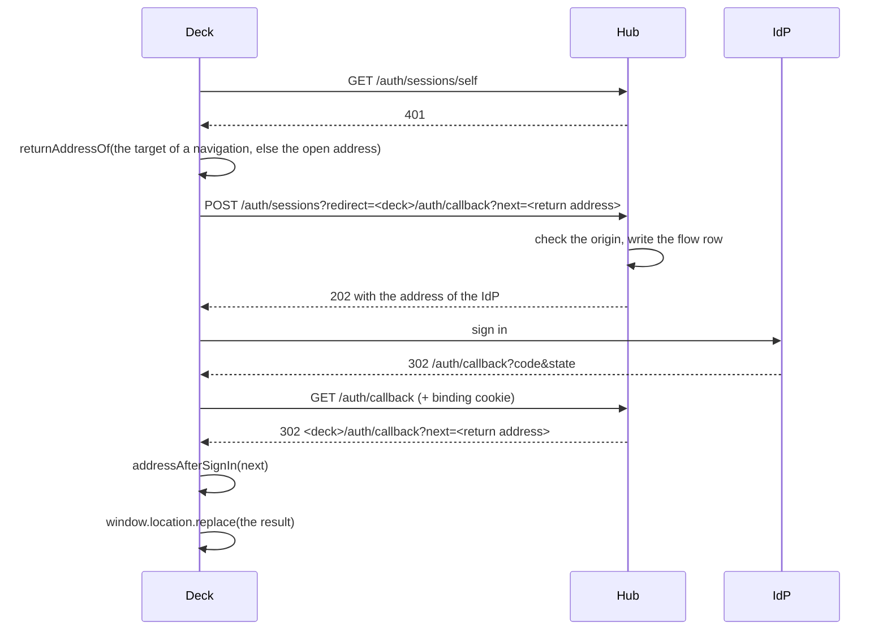

# Specification: The return address of a sign in

`spec.md` holds the session cookie, the sign out, and the build plan. This file holds
the return address of `WEBSESS-FR-009` and `WEBSESS-FR-010`. The deck puts the return
address in the query of its landing address. The hub already stores that address in
the flow row and sends the browser back to it unchanged, so no production code of the
hub changes.

## 1. Guideline compliance

| Rule      | Guideline              | How this file obeys it                                                                          |
| --------- | ---------------------- | ----------------------------------------------------------------------------------------------- |
| `UI-001`  | The web user interface | `WEBSESS-DD-010`. The deck holds the check. A plugin takes no part.                             |
| `CFG-007` | Configuration          | `auth.allowed_redirects` keeps its values. The landing address keeps its origin.                |
| `TS-002`  | Frontend code style    | The landing page keeps its runes. The helper module holds functions and no state.               |
| `TST-004` | Testing                | Section 4 gives a layer for each scenario. The deck has no test runner, so its layer is manual. |

## 2. Design

### 2.1 Components

| Path                                              | Change | Holds                                                                       |
| ------------------------------------------------- | ------ | --------------------------------------------------------------------------- |
| `apps/deck/src/lib/auth/return-address.ts`        | Create | The name of the query parameter, the read of the open address, the check.   |
| `apps/deck/src/lib/api/client.ts`                 | Change | `startSignIn` takes a return address. `redirectToAuth` passes the open one. |
| `apps/deck/src/routes/auth/callback/+page.svelte` | Change | Opens the checked return address. Try Again passes it on.                   |
| `apps/hub/internal/handler/websess_test.go`       | Change | `WEBSESS-SC-017` and `WEBSESS-SC-018`.                                      |

`return-address.ts`:

```ts
export const RETURN_ADDRESS_PARAMETER = 'next';

// The path, the query, and the fragment of the open address, or undefined
// when the open address is an address of the sign in.
export function returnAddressOf(open: URL): string | undefined;

// The address that the landing opens: the return address when it passes
// the check, and the home of the deck otherwise.
export function addressAfterSignIn(raw: string | null, origin: string): string;
```

`client.ts` changes two signatures. `landingUrl` builds the landing address with
`URL.searchParams`, so the return address arrives encoded:

```ts
function landingUrl(returnAddress?: string): string;
export function startSignIn(returnAddress?: string): Promise<string>;
```

`redirectToAuth` reads the address from `$app/state` (`WEBSESS-DD-012`):

```ts
startSignIn(returnAddressOf(navigating.to?.url ?? new URL(window.location.href)));
```

`/signed-out` keeps `startSignIn()`, so a sign in from there names no return address.
`startInvitationRedemption` keeps `landingUrl()`.

### 2.2 The hub

The hub keeps its code. Each step below exists in `apps/hub/internal/handler/auth.go`
today:

1. `Initiate` passes `redirect` to `validateRedirect`, which reads its origin alone.
2. `OIDCFlow.Initiate` writes the whole value to `public.auth_flows.redirect`.
3. `Callback` sends the 302 to the value of the row.
4. `redirectWithReason` parses that value, sets `error`, and keeps every other
   parameter of the query.

The IdP never sees the return address. The state names the row, and the row holds the
address. `WEBSESS-SC-017` and `WEBSESS-SC-018` fix steps 3 and 4 as behavior, so a
later change to the hub cannot drop the query in silence.

### 2.3 Flow



A failure ends at the same landing with `error` beside `next`. The landing shows the
message, and Try Again calls `startSignIn` with the `next` that it read, after the
check of `WEBSESS-DD-010`.

A failure of the check opens the home of the deck. It shows no message, because the
person signed in and the home is a valid place to land.

## 3. Design decisions

### `WEBSESS-DD-009`

**Realizes:** `WEBSESS-FR-009`
**Decision:** The return address travels as the `next` parameter of the landing
address, inside the `redirect` that the deck already sends. The hub adds no parameter
and no column.
**Rationale:** The flow row already holds one target for one flow, the browser cannot
change a row, and the row dies with the flow. A failure keeps `next` with no change,
because `redirectWithReason` keeps the query. The work touches three files of the deck
and no migration.
**Alternatives:** A `next` parameter of the hub and a column of `public.auth_flows`.
It holds a second copy of a value that the row already holds, and it costs a
migration and a change to the contract of `POST /auth/sessions`. A cookie of the hub.
The browser can change it, and the binding cookie already ties the browser to the
flow. `sessionStorage` in the deck. It needs nothing of the hub, and the value
outlives the flow that wrote it: a later sign in from `/signed-out` reads an old
address unless every path clears it.

### `WEBSESS-DD-010`

**Realizes:** `WEBSESS-FR-010`
**Decision:** `addressAfterSignIn` resolves the raw value against the origin of the
deck with `new URL(raw, origin)`. It returns `/` when the origins differ, or when the
path is `/auth/callback`, `/signed-out`, or `/invite`. Otherwise it returns the whole
parsed address, origin included, never the raw value and never its path alone.
`returnAddressOf` applies the same list of paths. Both functions compare the path as
the router of the deck reads it: decoded, with no trailing slash.
**Rationale:** The landing reads `next` from its own address bar, and a link that
anyone writes reaches it with no flow at all. The hub never sees such a link, so the
check sits in the deck. The parser of the browser reads `//host`, `/\host`, and
`javascript:` as the browser reads them, so one comparison of origins refuses each
one with no list of forms. The result keeps its origin, because a path alone is not
safe to open: `/.//host` resolves to the deck with the path `//host`, and a browser
opens that path as a foreign host. The path list holds the three routes of the deck
that start or end a sign in. The router decodes a path and drops a trailing slash
before it picks a route, so `/signed-out/` and `/signed%2Dout` open the page that
follows a sign out, and a comparison of the raw path misses both.
**Alternatives:** A check of the raw string: it starts with `/` and not with `//`.
It accepts `/\host`, which a browser opens as `//host`. A list of the route groups
that receive a return address. Each new route edits the list. A check in the hub.
It misses the link above, and the hub then holds the routes of the deck.

### `WEBSESS-DD-011`

**Realizes:** `WEBSESS-FR-009`
**Decision:** The landing opens the result with `window.location.replace`.
**Rationale:** The replace drops the landing from the history, so Back from the
return address does not reopen the landing, which would open the home. `goto` takes
a route identifier through `resolve`, and a return address is not one. The full load
costs one start of the deck, and the landing shows nothing that a person loses.
**Alternatives:** `goto(address, { replaceState: true })`. It passes a string that
`resolve` did not build, and the lint rule of the deck refuses that.

### `WEBSESS-DD-012`

**Realizes:** `WEBSESS-FR-009`
**Decision:** `redirectToAuth` takes the target of the navigation in flight from
`navigating.to` of `$app/state`, and the address of the window when no navigation
runs.
**Rationale:** The router runs the load of a route before it changes the address of
the window. `w/[workspace]/+layout.ts` calls the hub in its load, so a 401 there fires
while the window still shows the previous address. `navigating` holds the target of
that navigation until it ends, and it holds `null` on a full load, where the window
already shows the target.
**Alternatives:** A `beforeNavigate` callback that stores the target in a variable of
the module. It adds state that a cancelled navigation leaves stale. The address of the
window alone. The person lands on the page they left, which the limit case of
`WEBSESS-FR-009` refuses.

## 4. Scenarios

### `WEBSESS-SC-017`

**Verifies:** `WEBSESS-FR-009`
**Layer:** integration

**Given** `auth.allowed_redirects` that holds the origin of the deck.
**When** a sign in starts with
`redirect=<deck>/auth/callback?next=%2Fw%2Fw1%2Fplugins%2Fp%2Fhistory%3Fplate%3DAA001AA`
and the IdP answers the callback.
**Then** the hub answers 302, and `Location` equals that `redirect`.

### `WEBSESS-SC-018`

**Verifies:** `WEBSESS-FR-009`
**Layer:** integration

**Given** the sign in of `WEBSESS-SC-017`, for an account that no user record holds.
**When** the IdP answers the callback.
**Then** `Location` carries the same `next` and `error=no_identity`.

### `WEBSESS-SC-019`

**Verifies:** `WEBSESS-FR-009`
**Layer:** manual

**Given** a person at a plugin page of a workspace, with a query in the address.
**When** they delete the session cookie, reload, and sign in at the IdP.
**Then** the deck opens the same address with the same query, and Back does not open
`/auth/callback`.

### `WEBSESS-SC-020`

**Verifies:** `WEBSESS-FR-009`
**Layer:** manual

**Given** the person of `WEBSESS-SC-019` after the reload.
**When** they cancel at the IdP, select Try Again at the landing, and sign in.
**Then** the deck opens the address of `WEBSESS-SC-019`.

### `WEBSESS-SC-021`

**Verifies:** `WEBSESS-FR-010`
**Layer:** manual

**Given** a person with a live session.
**When** they open `/auth/callback?next=` with `https://example.org/`, then with
`//example.org/`, then with `/\example.org/`, then with `/.//example.org/`.
**Then** the deck opens `/` each time.

### `WEBSESS-SC-022`

**Verifies:** `WEBSESS-FR-010`
**Layer:** manual

**Given** a person with a live session.
**When** they open `/auth/callback?next=` with `%2Fsigned-out`, then with
`%2Fsigned-out%2F`, then with `%2Fsigned%252Dout`, then with `%2Finvite%2F%3Ftoken%3Dx`.
**Then** the deck opens `/` each time.

### `WEBSESS-SC-023`

**Verifies:** `WEBSESS-FR-009`
**Layer:** manual

**Given** a person at `/signed-out`.
**When** they select Sign in and sign in at the IdP.
**Then** the request to `/auth/sessions` carries a `redirect` with no `next`, and the
deck opens `/`.

### `WEBSESS-SC-024`

**Verifies:** `WEBSESS-FR-009`
**Layer:** manual

**Given** a signed-in person at the page of one workspace.
**When** they delete the session cookie, then select a second workspace in the deck,
and sign in at the IdP.
**Then** the deck opens the page of the second workspace.

## Retired identifiers

This file has no retired identifier.
