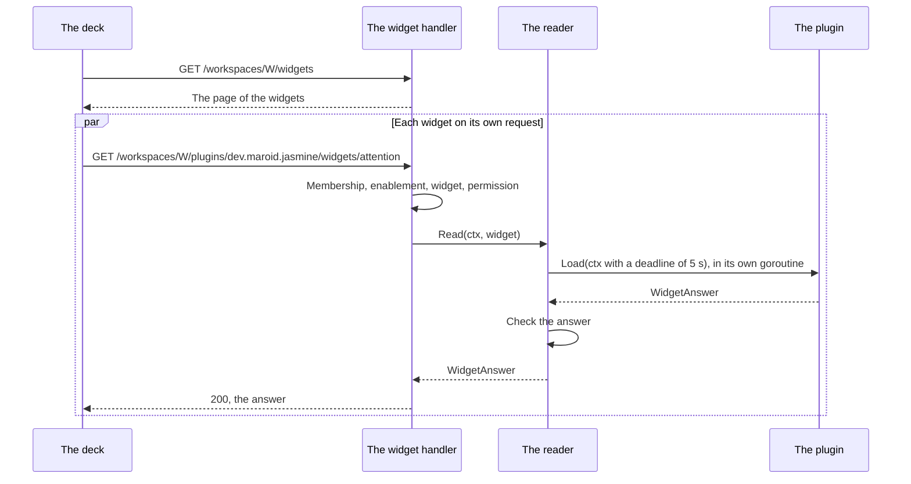

# Specification: The widgets of the home page

## 1. Summary

A plugin implements `pluginapi.WidgetPlugin`, and a new registrar checks and stores
each widget. The hub lists the widgets of the acting workspace and reads one widget
on each request: it checks the enablement and the permission, calls `Load` with a
deadline of 5 seconds, and checks the answer. The deck draws a grid of the widgets
on the home page. Parking and jasmine declare the first two. `ADR-0016` changes
`SEC-012` and `SEC-013`. `spec-scenarios.md` holds the scenarios.

## 2. Coverage

| Requirement       | Where this specification realizes it |
| ----------------- | ------------------------------------ |
| `WIDGET-FR-001`   | Section 4.1, 4.3, `WIDGET-SC-001` |
| `WIDGET-FR-002`   | Section 4.3, `WIDGET-SC-002` |
| `WIDGET-FR-003`   | Section 4.3, `WIDGET-SC-002` |
| `WIDGET-FR-004`   | Section 4.3, `WIDGET-SC-002` |
| `WIDGET-FR-005`   | Section 4.5, `WIDGET-DD-001`, `WIDGET-SC-002`, `WIDGET-SC-003` |
| `WIDGET-FR-006`   | Section 4.3, `WIDGET-SC-003` |
| `WIDGET-FR-007`   | Section 4.3, `WIDGET-SC-004`, `WIDGET-SC-018` |
| `WIDGET-FR-008`   | Section 4.3, 4.4, `WIDGET-SC-005`, `WIDGET-SC-019`, `WIDGET-SC-030` |
| `WIDGET-FR-009`   | Section 4.3, 4.4, `WIDGET-SC-006`, `WIDGET-SC-030` |
| `WIDGET-FR-010`   | Section 4.4, `WIDGET-DD-002`, `WIDGET-SC-007` |
| `WIDGET-FR-012`   | Section 4.4, `WIDGET-SC-008` |
| `WIDGET-FR-013`   | Section 4.4, `WIDGET-SC-009` |
| `WIDGET-FR-014`   | Section 4.6, `WIDGET-DD-003`, `WIDGET-SC-021` |
| `WIDGET-FR-015`   | Section 4.6, `WIDGET-SC-021` |
| `WIDGET-FR-016`   | Section 4.3, 4.5, `WIDGET-SC-010` |
| `WIDGET-FR-017`   | Section 4.6, `WIDGET-SC-022` |
| `WIDGET-FR-018`   | Section 4.6, `WIDGET-SC-022` |
| `WIDGET-FR-019`   | Section 4.6, `WIDGET-SC-022` |
| `WIDGET-FR-020`   | Section 4.5, 4.6, `WIDGET-SC-011`, `WIDGET-SC-015`, `WIDGET-SC-023` |
| `WIDGET-FR-021`   | Section 4.6, `WIDGET-DD-005`, `WIDGET-SC-023` |
| `WIDGET-FR-022`   | Section 4.5, `WIDGET-DD-004`, `WIDGET-SC-012` |
| `WIDGET-FR-023`   | Section 4.3, 4.6, `WIDGET-SC-022` |
| `WIDGET-FR-024`   | Section 4.3, 4.6, `WIDGET-SC-022` |
| `WIDGET-FR-025`   | Section 4.6, `WIDGET-SC-024` |
| `WIDGET-FR-026`   | Section 4.6, `WIDGET-SC-024` |
| `WIDGET-FR-027`   | Section 4.6, `WIDGET-SC-024` |
| `WIDGET-FR-028`   | Section 4.6, `WIDGET-SC-025` |
| `WIDGET-FR-029`   | Section 4.6, `WIDGET-SC-025` |
| `WIDGET-FR-030`   | Section 4.7, `WIDGET-SC-014` |
| `WIDGET-FR-031`   | Section 4.7, `WIDGET-SC-015` |
| `WIDGET-FR-032`   | Section 4.7, `WIDGET-SC-016` |
| `WIDGET-FR-033`   | Section 4.7, `WIDGET-SC-016` |
| `WIDGET-FR-034`   | Section 4.7, `WIDGET-SC-016` |
| `WIDGET-FR-035`   | Section 4.7, `WIDGET-SC-016` |
| `WIDGET-FR-036`   | Section 4.7, `WIDGET-SC-017` |
| `WIDGET-FR-037`   | Section 4.6, `WIDGET-SC-026` |
| `WIDGET-FR-038`   | Section 4.6, `WIDGET-SC-027` |
| `WIDGET-FR-039`   | Section 4.6, `WIDGET-SC-027` |
| `WIDGET-FR-040`   | Section 4.6, `WIDGET-SC-028` |
| `WIDGET-FR-041`   | Section 4.6, `WIDGET-SC-028` |
| `WIDGET-FR-042`   | Section 4.6, `WIDGET-SC-029` |
| `WIDGET-NFR-001`  | Section 4.4, `WIDGET-DD-003`, `WIDGET-SC-013` |
| `WIDGET-INV-001`  | Section 4.4, `WIDGET-SC-009` |
| `WIDGET-INV-002`  | Section 4.4, `WIDGET-SC-008` |

## 3. Guideline compliance

| Rule                 | Guideline    | How this specification obeys it |
| -------------------- | ------------ | ------------------------------- |
| `PLG-005`, `PLG-006` | Plugin model | `WidgetPlugin` in `libs/pluginapi`, `WidgetRegistry`, `WidgetRegistrar`. Section 4.1. |
| `PLG-007`            | Plugin model | A plugin reads its own data in `Load`. It imports nothing of the hub. |
| `PLG-011`            | Plugin model | `WidgetRegistry.Register` refuses a second widget under one plugin and key. |
| `ARC-008`            | Architecture | The registrar, the reader, and the deck treat every widget alike. |
| `SEC-012`, `SEC-013` | Security     | `ADR-0016` names the widget in both. Section 4.4 checks both before `Load`. |
| `OWN-005`            | Ownership    | `Load` reads through `PluginDB.WithTx`, which sets the acting workspace for the policy. |
| `API-003`            | HTTP API     | Both routes live under `/workspaces*`. The table needs no new row. |
| `RES-005`            | REST         | The list answers one page that holds every widget. |
| `ERR-003`            | Errors       | Section 4.5 adds the hub problem type `widget-timeout`. |
| `UI-001`, `UI-007`   | Web UI       | The deck draws every widget and reaches the hub through `@maroid/api-client`. |
| `TS-002`             | Frontend     | Each widget component takes its props through `$props`. |
| `GO-003`, `GO-004`   | Go style     | Every exported identifier of `widget.go` carries a documentation comment. Each error wraps its cause. |
| `BLD-004`            | Build        | `libs/pluginapi` changes, so every plugin builds again. Section 7. |
| `TST-004`            | Testing      | The deck has no test runner. Every deck scenario is manual. |

## 4. Design

### 4.1 Components

| Path | Action | Holds |
| ---- | ------ | ----- |
| `libs/pluginapi/widget.go` | create | The contract of section 4.3. |
| `libs/pluginapi/widget_test.go` | create | `WIDGET-SC-001`. |
| `apps/hub/internal/domain/errs/errs.go` | change | `ErrWidgetAlreadyRegistered`, `ErrInvalidWidget`, `ErrWidgetTimeout`, `ErrInvalidWidgetAnswer`, `ErrWidgetPanicked`. |
| `apps/hub/internal/domain/problems/problems.go` | change | `TypeWidgetTimeout`, `NewWidgetTimeout()`. |
| `specs/guidelines/errors.md` | change | `widget-timeout`, 504, in the hub table of `ERR-003`. |
| `apps/hub/internal/registry/widget.go` | create | `Widget{PluginID string; Meta pluginapi.WidgetMeta; Permission string; Load func(context.Context) (pluginapi.WidgetAnswer, error)}`. `WidgetRegistry` with `Register(widgets ...Widget) error`, `Get(pluginID, key string) (Widget, bool)`, `Of(pluginID string) []Widget`. `Of` keeps the order of the declaration. |
| `apps/hub/internal/registry/capability.go` | change | `CapWidgets Capability = "widgets"`. |
| `apps/hub/internal/registry/capability_item.go` | change | `WidgetItem{PluginID, Key, Title, Kind, Size, Permission string}`, the shape of the schema `Widget`. |
| `apps/hub/internal/plugin/registrar/widget.go` | create | `WidgetRegistrar`. Section 4.5 gives the checks. It calls `permissionOf`. |
| `apps/hub/internal/plugin/registrar/widget_test.go` | create | `WIDGET-SC-002` to `WIDGET-SC-004`. |
| `apps/hub/internal/plugin/loader/loader.go` | change | `New` takes `widgetRegistry *registry.WidgetRegistry`, and appends `registrar.NewWidgetRegistrar(widgetRegistry, capabilityRegistry, permissionRegistry)` after the MCP registrar. |
| `apps/hub/internal/widget/reader.go` | create | `Deadline = 5 * time.Second`. `New(deadline time.Duration) *Reader`. The handler logs a failure. Section 4.4. |
| `apps/hub/internal/widget/reader_test.go` | create | `WIDGET-SC-008` to `WIDGET-SC-013`. |
| `apps/hub/internal/handler/widget.go` | create | `Widget` handler. A list answers `registry.WidgetItem`, and a read answers `widgetAnswerBody`, `widgetStatBody`, `widgetListBody`, and `widgetListItemBody`, with the snake_case tags of `api.yaml`. `Register` adds the three paths flat inside one `router.Group`, as `Notification.Register` does, because a mount of `/workspaces/{workspaceId}` shadows the workspace handler. `RequireEnabledOf` runs after `workspace.Middleware`. Section 4.3 and 4.4. |
| `apps/hub/internal/handler/widget_test.go` | create | `WIDGET-SC-005` to `WIDGET-SC-007`, `WIDGET-SC-009`, `WIDGET-SC-011`, `WIDGET-SC-013`, `WIDGET-SC-030`. |
| `apps/hub/internal/depresolver/widget.go` | create | `WidgetRegistry()`, and `buildWidgetHandler()`, which builds the reader with `widget.Deadline`. |
| `apps/hub/internal/depresolver/plugin.go` | change | Passes the widget registry to `loader.New`. |
| `apps/hub/internal/depresolver/server.go` | change | `registerHandlers` adds `{"widget", ...buildWidgetHandler}`. |
| `specs/api/components.yaml` | change | The schema `Widget` that two fragments need. |
| `specs/features/pcap/api.yaml` | change | `Capabilities.widgets`, an array of `Widget`. |
| `apps/deck/src/lib/api/types.ts` | change | `Widget`, `WidgetAnswer`, `StatData`, `ListData`, `ListItem`. `Capabilities.widgets`. |
| `apps/deck/src/lib/api/widgets.ts` | create | `widgets.list(workspaceId)`, `widgets.read(workspaceId, pluginId, key)`. |
| `apps/deck/src/lib/api/index.ts` | change | Exports `widgets` in `api`. |
| `apps/deck/src/lib/plugins/capabilities.ts` | change | `widgets: 'Widgets'` in `LABELS`, after `ui`. |
| `apps/deck/src/lib/components/widgets/WidgetGrid.svelte` | create | Reads the list, draws one `WidgetCard` for each widget. |
| `apps/deck/src/lib/components/widgets/WidgetCard.svelte` | create | Reads one widget, draws the placeholder, the error, the states, and the kind. |
| `apps/deck/src/lib/components/widgets/StatWidget.svelte` | create | The `stat` kind. |
| `apps/deck/src/lib/components/widgets/ListWidget.svelte` | create | The `list` kind. |
| `apps/deck/src/lib/components/widgets/layout.ts` | create | `spanOf(size)`, `itemsOf(size)`, `linkOf(workspaceId, pluginId, path)`, `GRID_COLUMNS`. |
| `apps/deck/src/routes/(dashboard)/w/[workspace]/+page.svelte` | change | The title of the workspace and `WidgetGrid`. The list of links goes. |
| `apps/deck/src/lib/components/layout/Sidebar.svelte` | change | Overview links to the home page of the acting workspace. The Workspace group. The Plugins group loses "All plugins". Section 4.6. |
| `plugins/parking/widget/balance.go` | create | The balance widget. Section 4.7. |
| `plugins/parking/widget/balance_test.go` | create | `WIDGET-SC-014`, `WIDGET-SC-015`. |
| `plugins/parking/main.go` | change | `pluginapi.WidgetPlugin`. `Widgets()` answers the balance widget. |
| `plugins/jasmine/widget/attention.go` | create | The attention widget. Section 4.7. |
| `plugins/jasmine/widget/attention_test.go` | create | `WIDGET-SC-016`, `WIDGET-SC-017`. |
| `plugins/jasmine/main.go` | change | `pluginapi.WidgetPlugin`. `Widgets()` answers the attention widget. |
| `specs/guidelines/security.md` | change | `SEC-012` and `SEC-013` as `ADR-0016` gives them. |

### 4.2 Data model

This feature adds no table.

### 4.3 Declarations

**The plugin contract.** `libs/pluginapi/widget.go`. The types carry no JSON tag. The handler maps them to its body types.

```go
type WidgetPlugin interface {
	Plugin
	Widgets() ([]Widget, error)
}

type Widget interface {
	Meta() WidgetMeta
	Load(ctx context.Context) (WidgetAnswer, error)
}

type WidgetMeta struct {
	Key        string
	Title      string
	Kind       WidgetKind  // WidgetKindStat "stat", WidgetKindList "list"
	Size       WidgetSize  // WidgetSizeXS "xs", WidgetSizeS "s", WidgetSizeM "m", WidgetSizeL "l"
	Permission string
}

type WidgetAnswer struct {
	State   WidgetState // WidgetStateReady "ready", WidgetStateEmpty "empty", WidgetStateNotSetUp "not_set_up"
	Message string      // empty and not_set_up
	Link    string      // not_set_up
	Stat    *StatData   // ready, kind stat
	List    *ListData   // ready, kind list
}

type StatData struct{ Value, Unit, Caption, Link string }
type ListData struct {
	Items []ListItem
	More  string
}
type ListItem struct{ Label, Meta, Link string }

// FuncWidget implements Widget, as TypedTool implements MCPTool.
func NewWidget(meta WidgetMeta, load func(ctx context.Context) (WidgetAnswer, error)) *FuncWidget
func StatAnswer(data StatData) WidgetAnswer
func ListAnswer(data ListData) WidgetAnswer
func EmptyAnswer(message string) WidgetAnswer
func NotSetUpAnswer(message, link string) WidgetAnswer
```

| Element | Rule | Realizes |
| ------- | ---- | -------- |
| `WidgetPlugin` | A plugin implements it to declare widgets. An empty slice is legal. | `WIDGET-FR-001` |
| `WidgetMeta.Key` | Matches `^[a-z0-9-]{1,64}$`. Unique within the plugin. | `WIDGET-FR-002`, `WIDGET-FR-003` |
| `WidgetMeta.Title` | 1 to 64 characters after `strings.TrimSpace`. The registrar stores the trimmed title. | `WIDGET-FR-004` |
| `WidgetMeta.Kind`, `Size` | One of the constants. Any kind with any size. | `WIDGET-FR-002`, `WIDGET-FR-006` |
| `WidgetMeta.Permission` | A local name that the plugin declares, as for a route. | `WIDGET-FR-002` |
| The answer helpers | Each sets `State` and the members of that state alone. | `WIDGET-FR-016` |
| A link | A path relative to the plugin. Section 4.5 gives the check. | `WIDGET-FR-022` |

**The capability.** `CapWidgets` records one `WidgetItem` for each widget, in the order
of the declaration, with the permission in its full name. `GET /plugins` answers it
under `capabilities.widgets`. `WIDGET-FR-007`.

**HTTP routes.** `api.yaml` holds the bodies. Both routes run behind `auth.Middleware`
and `workspace.Middleware`, as the routes of a plugin do: an administrator who is no
member reads no widget.

| Method | Path | Access | Realizes |
| ------ | ---- | ------ | -------- |
| `GET` | `/workspaces/{workspaceId}/widgets` | Member. Permission `workspace.read`. | `WIDGET-FR-008`, `WIDGET-FR-009`, `WIDGET-FR-010` |
| `GET` | `/workspaces/{workspaceId}/plugins/{pluginId}/widgets` | Member, enabled. Permission `workspace.read`. `Z-143` asks the path to answer. | `WIDGET-FR-008`, `WIDGET-FR-009` |
| `GET` | `/workspaces/{workspaceId}/plugins/{pluginId}/widgets/{key}` | Member, enabled. The permission of the widget. | `WIDGET-FR-012`, `WIDGET-FR-013`, `WIDGET-FR-016`, `WIDGET-FR-020`, `WIDGET-FR-022`, `WIDGET-NFR-001` |

### 4.4 Flow

**The list.** `Widget.List` reads `EnablementService.Enabled(ctx)`, which answers the
plugins of the acting workspace ordered by `plugin_id`, the order of the navigation.
For each plugin it takes `WidgetRegistry.Of(pluginID)`, and keeps a widget when
`Authorizer.Allowed(role, widget.Permission)` holds. It answers one page with every
kept widget as the schema `Widget` of `components.yaml`. `WIDGET-FR-008` to `WIDGET-FR-010`.

**One widget.** The route passes `workspace.RequireEnabledOf` with the plugin of the
path. The handler finds the widget with `WidgetRegistry.Get`, checks its permission
with `Authorizer.Allowed`, and calls `Reader.Read`.



`Reader.Read(ctx context.Context, widget registry.Widget) (pluginapi.WidgetAnswer, error)`:

1. Derives `context.WithTimeout(ctx, deadline)`. The container passes `widget.Deadline`. The context keeps the acting
   user and the acting workspace, so `PluginDB.WithTx` sets both for the policy.
   `WIDGET-FR-013`, `WIDGET-INV-001`.
2. Runs `Load` in a goroutine that recovers a panic into `ErrWidgetPanicked` with the
   stack, and sends the result into a channel with a buffer of one.
3. Waits for the result or for the end of the context. A deadline answers
   `ErrWidgetTimeout`, also when `Load` honours the context and returns its error at
   the same moment. A request that the client cancels answers `context.Canceled`. The
   goroutine ends alone when `Load` returns. `WIDGET-NFR-001`.
4. Checks the answer with section 4.5.
5. Keeps nothing. The next request calls `Load` again. `WIDGET-FR-012`, `WIDGET-INV-002`.

### 4.5 Errors

**At the load.** `WidgetRegistrar.Register` refuses the plugin, and the hub stops its start.

| Condition | Error | Realizes |
| --------- | ----- | -------- |
| `Widgets()` fails | `fmt.Errorf("retrieving the widgets for plugin %s: %w", id, err)` | `WIDGET-FR-005` |
| A key breaks its pattern | `fmt.Errorf("%w: plugin %s, widget %s: key", errs.ErrInvalidWidget, id, key)` | `WIDGET-FR-005` |
| A title breaks its length | The same, ending in `title` | `WIDGET-FR-005` |
| An unknown kind | The same, ending in `kind` | `WIDGET-FR-005` |
| An unknown size | The same, ending in `size` | `WIDGET-FR-005` |
| No permission, or one the plugin does not declare | `permissionOf` answers `ErrPermissionMissing` or `ErrPermissionUndeclared` | `WIDGET-FR-005` |
| A second key in one plugin | `fmt.Errorf("%w: plugin %s, widget %s", errs.ErrWidgetAlreadyRegistered, id, key)` | `WIDGET-FR-005` |

**At a read.** The reader answers `ErrInvalidWidgetAnswer` for each condition below.

| Condition | Realizes |
| --------- | -------- |
| `State` is none of the three. | `WIDGET-FR-016` |
| `ready` of a `stat` widget with no `Stat`, or an empty `Stat.Value`. | `WIDGET-FR-016` |
| `ready` that carries the data of the other kind. | `WIDGET-FR-016` |
| `ready` of a `list` widget with no `List`, or an item with an empty label. | `WIDGET-FR-016` |
| `empty` or `not_set_up` with an empty `Message`. `not_set_up` with an empty `Link`. | `WIDGET-FR-018`, `WIDGET-FR-019` |
| A link that does not start with `/`, starts with `//` or `/\`, or holds a `..` segment. | `WIDGET-FR-022` |

**The answer of the route.**

| Condition | Status | Type |
| --------- | ------ | ---- |
| The workspace is not one of the person | 404 | `/problems/http/not-found` |
| The plugin is disabled, or holds no widget under the key | 404 | `/problems/http/not-found` |
| The role does not hold the permission of the widget | 403 | `/problems/http/permission-denied` |
| `ErrWidgetTimeout` | 504 | `/problems/hub/widget-timeout`, "The plugin did not answer the widget in time." |
| `Load` fails, panics, or answers `ErrInvalidWidgetAnswer` | 500 | `/problems/http/internal`. The log record names the plugin, the key, and the cause. |

A failure of `Load` is 500 and not 502. The plugin runs in the process of the hub, so
its failure is a failure of the hub. A plugin that expects a failure, a missing
connection for example, answers a state instead.

### 4.6 The deck

| Element | Behavior | Realizes |
| ------- | -------- | -------- |
| The home page | The title of the workspace and `WidgetGrid`, and no link to Members, Plugins, Notifications, or Settings. No widget: the `empty-state` "No plugin of this workspace shows a widget yet." with a link "Open the plugins" to `/w/{workspace}/plugins`. A failed list: an `Alert` "The widgets did not load." While the list loads, and when the client answers no body, as it does on a 401 before the redirect to the sign in, a placeholder grid of two skeleton cards. An administrator who is no member sees no grid, as the layout tells them that they read no record. | `WIDGET-FR-038`, `WIDGET-FR-039` |
| The grid | `grid gap-4 auto-rows-[10rem]` and `GRID_COLUMNS`, `grid-cols-1! sm:grid-cols-2! lg:grid-cols-4!`. The important flag of every column and span class keeps the order of the deck: the stylesheet of a remote stays in the page after its first page opens, and its later `sm:` rule would beat an `lg:` rule of the deck. A row of 10rem holds two rows of a list, so 5 items fit in two rows. | `WIDGET-FR-028` |
| `spanOf(size)` | `xs`: `col-span-1! row-span-1!`. `s`: `sm:col-span-2! row-span-1!`. `m`: `sm:col-span-2! row-span-2!`. `l`: `sm:col-span-2! lg:col-span-4! row-span-2!`. One column below `sm`, so every widget takes the full width and keeps its rows. | `WIDGET-FR-028`, `WIDGET-FR-029` |
| `WidgetCard` | Calls `widgets.read` on mount, on its own. Each card holds its own state, so one card waits or fails alone. | `WIDGET-FR-014` |
| The placeholder | The card of the span of the size, with the title and `SkeletonList`, and `aria-busy`. A read that answers no body keeps it. The card names itself by its title with `aria-labelledby`. | `WIDGET-FR-015` |
| `ready` | `StatWidget` or `ListWidget` by the kind that the widget declares. | `WIDGET-FR-017` |
| `empty` | The title and the message, muted. | `WIDGET-FR-018` |
| `not_set_up` | The title, the message, and a link "Set up" to `linkOf(link)`. | `WIDGET-FR-019` |
| An error | The title, and "This widget did not load." in `text-error`. | `WIDGET-FR-020` |
| `StatWidget` | The value large, the unit beside it, the caption below. The card links to the link, when present. | `WIDGET-FR-023` |
| `ListWidget` | The first `itemsOf(size)` items, as the rows of the link list of the home page: `list-row` with a hover background and an arrow when the item links. The label, the meta line below. Then "N more" when items remain. Then "See all" when `more` is present. | `WIDGET-FR-024` to `WIDGET-FR-027` |
| `itemsOf(size)` | 2 for `xs` and `s`, 5 for `m` and `l`. | `WIDGET-FR-025` |
| `linkOf` | `resolve('/(dashboard)/w/[workspace]/plugins/[plugin]/[...path]')` with the path without its leading `/`. | `WIDGET-FR-022` |
| Text | Every text goes through `{value}`. No widget component uses `{@html}`. | `WIDGET-FR-021` |
| Overview | Links to `resolve('/(dashboard)/w/[workspace]', ...)` of the acting workspace, else to `/`. Active when the address is that link. | `WIDGET-FR-037` |
| The Workspace group | A `details` group after the Plugins group, with Members, Plugins, Notifications, and Settings, each to its route of the acting workspace. Each entry names its route identifiers: Members `w/[workspace]/members`, Plugins `w/[workspace]/plugins` and `w/[workspace]/plugins/[plugin]/settings`, Notifications `w/[workspace]/settings/notifications`, Settings `w/[workspace]/settings`. The entry whose identifiers hold the current route is active, and the group is open while one is. A page of a plugin opens neither. Absent with no acting workspace. | `WIDGET-FR-040`, `WIDGET-FR-041` |
| The Plugins group | The navigation entries of the enabled plugins alone. Absent when no enabled plugin holds a navigation entry. | `WIDGET-FR-042` |

### 4.7 The first widgets

| Plugin | Key | Title | Kind | Size | Permission |
| ------ | --- | ----- | ---- | ---- | ---------- |
| parking | `balance` | Parking balance | `stat` | `s` | `sessions.read` |
| jasmine | `attention` | Plants that need care | `list` | `m` | `plants.read` |

**Parking.** `widget.NewBalance(connections service.ConnectionService) *pluginapi.FuncWidget`.
`Load` calls `connections.Status(ctx)`:

| Result | Answer | Realizes |
| ------ | ------ | -------- |
| `connected` with an account | `StatAnswer{Value: "%.2f" of the balance, Unit: "GEL", Caption: "<n> free parkings left today", Link: "/account"}`. One free parking reads "1 free parking left today". | `WIDGET-FR-030` |
| `not_connected` | `NotSetUpAnswer("Connect your parking account.", "/account")` | `WIDGET-FR-031` |
| `connected` with no account | `errs.ErrNoAccount`. The card shows the error. | `WIDGET-FR-020` |
| An error | The error, wrapped. The card shows the error. | `WIDGET-FR-020` |

**Jasmine.** `widget.NewAttention(db *pluginapi.PluginDB) *pluginapi.FuncWidget`. `Load`
runs `repository.NewCareInterval(tx).ListAttention(ctx)` in `db.WithTx`:

| Result | Answer | Realizes |
| ------ | ------ | -------- |
| One or more intervals | `ListAnswer` with one item for each interval, in the order of the list. Label: `<display id> <common name>`. Meta: `<type>, <days since>, every <days>, <state>`, where a count of days reads "1 day" or "<n> days", and a `_` of the type and of the state reads as a space. Link: `/plants/<plant id>`. `More`: `/attention`. | `WIDGET-FR-032` to `WIDGET-FR-035` |
| No interval | `EmptyAnswer("No plant needs care.")` | `WIDGET-FR-036` |

## 5. Design decisions

### `WIDGET-DD-001`

**Realizes:** `WIDGET-FR-005`
**Decision:** The registrar checks every widget of a plugin before it registers any, and the first broken widget stops the load.
**Rationale:** A plugin loads whole or not at all, as for the MCP registrar. A partial load hides a broken widget.
**Alternatives:** Skip the broken widget with a warning. The author misses it.

### `WIDGET-DD-002`

**Realizes:** `WIDGET-FR-010`
**Decision:** The list follows `EnablementService.Enabled`, ordered by `plugin_id`, and `WidgetRegistry.Of` keeps the order of the declaration in a slice for each plugin.
**Rationale:** The sidebar lists the plugins in the same order. Every registry of the hub reads from a map, and its order changes between two calls.
**Alternatives:** The order of the configuration. No store keeps it after the load.

### `WIDGET-DD-003`

**Realizes:** `WIDGET-FR-014`, `WIDGET-NFR-001`
**Decision:** The deck reads each widget on its own request, and the hub runs `Load` in a goroutine and stops the wait at 5 seconds, whether or not the plugin reads its context.
**Rationale:** The owner chose one request for each widget. A plugin that ignores its context must not hold the request past the deadline.
**Alternatives:** One request for every widget. The slowest plugin then sets the time of the page. Trust the plugin to honor the context. One defect then hangs a card.

### `WIDGET-DD-004`

**Realizes:** `WIDGET-FR-022`
**Decision:** The hub refuses an answer whose link is not a path relative to the plugin, and the deck builds the address with `resolve`.
**Rationale:** The check runs in one place for every client, and the deck never reads a scheme or a host from a plugin.
**Alternatives:** The deck checks alone. A second client would need the same check.

### `WIDGET-DD-005`

**Realizes:** `WIDGET-FR-016`, `WIDGET-FR-021`
**Decision:** An answer carries plain strings. The plugin formats a value, a number for example, as the person reads it.
**Rationale:** The deck holds no rule of one plugin (`ARC-008`), so it cannot know a currency or a unit of a reading.
**Alternatives:** A typed number with a format. It adds a format language for two widgets.

### `WIDGET-DD-006`

**Realizes:** `WIDGET-FR-012`, `WIDGET-FR-013`
**Decision:** The route of one widget lives under `/workspaces/{workspaceId}/plugins/{pluginId}/widgets/{key}`, beside the settings of a plugin.
**Rationale:** `RequireEnabledOf` reads the plugin from the path, as the settings routes do, and a key needs no prefix.
**Alternatives:** `/workspaces/{workspaceId}/widgets/{pluginId}/{key}`. It repeats the enablement check in the handler.

## 6. Scenarios

`spec-scenarios.md` holds every scenario.

## 7. Build plan

| #   | Step | Realizes | Done |
| --- | ---- | -------- | ---- |
| 1   | `ADR-0016` accepted. `SEC-012` and `SEC-013` changed. | `WIDGET-FR-008`, `WIDGET-FR-009` | [x] |
| 2   | `libs/pluginapi/widget.go` and its test. | `WIDGET-FR-001`, `WIDGET-FR-002`, `WIDGET-FR-016` | [x] |
| 3   | Errors, problem, registry, capability, registrar, loader, and their tests. | `WIDGET-FR-002` to `WIDGET-FR-007` | [x] |
| 4   | `widget.Reader`, the handler, the wiring, and their tests. `api.yaml`, `components.yaml`, `pcap/api.yaml`. | `WIDGET-FR-008` to `WIDGET-FR-013`, `WIDGET-FR-016`, `WIDGET-FR-020`, `WIDGET-FR-022`, `WIDGET-NFR-001`, `WIDGET-INV-001`, `WIDGET-INV-002` | [x] |
| 5   | The parking widget and the jasmine widget, and their tests. Build every plugin (`BLD-004`). | `WIDGET-FR-030` to `WIDGET-FR-036` | [x] |
| 6   | The deck: the client, the components, the home page, the label, the Overview entry. | `WIDGET-FR-014` to `WIDGET-FR-029`, `WIDGET-FR-037` | [x] |
| 7   | The deck: the home page without the links, the Workspace group, the Plugins group. | `WIDGET-FR-038` to `WIDGET-FR-042` | [x] |
| 8   | The manual scenarios. | `WIDGET-SC-018` to `WIDGET-SC-029` | [ ] |

## 8. Out of scope for this specification

This specification postpones no requirement.

## Retired identifiers

This file has no retired identifier.
