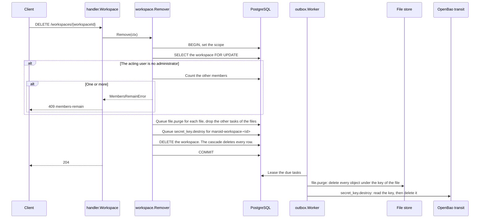

# Specification: The removal of a workspace and of every record it holds

This file holds the design. [`spec-scenarios.md`](spec-scenarios.md) holds the
scenarios. `SPC-001` divides them.

## 1. Summary

`DELETE /workspaces/{workspaceId}` removes a workspace in one transaction. Under
`ADR-0026`, every scope column of a workspace cascades, so the delete of the row of the
workspace deletes the rows of the hub and of every plugin. The same transaction queues
a purge of each file and the destruction of the transit key of the workspace in the
outbox of `ADR-0027`. A new handler of the outbox destroys the key, and the handler of
the files purges the bytes. The deck adds the
removal to the settings page of a workspace and to the list of every workspace of an
administrator.

## 2. Coverage

| Requirement        | Where this specification realizes it                                   |
| ------------------ | ---------------------------------------------------------------------- |
| `WSREMOVE-FR-001`  | Section 4.3, `WSREMOVE-SC-001`, `WSREMOVE-SC-002`, `WSREMOVE-SC-003`   |
| `WSREMOVE-FR-002`  | Section 4.4, `WSREMOVE-DD-002`, `WSREMOVE-SC-004` to `WSREMOVE-SC-006` |
| `WSREMOVE-FR-003`  | Section 4.5, `WSREMOVE-SC-004`                                         |
| `WSREMOVE-FR-004`  | Section 4.4, `WSREMOVE-SC-007`, `WSREMOVE-SC-008`                      |
| `WSREMOVE-FR-005`  | Section 4.2, `WSREMOVE-DD-001`, `WSREMOVE-SC-009` to `WSREMOVE-SC-011` |
| `WSREMOVE-FR-006`  | Section 4.2, `WSREMOVE-SC-012`                                         |
| `WSREMOVE-FR-007`  | Section 4.4, `WSREMOVE-DD-003`, `WSREMOVE-SC-013`                      |
| `WSREMOVE-FR-008`  | Section 4.3, `WSREMOVE-DD-004`, `WSREMOVE-SC-015`, `WSREMOVE-SC-016`   |
| `WSREMOVE-FR-009`  | Section 4.4, `WSREMOVE-SC-017`                                         |
| `WSREMOVE-FR-010`  | Section 4.3, `WSREMOVE-DD-005`, `WSREMOVE-SC-014`, `WSREMOVE-SC-018`   |
| `WSREMOVE-FR-011`  | Section 4.6, `WSREMOVE-SC-019`                                         |
| `WSREMOVE-FR-012`  | Section 4.6, `WSREMOVE-SC-020`                                         |
| `WSREMOVE-FR-013`  | Section 4.6, `WSREMOVE-SC-021`                                         |
| `WSREMOVE-FR-014`  | Section 4.6, `WSREMOVE-SC-020`                                         |
| `WSREMOVE-FR-015`  | Section 4.2, `WSREMOVE-SC-022`                                         |
| `WSREMOVE-NFR-001` | `WSREMOVE-SC-023`                                                      |
| `WSREMOVE-NFR-002` | `WSREMOVE-DD-003`, `WSREMOVE-SC-013`, `WSREMOVE-SC-014`                |
| `WSREMOVE-NFR-003` | `WSREMOVE-DD-005`, `WSREMOVE-SC-015`, `WSREMOVE-SC-018`                |
| `WSREMOVE-INV-001` | Section 4.2, `WSREMOVE-DD-001`, `WSREMOVE-SC-024`                      |

## 3. Guideline compliance

| Rule      | Guideline        | How this specification obeys it                                                                                  |
| --------- | ---------------- | ---------------------------------------------------------------------------------------------------------------- |
| `OWN-005` | Record ownership | Every scope column of a workspace cascades, as `ADR-0026` changes it. Section 4.2.                               |
| `OWN-010` | Record ownership | `workspace.Remover` is the only code that deletes a row of `public.workspaces`, as `ADR-0026` changes it.        |
| `OWN-006` | Record ownership | The cascade runs as the owner of each table, so the policy hides no row from it. `WSREMOVE-SC-010`.              |
| `OWN-007` | Record ownership | `Remover.Remove` runs in `database.WithScopeTx`, so the policy of `public.workspace_files` shows its files.      |
| `SEC-011` | Security         | `workspace.AdmitAdministrator` lets an administrator who is no member reach the route, as `ADR-0026` changes it. |
| `SEC-013` | Security         | The route declares `workspace.remove`, whose lowest role is manager.                                             |
| `DAT-003` | Data             | A row of a plugin that names a file blocks no cascade. `ADR-0026` records the check. `WSREMOVE-SC-010`.          |
| `ERR-003` | Errors           | The refusal of `WSREMOVE-FR-002` answers `members-remain`, which `ADR-0026` adds.                                |
| `API-003` | HTTP API         | The route sits under `/workspaces`.                                                                              |
| `Z-149`   | REST             | A second removal answers `not-found` and leaves the same state, so `DELETE` stays idempotent.                    |
| `JOB-009` | Jobs             | Every task of the removal is a row of `public.outbox_tasks`, as `ADR-0027` adds the rule.                        |
| `JOB-010` | Jobs             | The removal adds the type `secret_key.destroy` and one handler for it.                                           |
| `REP-003` | Repository       | Each new repository takes the transaction, as `ADR-0011` gives.                                                  |

## 4. Design

### 4.1 Components

| Path                                                                         | Action | Holds                                                                              |
| ---------------------------------------------------------------------------- | ------ | ---------------------------------------------------------------------------------- |
| `apps/hub/db/migrations/20261125100000_workspace_references_cascade.*`       | create | The cascade of every scope column of the hub. Section 4.2.                         |
| `plugins/<name>/db/migrations/20261125110000_workspace_references_cascade.*` | create | The cascade of every scope column of the plugin, for each plugin of section 4.2.   |
| `libs/testdb/cascade.go`                                                     | create | `RequireWorkspaceCascade`, the check of `WSREMOVE-SC-024` for one schema           |
| `apps/hub/internal/authz/hub.go`                                             | change | `PermissionWorkspaceRemove`, `workspace.remove`, lowest role manager               |
| `apps/hub/internal/domain/errs/errs.go`                                      | change | `ErrMembersRemain`, `MembersRemainError`                                           |
| `apps/hub/internal/domain/problems/problems.go`                              | change | `TypeMembersRemain`, `MembersRemainProblem`, `NewMembersRemain`                    |
| `apps/hub/internal/repository/workspace.go`                                  | change | `Workspace.Delete`                                                                 |
| `apps/hub/internal/repository/workspace_member.go`                           | change | `WorkspaceMember.CountOthers`. `Add` answers `errs.ErrWorkspaceNotFound` on 23503. |
| `apps/hub/internal/repository/file.go`                                       | change | `File.ListOfWorkspace`                                                             |
| `apps/hub/internal/file/store.go`                                            | change | `Store.PurgeWorkspace`                                                             |
| `apps/hub/internal/secret/transit.go`                                        | change | `Transit.DestroyKey`, and the interface `KeyDestroyer`                             |
| `apps/hub/internal/secret/destroy.go`                                        | create | `secret.DestroyHandler`, the handler of `secret_key.destroy`                       |
| `apps/hub/internal/workspace/remover.go`                                     | create | `workspace.Remover`                                                                |
| `apps/hub/internal/handler/workspace.go`                                     | change | `Workspace.Remove` and the route, in `registerAdmitting`                           |
| `apps/hub/internal/depresolver/{workspace,outbox}.go`                        | change | `WorkspaceRemover`, and `secret.DestroyHandler` in the registry of the outbox      |
| `apps/hub/internal/testbao/testbao.go`                                       | change | The policy reads and deletes `transit/keys/maroid-workspace-*`. `WSREMOVE-DD-004`  |
| `specs/features/wsremove/api.yaml`                                           | create | The route. `SPC-002`                                                               |
| `apps/deck/src/lib/api/workspaces.ts`                                        | change | `workspaces.remove`                                                                |
| `apps/deck/src/lib/permissions.ts`                                           | change | `PERMISSION.workspaceRemove`                                                       |
| `apps/deck/src/lib/components/workspace/RemoveWorkspaceDialog.svelte`        | create | The dialog of `WSREMOVE-FR-011`                                                    |
| `apps/deck/src/lib/components/workspace/RemoveWorkspacePanel.svelte`         | create | The panel of the settings page                                                     |
| `apps/deck/src/routes/(dashboard)/w/[workspace]/settings/+page.svelte`       | change | Shows the panel when the role holds `workspace.remove`                             |
| `apps/deck/src/routes/(dashboard)/admin/workspaces/+page.svelte`             | change | A removal on each row                                                              |

```go
// apps/hub/internal/workspace/remover.go

// FilePurger queues the purge of every file of the acting workspace in a transaction.
type FilePurger interface {
    PurgeWorkspace(ctx context.Context, tx *sqlx.Tx) error
}

// Remover removes the acting workspace with every record it holds.
type Remover struct { /* db *sqlx.DB, files FilePurger, logger *slog.Logger */ }

func NewRemover(logger *slog.Logger, db *sqlx.DB, files FilePurger) *Remover

// Remove answers errs.MembersRemainError when an acting user who is no administrator
// shares the workspace, and errs.ErrWorkspaceNotFound when the workspace is gone.
func (r *Remover) Remove(ctx context.Context) error

// apps/hub/internal/file/store.go

// PurgeWorkspace queues a file.purge for every file of the acting workspace, and
// drops every other task of a file that the workspace owns.
func (s *Store) PurgeWorkspace(ctx context.Context, tx *sqlx.Tx) error

// apps/hub/internal/secret/transit.go

// KeyDestroyer destroys a named key. An absent key counts as destroyed.
type KeyDestroyer interface {
    DestroyKey(ctx context.Context, key Key) error
}

// apps/hub/internal/secret/destroy.go

// TypeDestroy names the task that destroys one key of the secret store.
const TypeDestroy = "secret_key.destroy"

// DestroyPayload is the payload of a task of TypeDestroy.
type DestroyPayload struct {
    Key Key `json:"key"`
}

// DestroyHandler destroys the key that a task names. It implements outbox.Handler.
type DestroyHandler struct { /* keys KeyDestroyer */ }

func NewDestroyHandler(keys KeyDestroyer) *DestroyHandler

// apps/hub/internal/domain/errs/errs.go

// MembersRemainError reports a removal that other members block. It matches
// ErrMembersRemain under errors.Is.
type MembersRemainError struct{ Others int }
```

### 4.2 Data model

| Table                         | Schema  | Scope  | Migration                                                                                                                     | Realizes                                                 |
| ----------------------------- | ------- | ------ | ----------------------------------------------------------------------------------------------------------------------------- | -------------------------------------------------------- |
| Every table in the list below | its own | scoped | `20261125100000_workspace_references_cascade.up.sql`, and `20261125110000_workspace_references_cascade.up.sql` in each plugin | `WSREMOVE-FR-005`, `WSREMOVE-FR-015`, `WSREMOVE-INV-001` |

Each migration drops the foreign key of the scope column and adds it again with the
action below. The down migration restores the foreign key with no action.

| Schema           | Tables                                                                                                                                                                | Action     |
| ---------------- | --------------------------------------------------------------------------------------------------------------------------------------------------------------------- | ---------- |
| `public`         | `workspace_members`, `workspace_plugins`, `plugin_workspace_settings`, `plugin_workspace_secrets`, `notification_providers`, `notification_routes`, `workspace_files` | `CASCADE`  |
| `public`         | `telegram_chats.selected_workspace_id`                                                                                                                                | `SET NULL` |
| `gwp`            | `customer_assignments`, `readings`                                                                                                                                    | `CASCADE`  |
| `jasmine`        | Each table of `20261010120000_tables_garden_scope_to_workspace` and of `20261118120000_tables_garden_photos`                                                          | `CASCADE`  |
| `tbilisi_energy` | `customer_assignments`, `transactions`                                                                                                                                | `CASCADE`  |
| `telasi`         | `billing_items`                                                                                                                                                       | `CASCADE`  |
| `telmico`        | `customer_assignments`, `transactions`, `bills`                                                                                                                       | `CASCADE`  |

`telegram_chats` belongs to a user, so the row stays and its selection clears, which
realizes `WSREMOVE-FR-015`. No column of a user changes, which realizes
`WSREMOVE-FR-006`: `plugin_user_settings`, `plugin_user_secrets`, `user_files`, and
every table that a user scopes in a plugin keep their rows. The foreign key of
`jasmine` on `public.workspace_files` keeps `ON DELETE RESTRICT`, as `DAT-003` gives.

This feature adds no table. Every task of the removal is a row of
`public.outbox_tasks`, which `ADR-0027` adds:

| Type                 | Owner         | Payload                               | Dedupe key                 | Queued by              |
| -------------------- | ------------- | ------------------------------------- | -------------------------- | ---------------------- |
| `file.purge`         | The workspace | `{"file_id": ..., "object_key": ...}` | None                       | `Store.PurgeWorkspace` |
| `secret_key.destroy` | None          | `{"key": "maroid-workspace-<id>"}`    | `secret_key.destroy:<key>` | `Remover.Remove`       |

The handler of `secret_key.destroy` checks no prefix of the key, so a later feature can
destroy a key of a user with the same type. The policy of `WSREMOVE-DD-004` limits the
hub to the keys of a workspace today.

### 4.3 Declarations

**HTTP routes.** `api.yaml` holds the body and the status codes. The route sits behind
`auth.Middleware` and `workspace.Middleware` with `workspace.AdmitAdministrator()`.

| Method   | Path                        | Access | Permission         | Realizes                                                                                          |
| -------- | --------------------------- | ------ | ------------------ | ------------------------------------------------------------------------------------------------- |
| `DELETE` | `/workspaces/{workspaceId}` | Member | `workspace.remove` | `WSREMOVE-FR-001` to `WSREMOVE-FR-005`, `WSREMOVE-FR-007` to `WSREMOVE-FR-009`, `WSREMOVE-FR-015` |

The route reads no `Idempotency-Key`. A second removal answers `not-found`, and the
state stays the same, so the method stays idempotent as `Z-149` gives.

**Handlers of the outbox.** `JOB-010` gives the registry.

| Type                 | Handle does                                                                                   | Realizes                                                 |
| -------------------- | --------------------------------------------------------------------------------------------- | -------------------------------------------------------- |
| `secret_key.destroy` | `KeyDestroyer.DestroyKey` on the key of the payload. A payload with no key fails and retries. | `WSREMOVE-FR-008`, `WSREMOVE-FR-010`, `WSREMOVE-NFR-003` |

`file.purge` exists already, as a handler of `FILES` under `ADR-0027`.

### 4.4 Flow



The lock comes first, so the count and the delete see the same members. An insert of a
membership takes `FOR KEY SHARE` on the row of the workspace, so it waits for the lock
or holds it off. `WSREMOVE-DD-002` gives the order.

`Remove` checks `auth.IsAdministratorFromContext`. An administrator skips the count,
which realizes `WSREMOVE-FR-004`, whether or not they are a member.

`Remove` calls neither store. The outbox does, after the commit, which realizes
`WSREMOVE-FR-009`.

`Remove` logs one line at `info` with the workspace, the acting user, whether the actor
is an administrator, and the count of the purges that it queued.

### 4.5 Errors

| Condition                                                      | Status | Type                                                        |
| -------------------------------------------------------------- | ------ | ----------------------------------------------------------- |
| The role of the acting user does not hold `workspace.remove`   | 403    | `/problems/http/permission-denied`                          |
| No workspace holds the identifier, or the user is no member    | 404    | `/problems/http/not-found`                                  |
| A manager who is no administrator shares the workspace         | 409    | `/problems/hub/members-remain`, with `other_members`        |
| A row of the workspace blocks the delete, or any other failure | 500    | `/problems/http/internal`. The transaction deletes nothing. |
| A membership lands after the removal committed                 | 404    | `/problems/http/not-found`, from `POST .../members`         |

`members-remain` carries `other_members`, the count of the members other than the
acting user, and the detail "The workspace holds 2 other members.", which realizes
`WSREMOVE-FR-003`.

`DestroyKey` reads `<mount>/keys/<key>` first. No data means the key is absent, and the
task is done. A failure of the read or of the delete returns an error that names the
key, and the task retries.

### 4.6 The deck

| Element                     | Behavior                                                                                                                                                                                 | Realizes          |
| --------------------------- | ---------------------------------------------------------------------------------------------------------------------------------------------------------------------------------------- | ----------------- |
| `RemoveWorkspaceDialog`     | A modal with the name of the workspace, a text field, and the button "Remove". The button stays disabled until the field holds the name exactly, with the same case and the same spaces. | `WSREMOVE-FR-011` |
| `RemoveWorkspacePanel`      | A panel at the end of the settings page: one sentence that the removal deletes every record and cannot be undone, and the button that opens the dialog.                                  | `WSREMOVE-FR-012` |
| The settings page           | Shows the panel when `holds(workspace, PERMISSION.workspaceRemove)`.                                                                                                                     | `WSREMOVE-FR-012` |
| After a removal             | `loadWorkspaces()`, then `goto('/')`. The root page opens the first workspace, or the page of `WSPACE-FR-024`.                                                                           | `WSREMOVE-FR-014` |
| `members-remain`            | The dialog shows "Remove the 2 other members first." with a link to the members page.                                                                                                    | `WSREMOVE-FR-003` |
| The list of every workspace | Each row gets "Remove", which opens the dialog. A success reloads the list and calls `loadWorkspaces()`, so the sidebar drops a workspace of which the administrator was a member.       | `WSREMOVE-FR-013` |

## 5. Design decisions

### `WSREMOVE-DD-001`

**Realizes:** `WSREMOVE-FR-005`, `WSREMOVE-INV-001`
**Decision:** Every scope column of a workspace references `public.workspaces (id)` with
`ON DELETE CASCADE`, and `Remover` deletes the row of the workspace with one statement.
`ADR-0026` records the change of `OWN-005`.
**Rationale:** The owner chose the cascade. It reaches the schema of a plugin that the
instance no longer loads, and it deletes in one transaction, so a failure deletes
nothing. A check on PostgreSQL 18 showed that the cascade passes `FORCE ROW LEVEL
SECURITY` and a reference to a file with `RESTRICT`, in either order of the tables.
**Alternatives:** A delete for each table, from the catalog. The hub orders the deletes
of each plugin, and a new key inside a plugin breaks the order. A capability of each
plugin. A plugin that is not loaded keeps its rows.

### `WSREMOVE-DD-002`

**Realizes:** `WSREMOVE-FR-002`
**Decision:** `Remover` locks the row of the workspace with `Workspace.Lock`, then counts
the members other than the acting user, then deletes, in one transaction.
`WorkspaceMember.Add` answers `errs.ErrWorkspaceNotFound` on a foreign key violation.
**Rationale:** `Manager.keepingAManager` already locks the same row, so a change of a
role and a removal also wait for each other. An insert of a membership takes
`FOR KEY SHARE` on the row, which conflicts with `FOR UPDATE`. The insert either commits
first and the count sees it, or waits and then fails on the foreign key. The count runs
after the lock, and under `READ COMMITTED` it sees the committed insert.
**Alternatives:** `SERIALIZABLE`. A retry of each serialization failure, for one row
that a lock already guards.

### `WSREMOVE-DD-003`

**Realizes:** `WSREMOVE-FR-007`, `WSREMOVE-NFR-002`
**Decision:** `Store.PurgeWorkspace` reads every row of `public.workspace_files` of the
acting workspace and queues one `file.purge` for each, with the key of `keyOf`. Each purge
waits the greater of `upload_ttl` plus `checkMargin` and `leaseLength`, which is 16
minutes with the default configuration. It drops every other task of a file that the
workspace owns: `file.process`, `file.check`, `file.discard_upload`, and `file.expire`.
**Rationale:** The purge of `FILES` already deletes every object under the key of one
file, and retries. An upload address stays valid for `upload_ttl`, and a task of the
worker can still write a variant for `leaseLength`. The wait keeps the purge after both,
so no object lands after it. 16 minutes and the retry limit of 5 minutes stay within the
1 hour of `WSREMOVE-NFR-002`.
**Alternatives:** One task that deletes a prefix of the workspace. The key starts with
the plugin, so no prefix holds every file of a workspace.

### `WSREMOVE-DD-004`

**Realizes:** `WSREMOVE-FR-008`
**Decision:** The handler of `secret_key.destroy` destroys the transit key
`maroid-workspace-<id>`. The policy of
Maroid gains `path "transit/keys/maroid-workspace-*" { capabilities = ["read",
"delete"] }`. The person who creates a workspace key sets `deletion_allowed=true` on it,
as they set every other property of the key under `PSET-DD-004`.
**Rationale:** The rows of the secrets go with the cascade. A backup of the database
still holds their ciphertext, and the destruction of the key makes it unreadable. A
policy that also lets Maroid change the configuration needs `update` under the same
prefix, because the glob outranks a path with `+`. That `update` also creates a key,
which `PSET-DD-004` denies to the hub.
**Alternatives:** Keep the key. A backup and the key still give every secret back.
`update` on the prefix. The hub then creates keys.

### `WSREMOVE-DD-005`

**Realizes:** `WSREMOVE-FR-010`, `WSREMOVE-NFR-003`
**Decision:** The destruction of a key is a task of the outbox of `ADR-0027`, of the type
`secret_key.destroy`, with no owner and the dedupe key `secret_key.destroy:<key>`.
**Rationale:** The task commits with the removal, so a crash after the commit loses no
destruction. The outbox retries with no limit, and its backoff stops at 5 minutes. A
poll of 2 seconds therefore destroys the key within about 5 minutes of the moment the
store is ready, inside the 1 hour of `WSREMOVE-NFR-003`. The dedupe key keeps one task
for one key.
**Alternatives:** A table and a worker of its own. The owner chose one outbox, so the
lease and the retry stay in one place.

## 6. Scenarios

`spec-scenarios.md` holds `WSREMOVE-SC-001` through `WSREMOVE-SC-024`.

## 7. Build plan

| #   | Step                                                                                                                                                 | Realizes                                                                      | Done |
| --- | ---------------------------------------------------------------------------------------------------------------------------------------------------- | ----------------------------------------------------------------------------- | ---- |
| 1   | The owner accepts `ADR-0026` and `ADR-0027`. Apply the changes of `ADR-0026` to `OWN-005`, `OWN-010`, `SEC-011`, `ERR-003`, `WSPACE`, and `PERMS`.   | `ADR-0026`                                                                    | [x]  |
| 2   | Write `RequireWorkspaceCascade` and `WSREMOVE-SC-024`. Write the migration of the hub. Run the scenario.                                             | `WSREMOVE-INV-001`, `WSREMOVE-FR-015`                                         | [ ]  |
| 3   | Write the migration of each plugin of section 4.2, each with `WSREMOVE-SC-024` for its schema. Build every plugin.                                   | `WSREMOVE-INV-001`                                                            | [ ]  |
| 4   | Add `workspace.remove`, `members-remain`, and `MembersRemainError`.                                                                                  | `WSREMOVE-FR-002`, `WSREMOVE-FR-003`                                          | [ ]  |
| 5   | Confirm that the refactor of `ADR-0027` is done: `public.outbox_tasks`, the `outbox` worker, and the handlers of the files.                          | `JOB-009`, `JOB-010`                                                          | [ ]  |
| 6   | Write `WSREMOVE-SC-013`, then `File.ListOfWorkspace`, `OutboxTask.Drop`, and `Store.PurgeWorkspace`.                                                 | `WSREMOVE-FR-007`, `WSREMOVE-NFR-002`                                         | [ ]  |
| 7   | Write `WSREMOVE-SC-001` to `WSREMOVE-SC-012`, `WSREMOVE-SC-017`, `WSREMOVE-SC-022`, `WSREMOVE-SC-023`, then `Remover`, the route, and `api.yaml`.    | `WSREMOVE-FR-001` to `WSREMOVE-FR-006`, `WSREMOVE-FR-009`, `WSREMOVE-NFR-001` | [ ]  |
| 8   | Write `WSREMOVE-SC-015`, `WSREMOVE-SC-016`, `WSREMOVE-SC-018`, then `Transit.DestroyKey`, `DestroyHandler`, the policy of `testbao`, and the wiring. | `WSREMOVE-FR-008`, `WSREMOVE-FR-010`, `WSREMOVE-NFR-003`                      | [ ]  |
| 9   | Build the deck: the client, the permission, the dialog, the panel, and the list of the administrator. Run `WSREMOVE-SC-019` to `WSREMOVE-SC-021`.    | `WSREMOVE-FR-011` to `WSREMOVE-FR-014`                                        | [ ]  |
| 10  | Before a release, set `deletion_allowed=true` on every workspace key of the instance, and add the policy of `WSREMOVE-DD-004`.                       | `WSREMOVE-FR-008`                                                             | [ ]  |

## Retired identifiers

This file has no retired identifier.
